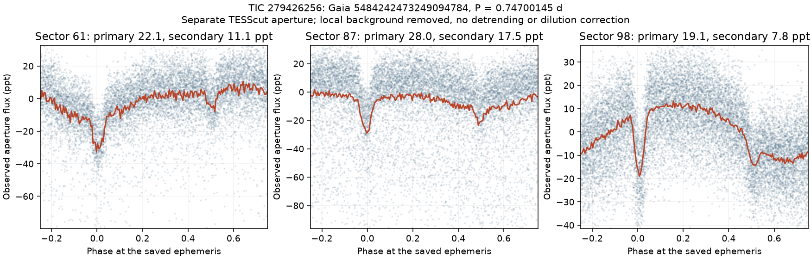
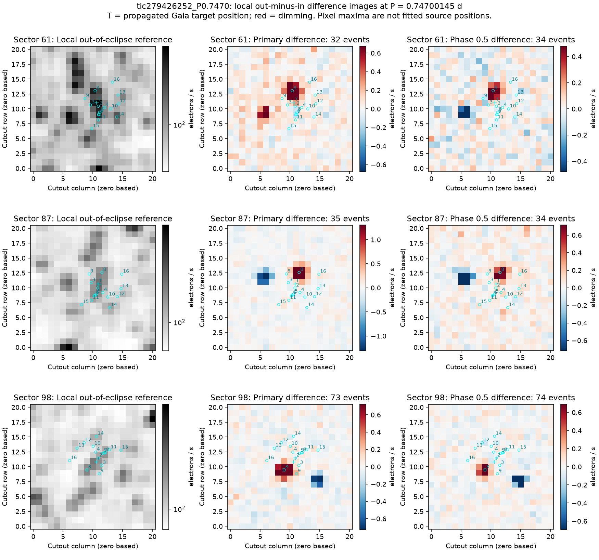

# TIC 279426256: local eclipsing-binary candidate report

Prepared 2026-09-06 from the P8 rejected-signal follow-up. Two recurring minima and their pixel differences support a photometric eclipsing-binary candidate at TIC 279426256, about 42.1 arcsec from the searched M dwarf TIC 279426252 [M]. No external submission has been made.

[M] denotes measurements made in P8, including catalogue queries; [A] denotes an adopted diagnostic choice. The binary subtype and any unresolved companion are undetermined.

## Identification and fields for human review

| Field | Value |
|---|---|
| Primary identifier | TIC 279426256 [M] |
| Other identifier | Gaia DR3 5484242473249094784 [M] |
| TIC coordinates, J2000 | 06 59 54.70, -56 18 35.3; 104.97792763, -56.30981120 deg [M] |
| Classification | Eclipsing-binary candidate; leave a more specific subtype unset |
| Working period | Approximately 0.7470 d [M]; no formal uncertainty fitted |
| Reproduction ephemeris | P = 0.747001447800 d, primary epoch BTJD 2964.227467234, or BJD_TDB 2459964.227467 [M] |
| Catalogue brightness | TIC Tmag 13.8592 [M], a reference magnitude, not a calibrated eclipse maximum |
| Intrinsic maximum/minimum magnitudes | Leave unset: the aperture depths are diluted and no calibrated magnitude range was measured |
| Data | TESS 200-second full-frame TESScut pixels, sectors 61, 87 and 98 [M] |

The reproduction digits preserve the saved forced-TLS ephemeris from the contaminated target; they do not express a period or epoch uncertainty. The signal was followed at this ephemeris rather than fitted as a full binary system. The catalogue Teff of 5053 K and radius of 1.1327 solar radii [M] put this neighbour outside the P8 small-star population. It is a side result of inspecting a rejected target.

## Light curve and location

The source aperture uses pixels within one pixel of the propagated Gaia position. A local median sky annulus spans five to nine pixels, excluding pixels within two pixels of Gaia sources brighter than G=18 [A]. Each sector is median-normalized; no trend or dilution correction is applied. Two narrow minima sit on a broader waveform that changes between sectors [M].

| Sector | Cadences [M] | Primary depth, ppt [M] | Secondary depth, ppt [M] | Adopted planet-bound calculation, ppt [M under A] |
|---|---:|---:|---:|---:|
| 61 | 10,654 | 22.12 +/- 0.54 | 11.09 +/- 0.58 | 1.69 |
| 87 | 11,168 | 28.01 +/- 0.70 | 17.52 +/- 0.73 | 2.14 |
| 98 | 24,068 | 19.13 +/- 0.44 | 7.79 +/- 0.46 | 1.46 |

Depths use local boxes of width 0.801 h [A, the saved search duration]; this width is not a fitted contact duration. Errors use local point scatter and omit correlated noise. The inherited planetary-secondary diagnostic uses the TIC source parameters and albedo 0.3 [A]; the observed secondary is about 5 to 8 times that bound [M]. Catalogue stellar parameters could describe a composite system, and the bound is supporting evidence rather than a binary model.

The Gaia source labelled 8 follows the positive primary and secondary differences through three detector orientations [M]. Local out-of-event images are interpolated across each event and the event differences are median-stacked. The stacks contain 32/34, 35/34 and 73/74 primary/secondary events respectively [M]. The extended sector 98 spans four orbits, accounting for its larger event count. The searched target is labelled T. These are pixel maxima, not fitted PRF centroids, so a formal localization uncertainty and unresolved alternatives remain open. Separate whole-cutout centroid shifts are flagged in sectors 61 and 87; shifts in detector coordinates were not combined to assign a sky position.

## Catalogue checks and funnel context

The six-source hard stop is CLEAN as of 2026-09-06: no TIC match and no match within 21 arcsec [M]. All six payloads were downloaded again, including all 132 SPOC TCE version files [M]. The wider VSX and SIMBAD queries cover a five-arcminute cone around the searched target and contain no entry within 21 arcsec of the implicated source [M]. This establishes absence from the checked catalogues on this date, not from every catalogue or publication.

The target's 0.7470-day signal failed Stage A depth consistency; its 11.2049-day alias passed A and failed the full-phase secondary gate [M]. No planet gate was relaxed for this follow-up. The depth changes between apertures and sectors, and the off-target localization, explain why this signal is unsuitable as a planet candidate on the searched M dwarf.

## Remaining measurements

Resolve the source with ground-based time-series photometry, determine a binary ephemeris and uncertainty, measure a calibrated magnitude range, and model the two eclipses before assigning a subtype. Gaia RUWE 2.515 [M] is consistent with an imperfect single-source astrometric fit and is not, by itself, a binary classification. No radial velocities or component parameters were measured here.

## Reproduction and saved evidence

Run `python scripts/p8_write_eb_report.py` to rebuild this report from the saved follow-up. The image and aperture measurements are rebuilt by `scripts/p8_eb_difference_image.py` and `scripts/p8_eb_aperture.py`; their JSON files record the ephemeris, selected pixel files and input SHA-256 hashes.

- [Measurements and input hashes](tic279426256_measurements.json)
- [Sector-specific binned folds](tic279426256_fold_binned.txt)
- [Catalogue manifest](../../data/survey/p8/eb_screen/tic279426256_catalog_versions.json)
- [Raw TCE download receipt](../../data/survey/p8/eb_screen/tic279426256_catalog_refetch.json)
- [VSX query](../../data/survey/p8/eb_screen/tic279426252_wide_vsx.json)
- [SIMBAD query](../../data/survey/p8/eb_screen/tic279426252_wide_simbad.json)
- [Gaia query](../../data/survey/p8/eb_screen/tic279426252_wide_gaia.json)
- [Original Gaia neighbour record, including RUWE](../../data/survey/p8/neighbours/tic279426252.json)
- [TIC query matching the exact Gaia identifier](../../data/survey/p8/eb_screen/gaia5484242473249094784_tic.json)
