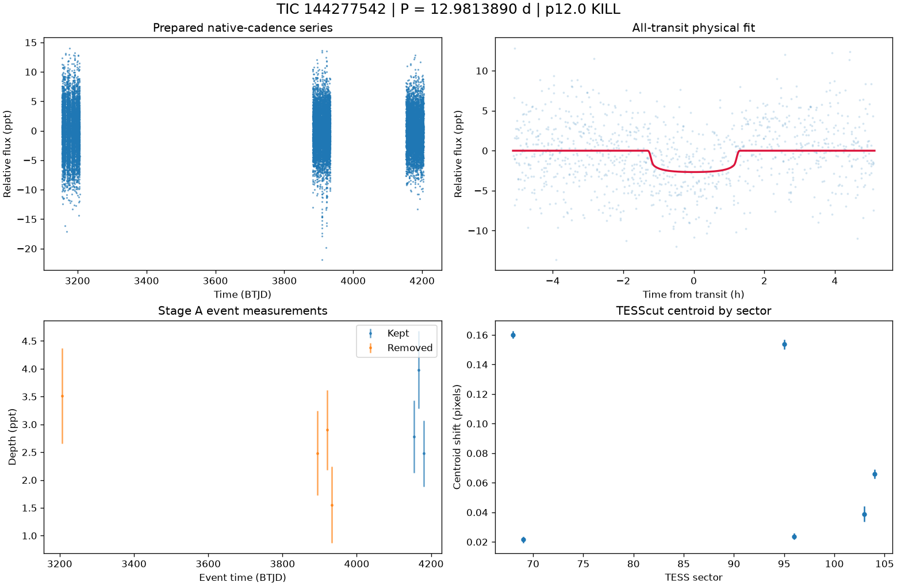

# TIC 144277542: P12 candidate review (tic144277542_P12.9812)

**KILL** under p12.0: K9; criterion holds: K9a in 6, K9b in 2 sector(s) of 6 measurable; reviewer decision artefact

This is a candidate packet. No external submission has been made; the user decides.

| Measurement | Value |
|---|---|
| Period | 12.981388999 +/- 0.00012624287275869294 d |
| Epoch | 2460167.287570139 +/- 0.008577592364062256 BJD |
| Radius | 2.253 +/- 0.26 Earth radii |
| T14 | 2.563 +/- 2.574 h |
| Impact parameter | 0.00002 +/- 2362.0151252802166 |
| Density prior / grazing | True / False |
| Transits / beta | 7 / 1.14 |
| FPP / NFPP | 0.047287532942974164 / 0.0 |
| fpp_uniform | False |
| Centroid | Centroid shift (weighted over 6 sectors): dcol = +0.060 px, drow = +0.004 px, total = 0.061 px (1.3 arcsec), significance = 55.3 sigma; 6 of 6 sectors flagged on their own. |

ExoFOP note draft: TessHunter P12 candidate: P = 12.981389 d, T0 = 2460167.28757 BJD, depth 2672 ppm, duration 2.56 h, TESS sectors 68-104 (6), preset survey_p10, rules p12.0. Verdict KILL; not claimed: a validated planet or a resolved source. The field's validation bar (resolved source, localised repeated dimming, low FPP) is out of reach for TESS FFI photometry alone at Tmag 13.5; this is a candidate for follow-up, not a validated planet.

The field's validation bar (resolved source, localised repeated dimming, low FPP) is out of reach for TESS FFI photometry alone at Tmag 13.5; this is a candidate for follow-up, not a validated planet.

## p10.0 verdict tiers

**KILL** on K9

| Condition | Fired | Detail |
|---|---|---|
| K0: hard stop: the star is catalogued at this TIC (REJECT) | no | hard stop CLEAN |
| K1: Stage A fails the six criteria | no | Stage A PASS |
| K2: the secondary gate fails | no | secondary gate PASS (mode bound) |
| K3: Stage B phase-independent sector non-detection excludes the period | no | phase-independent exclusion False (6 sector(s) tested) |
| K4: Stage C fails | no | Stage C PASS (strongest): strongest peak 12.98136 d is within 1% of the survey period at SDE 14.9 |
| K5: the period is an integer alias of a deeper accepted signal or a catalogued period | no | no alias match among 10 accepted signals and 0 catalogued periods |
| K6: odd/even depth difference above 3 sigma | no | odd/even 0.29 sigma (4 odd, 4 even transits) |
| K7: pixel evidence places the dimming elsewhere or measures its absence | no | K7a in 0 sector(s) (literal whole-cutout form: 1), K7b in 0 sector(s) (5 K7a-measurable, 0 K7b-measurable) |
| K8: the physical fit implies a stellar companion | no | Rp 2.253 Re (limit 16.81); density prior delta chi2 1.0988087863213423, converged True, non-grazing True, rho_fit/rho_cat 0.818 |
| K9: artefact-carried under D review (numeric criterion plus the reviewer's decision) | yes | criterion holds: K9a in 6, K9b in 2 sector(s) of 6 measurable; reviewer decision artefact |
| H1: TRICERATOPS NFPP at or above 0.5 | no | NFPP 0, FPP 0.047287532942974164 |
| H2: the all-transit fit is unconverged or on the grazing rail | no | converged |
| H3: a D measurement did not execute and can be re-run | no | every D measurement executed |
| H4: the target is a VSX EA/EB/EW/ELL with no alias match | no | 1 VSX entr(ies) within 21 arcsec, 0 eclipsing class(es) |

### Flags

- **F1**: []
- **F2**: {"ruwe": 1.2617647647857666, "ipd_frac_multi_peak": 0.0, "astrometric_excess_noise_sig": 3.476106882095337, "non_single_star": 0.0, "phot_variable_flag": "VARIABLE", "best_class_name": "SOLAR_LIKE", "duplicated_source": 0.0}
- **F3**: {"vsx": [{"Name": "Gaia DR3 6524996886834125952", "Type": "ROT", "Period": null, "sep_arcsec": 0.0}], "simbad": []}
- **F4**: {"fpp": 0.047287532942974164, "nfpp": 0.0, "available": true, "fpp_uniform": false, "sectors": [68, 69, 95], "caveats": "binned fold; circular aperture from Tmag; first three selected sectors; probabilities are conditional on TRICERATOPS's astrophysical scenarios and do not price instrumental artefacts"}
- **F5**: {"localisation": "on_target_consistent", "n_sectors_measurable": 6, "per_sector": [{"sector": 68, "net_depth_ppt": 33.1781, "net_err_ppt": 4.4239, "k7_absent": null, "note": "unmeasurable: 0.5 x D_ref 1.161 < 3 sigma_s 13.272 ppt", "k7_elsewhere": null, "difference_max_dist_target_px": 2.235, "centroid_sigma": 63.7042452776691, "centroid_shift_px": 0.16012044538710143}, {"sector": 69, "net_depth_ppt": -0.8657, "net_err_ppt": 0.851, "k7_absent": null, "note": "unmeasurable: 0.5 x D_ref 1.161 < 3 sigma_s 2.553 ppt", "k7_elsewhere": false, "difference_max_dist_target_px": 0.85, "centroid_sigma": 10.230998229852391, "centroid_shift_px": 0.02160221182526046}, {"sector": 95, "net_depth_ppt": 0.5844, "net_err_ppt": 1.3531, "k7_absent": null, "note": "unmeasurable: 0.5 x D_ref 1.161 < 3 sigma_s 4.059 ppt", "k7_elsewhere": false, "difference_max_dist_target_px": 1.216, "centroid_sigma": 46.549643
- **F6**: [{"period_days": "13.152501575811261", "depth_ppt": "3.598549150176633", "snr": "11.969505583911136", "verdict": "ambiguous / manual vetting required", "stitch_snr": "7.53577153906909", "passes_pregate": "True"}, {"period_days": "25.6028257864034", "depth_ppt": "1.8640392499183884", "snr": "9.309992925887627", "verdict": "promising planet candidate", "stitch_snr": "9.309992925887627", "passes_pregate": "True"}, {"period_days": "22.0965007570962", "depth_ppt": "2.4616396700180543", "snr": "7.9055394196981945", "verdict": "ambiguous / manual vetting required", "stitch_snr": "7.9055394196981945", "passes_pregate": "True"}, {"period_days": "18.218592595122303", "depth_ppt": "1.6902850299672632", "snr": "6.524430495789191", "verdict": "promising planet candidate", "stitch_snr": "7.86238675521882", "passes_pregate": "True"}, {"period_days": "23.775175390526833", "depth_ppt": "2.413669567163404
- **F7**: {"status": "CLEAN", "tic_matches": [], "neighbour_matches": [], "tce_association": null}
- **F8**: {"n_observed": 11, "n_excluded": 8, "n_kept": 3, "removed_by_class": {"dip_absent_in_sap": 0, "pdc_gap": 1, "scattered_light_ramp": 5, "scattered_light_flag": 4, "momentum_dump": 0, "sector_orbit_edge": 0, "quality_flagged": 4, "sap_baseline_ramp": 6}, "strongest_event_removed": false}
- **F9**: No Gaia neighbour within 63 arcsec can produce the depth by total eclipse; an unresolved companion within the target's PSF remains untested until high-resolution imaging or RV excludes it. TESS fixed-aperture photometry is consistent with the target in 6 sector(s). TRICERATOPS FPP 0.0473, NFPP 0 on the binned fold; a low value does not price instrumental artefacts. Statistical validation additionally needs a resolved source, repeated localised dimming and a low FPP with the scene fixed; this candidate is submitted as a candidate, not as a validated planet.

## p12.0 verdict tiers

**KILL** on K9

| Condition | Fired | Detail |
|---|---|---|
| K0: hard stop: the star is catalogued at this TIC (REJECT) | no | hard stop CLEAN |
| K1: Stage A fails the six criteria | no | Stage A PASS |
| K2: the secondary gate fails | no | secondary gate PASS (mode bound) |
| K3: Stage B phase-independent sector non-detection excludes the period | no | phase-independent exclusion False (6 sector(s) tested) |
| K4: Stage C fails | no | Stage C PASS (strongest): strongest peak 12.98136 d is within 1% of the survey period at SDE 14.9 |
| K5: the period is an integer alias of a deeper accepted signal or a catalogued period | no | no alias match among 10 accepted signals and 0 catalogued periods |
| K6: odd/even depth difference above 3 sigma | no | odd/even 0.29 sigma (4 odd, 4 even transits) |
| K7: pixel evidence places the dimming elsewhere or measures its absence | no | K7a in 0 sector(s) (literal whole-cutout form: 1), K7b in 0 sector(s) (5 K7a-measurable, 0 K7b-measurable) |
| K8: the physical fit implies a stellar companion | no | Rp 2.253 Re (limit 16.81); density prior delta chi2 1.0988087863213423, converged True, non-grazing True, rho_fit/rho_cat 0.818 |
| K9: artefact-carried under D review (numeric criterion plus the reviewer's decision) | yes | criterion holds: K9a in 6, K9b in 2 sector(s) of 6 measurable; reviewer decision artefact |
| H1: TRICERATOPS NFPP at or above 0.5 | no | NFPP 0, FPP 0.047287532942974164 |
| H2: the all-transit fit is unconverged or on the grazing rail | no | converged |
| H3: a D measurement did not execute and can be re-run | no | every D measurement executed |
| H4: the target is a VSX EA/EB/EW/ELL with no alias match | no | 1 VSX entr(ies) within 21 arcsec, 0 eclipsing class(es) |
| H5: the K9b fixed-aperture disagreement holds in exactly one measurable sector | no | K9b disagreement in 2 of 6 measurable sector(s) |
| H6: Stage C UNRESOLVED after its one recorded retry | no | Stage C PASS |

### Flags

- **F1**: []
- **F2**: {"ruwe": 1.2617647647857666, "ipd_frac_multi_peak": 0.0, "astrometric_excess_noise_sig": 3.476106882095337, "non_single_star": 0.0, "phot_variable_flag": "VARIABLE", "best_class_name": "SOLAR_LIKE", "duplicated_source": 0.0}
- **F3**: {"vsx": [{"Name": "Gaia DR3 6524996886834125952", "Type": "ROT", "Period": null, "sep_arcsec": 0.0}], "simbad": []}
- **F4**: {"fpp": 0.047287532942974164, "nfpp": 0.0, "available": true, "fpp_uniform": false, "sectors": [68, 69, 95], "caveats": "binned fold; circular aperture from Tmag; first three selected sectors; probabilities are conditional on TRICERATOPS's astrophysical scenarios and do not price instrumental artefacts"}
- **F5**: {"localisation": "on_target_consistent", "n_sectors_measurable": 6, "per_sector": [{"sector": 68, "net_depth_ppt": 33.1781, "net_err_ppt": 4.4239, "k7_absent": null, "note": "unmeasurable: 0.5 x D_ref 1.161 < 3 sigma_s 13.272 ppt", "k7_elsewhere": null, "difference_max_dist_target_px": 2.235, "centroid_sigma": 63.7042452776691, "centroid_shift_px": 0.16012044538710143}, {"sector": 69, "net_depth_ppt": -0.8657, "net_err_ppt": 0.851, "k7_absent": null, "note": "unmeasurable: 0.5 x D_ref 1.161 < 3 sigma_s 2.553 ppt", "k7_elsewhere": false, "difference_max_dist_target_px": 0.85, "centroid_sigma": 10.230998229852391, "centroid_shift_px": 0.02160221182526046}, {"sector": 95, "net_depth_ppt": 0.5844, "net_err_ppt": 1.3531, "k7_absent": null, "note": "unmeasurable: 0.5 x D_ref 1.161 < 3 sigma_s 4.059 ppt", "k7_elsewhere": false, "difference_max_dist_target_px": 1.216, "centroid_sigma": 46.549643
- **F6**: [{"period_days": "13.152501575811261", "depth_ppt": "3.598549150176633", "snr": "11.969505583911136", "verdict": "ambiguous / manual vetting required", "stitch_snr": "7.53577153906909", "passes_pregate": "True"}, {"period_days": "25.6028257864034", "depth_ppt": "1.8640392499183884", "snr": "9.309992925887627", "verdict": "promising planet candidate", "stitch_snr": "9.309992925887627", "passes_pregate": "True"}, {"period_days": "22.0965007570962", "depth_ppt": "2.4616396700180543", "snr": "7.9055394196981945", "verdict": "ambiguous / manual vetting required", "stitch_snr": "7.9055394196981945", "passes_pregate": "True"}, {"period_days": "18.218592595122303", "depth_ppt": "1.6902850299672632", "snr": "6.524430495789191", "verdict": "promising planet candidate", "stitch_snr": "7.86238675521882", "passes_pregate": "True"}, {"period_days": "23.775175390526833", "depth_ppt": "2.413669567163404
- **F7**: {"status": "CLEAN", "tic_matches": [], "neighbour_matches": [], "tce_association": null}
- **F8**: {"n_observed": 11, "n_excluded": 8, "n_kept": 3, "removed_by_class": {"dip_absent_in_sap": 0, "pdc_gap": 1, "scattered_light_ramp": 5, "scattered_light_flag": 4, "momentum_dump": 0, "sector_orbit_edge": 0, "quality_flagged": 4, "sap_baseline_ramp": 6}, "strongest_event_removed": false}
- **F9**: No Gaia neighbour within 63 arcsec can produce the depth by total eclipse; an unresolved companion within the target's PSF remains untested until high-resolution imaging or RV excludes it. TESS fixed-aperture photometry is consistent with the target in 6 sector(s). TRICERATOPS FPP 0.0473, NFPP 0 on the binned fold; a low value does not price instrumental artefacts. Statistical validation additionally needs a resolved source, repeated localised dimming and a low FPP with the scene fixed; this candidate is submitted as a candidate, not as a validated planet.
- **F10**: {"word": "K10_FLAG", "or_variants": ["K10e", "K10s"], "or_fired": true, "K10e": {"fired": true, "measurable": true, "detail": "n_excluded / n_observed = 8/11 = 0.727 (> 0.5 fires)", "n_observed": 11, "n_excluded": 8, "fraction": 0.7272727272727273}, "K10s": {"fired": false, "measurable": true, "detail": "SAP 3.058 +/- 0.372 ppt vs corrected 3.003 +/- 0.371 ppt; SAP < 0.5x False; difference > 3 sigma False; kept events in 2 sector(s)", "det_ppt": 3.003, "det_err_ppt": 0.371, "sap_ppt": 3.058, "sap_err_ppt": 0.372, "quadrature_err_ppt": 0.525380814267137, "kept_sectors": [103, 104], "sap_below_half": false, "difference_significant": false, "kept_sectors_ge_2": true}, "deciding": false}
