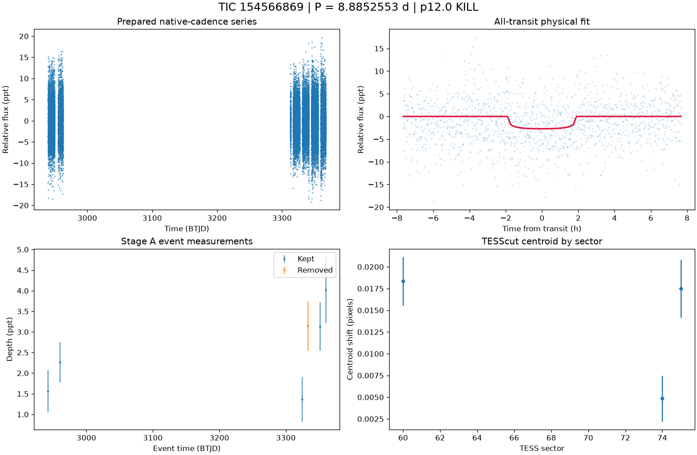

# TIC 154566869: P12 candidate review (tic154566869_P8.9053)

**KILL** under p12.0: K8; Rp 1.505 Re (limit 16.81); density prior delta chi2 21.367661308159313, converged True, non-grazing True, rho_fit/rho_cat 0.095

This is a candidate packet. No external submission has been made; the user decides.

| Measurement | Value |
|---|---|
| Period | 8.885255332 +/- 0.00021221664437999857 d |
| Epoch | 2459942.360624076 +/- 0.007362511814997891 BJD |
| Radius | 1.505 +/- 0.357 Earth radii |
| T14 | 3.83 +/- 4.443 h |
| Impact parameter | 0.12354 +/- 11.311903899078684 |
| Density prior / grazing | False / False |
| Transits / beta | 6 / 1.48 |
| FPP / NFPP | 0.9888071352713687 / 0.8681054034540543 |
| fpp_uniform | False |
| Centroid | Centroid shift (weighted over 3 sectors): dcol = +0.009 px, drow = -0.000 px, total = 0.009 px (0.2 arcsec), significance = 5.6 sigma; 2 of 3 sectors flagged on their own. |

ExoFOP note draft: TessHunter P12 candidate: P = 8.885255 d, T0 = 2459942.36062 BJD, depth 2714 ppm, duration 3.83 h, TESS sectors 60-75 (3), preset survey_p10, rules p12.0. Verdict KILL; not claimed: a validated planet or a resolved source. The field's validation bar (resolved source, localised repeated dimming, low FPP) is out of reach for TESS FFI photometry alone at Tmag 13.5; this is a candidate for follow-up, not a validated planet.

The field's validation bar (resolved source, localised repeated dimming, low FPP) is out of reach for TESS FFI photometry alone at Tmag 13.5; this is a candidate for follow-up, not a validated planet.

## p10.0 verdict tiers

**KILL** on K8

| Condition | Fired | Detail |
|---|---|---|
| K0: hard stop: the star is catalogued at this TIC (REJECT) | no | hard stop CLEAN |
| K1: Stage A fails the six criteria | no | Stage A PASS |
| K2: the secondary gate fails | no | secondary gate PASS (mode bound) |
| K3: Stage B phase-independent sector non-detection excludes the period | no | phase-independent exclusion False (3 sector(s) tested) |
| K4: Stage C fails | no | Stage C PASS (strongest): strongest peak 8.88504 d is within 1% of the survey period at SDE 13.7 |
| K5: the period is an integer alias of a deeper accepted signal or a catalogued period | no | no alias match among 7 accepted signals and 0 catalogued periods |
| K6: odd/even depth difference above 3 sigma | no | odd/even 0.21 sigma (2 odd, 4 even transits) |
| K7: pixel evidence places the dimming elsewhere or measures its absence | no | K7a in 0 sector(s) (literal whole-cutout form: 0), K7b in 0 sector(s) (3 K7a-measurable, 1 K7b-measurable) |
| K8: the physical fit implies a stellar companion | yes | Rp 1.505 Re (limit 16.81); density prior delta chi2 21.367661308159313, converged True, non-grazing True, rho_fit/rho_cat 0.095 |
| K9: artefact-carried under D review (numeric criterion plus the reviewer's decision) | no | criterion does not hold: K9a in 2, K9b in 0 sector(s) of 3 measurable; reviewer decision not an artefact |
| H1: TRICERATOPS NFPP at or above 0.5 | yes | NFPP 0.8681, FPP 0.9888071352713687 |
| H2: the all-transit fit is unconverged or on the grazing rail | no | converged |
| H3: a D measurement did not execute and can be re-run | no | every D measurement executed |
| H4: the target is a VSX EA/EB/EW/ELL with no alias match | no | 0 VSX entr(ies) within 21 arcsec, 0 eclipsing class(es) |

### Flags

- **F1**: [{"source_id": 1691594417380687744, "sep_arcsec": 6.3, "sep_px": 0.3, "G": 17.94512176513672, "delta_mag": 4.35, "max_depth_ppt_total_eclipse": 17.84, "required_eclipse_fraction": 0.113}, {"source_id": 1691594417381929984, "sep_arcsec": 28.3, "sep_px": 1.35, "G": 16.07878875732422, "delta_mag": 1.87, "max_depth_ppt_total_eclipse": 151.32, "required_eclipse_fraction": 0.0133}, {"source_id": 1691594486100312448, "sep_arcsec": 29.4, "sep_px": 1.4, "G": 19.778501510620117, "delta_mag": 6.05, "max_depth_ppt_total_eclipse": 3.79, "required_eclipse_fraction": 0.5317}, {"source_id": 1691594378725852928, "sep_arcsec": 34.1, "sep_px": 1.62, "G": 19.802095413208008, "delta_mag": 5.73, "max_depth_ppt_total_eclipse": 5.08, "required_eclipse_fraction": 0.3967}, {"source_id": 1691594451741175424, "sep_arcsec": 41.6, "sep_px": 1.98, "G": 18.614042282104492, "delta_mag": 5.04, "max_depth_ppt_total_eclips
- **F2**: {"ruwe": 1.171926736831665, "ipd_frac_multi_peak": 0.0, "astrometric_excess_noise_sig": 3.387705087661743, "non_single_star": 0.0, "phot_variable_flag": "NOT_AVAILABLE", "best_class_name": "", "duplicated_source": 0.0}
- **F3**: {"vsx": [], "simbad": [{"main_id": "LP   39-181", "otype": "PM*", "sp_type": "", "sep_arcsec": 0.0}]}
- **F4**: {"fpp": 0.9888071352713687, "nfpp": 0.8681054034540543, "available": true, "fpp_uniform": false, "sectors": [60, 74, 75], "caveats": "binned fold; circular aperture from Tmag; first three selected sectors; probabilities are conditional on TRICERATOPS's astrophysical scenarios and do not price instrumental artefacts"}
- **F5**: {"localisation": "unlocalised", "n_sectors_measurable": 3, "per_sector": [{"sector": 60, "net_depth_ppt": 3.6942, "net_err_ppt": 0.8225, "k7_absent": null, "note": "unmeasurable: 0.5 x D_ref 1.183 < 3 sigma_s 2.467 ppt", "k7_elsewhere": false, "difference_max_dist_target_px": 1.74, "centroid_sigma": 6.597161335506454, "centroid_shift_px": 0.01834677296679095}, {"sector": 74, "net_depth_ppt": 2.0755, "net_err_ppt": 0.3553, "k7_absent": false, "note": "net 2.076 +/- 0.355 ppt against 0.5 x D_ref 1.183 ppt: consistent with the diluted depth", "k7_elsewhere": false, "difference_max_dist_target_px": 0.874, "centroid_sigma": 1.8427066368423655, "centroid_shift_px": 0.004851792429202544}, {"sector": 75, "net_depth_ppt": 5.7399, "net_err_ppt": 0.8271, "k7_absent": null, "note": "unmeasurable: 0.5 x D_ref 1.183 < 3 sigma_s 2.481 ppt", "k7_elsewhere": false, "difference_max_dist_target_px": 1.202,
- **F6**: [{"period_days": "24.28178413269584", "depth_ppt": "4.393452341131642", "snr": "8.315602719587897", "verdict": "promising planet candidate", "stitch_snr": "8.315602719587897", "passes_pregate": "True"}, {"period_days": "12.141218621253506", "depth_ppt": "4.26575853953431", "snr": "8.056590436084841", "verdict": "promising planet candidate", "stitch_snr": "7.894860218030995", "passes_pregate": "True"}, {"period_days": "2.925986589303831", "depth_ppt": "1.5496717499585466", "snr": "7.977688041327188", "verdict": "promising planet candidate", "stitch_snr": "7.921063111736052", "passes_pregate": "True"}, {"period_days": "17.769679285899155", "depth_ppt": "2.4176181978371702", "snr": "7.791393261491189", "verdict": "promising planet candidate", "stitch_snr": "7.791393261491189", "passes_pregate": "True"}, {"period_days": "15.694768921057996", "depth_ppt": "5.694648364627813", "snr": "6.845366
- **F7**: {"status": "CLEAN", "tic_matches": [], "neighbour_matches": [], "tce_association": null}
- **F8**: {"n_observed": 8, "n_excluded": 3, "n_kept": 5, "removed_by_class": {"dip_absent_in_sap": 1, "pdc_gap": 0, "scattered_light_ramp": 1, "scattered_light_flag": 2, "momentum_dump": 1, "sector_orbit_edge": 0, "quality_flagged": 0, "sap_baseline_ramp": 0}, "strongest_event_removed": false}
- **F9**: 8 Gaia neighbour(s) within 63 arcsec could produce the depth by total eclipse (nearest 6.3 arcsec, G 17.94512176513672, needing an eclipse of 11% of its light). Seeing-limited ground photometry at the predicted epochs, resolving each of them, would settle the source. TESS fixed-aperture photometry is consistent with the target in 3 sector(s) but cannot separate the target from the listed neighbours. TRICERATOPS FPP 0.989, NFPP 0.868 on the binned fold; a low value does not price instrumental artefacts. Statistical validation additionally needs a resolved source, repeated localised dimming and a low FPP with the scene fixed; this candidate is submitted as a candidate, not as a validated planet.

## p12.0 verdict tiers

**KILL** on K8

| Condition | Fired | Detail |
|---|---|---|
| K0: hard stop: the star is catalogued at this TIC (REJECT) | no | hard stop CLEAN |
| K1: Stage A fails the six criteria | no | Stage A PASS |
| K2: the secondary gate fails | no | secondary gate PASS (mode bound) |
| K3: Stage B phase-independent sector non-detection excludes the period | no | phase-independent exclusion False (3 sector(s) tested) |
| K4: Stage C fails | no | Stage C PASS (strongest): strongest peak 8.88504 d is within 1% of the survey period at SDE 13.7 |
| K5: the period is an integer alias of a deeper accepted signal or a catalogued period | no | no alias match among 7 accepted signals and 0 catalogued periods |
| K6: odd/even depth difference above 3 sigma | no | odd/even 0.21 sigma (2 odd, 4 even transits) |
| K7: pixel evidence places the dimming elsewhere or measures its absence | no | K7a in 0 sector(s) (literal whole-cutout form: 0), K7b in 0 sector(s) (3 K7a-measurable, 1 K7b-measurable) |
| K8: the physical fit implies a stellar companion | yes | Rp 1.505 Re (limit 16.81); density prior delta chi2 21.367661308159313, converged True, non-grazing True, rho_fit/rho_cat 0.095 |
| K9: artefact-carried under D review (numeric criterion plus the reviewer's decision) | no | criterion does not hold: K9a in 2, K9b in 0 sector(s) of 3 measurable; reviewer decision not an artefact |
| H1: TRICERATOPS NFPP at or above 0.5 | yes | NFPP 0.8681, FPP 0.9888071352713687 |
| H2: the all-transit fit is unconverged or on the grazing rail | no | converged |
| H3: a D measurement did not execute and can be re-run | no | every D measurement executed |
| H4: the target is a VSX EA/EB/EW/ELL with no alias match | no | 0 VSX entr(ies) within 21 arcsec, 0 eclipsing class(es) |
| H5: the K9b fixed-aperture disagreement holds in exactly one measurable sector | no | K9b disagreement in 0 of 3 measurable sector(s) |
| H6: Stage C UNRESOLVED after its one recorded retry | no | Stage C PASS |

### Flags

- **F1**: [{"source_id": 1691594417380687744, "sep_arcsec": 6.3, "sep_px": 0.3, "G": 17.94512176513672, "delta_mag": 4.35, "max_depth_ppt_total_eclipse": 17.84, "required_eclipse_fraction": 0.113}, {"source_id": 1691594417381929984, "sep_arcsec": 28.3, "sep_px": 1.35, "G": 16.07878875732422, "delta_mag": 1.87, "max_depth_ppt_total_eclipse": 151.32, "required_eclipse_fraction": 0.0133}, {"source_id": 1691594486100312448, "sep_arcsec": 29.4, "sep_px": 1.4, "G": 19.778501510620117, "delta_mag": 6.05, "max_depth_ppt_total_eclipse": 3.79, "required_eclipse_fraction": 0.5317}, {"source_id": 1691594378725852928, "sep_arcsec": 34.1, "sep_px": 1.62, "G": 19.802095413208008, "delta_mag": 5.73, "max_depth_ppt_total_eclipse": 5.08, "required_eclipse_fraction": 0.3967}, {"source_id": 1691594451741175424, "sep_arcsec": 41.6, "sep_px": 1.98, "G": 18.614042282104492, "delta_mag": 5.04, "max_depth_ppt_total_eclips
- **F2**: {"ruwe": 1.171926736831665, "ipd_frac_multi_peak": 0.0, "astrometric_excess_noise_sig": 3.387705087661743, "non_single_star": 0.0, "phot_variable_flag": "NOT_AVAILABLE", "best_class_name": "", "duplicated_source": 0.0}
- **F3**: {"vsx": [], "simbad": [{"main_id": "LP   39-181", "otype": "PM*", "sp_type": "", "sep_arcsec": 0.0}]}
- **F4**: {"fpp": 0.9888071352713687, "nfpp": 0.8681054034540543, "available": true, "fpp_uniform": false, "sectors": [60, 74, 75], "caveats": "binned fold; circular aperture from Tmag; first three selected sectors; probabilities are conditional on TRICERATOPS's astrophysical scenarios and do not price instrumental artefacts"}
- **F5**: {"localisation": "unlocalised", "n_sectors_measurable": 3, "per_sector": [{"sector": 60, "net_depth_ppt": 3.6942, "net_err_ppt": 0.8225, "k7_absent": null, "note": "unmeasurable: 0.5 x D_ref 1.183 < 3 sigma_s 2.467 ppt", "k7_elsewhere": false, "difference_max_dist_target_px": 1.74, "centroid_sigma": 6.597161335506454, "centroid_shift_px": 0.01834677296679095}, {"sector": 74, "net_depth_ppt": 2.0755, "net_err_ppt": 0.3553, "k7_absent": false, "note": "net 2.076 +/- 0.355 ppt against 0.5 x D_ref 1.183 ppt: consistent with the diluted depth", "k7_elsewhere": false, "difference_max_dist_target_px": 0.874, "centroid_sigma": 1.8427066368423655, "centroid_shift_px": 0.004851792429202544}, {"sector": 75, "net_depth_ppt": 5.7399, "net_err_ppt": 0.8271, "k7_absent": null, "note": "unmeasurable: 0.5 x D_ref 1.183 < 3 sigma_s 2.481 ppt", "k7_elsewhere": false, "difference_max_dist_target_px": 1.202,
- **F6**: [{"period_days": "24.28178413269584", "depth_ppt": "4.393452341131642", "snr": "8.315602719587897", "verdict": "promising planet candidate", "stitch_snr": "8.315602719587897", "passes_pregate": "True"}, {"period_days": "12.141218621253506", "depth_ppt": "4.26575853953431", "snr": "8.056590436084841", "verdict": "promising planet candidate", "stitch_snr": "7.894860218030995", "passes_pregate": "True"}, {"period_days": "2.925986589303831", "depth_ppt": "1.5496717499585466", "snr": "7.977688041327188", "verdict": "promising planet candidate", "stitch_snr": "7.921063111736052", "passes_pregate": "True"}, {"period_days": "17.769679285899155", "depth_ppt": "2.4176181978371702", "snr": "7.791393261491189", "verdict": "promising planet candidate", "stitch_snr": "7.791393261491189", "passes_pregate": "True"}, {"period_days": "15.694768921057996", "depth_ppt": "5.694648364627813", "snr": "6.845366
- **F7**: {"status": "CLEAN", "tic_matches": [], "neighbour_matches": [], "tce_association": null}
- **F8**: {"n_observed": 8, "n_excluded": 3, "n_kept": 5, "removed_by_class": {"dip_absent_in_sap": 1, "pdc_gap": 0, "scattered_light_ramp": 1, "scattered_light_flag": 2, "momentum_dump": 1, "sector_orbit_edge": 0, "quality_flagged": 0, "sap_baseline_ramp": 0}, "strongest_event_removed": false}
- **F9**: 8 Gaia neighbour(s) within 63 arcsec could produce the depth by total eclipse (nearest 6.3 arcsec, G 17.94512176513672, needing an eclipse of 11% of its light). Seeing-limited ground photometry at the predicted epochs, resolving each of them, would settle the source. TESS fixed-aperture photometry is consistent with the target in 3 sector(s) but cannot separate the target from the listed neighbours. TRICERATOPS FPP 0.989, NFPP 0.868 on the binned fold; a low value does not price instrumental artefacts. Statistical validation additionally needs a resolved source, repeated localised dimming and a low FPP with the scene fixed; this candidate is submitted as a candidate, not as a validated planet.
- **F10**: {"word": "K10_FLAG", "or_variants": ["K10e", "K10s"], "or_fired": false, "K10e": {"fired": false, "measurable": true, "detail": "n_excluded / n_observed = 3/8 = 0.375 (> 0.5 fires)", "n_observed": 8, "n_excluded": 3, "fraction": 0.375}, "K10s": {"fired": false, "measurable": true, "detail": "SAP 1.146 +/- 0.223 ppt vs corrected 2.234 +/- 0.251 ppt; SAP < 0.5x False; difference > 3 sigma True; kept events in 3 sector(s)", "det_ppt": 2.234, "det_err_ppt": 0.251, "sap_ppt": 1.146, "sap_err_ppt": 0.223, "quadrature_err_ppt": 0.33575288531895003, "kept_sectors": [60, 74, 75], "sap_below_half": false, "difference_significant": true, "kept_sectors_ge_2": true}, "deciding": false}
