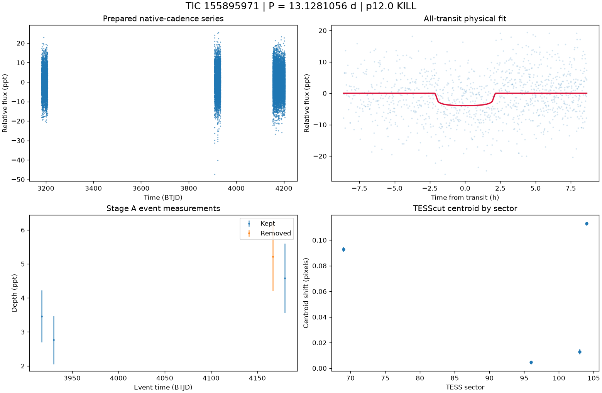

# TIC 155895971: P12 candidate review (tic155895971_P13.1279)

**KILL** under p12.0: K8; Rp 1.706 Re (limit 16.81); density prior delta chi2 51.07424354667978, converged True, non-grazing True, rho_fit/rho_cat 0.093

This is a candidate packet. No external submission has been made; the user decides.

| Measurement | Value |
|---|---|
| Period | 13.128105649 +/- 0.0004743061783958103 d |
| Epoch | 2460195.045187952 +/- 0.030234980670136954 BJD |
| Radius | 1.706 +/- 0.326 Earth radii |
| T14 | 4.315 +/- 4.85 h |
| Impact parameter | 0.02566 +/- 40.73917591018276 |
| Density prior / grazing | False / False |
| Transits / beta | 4 / 1.07 |
| FPP / NFPP | 0.0004815743365066405 / 5.531254192684357e-06 |
| fpp_uniform | False |
| Centroid | Centroid shift (weighted over 4 sectors): dcol = +0.028 px, drow = +0.014 px, total = 0.032 px (0.7 arcsec), significance = 41.9 sigma; 4 of 4 sectors flagged on their own. |

ExoFOP note draft: TessHunter P12 candidate: P = 13.128106 d, T0 = 2460195.04519 BJD, depth 3926 ppm, duration 4.32 h, TESS sectors 69-104 (4), preset survey_p10, rules p12.0. Verdict KILL; not claimed: a validated planet or a resolved source. The field's validation bar (resolved source, localised repeated dimming, low FPP) is out of reach for TESS FFI photometry alone at Tmag 13.5; this is a candidate for follow-up, not a validated planet.

The field's validation bar (resolved source, localised repeated dimming, low FPP) is out of reach for TESS FFI photometry alone at Tmag 13.5; this is a candidate for follow-up, not a validated planet.

## p10.0 verdict tiers

**KILL** on K8

| Condition | Fired | Detail |
|---|---|---|
| K0: hard stop: the star is catalogued at this TIC (REJECT) | no | hard stop CLEAN |
| K1: Stage A fails the six criteria | no | Stage A PASS |
| K2: the secondary gate fails | no | secondary gate PASS (mode bound) |
| K3: Stage B phase-independent sector non-detection excludes the period | no | phase-independent exclusion False (4 sector(s) tested) |
| K4: Stage C fails | no | Stage C PASS (strongest): strongest peak 13.12808 d is within 1% of the survey period at SDE 10.2 |
| K5: the period is an integer alias of a deeper accepted signal or a catalogued period | no | no alias match among 8 accepted signals and 0 catalogued periods |
| K6: odd/even depth difference above 3 sigma | no | odd/even 0.21 sigma (4 odd, 4 even transits) |
| K7: pixel evidence places the dimming elsewhere or measures its absence | no | K7a in 0 sector(s) (literal whole-cutout form: 0), K7b in 1 sector(s) (3 K7a-measurable, 2 K7b-measurable) |
| K8: the physical fit implies a stellar companion | yes | Rp 1.706 Re (limit 16.81); density prior delta chi2 51.07424354667978, converged True, non-grazing True, rho_fit/rho_cat 0.093 |
| K9: artefact-carried under D review (numeric criterion plus the reviewer's decision) | yes | criterion holds: K9a in 3, K9b in 2 sector(s) of 4 measurable; reviewer decision artefact |
| H1: TRICERATOPS NFPP at or above 0.5 | no | NFPP 5.531e-06, FPP 0.0004815743365066405 |
| H2: the all-transit fit is unconverged or on the grazing rail | no | converged |
| H3: a D measurement did not execute and can be re-run | no | every D measurement executed |
| H4: the target is a VSX EA/EB/EW/ELL with no alias match | no | 0 VSX entr(ies) within 21 arcsec, 0 eclipsing class(es) |

### Flags

- **F1**: [{"source_id": 4977057580628443008, "sep_arcsec": 29.8, "sep_px": 1.42, "G": 18.99403953552246, "delta_mag": 4.36, "max_depth_ppt_total_eclipse": 17.76, "required_eclipse_fraction": 0.1636}, {"source_id": 4977057580628445440, "sep_arcsec": 31.5, "sep_px": 1.5, "G": 19.85626792907715, "delta_mag": 5.08, "max_depth_ppt_total_eclipse": 9.18, "required_eclipse_fraction": 0.3166}, {"source_id": 4977057584925116928, "sep_arcsec": 49.2, "sep_px": 2.35, "G": 20.382061004638672, "delta_mag": 6.17, "max_depth_ppt_total_eclipse": 3.39, "required_eclipse_fraction": 0.8573}, {"source_id": 4977057584926751232, "sep_arcsec": 51.1, "sep_px": 2.43, "G": 17.925464630126953, "delta_mag": 3.84, "max_depth_ppt_total_eclipse": 28.32, "required_eclipse_fraction": 0.1026}]
- **F2**: {"ruwe": 1.0796840190887451, "ipd_frac_multi_peak": 0.0, "astrometric_excess_noise_sig": 1.0043927431106567, "non_single_star": 0.0, "phot_variable_flag": "NOT_AVAILABLE", "best_class_name": "", "duplicated_source": 1.0}
- **F3**: {"vsx": [], "simbad": [{"main_id": "Gaia DR3 4977056829012507520", "otype": "PM*", "sp_type": "", "sep_arcsec": 0.0}]}
- **F4**: {"fpp": 0.0004815743365066405, "nfpp": 5.531254192684357e-06, "available": true, "fpp_uniform": false, "sectors": [69, 96, 103], "caveats": "binned fold; circular aperture from Tmag; first three selected sectors; probabilities are conditional on TRICERATOPS's astrophysical scenarios and do not price instrumental artefacts"}
- **F5**: {"localisation": "unlocalised", "n_sectors_measurable": 4, "per_sector": [{"sector": 69, "net_depth_ppt": -82.2086, "net_err_ppt": 2.1044, "k7_absent": null, "note": "unmeasurable: 0.5 x D_ref 1.698 < 3 sigma_s 6.313 ppt", "k7_elsewhere": null, "difference_max_dist_target_px": 2.994, "centroid_sigma": 50.35249245775604, "centroid_shift_px": 0.09277899110612405}, {"sector": 96, "net_depth_ppt": 1.2659, "net_err_ppt": 0.5332, "k7_absent": false, "note": "net 1.266 +/- 0.533 ppt against 0.5 x D_ref 1.698 ppt: consistent with the diluted depth", "k7_elsewhere": false, "difference_max_dist_target_px": 0.405, "centroid_sigma": 3.4995381035001185, "centroid_shift_px": 0.004729515591156666}, {"sector": 103, "net_depth_ppt": -3.2726, "net_err_ppt": 0.5617, "k7_absent": true, "note": "net -3.273 +/- 0.562 ppt against 0.5 x D_ref 1.698 ppt: absence at 3 sigma", "k7_elsewhere": false, "difference_ma
- **F6**: [{"period_days": "12.778910810529826", "depth_ppt": "2.9155646126516213", "snr": "8.317924205923978", "verdict": "promising planet candidate", "stitch_snr": "8.317924205923978", "passes_pregate": "True"}, {"period_days": "23.939542750309403", "depth_ppt": "8.744178937942179", "snr": "7.86665227925965", "verdict": "promising planet candidate", "stitch_snr": "7.676729299586823", "passes_pregate": "True"}, {"period_days": "12.200629418414461", "depth_ppt": "6.178078114210407", "snr": "7.309295976542536", "verdict": "promising planet candidate", "stitch_snr": "6.315153017925365", "passes_pregate": "False"}, {"period_days": "10.244807591744348", "depth_ppt": "2.1803377385491074", "snr": "5.923103758449693", "verdict": "promising planet candidate", "stitch_snr": "5.771463431323205", "passes_pregate": "False"}, {"period_days": "29.48347925334411", "depth_ppt": "6.837073386002091", "snr": "5.623
- **F7**: {"status": "CLEAN", "tic_matches": [], "neighbour_matches": [], "tce_association": null}
- **F8**: {"n_observed": 6, "n_excluded": 3, "n_kept": 3, "removed_by_class": {"dip_absent_in_sap": 1, "pdc_gap": 0, "scattered_light_ramp": 3, "scattered_light_flag": 3, "momentum_dump": 0, "sector_orbit_edge": 0, "quality_flagged": 2, "sap_baseline_ramp": 3}, "strongest_event_removed": true}
- **F9**: 4 Gaia neighbour(s) within 63 arcsec could produce the depth by total eclipse (nearest 29.8 arcsec, G 18.99403953552246, needing an eclipse of 16% of its light). Seeing-limited ground photometry at the predicted epochs, resolving each of them, would settle the source. TESS fixed-aperture photometry is consistent with the target in 4 sector(s) but cannot separate the target from the listed neighbours. TRICERATOPS FPP 0.000482, NFPP 5.53e-06 on the binned fold; a low value does not price instrumental artefacts. Statistical validation additionally needs a resolved source, repeated localised dimming and a low FPP with the scene fixed; this candidate is submitted as a candidate, not as a validated planet.

## p12.0 verdict tiers

**KILL** on K8

| Condition | Fired | Detail |
|---|---|---|
| K0: hard stop: the star is catalogued at this TIC (REJECT) | no | hard stop CLEAN |
| K1: Stage A fails the six criteria | no | Stage A PASS |
| K2: the secondary gate fails | no | secondary gate PASS (mode bound) |
| K3: Stage B phase-independent sector non-detection excludes the period | no | phase-independent exclusion False (4 sector(s) tested) |
| K4: Stage C fails | no | Stage C PASS (strongest): strongest peak 13.12808 d is within 1% of the survey period at SDE 10.2 |
| K5: the period is an integer alias of a deeper accepted signal or a catalogued period | no | no alias match among 8 accepted signals and 0 catalogued periods |
| K6: odd/even depth difference above 3 sigma | no | odd/even 0.21 sigma (4 odd, 4 even transits) |
| K7: pixel evidence places the dimming elsewhere or measures its absence | no | K7a in 0 sector(s) (literal whole-cutout form: 0), K7b in 1 sector(s) (3 K7a-measurable, 2 K7b-measurable) |
| K8: the physical fit implies a stellar companion | yes | Rp 1.706 Re (limit 16.81); density prior delta chi2 51.07424354667978, converged True, non-grazing True, rho_fit/rho_cat 0.093 |
| K9: artefact-carried under D review (numeric criterion plus the reviewer's decision) | yes | criterion holds: K9a in 3, K9b in 2 sector(s) of 4 measurable; reviewer decision artefact |
| H1: TRICERATOPS NFPP at or above 0.5 | no | NFPP 5.531e-06, FPP 0.0004815743365066405 |
| H2: the all-transit fit is unconverged or on the grazing rail | no | converged |
| H3: a D measurement did not execute and can be re-run | no | every D measurement executed |
| H4: the target is a VSX EA/EB/EW/ELL with no alias match | no | 0 VSX entr(ies) within 21 arcsec, 0 eclipsing class(es) |
| H5: the K9b fixed-aperture disagreement holds in exactly one measurable sector | no | K9b disagreement in 2 of 4 measurable sector(s) |
| H6: Stage C UNRESOLVED after its one recorded retry | no | Stage C PASS |

### Flags

- **F1**: [{"source_id": 4977057580628443008, "sep_arcsec": 29.8, "sep_px": 1.42, "G": 18.99403953552246, "delta_mag": 4.36, "max_depth_ppt_total_eclipse": 17.76, "required_eclipse_fraction": 0.1636}, {"source_id": 4977057580628445440, "sep_arcsec": 31.5, "sep_px": 1.5, "G": 19.85626792907715, "delta_mag": 5.08, "max_depth_ppt_total_eclipse": 9.18, "required_eclipse_fraction": 0.3166}, {"source_id": 4977057584925116928, "sep_arcsec": 49.2, "sep_px": 2.35, "G": 20.382061004638672, "delta_mag": 6.17, "max_depth_ppt_total_eclipse": 3.39, "required_eclipse_fraction": 0.8573}, {"source_id": 4977057584926751232, "sep_arcsec": 51.1, "sep_px": 2.43, "G": 17.925464630126953, "delta_mag": 3.84, "max_depth_ppt_total_eclipse": 28.32, "required_eclipse_fraction": 0.1026}]
- **F2**: {"ruwe": 1.0796840190887451, "ipd_frac_multi_peak": 0.0, "astrometric_excess_noise_sig": 1.0043927431106567, "non_single_star": 0.0, "phot_variable_flag": "NOT_AVAILABLE", "best_class_name": "", "duplicated_source": 1.0}
- **F3**: {"vsx": [], "simbad": [{"main_id": "Gaia DR3 4977056829012507520", "otype": "PM*", "sp_type": "", "sep_arcsec": 0.0}]}
- **F4**: {"fpp": 0.0004815743365066405, "nfpp": 5.531254192684357e-06, "available": true, "fpp_uniform": false, "sectors": [69, 96, 103], "caveats": "binned fold; circular aperture from Tmag; first three selected sectors; probabilities are conditional on TRICERATOPS's astrophysical scenarios and do not price instrumental artefacts"}
- **F5**: {"localisation": "unlocalised", "n_sectors_measurable": 4, "per_sector": [{"sector": 69, "net_depth_ppt": -82.2086, "net_err_ppt": 2.1044, "k7_absent": null, "note": "unmeasurable: 0.5 x D_ref 1.698 < 3 sigma_s 6.313 ppt", "k7_elsewhere": null, "difference_max_dist_target_px": 2.994, "centroid_sigma": 50.35249245775604, "centroid_shift_px": 0.09277899110612405}, {"sector": 96, "net_depth_ppt": 1.2659, "net_err_ppt": 0.5332, "k7_absent": false, "note": "net 1.266 +/- 0.533 ppt against 0.5 x D_ref 1.698 ppt: consistent with the diluted depth", "k7_elsewhere": false, "difference_max_dist_target_px": 0.405, "centroid_sigma": 3.4995381035001185, "centroid_shift_px": 0.004729515591156666}, {"sector": 103, "net_depth_ppt": -3.2726, "net_err_ppt": 0.5617, "k7_absent": true, "note": "net -3.273 +/- 0.562 ppt against 0.5 x D_ref 1.698 ppt: absence at 3 sigma", "k7_elsewhere": false, "difference_ma
- **F6**: [{"period_days": "12.778910810529826", "depth_ppt": "2.9155646126516213", "snr": "8.317924205923978", "verdict": "promising planet candidate", "stitch_snr": "8.317924205923978", "passes_pregate": "True"}, {"period_days": "23.939542750309403", "depth_ppt": "8.744178937942179", "snr": "7.86665227925965", "verdict": "promising planet candidate", "stitch_snr": "7.676729299586823", "passes_pregate": "True"}, {"period_days": "12.200629418414461", "depth_ppt": "6.178078114210407", "snr": "7.309295976542536", "verdict": "promising planet candidate", "stitch_snr": "6.315153017925365", "passes_pregate": "False"}, {"period_days": "10.244807591744348", "depth_ppt": "2.1803377385491074", "snr": "5.923103758449693", "verdict": "promising planet candidate", "stitch_snr": "5.771463431323205", "passes_pregate": "False"}, {"period_days": "29.48347925334411", "depth_ppt": "6.837073386002091", "snr": "5.623
- **F7**: {"status": "CLEAN", "tic_matches": [], "neighbour_matches": [], "tce_association": null}
- **F8**: {"n_observed": 6, "n_excluded": 3, "n_kept": 3, "removed_by_class": {"dip_absent_in_sap": 1, "pdc_gap": 0, "scattered_light_ramp": 3, "scattered_light_flag": 3, "momentum_dump": 0, "sector_orbit_edge": 0, "quality_flagged": 2, "sap_baseline_ramp": 3}, "strongest_event_removed": true}
- **F9**: 4 Gaia neighbour(s) within 63 arcsec could produce the depth by total eclipse (nearest 29.8 arcsec, G 18.99403953552246, needing an eclipse of 16% of its light). Seeing-limited ground photometry at the predicted epochs, resolving each of them, would settle the source. TESS fixed-aperture photometry is consistent with the target in 4 sector(s) but cannot separate the target from the listed neighbours. TRICERATOPS FPP 0.000482, NFPP 5.53e-06 on the binned fold; a low value does not price instrumental artefacts. Statistical validation additionally needs a resolved source, repeated localised dimming and a low FPP with the scene fixed; this candidate is submitted as a candidate, not as a validated planet.
- **F10**: {"word": "K10_FLAG", "or_variants": ["K10e", "K10s"], "or_fired": false, "K10e": {"fired": false, "measurable": true, "detail": "n_excluded / n_observed = 3/6 = 0.500 (> 0.5 fires)", "n_observed": 6, "n_excluded": 3, "fraction": 0.5}, "K10s": {"fired": false, "measurable": true, "detail": "SAP 3.154 +/- 0.468 ppt vs corrected 3.389 +/- 0.462 ppt; SAP < 0.5x False; difference > 3 sigma False; kept events in 2 sector(s)", "det_ppt": 3.389, "det_err_ppt": 0.462, "sap_ppt": 3.154, "sap_err_ppt": 0.468, "quadrature_err_ppt": 0.6576229922987791, "kept_sectors": [96, 104], "sap_below_half": false, "difference_significant": false, "kept_sectors_ge_2": true}, "deciding": false}
