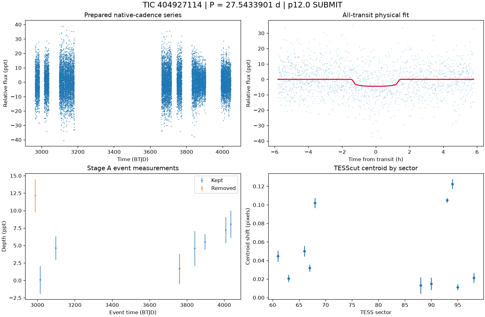

# TIC 404927114: P12 candidate review (tic404927114_P27.5436)

**SUBMIT** (candidate tier 2: pixel-supported candidate) under p12.0: no condition; every measured condition passes

This is a candidate packet. No external submission has been made; the user decides.

| Measurement | Value |
|---|---|
| Period | 27.543390053 +/- 0.0002485035541247843 d |
| Epoch | 2459987.928697499 +/- 0.006997371079042699 BJD |
| Radius | 3.079 +/- 0.375 Earth radii |
| T14 | 2.899 +/- 0.327 h |
| Impact parameter | 0.55243 +/- 0.08937668354443128 |
| Density prior / grazing | True / False |
| Transits / beta | 8 / 1.12 |
| FPP / NFPP | 0.17421443514255952 / 0.15011232826588902 |
| fpp_uniform | False |
| Centroid | Centroid shift (weighted over 11 sectors): dcol = +0.018 px, drow = -0.033 px, total = 0.038 px (0.8 arcsec), significance = 28.7 sigma; 9 of 11 sectors flagged on their own. |

ExoFOP note draft: TessHunter P12 candidate: P = 27.543390 d, T0 = 2459987.92870 BJD, depth 4516 ppm, duration 2.90 h, TESS sectors 61-98 (12), preset survey_p10, rules p12.0. Verdict SUBMIT tier 2; not claimed: a validated planet or a resolved source. The field's validation bar (resolved source, localised repeated dimming, low FPP) is out of reach for TESS FFI photometry alone at Tmag 13.5; this is a candidate for follow-up, not a validated planet.

The field's validation bar (resolved source, localised repeated dimming, low FPP) is out of reach for TESS FFI photometry alone at Tmag 13.5; this is a candidate for follow-up, not a validated planet.

## p10.0 verdict tiers

**SUBMIT** on no condition

| Condition | Fired | Detail |
|---|---|---|
| K0: hard stop: the star is catalogued at this TIC (REJECT) | no | hard stop CLEAN |
| K1: Stage A fails the six criteria | no | Stage A PASS |
| K2: the secondary gate fails | no | secondary gate PASS (mode bound) |
| K3: Stage B phase-independent sector non-detection excludes the period | no | phase-independent exclusion False (1 sector(s) tested) |
| K4: Stage C fails | no | Stage C PASS (strongest): strongest peak 27.54365 d is within 1% of the survey period at SDE 15.9 |
| K5: the period is an integer alias of a deeper accepted signal or a catalogued period | no | no alias match among 9 accepted signals and 0 catalogued periods |
| K6: odd/even depth difference above 3 sigma | no | odd/even 1.17 sigma (5 odd, 5 even transits) |
| K7: pixel evidence places the dimming elsewhere or measures its absence | no | K7a in 0 sector(s) (literal whole-cutout form: 0), K7b in 0 sector(s) (1 K7a-measurable, 0 K7b-measurable) |
| K8: the physical fit implies a stellar companion | no | Rp 3.079 Re (limit 16.81); density prior delta chi2 3.5049874232472575, converged True, non-grazing True, rho_fit/rho_cat 0.119 |
| K9: artefact-carried under D review (numeric criterion plus the reviewer's decision) | not measurable | criterion does not hold: K9a in 0, K9b in 0 sector(s) of 0 measurable; reviewer decision not an artefact |
| H1: TRICERATOPS NFPP at or above 0.5 | no | NFPP 0.1501, FPP 0.17421443514255952 |
| H2: the all-transit fit is unconverged or on the grazing rail | no | converged |
| H3: a D measurement did not execute and can be re-run | no | every D measurement executed |
| H4: the target is a VSX EA/EB/EW/ELL with no alias match | no | 1 VSX entr(ies) within 21 arcsec, 0 eclipsing class(es) |

### Flags

- **F1**: [{"source_id": 4659942076276901120, "sep_arcsec": 13.3, "sep_px": 0.63, "G": 17.829437255859375, "delta_mag": 4.54, "max_depth_ppt_total_eclipse": 15.02, "required_eclipse_fraction": 0.3233}, {"source_id": 4659942071944202624, "sep_arcsec": 18.3, "sep_px": 0.87, "G": 18.94882583618164, "delta_mag": 5.03, "max_depth_ppt_total_eclipse": 9.59, "required_eclipse_fraction": 0.5064}, {"source_id": 4659930325207234688, "sep_arcsec": 19.3, "sep_px": 0.92, "G": 18.802364349365234, "delta_mag": 4.86, "max_depth_ppt_total_eclipse": 11.22, "required_eclipse_fraction": 0.4328}, {"source_id": 4659930359605646720, "sep_arcsec": 21.4, "sep_px": 1.02, "G": 18.81393051147461, "delta_mag": 4.71, "max_depth_ppt_total_eclipse": 12.93, "required_eclipse_fraction": 0.3756}, {"source_id": 4659930359605646848, "sep_arcsec": 21.9, "sep_px": 1.04, "G": 18.09006118774414, "delta_mag": 4.01, "max_depth_ppt_total_ecl
- **F2**: {"ruwe": 1.1008936166763306, "ipd_frac_multi_peak": 0.0, "astrometric_excess_noise_sig": 0.0, "non_single_star": 0.0, "phot_variable_flag": "VARIABLE", "best_class_name": "SOLAR_LIKE", "duplicated_source": 0.0}
- **F3**: {"vsx": [{"Name": "Gaia DR3 4659930359605646592", "Type": "ROT", "Period": null, "sep_arcsec": 0.0}], "simbad": [{"main_id": "UCAC4 120-008270", "otype": "PM*", "sp_type": "", "sep_arcsec": 0.0}, {"main_id": "OGLE LMC-ECL-36904", "otype": "EB*", "sp_type": "", "sep_arcsec": 45.6}]}
- **F4**: {"fpp": 0.17421443514255952, "nfpp": 0.15011232826588902, "available": true, "fpp_uniform": false, "sectors": [61, 63, 66], "caveats": "binned fold; circular aperture from Tmag; first three selected sectors; probabilities are conditional on TRICERATOPS's astrophysical scenarios and do not price instrumental artefacts"}
- **F5**: {"localisation": "not_measurable", "n_sectors_measurable": 0, "per_sector": [{"sector": 61, "net_depth_ppt": null, "net_err_ppt": null, "k7_absent": null, "note": "unmeasurable: sector unmeasurable: Insufficient aperture or background pixels", "k7_elsewhere": null, "difference_max_dist_target_px": 0.689, "centroid_sigma": 7.334680775322424, "centroid_shift_px": 0.04479979673294406}, {"sector": 63, "net_depth_ppt": null, "net_err_ppt": null, "k7_absent": null, "note": "unmeasurable: sector unmeasurable: Insufficient aperture or background pixels", "k7_elsewhere": null, "difference_max_dist_target_px": 1.925, "centroid_sigma": 5.377574160134861, "centroid_shift_px": 0.02073742896388247}, {"sector": 66, "centroid_sigma": 8.659529357745342, "centroid_shift_px": 0.050065647297004245}, {"sector": 67, "net_depth_ppt": null, "net_err_ppt": null, "k7_absent": null, "note": "unmeasurable: sector u
- **F6**: [{"period_days": "14.528956691375901", "depth_ppt": "3.9345840716281146", "snr": "8.992037329254616", "verdict": "promising planet candidate", "stitch_snr": "6.105827790907652", "passes_pregate": "False"}, {"period_days": "26.93467278685396", "depth_ppt": "5.251458663921602", "snr": "7.951206134732675", "verdict": "promising planet candidate", "stitch_snr": "7.870820916904857", "passes_pregate": "False"}, {"period_days": "15.643361630894221", "depth_ppt": "5.044239617478126", "snr": "7.48156385395506", "verdict": "promising planet candidate", "stitch_snr": "5.998559603962218", "passes_pregate": "False"}, {"period_days": "13.615393343419061", "depth_ppt": "4.0365355685524325", "snr": "7.113726168688673", "verdict": "promising planet candidate", "stitch_snr": "7.061209022224173", "passes_pregate": "False"}, {"period_days": "14.017150978659462", "depth_ppt": "2.1554335820187154", "snr": "6.
- **F7**: {"status": "CLEAN", "tic_matches": [], "neighbour_matches": [], "tce_association": null}
- **F8**: {"n_observed": 12, "n_excluded": 5, "n_kept": 7, "removed_by_class": {"dip_absent_in_sap": 0, "pdc_gap": 0, "scattered_light_ramp": 1, "scattered_light_flag": 0, "momentum_dump": 0, "sector_orbit_edge": 0, "quality_flagged": 5, "sap_baseline_ramp": 1}, "strongest_event_removed": true}
- **F9**: 42 Gaia neighbour(s) within 63 arcsec could produce the depth by total eclipse (nearest 13.3 arcsec, G 17.829437255859375, needing an eclipse of 32% of its light). Seeing-limited ground photometry at the predicted epochs, resolving each of them, would settle the source. TESS pixel evidence is not measurable for this candidate (no usable fixed-aperture sector); the localisation rests entirely on external photometry. TRICERATOPS FPP 0.174, NFPP 0.15 on the binned fold; a low value does not price instrumental artefacts. Statistical validation additionally needs a resolved source, repeated localised dimming and a low FPP with the scene fixed; this candidate is submitted as a candidate, not as a validated planet.

## p12.0 verdict tiers

**SUBMIT** on no condition

| Condition | Fired | Detail |
|---|---|---|
| K0: hard stop: the star is catalogued at this TIC (REJECT) | no | hard stop CLEAN |
| K1: Stage A fails the six criteria | no | Stage A PASS |
| K2: the secondary gate fails | no | secondary gate PASS (mode bound) |
| K3: Stage B phase-independent sector non-detection excludes the period | no | phase-independent exclusion False (1 sector(s) tested) |
| K4: Stage C fails | no | Stage C PASS (strongest): strongest peak 27.54365 d is within 1% of the survey period at SDE 15.9 |
| K5: the period is an integer alias of a deeper accepted signal or a catalogued period | no | no alias match among 9 accepted signals and 0 catalogued periods |
| K6: odd/even depth difference above 3 sigma | no | odd/even 1.17 sigma (5 odd, 5 even transits) |
| K7: pixel evidence places the dimming elsewhere or measures its absence | no | K7a in 0 sector(s) (literal whole-cutout form: 0), K7b in 0 sector(s) (1 K7a-measurable, 0 K7b-measurable) |
| K8: the physical fit implies a stellar companion | no | Rp 3.079 Re (limit 16.81); density prior delta chi2 3.5049874232472575, converged True, non-grazing True, rho_fit/rho_cat 0.119 |
| K9: artefact-carried under D review (numeric criterion plus the reviewer's decision) | not measurable | criterion does not hold: K9a in 0, K9b in 0 sector(s) of 0 measurable; reviewer decision not an artefact |
| H1: TRICERATOPS NFPP at or above 0.5 | no | NFPP 0.1501, FPP 0.17421443514255952 |
| H2: the all-transit fit is unconverged or on the grazing rail | no | converged |
| H3: a D measurement did not execute and can be re-run | no | every D measurement executed |
| H4: the target is a VSX EA/EB/EW/ELL with no alias match | no | 1 VSX entr(ies) within 21 arcsec, 0 eclipsing class(es) |
| H5: the K9b fixed-aperture disagreement holds in exactly one measurable sector | not measurable | no K9b-measurable sector |
| H6: Stage C UNRESOLVED after its one recorded retry | no | Stage C PASS |

### Flags

- **F1**: [{"source_id": 4659942076276901120, "sep_arcsec": 13.3, "sep_px": 0.63, "G": 17.829437255859375, "delta_mag": 4.54, "max_depth_ppt_total_eclipse": 15.02, "required_eclipse_fraction": 0.3233}, {"source_id": 4659942071944202624, "sep_arcsec": 18.3, "sep_px": 0.87, "G": 18.94882583618164, "delta_mag": 5.03, "max_depth_ppt_total_eclipse": 9.59, "required_eclipse_fraction": 0.5064}, {"source_id": 4659930325207234688, "sep_arcsec": 19.3, "sep_px": 0.92, "G": 18.802364349365234, "delta_mag": 4.86, "max_depth_ppt_total_eclipse": 11.22, "required_eclipse_fraction": 0.4328}, {"source_id": 4659930359605646720, "sep_arcsec": 21.4, "sep_px": 1.02, "G": 18.81393051147461, "delta_mag": 4.71, "max_depth_ppt_total_eclipse": 12.93, "required_eclipse_fraction": 0.3756}, {"source_id": 4659930359605646848, "sep_arcsec": 21.9, "sep_px": 1.04, "G": 18.09006118774414, "delta_mag": 4.01, "max_depth_ppt_total_ecl
- **F2**: {"ruwe": 1.1008936166763306, "ipd_frac_multi_peak": 0.0, "astrometric_excess_noise_sig": 0.0, "non_single_star": 0.0, "phot_variable_flag": "VARIABLE", "best_class_name": "SOLAR_LIKE", "duplicated_source": 0.0}
- **F3**: {"vsx": [{"Name": "Gaia DR3 4659930359605646592", "Type": "ROT", "Period": null, "sep_arcsec": 0.0}], "simbad": [{"main_id": "UCAC4 120-008270", "otype": "PM*", "sp_type": "", "sep_arcsec": 0.0}, {"main_id": "OGLE LMC-ECL-36904", "otype": "EB*", "sp_type": "", "sep_arcsec": 45.6}]}
- **F4**: {"fpp": 0.17421443514255952, "nfpp": 0.15011232826588902, "available": true, "fpp_uniform": false, "sectors": [61, 63, 66], "caveats": "binned fold; circular aperture from Tmag; first three selected sectors; probabilities are conditional on TRICERATOPS's astrophysical scenarios and do not price instrumental artefacts"}
- **F5**: {"localisation": "not_measurable", "n_sectors_measurable": 0, "per_sector": [{"sector": 61, "net_depth_ppt": null, "net_err_ppt": null, "k7_absent": null, "note": "unmeasurable: sector unmeasurable: Insufficient aperture or background pixels", "k7_elsewhere": null, "difference_max_dist_target_px": 0.689, "centroid_sigma": 7.334680775322424, "centroid_shift_px": 0.04479979673294406}, {"sector": 63, "net_depth_ppt": null, "net_err_ppt": null, "k7_absent": null, "note": "unmeasurable: sector unmeasurable: Insufficient aperture or background pixels", "k7_elsewhere": null, "difference_max_dist_target_px": 1.925, "centroid_sigma": 5.377574160134861, "centroid_shift_px": 0.02073742896388247}, {"sector": 66, "centroid_sigma": 8.659529357745342, "centroid_shift_px": 0.050065647297004245}, {"sector": 67, "net_depth_ppt": null, "net_err_ppt": null, "k7_absent": null, "note": "unmeasurable: sector u
- **F6**: [{"period_days": "14.528956691375901", "depth_ppt": "3.9345840716281146", "snr": "8.992037329254616", "verdict": "promising planet candidate", "stitch_snr": "6.105827790907652", "passes_pregate": "False"}, {"period_days": "26.93467278685396", "depth_ppt": "5.251458663921602", "snr": "7.951206134732675", "verdict": "promising planet candidate", "stitch_snr": "7.870820916904857", "passes_pregate": "False"}, {"period_days": "15.643361630894221", "depth_ppt": "5.044239617478126", "snr": "7.48156385395506", "verdict": "promising planet candidate", "stitch_snr": "5.998559603962218", "passes_pregate": "False"}, {"period_days": "13.615393343419061", "depth_ppt": "4.0365355685524325", "snr": "7.113726168688673", "verdict": "promising planet candidate", "stitch_snr": "7.061209022224173", "passes_pregate": "False"}, {"period_days": "14.017150978659462", "depth_ppt": "2.1554335820187154", "snr": "6.
- **F7**: {"status": "CLEAN", "tic_matches": [], "neighbour_matches": [], "tce_association": null}
- **F8**: {"n_observed": 12, "n_excluded": 5, "n_kept": 7, "removed_by_class": {"dip_absent_in_sap": 0, "pdc_gap": 0, "scattered_light_ramp": 1, "scattered_light_flag": 0, "momentum_dump": 0, "sector_orbit_edge": 0, "quality_flagged": 5, "sap_baseline_ramp": 1}, "strongest_event_removed": true}
- **F9**: 42 Gaia neighbour(s) within 63 arcsec could produce the depth by total eclipse (nearest 13.3 arcsec, G 17.829437255859375, needing an eclipse of 32% of its light). Seeing-limited ground photometry at the predicted epochs, resolving each of them, would settle the source. TESS pixel evidence is not measurable for this candidate (no usable fixed-aperture sector); the localisation rests entirely on external photometry. TRICERATOPS FPP 0.174, NFPP 0.15 on the binned fold; a low value does not price instrumental artefacts. Statistical validation additionally needs a resolved source, repeated localised dimming and a low FPP with the scene fixed; this candidate is submitted as a candidate, not as a validated planet.
- **F10**: {"word": "K10_FLAG", "or_variants": ["K10e", "K10s"], "or_fired": false, "K10e": {"fired": false, "measurable": true, "detail": "n_excluded / n_observed = 5/12 = 0.417 (> 0.5 fires)", "n_observed": 12, "n_excluded": 5, "fraction": 0.4166666666666667}, "K10s": {"fired": false, "measurable": true, "detail": "SAP 3.698 +/- 0.668 ppt vs corrected 4.873 +/- 0.659 ppt; SAP < 0.5x False; difference > 3 sigma False; kept events in 6 sector(s)", "det_ppt": 4.873, "det_err_ppt": 0.659, "sap_ppt": 3.698, "sap_err_ppt": 0.668, "quadrature_err_ppt": 0.93835227926403, "kept_sectors": [63, 66, 90, 93, 95, 98], "sap_below_half": false, "difference_significant": false, "kept_sectors_ge_2": true}, "deciding": false}
