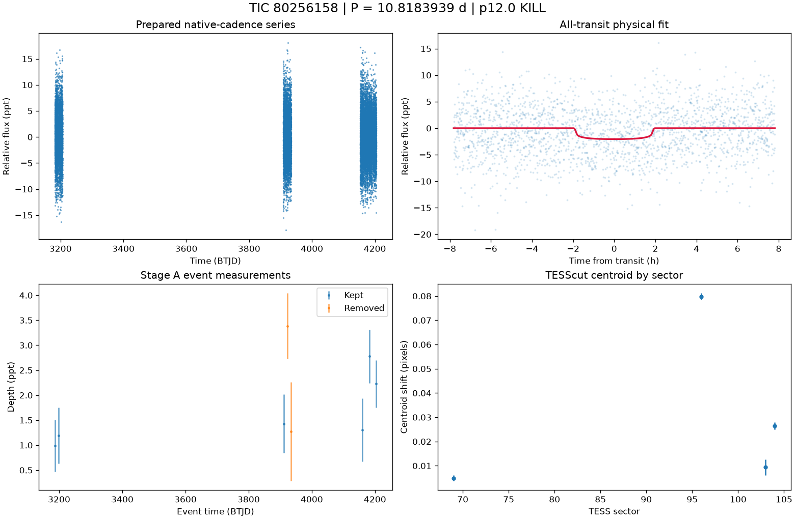

# TIC 80256158: P12 candidate review (tic80256158_P10.8184)

**KILL** under p12.0: K8; Rp 1.7 Re (limit 16.81); density prior delta chi2 27.41801303445527, converged True, non-grazing True, rho_fit/rho_cat 0.173

This is a candidate packet. No external submission has been made; the user decides.

| Measurement | Value |
|---|---|
| Period | 10.818393943 +/- 0.00011318900702270288 d |
| Epoch | 2460186.829973109 +/- 0.008103059032922038 BJD |
| Radius | 1.7 +/- 0.426 Earth radii |
| T14 | 3.907 +/- 4.568 h |
| Impact parameter | 0.07663 +/- 19.765123669081124 |
| Density prior / grazing | False / False |
| Transits / beta | 8 / 1.24 |
| FPP / NFPP | 0.2219548614700817 / 0.03406359841096649 |
| fpp_uniform | False |
| Centroid | Centroid shift (weighted over 4 sectors): dcol = +0.012 px, drow = +0.021 px, total = 0.024 px (0.5 arcsec), significance = 34.2 sigma; 3 of 4 sectors flagged on their own. |

ExoFOP note draft: TessHunter P12 candidate: P = 10.818394 d, T0 = 2460186.82997 BJD, depth 2058 ppm, duration 3.91 h, TESS sectors 69-104 (4), preset survey_p10, rules p12.0. Verdict KILL; not claimed: a validated planet or a resolved source. The field's validation bar (resolved source, localised repeated dimming, low FPP) is out of reach for TESS FFI photometry alone at Tmag 13.5; this is a candidate for follow-up, not a validated planet.

The field's validation bar (resolved source, localised repeated dimming, low FPP) is out of reach for TESS FFI photometry alone at Tmag 13.5; this is a candidate for follow-up, not a validated planet.

## p10.0 verdict tiers

**KILL** on K8

| Condition | Fired | Detail |
|---|---|---|
| K0: hard stop: the star is catalogued at this TIC (REJECT) | no | hard stop CLEAN |
| K1: Stage A fails the six criteria | no | Stage A PASS |
| K2: the secondary gate fails | no | secondary gate PASS (mode bound) |
| K3: Stage B phase-independent sector non-detection excludes the period | no | phase-independent exclusion False (4 sector(s) tested) |
| K4: Stage C fails | no | Stage C PASS (strongest): strongest peak 10.81837 d is within 1% of the survey period at SDE 14.1 |
| K5: the period is an integer alias of a deeper accepted signal or a catalogued period | no | no alias match among 9 accepted signals and 0 catalogued periods |
| K6: odd/even depth difference above 3 sigma | no | odd/even 1.55 sigma (4 odd, 5 even transits) |
| K7: pixel evidence places the dimming elsewhere or measures its absence | no | K7a in 1 sector(s) (literal whole-cutout form: 0), K7b in 0 sector(s) (4 K7a-measurable, 0 K7b-measurable) |
| K8: the physical fit implies a stellar companion | yes | Rp 1.7 Re (limit 16.81); density prior delta chi2 27.41801303445527, converged True, non-grazing True, rho_fit/rho_cat 0.173 |
| K9: artefact-carried under D review (numeric criterion plus the reviewer's decision) | yes | criterion holds: K9a in 4, K9b in 2 sector(s) of 4 measurable; reviewer decision artefact |
| H1: TRICERATOPS NFPP at or above 0.5 | no | NFPP 0.03406, FPP 0.2219548614700817 |
| H2: the all-transit fit is unconverged or on the grazing rail | no | converged |
| H3: a D measurement did not execute and can be re-run | no | every D measurement executed |
| H4: the target is a VSX EA/EB/EW/ELL with no alias match | no | 0 VSX entr(ies) within 21 arcsec, 0 eclipsing class(es) |

### Flags

- **F1**: [{"source_id": 4992273623261645440, "sep_arcsec": 53.9, "sep_px": 2.57, "G": 17.331188201904297, "delta_mag": 3.54, "max_depth_ppt_total_eclipse": 36.86, "required_eclipse_fraction": 0.0399}, {"source_id": 4992273382743478144, "sep_arcsec": 59.3, "sep_px": 2.82, "G": 16.21697998046875, "delta_mag": 2.27, "max_depth_ppt_total_eclipse": 110.29, "required_eclipse_fraction": 0.0133}]
- **F2**: {"ruwe": 1.2273283004760742, "ipd_frac_multi_peak": 0.0, "astrometric_excess_noise_sig": 4.422274112701416, "non_single_star": 0.0, "phot_variable_flag": "NOT_AVAILABLE", "best_class_name": "", "duplicated_source": 0.0}
- **F3**: {"vsx": [], "simbad": [{"main_id": "LP  989-34", "otype": "PM*", "sp_type": "", "sep_arcsec": 0.0}]}
- **F4**: {"fpp": 0.2219548614700817, "nfpp": 0.03406359841096649, "available": true, "fpp_uniform": false, "sectors": [69, 96, 103], "caveats": "binned fold; circular aperture from Tmag; first three selected sectors; probabilities are conditional on TRICERATOPS's astrophysical scenarios and do not price instrumental artefacts"}
- **F5**: {"localisation": "unlocalised", "n_sectors_measurable": 4, "per_sector": [{"sector": 69, "net_depth_ppt": 1.0123, "net_err_ppt": 0.3953, "k7_absent": null, "note": "unmeasurable: 0.5 x D_ref 0.903 < 3 sigma_s 1.186 ppt", "k7_elsewhere": false, "difference_max_dist_target_px": 0.673, "centroid_sigma": 4.649684843654156, "centroid_shift_px": 0.004933770760054094}, {"sector": 96, "net_depth_ppt": -1.0115, "net_err_ppt": 0.4861, "k7_absent": null, "note": "unmeasurable: 0.5 x D_ref 0.903 < 3 sigma_s 1.458 ppt", "k7_elsewhere": true, "difference_max_dist_target_px": 2.903, "centroid_sigma": 58.28605647802461, "centroid_shift_px": 0.07979961762678006}, {"sector": 103, "net_depth_ppt": 6.5784, "net_err_ppt": 0.766, "k7_absent": null, "note": "unmeasurable: 0.5 x D_ref 0.903 < 3 sigma_s 2.298 ppt", "k7_elsewhere": false, "difference_max_dist_target_px": 1.099, "centroid_sigma": 2.858877983548594
- **F6**: [{"period_days": "29.824244288924536", "depth_ppt": "4.836259792163813", "snr": "8.64446073900036", "verdict": "promising planet candidate", "stitch_snr": "8.64446073900036", "passes_pregate": "False"}, {"period_days": "12.337616147933797", "depth_ppt": "4.75498233425129", "snr": "7.026470006990109", "verdict": "promising planet candidate", "stitch_snr": "6.222976895391747", "passes_pregate": "False"}, {"period_days": "15.58328401875621", "depth_ppt": "1.578386839041909", "snr": "6.56637336362102", "verdict": "promising planet candidate", "stitch_snr": "6.56637336362102", "passes_pregate": "False"}, {"period_days": "13.697833085104035", "depth_ppt": "2.2904645075349253", "snr": "6.547856596511434", "verdict": "promising planet candidate", "stitch_snr": "6.324510996598376", "passes_pregate": "False"}, {"period_days": "25.068373910509386", "depth_ppt": "4.244061579623869", "snr": "5.742669
- **F7**: {"status": "CLEAN", "tic_matches": [], "neighbour_matches": [], "tce_association": null}
- **F8**: {"n_observed": 10, "n_excluded": 4, "n_kept": 6, "removed_by_class": {"dip_absent_in_sap": 1, "pdc_gap": 0, "scattered_light_ramp": 1, "scattered_light_flag": 0, "momentum_dump": 0, "sector_orbit_edge": 1, "quality_flagged": 3, "sap_baseline_ramp": 3}, "strongest_event_removed": false}
- **F9**: 2 Gaia neighbour(s) within 63 arcsec could produce the depth by total eclipse (nearest 53.9 arcsec, G 17.331188201904297, needing an eclipse of 4% of its light). Seeing-limited ground photometry at the predicted epochs, resolving each of them, would settle the source. TESS fixed-aperture photometry is consistent with the target in 4 sector(s) but cannot separate the target from the listed neighbours. TRICERATOPS FPP 0.222, NFPP 0.0341 on the binned fold; a low value does not price instrumental artefacts. Statistical validation additionally needs a resolved source, repeated localised dimming and a low FPP with the scene fixed; this candidate is submitted as a candidate, not as a validated planet.

## p12.0 verdict tiers

**KILL** on K8

| Condition | Fired | Detail |
|---|---|---|
| K0: hard stop: the star is catalogued at this TIC (REJECT) | no | hard stop CLEAN |
| K1: Stage A fails the six criteria | no | Stage A PASS |
| K2: the secondary gate fails | no | secondary gate PASS (mode bound) |
| K3: Stage B phase-independent sector non-detection excludes the period | no | phase-independent exclusion False (4 sector(s) tested) |
| K4: Stage C fails | no | Stage C PASS (strongest): strongest peak 10.81837 d is within 1% of the survey period at SDE 14.1 |
| K5: the period is an integer alias of a deeper accepted signal or a catalogued period | no | no alias match among 9 accepted signals and 0 catalogued periods |
| K6: odd/even depth difference above 3 sigma | no | odd/even 1.55 sigma (4 odd, 5 even transits) |
| K7: pixel evidence places the dimming elsewhere or measures its absence | no | K7a in 1 sector(s) (literal whole-cutout form: 0), K7b in 0 sector(s) (4 K7a-measurable, 0 K7b-measurable) |
| K8: the physical fit implies a stellar companion | yes | Rp 1.7 Re (limit 16.81); density prior delta chi2 27.41801303445527, converged True, non-grazing True, rho_fit/rho_cat 0.173 |
| K9: artefact-carried under D review (numeric criterion plus the reviewer's decision) | yes | criterion holds: K9a in 4, K9b in 2 sector(s) of 4 measurable; reviewer decision artefact |
| H1: TRICERATOPS NFPP at or above 0.5 | no | NFPP 0.03406, FPP 0.2219548614700817 |
| H2: the all-transit fit is unconverged or on the grazing rail | no | converged |
| H3: a D measurement did not execute and can be re-run | no | every D measurement executed |
| H4: the target is a VSX EA/EB/EW/ELL with no alias match | no | 0 VSX entr(ies) within 21 arcsec, 0 eclipsing class(es) |
| H5: the K9b fixed-aperture disagreement holds in exactly one measurable sector | no | K9b disagreement in 2 of 4 measurable sector(s) |
| H6: Stage C UNRESOLVED after its one recorded retry | no | Stage C PASS |

### Flags

- **F1**: [{"source_id": 4992273623261645440, "sep_arcsec": 53.9, "sep_px": 2.57, "G": 17.331188201904297, "delta_mag": 3.54, "max_depth_ppt_total_eclipse": 36.86, "required_eclipse_fraction": 0.0399}, {"source_id": 4992273382743478144, "sep_arcsec": 59.3, "sep_px": 2.82, "G": 16.21697998046875, "delta_mag": 2.27, "max_depth_ppt_total_eclipse": 110.29, "required_eclipse_fraction": 0.0133}]
- **F2**: {"ruwe": 1.2273283004760742, "ipd_frac_multi_peak": 0.0, "astrometric_excess_noise_sig": 4.422274112701416, "non_single_star": 0.0, "phot_variable_flag": "NOT_AVAILABLE", "best_class_name": "", "duplicated_source": 0.0}
- **F3**: {"vsx": [], "simbad": [{"main_id": "LP  989-34", "otype": "PM*", "sp_type": "", "sep_arcsec": 0.0}]}
- **F4**: {"fpp": 0.2219548614700817, "nfpp": 0.03406359841096649, "available": true, "fpp_uniform": false, "sectors": [69, 96, 103], "caveats": "binned fold; circular aperture from Tmag; first three selected sectors; probabilities are conditional on TRICERATOPS's astrophysical scenarios and do not price instrumental artefacts"}
- **F5**: {"localisation": "unlocalised", "n_sectors_measurable": 4, "per_sector": [{"sector": 69, "net_depth_ppt": 1.0123, "net_err_ppt": 0.3953, "k7_absent": null, "note": "unmeasurable: 0.5 x D_ref 0.903 < 3 sigma_s 1.186 ppt", "k7_elsewhere": false, "difference_max_dist_target_px": 0.673, "centroid_sigma": 4.649684843654156, "centroid_shift_px": 0.004933770760054094}, {"sector": 96, "net_depth_ppt": -1.0115, "net_err_ppt": 0.4861, "k7_absent": null, "note": "unmeasurable: 0.5 x D_ref 0.903 < 3 sigma_s 1.458 ppt", "k7_elsewhere": true, "difference_max_dist_target_px": 2.903, "centroid_sigma": 58.28605647802461, "centroid_shift_px": 0.07979961762678006}, {"sector": 103, "net_depth_ppt": 6.5784, "net_err_ppt": 0.766, "k7_absent": null, "note": "unmeasurable: 0.5 x D_ref 0.903 < 3 sigma_s 2.298 ppt", "k7_elsewhere": false, "difference_max_dist_target_px": 1.099, "centroid_sigma": 2.858877983548594
- **F6**: [{"period_days": "29.824244288924536", "depth_ppt": "4.836259792163813", "snr": "8.64446073900036", "verdict": "promising planet candidate", "stitch_snr": "8.64446073900036", "passes_pregate": "False"}, {"period_days": "12.337616147933797", "depth_ppt": "4.75498233425129", "snr": "7.026470006990109", "verdict": "promising planet candidate", "stitch_snr": "6.222976895391747", "passes_pregate": "False"}, {"period_days": "15.58328401875621", "depth_ppt": "1.578386839041909", "snr": "6.56637336362102", "verdict": "promising planet candidate", "stitch_snr": "6.56637336362102", "passes_pregate": "False"}, {"period_days": "13.697833085104035", "depth_ppt": "2.2904645075349253", "snr": "6.547856596511434", "verdict": "promising planet candidate", "stitch_snr": "6.324510996598376", "passes_pregate": "False"}, {"period_days": "25.068373910509386", "depth_ppt": "4.244061579623869", "snr": "5.742669
- **F7**: {"status": "CLEAN", "tic_matches": [], "neighbour_matches": [], "tce_association": null}
- **F8**: {"n_observed": 10, "n_excluded": 4, "n_kept": 6, "removed_by_class": {"dip_absent_in_sap": 1, "pdc_gap": 0, "scattered_light_ramp": 1, "scattered_light_flag": 0, "momentum_dump": 0, "sector_orbit_edge": 1, "quality_flagged": 3, "sap_baseline_ramp": 3}, "strongest_event_removed": false}
- **F9**: 2 Gaia neighbour(s) within 63 arcsec could produce the depth by total eclipse (nearest 53.9 arcsec, G 17.331188201904297, needing an eclipse of 4% of its light). Seeing-limited ground photometry at the predicted epochs, resolving each of them, would settle the source. TESS fixed-aperture photometry is consistent with the target in 4 sector(s) but cannot separate the target from the listed neighbours. TRICERATOPS FPP 0.222, NFPP 0.0341 on the binned fold; a low value does not price instrumental artefacts. Statistical validation additionally needs a resolved source, repeated localised dimming and a low FPP with the scene fixed; this candidate is submitted as a candidate, not as a validated planet.
- **F10**: {"word": "K10_FLAG", "or_variants": ["K10e", "K10s"], "or_fired": false, "K10e": {"fired": false, "measurable": true, "detail": "n_excluded / n_observed = 4/10 = 0.400 (> 0.5 fires)", "n_observed": 10, "n_excluded": 4, "fraction": 0.4}, "K10s": {"fired": false, "measurable": true, "detail": "SAP 0.845 +/- 0.216 ppt vs corrected 1.705 +/- 0.222 ppt; SAP < 0.5x True; difference > 3 sigma False; kept events in 4 sector(s)", "det_ppt": 1.705, "det_err_ppt": 0.222, "sap_ppt": 0.845, "sap_err_ppt": 0.216, "quadrature_err_ppt": 0.30974182797936733, "kept_sectors": [69, 96, 103, 104], "sap_below_half": true, "difference_significant": false, "kept_sectors_ge_2": true}, "deciding": false}
