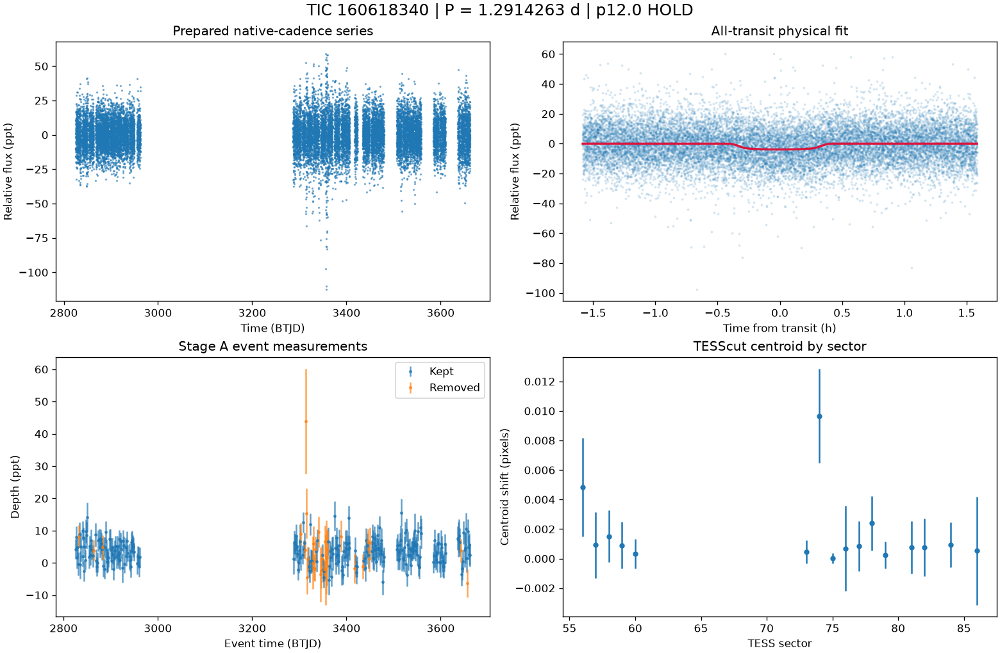

# TIC 160618340: P12 candidate review (tic160618340_P1.2915)

**HOLD** under p12.0: H5; K9b disagreement in 1 of 16 measurable sector(s)

This is a candidate packet. No external submission has been made; the user decides.

| Measurement | Value |
|---|---|
| Period | 1.291426325 +/- 2.6711119963861425e-06 d |
| Epoch | 2459825.711782326 +/- 0.00105790627979908 BJD |
| Radius | 2.96 +/- 0.317 Earth radii |
| T14 | 0.792 +/- 0.078 h |
| Impact parameter | 0.80214 +/- 0.02161340683434222 |
| Density prior / grazing | True / False |
| Transits / beta | 283 / 1.02 |
| FPP / NFPP | 0.06076775474905671 / 0.0008293958709158044 |
| fpp_uniform | False |
| Centroid | Centroid shift (weighted over 16 sectors): dcol = -0.000 px, drow = +0.000 px, total = 0.000 px (0.0 arcsec), significance = 0.4 sigma; 1 of 16 sectors flagged on their own. |

ExoFOP note draft: TessHunter P12 candidate: P = 1.291426 d, T0 = 2459825.71178 BJD, depth 3909 ppm, duration 0.79 h, TESS sectors 56-86 (16), preset survey_p10, rules p12.0. Verdict HOLD; not claimed: a validated planet or a resolved source. The field's validation bar (resolved source, localised repeated dimming, low FPP) is out of reach for TESS FFI photometry alone at Tmag 13.5; this is a candidate for follow-up, not a validated planet.

The field's validation bar (resolved source, localised repeated dimming, low FPP) is out of reach for TESS FFI photometry alone at Tmag 13.5; this is a candidate for follow-up, not a validated planet.

## p12.0 verdict tiers

**HOLD** on H5

| Condition | Fired | Detail |
|---|---|---|
| K0: hard stop: the star is catalogued at this TIC (REJECT) | no | hard stop CLEAN |
| K1: Stage A fails the six criteria | no | Stage A PASS |
| K2: the secondary gate fails | no | secondary gate PASS (mode bound) |
| K3: Stage B phase-independent sector non-detection excludes the period | no | phase-independent exclusion False (16 sector(s) tested) |
| K4: Stage C fails | no | Stage C PASS (strongest): strongest peak 1.29143 d is within 1% of the survey period at SDE 64.0 |
| K5: the period is an integer alias of a deeper accepted signal or a catalogued period | no | no alias match among 9 accepted signals and 0 catalogued periods |
| K6: odd/even depth difference above 3 sigma | no | odd/even 2.34 sigma (148 odd, 157 even transits) |
| K7: pixel evidence places the dimming elsewhere or measures its absence | no | K7a in 0 sector(s) (literal whole-cutout form: 0), K7b in 0 sector(s) (16 K7a-measurable, 1 K7b-measurable) |
| K8: the physical fit implies a stellar companion | no | Rp 2.96 Re (limit 16.81); density prior delta chi2 0.8327763050037902, converged True, non-grazing True, rho_fit/rho_cat 3.64 |
| K9: artefact-carried under D review (numeric criterion plus the reviewer's decision) | no | criterion does not hold: K9a in 16, K9b in 1 sector(s) of 16 measurable; reviewer decision not recorded |
| H1: TRICERATOPS NFPP at or above 0.5 | no | NFPP 0.0008294, FPP 0.06076775474905671 |
| H2: the all-transit fit is unconverged or on the grazing rail | no | converged |
| H3: a D measurement did not execute and can be re-run | no | every D measurement executed |
| H4: the target is a VSX EA/EB/EW/ELL with no alias match | no | 0 VSX entr(ies) within 21 arcsec, 0 eclipsing class(es) |
| H5: the K9b fixed-aperture disagreement holds in exactly one measurable sector | yes | K9b disagreement in 1 of 16 measurable sector(s) |
| H6: Stage C UNRESOLVED after its one recorded retry | no | Stage C PASS |

### Flags

- **F1**: [{"source_id": 1702938972198551040, "sep_arcsec": 29.9, "sep_px": 1.43, "G": 17.5458984375, "delta_mag": 2.45, "max_depth_ppt_total_eclipse": 94.74, "required_eclipse_fraction": 0.0367}, {"source_id": 1702950787652636416, "sep_arcsec": 35.9, "sep_px": 1.71, "G": 20.19704246520996, "delta_mag": 5.9, "max_depth_ppt_total_eclipse": 4.33, "required_eclipse_fraction": 0.8025}, {"source_id": 1702938972198499200, "sep_arcsec": 46.6, "sep_px": 2.22, "G": 14.146173477172852, "delta_mag": -0.17, "max_depth_ppt_total_eclipse": 539.28, "required_eclipse_fraction": 0.0064}, {"source_id": 1702950757588937216, "sep_arcsec": 50.2, "sep_px": 2.39, "G": 20.672836303710938, "delta_mag": 5.63, "max_depth_ppt_total_eclipse": 5.55, "required_eclipse_fraction": 0.6261}]
- **F2**: {"ruwe": 1.6136231422424316, "ipd_frac_multi_peak": 0.0, "astrometric_excess_noise_sig": 16.912887573242188, "non_single_star": 0.0, "phot_variable_flag": "NOT_AVAILABLE", "best_class_name": "", "duplicated_source": 0.0}
- **F3**: {"vsx": [], "simbad": []}
- **F4**: {"fpp": 0.06076775474905671, "nfpp": 0.0008293958709158044, "available": true, "fpp_uniform": false, "sectors": [56, 57, 58], "caveats": "binned fold; circular aperture from Tmag; first three selected sectors; probabilities are conditional on TRICERATOPS's astrophysical scenarios and do not price instrumental artefacts"}
- **F5**: {"localisation": "unlocalised", "n_sectors_measurable": 16, "per_sector": [{"sector": 56, "net_depth_ppt": 2.668, "net_err_ppt": 1.0204, "k7_absent": null, "note": "unmeasurable: 0.5 x D_ref 1.510 < 3 sigma_s 3.061 ppt", "k7_elsewhere": false, "difference_max_dist_target_px": 1.693, "centroid_sigma": 1.4409255455662355, "centroid_shift_px": 0.004828516072047817}, {"sector": 57, "net_depth_ppt": 2.1678, "net_err_ppt": 0.6866, "k7_absent": null, "note": "unmeasurable: 0.5 x D_ref 1.510 < 3 sigma_s 2.060 ppt", "k7_elsewhere": false, "difference_max_dist_target_px": 1.769, "centroid_sigma": 0.4146594052589466, "centroid_shift_px": 0.000922778653023022}, {"sector": 58, "net_depth_ppt": 3.3683, "net_err_ppt": 1.3706, "k7_absent": null, "note": "unmeasurable: 0.5 x D_ref 1.510 < 3 sigma_s 4.112 ppt", "k7_elsewhere": false, "difference_max_dist_target_px": 1.461, "centroid_sigma": 0.869610665205
- **F6**: [{"period_days": "2.5828254718860673", "depth_ppt": "3.7683196226397437", "snr": "9.8671370677414", "verdict": "ambiguous / manual vetting required", "stitch_snr": "12.384355833712654", "passes_pregate": "True"}, {"period_days": "28.205167277833326", "depth_ppt": "4.211621278370675", "snr": "8.622771144333088", "verdict": "promising planet candidate", "stitch_snr": "7.60242141305852", "passes_pregate": "True"}, {"period_days": "11.623097654267907", "depth_ppt": "4.123442956614096", "snr": "7.368124489295379", "verdict": "promising planet candidate", "stitch_snr": "7.368124489295379", "passes_pregate": "True"}, {"period_days": "10.331576370655888", "depth_ppt": "4.188105001652577", "snr": "7.174651191115297", "verdict": "ambiguous / manual vetting required", "stitch_snr": "7.174651191115297", "passes_pregate": "True"}, {"period_days": "17.503844022629586", "depth_ppt": "4.012806957308962"
- **F7**: {"status": "CLEAN", "tic_matches": [], "neighbour_matches": [], "tce_association": null}
- **F8**: {"n_observed": 302, "n_excluded": 53, "n_kept": 249, "removed_by_class": {"dip_absent_in_sap": 0, "pdc_gap": 0, "scattered_light_ramp": 24, "scattered_light_flag": 6, "momentum_dump": 11, "sector_orbit_edge": 7, "quality_flagged": 24, "sap_baseline_ramp": 7}, "strongest_event_removed": false}
- **F9**: 4 Gaia neighbour(s) within 63 arcsec could produce the depth by total eclipse (nearest 29.9 arcsec, G 17.5458984375, needing an eclipse of 4% of its light). Seeing-limited ground photometry at the predicted epochs, resolving each of them, would settle the source. TESS fixed-aperture photometry is consistent with the target in 16 sector(s) but cannot separate the target from the listed neighbours. TRICERATOPS FPP 0.0608, NFPP 0.000829 on the binned fold; a low value does not price instrumental artefacts. Statistical validation additionally needs a resolved source, repeated localised dimming and a low FPP with the scene fixed; this candidate is submitted as a candidate, not as a validated planet.
- **F10**: {"word": "K10_FLAG", "or_variants": ["K10e", "K10s"], "or_fired": false, "K10e": {"fired": false, "measurable": true, "detail": "n_excluded / n_observed = 53/302 = 0.175 (> 0.5 fires)", "n_observed": 302, "n_excluded": 53, "fraction": 0.17549668874172186}, "K10s": {"fired": false, "measurable": true, "detail": "SAP 3.550 +/- 0.215 ppt vs corrected 3.374 +/- 0.215 ppt; SAP < 0.5x False; difference > 3 sigma False; kept events in 16 sector(s)", "det_ppt": 3.374, "det_err_ppt": 0.215, "sap_ppt": 3.55, "sap_err_ppt": 0.215, "quadrature_err_ppt": 0.3040559159102154, "kept_sectors": [56, 57, 58, 59, 60, 73, 74, 75, 76, 77, 78, 79, 81, 82, 84, 86], "sap_below_half": false, "difference_significant": false, "kept_sectors_ge_2": true}, "deciding": false}
