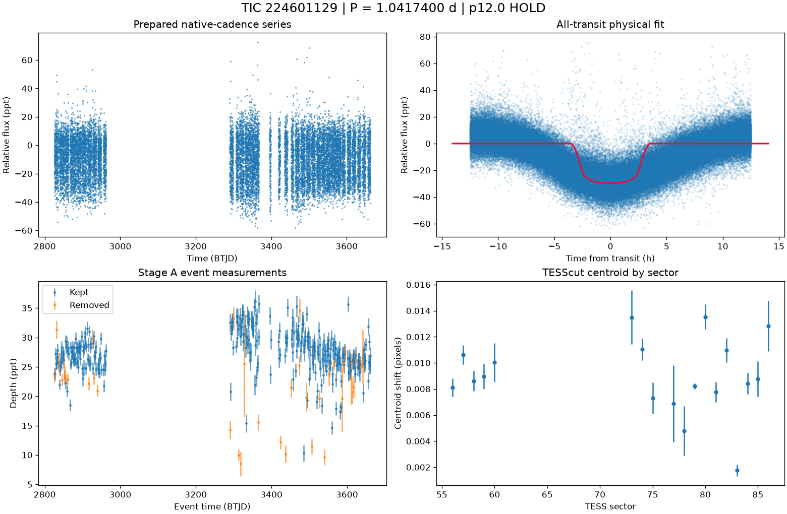

# TIC 224601129: P12 candidate review (tic224601129_P1.0418)

**HOLD** under p12.0: H2; singular fit covariance: parameter uncertainties are unavailable

This is a candidate packet. No external submission has been made; the user decides.

| Measurement | Value |
|---|---|
| Period | 1.041739997 +/- None d |
| Epoch | 2459825.470271626 +/- None BJD |
| Radius | 6.497 +/- None Earth radii |
| T14 | 7.036 +/- None h |
| Impact parameter | 0.00000 +/- None |
| Density prior / grazing | False / False |
| Transits / beta | 354 / 3.92 |
| FPP / NFPP | 1.0 / 0.0 |
| fpp_uniform | False |
| Centroid | Centroid shift (weighted over 18 sectors): dcol = -0.003 px, drow = +0.002 px, total = 0.003 px (0.1 arcsec), significance = 22.8 sigma; 16 of 18 sectors flagged on their own. |

ExoFOP note draft: TessHunter P12 candidate: P = 1.041740 d, T0 = 2459825.47027 BJD, depth 29730 ppm, duration 7.04 h, TESS sectors 56-86 (18), preset survey_p10, rules p12.0. Verdict HOLD; not claimed: a validated planet or a resolved source. The field's validation bar (resolved source, localised repeated dimming, low FPP) is out of reach for TESS FFI photometry alone at Tmag 13.5; this is a candidate for follow-up, not a validated planet.

The field's validation bar (resolved source, localised repeated dimming, low FPP) is out of reach for TESS FFI photometry alone at Tmag 13.5; this is a candidate for follow-up, not a validated planet.

## p12.0 verdict tiers

**HOLD** on H2

| Condition | Fired | Detail |
|---|---|---|
| K0: hard stop: the star is catalogued at this TIC (REJECT) | no | hard stop FLAG |
| K1: Stage A fails the six criteria | no | Stage A PASS |
| K2: the secondary gate fails | no | secondary gate PASS (mode bound) |
| K3: Stage B phase-independent sector non-detection excludes the period | no | phase-independent exclusion False (18 sector(s) tested) |
| K4: Stage C fails | no | Stage C PASS (strongest): strongest peak 1.04174 d is within 1% of the survey period at SDE 37.6 |
| K5: the period is an integer alias of a deeper accepted signal or a catalogued period | no | no alias match among 2 accepted signals and 0 catalogued periods |
| K6: odd/even depth difference above 3 sigma | no | odd/even 1.14 sigma (190 odd, 192 even transits) |
| K7: pixel evidence places the dimming elsewhere or measures its absence | not measurable | K7a in 0 sector(s) (literal whole-cutout form: 0), K7b in 0 sector(s) (0 K7a-measurable, 0 K7b-measurable) |
| K8: the physical fit implies a stellar companion | no | Rp 6.497 Re (limit 16.81); density prior delta chi2 9992.182673628065, converged False, non-grazing True, rho_fit/rho_cat 0.006 |
| K9: artefact-carried under D review (numeric criterion plus the reviewer's decision) | not measurable | criterion does not hold: K9a in 0, K9b in 0 sector(s) of 0 measurable; reviewer decision not recorded |
| H1: TRICERATOPS NFPP at or above 0.5 | no | NFPP 0, FPP 1.0 |
| H2: the all-transit fit is unconverged or on the grazing rail | yes | singular fit covariance: parameter uncertainties are unavailable |
| H3: a D measurement did not execute and can be re-run | no | every D measurement executed |
| H4: the target is a VSX EA/EB/EW/ELL with no alias match | no | 0 VSX entr(ies) within 21 arcsec, 0 eclipsing class(es) |
| H5: the K9b fixed-aperture disagreement holds in exactly one measurable sector | not measurable | no K9b-measurable sector |
| H6: Stage C UNRESOLVED after its one recorded retry | no | Stage C PASS |

### Flags

- **F1**: [{"source_id": 1437095992818193920, "sep_arcsec": 22.6, "sep_px": 1.08, "G": 18.149829864501953, "delta_mag": 3.88, "max_depth_ppt_total_eclipse": 27.39, "required_eclipse_fraction": 0.5126}, {"source_id": 1437095988522980608, "sep_arcsec": 29.7, "sep_px": 1.42, "G": 17.30331039428711, "delta_mag": 3.16, "max_depth_ppt_total_eclipse": 51.54, "required_eclipse_fraction": 0.2724}, {"source_id": 1437096095897408000, "sep_arcsec": 52.9, "sep_px": 2.52, "G": 16.60053253173828, "delta_mag": 2.38, "max_depth_ppt_total_eclipse": 100.42, "required_eclipse_fraction": 0.1398}, {"source_id": 1437096095897408640, "sep_arcsec": 58.0, "sep_px": 2.76, "G": 17.251874923706055, "delta_mag": 2.92, "max_depth_ppt_total_eclipse": 63.64, "required_eclipse_fraction": 0.2206}]
- **F2**: {"ruwe": 1.023009181022644, "ipd_frac_multi_peak": 0.0, "astrometric_excess_noise_sig": 0.0, "non_single_star": 0.0, "phot_variable_flag": "NOT_AVAILABLE", "best_class_name": "", "duplicated_source": 0.0}
- **F3**: {"vsx": [], "simbad": [{"main_id": "2MASS J17003230+5923189", "otype": "*", "sp_type": "", "sep_arcsec": 0.0}]}
- **F4**: {"fpp": 1.0, "nfpp": 0.0, "available": true, "fpp_uniform": false, "sectors": [56, 57, 58], "caveats": "binned fold; circular aperture from Tmag; first three selected sectors; probabilities are conditional on TRICERATOPS's astrophysical scenarios and do not price instrumental artefacts"}
- **F5**: {"localisation": "not_measurable", "n_sectors_measurable": 0, "per_sector": [{"sector": 56, "centroid_sigma": 11.395906722313386, "centroid_shift_px": 0.008106279893469341}, {"sector": 57, "centroid_sigma": 14.625465437818166, "centroid_shift_px": 0.010630580976056389}, {"sector": 58, "centroid_sigma": 11.116943748124513, "centroid_shift_px": 0.008606449741993587}, {"sector": 59, "centroid_sigma": 9.186597784976433, "centroid_shift_px": 0.008953217881662649}, {"sector": 60, "centroid_sigma": 6.7789479256739735, "centroid_shift_px": 0.010027154545231464}, {"sector": 73, "centroid_sigma": 6.514721759825733, "centroid_shift_px": 0.013487145529547264}, {"sector": 74, "centroid_sigma": 13.36680980758931, "centroid_shift_px": 0.011028519214089982}, {"sector": 75, "centroid_sigma": 6.04155558467467, "centroid_shift_px": 0.007293031930245372}, {"sector": 77, "centroid_sigma": 2.34554662257803, "
- **F6**: [{"period_days": "10.417282949532034", "depth_ppt": "15.760754621339656", "snr": "86.6826909820817", "verdict": "likely false positive", "stitch_snr": "86.6826909820817", "passes_pregate": "True"}]
- **F7**: {"status": "FLAG", "tic_matches": [{"source": "spoc_tce", "label": "TCE s0014-s0019 pn1", "detail": "P=79.0172d SNR=8.2", "ephemerides": []}, {"source": "spoc_tce", "label": "TCE s0014-s0023 pn1", "detail": "P=70.0125d SNR=11.2", "ephemerides": []}, {"source": "spoc_tce", "label": "TCE s0014-s0026 pn1", "detail": "P=70.0122d SNR=11.4", "ephemerides": []}, {"source": "spoc_tce", "label": "TCE s0014-s0041 pn1", "detail": "P=493.701d SNR=12.6", "ephemerides": []}, {"source": "spoc_tce", "label": "TCE s0014-s0041 pn2", "detail": "P=58.9271d SNR=8.3", "ephemerides": []}, {"source": "spoc_tce", "label": "TCE s0014-s0050 pn1", "detail": "P=493.701d SNR=12.8", "ephemerides": []}, {"source": "spoc_tce", "label": "TCE s0014-s0050 pn2", "detail": "P=557.261d SNR=12.0", "ephemerides": []}, {"source": "spoc_tce", "label": "TCE s0014-s0055 pn3", "detail": "P=1.04145d SNR=10.1", "ephemerides": []}, {"s
- **F8**: {"n_observed": 428, "n_excluded": 112, "n_kept": 312, "removed_by_class": {"dip_absent_in_sap": 8, "pdc_gap": 20, "scattered_light_ramp": 48, "scattered_light_flag": 84, "momentum_dump": 23, "sector_orbit_edge": 8, "quality_flagged": 2, "sap_baseline_ramp": 10}, "strongest_event_removed": false}
- **F9**: 4 Gaia neighbour(s) within 63 arcsec could produce the depth by total eclipse (nearest 22.6 arcsec, G 18.149829864501953, needing an eclipse of 51% of its light). Seeing-limited ground photometry at the predicted epochs, resolving each of them, would settle the source. TESS pixel evidence is not measurable for this candidate (no usable fixed-aperture sector); the localisation rests entirely on external photometry. TRICERATOPS FPP 1, NFPP 0 on the binned fold; a low value does not price instrumental artefacts. Statistical validation additionally needs a resolved source, repeated localised dimming and a low FPP with the scene fixed; this candidate is submitted as a candidate, not as a validated planet.
- **F10**: {"word": "K10_FLAG", "or_variants": ["K10e", "K10s"], "or_fired": false, "K10e": {"fired": false, "measurable": true, "detail": "n_excluded / n_observed = 112/428 = 0.262 (> 0.5 fires)", "n_observed": 428, "n_excluded": 112, "fraction": 0.2616822429906542}, "K10s": {"fired": false, "measurable": true, "detail": "SAP 17.723 +/- 0.053 ppt vs corrected 27.092 +/- 0.071 ppt; SAP < 0.5x False; difference > 3 sigma True; kept events in 18 sector(s)", "det_ppt": 27.092, "det_err_ppt": 0.071, "sap_ppt": 17.723, "sap_err_ppt": 0.053, "quadrature_err_ppt": 0.08860022573334675, "kept_sectors": [56, 57, 58, 59, 60, 73, 74, 75, 77, 78, 79, 80, 81, 82, 83, 84, 85, 86], "sap_below_half": false, "difference_significant": true, "kept_sectors_ge_2": true}, "deciding": false}
