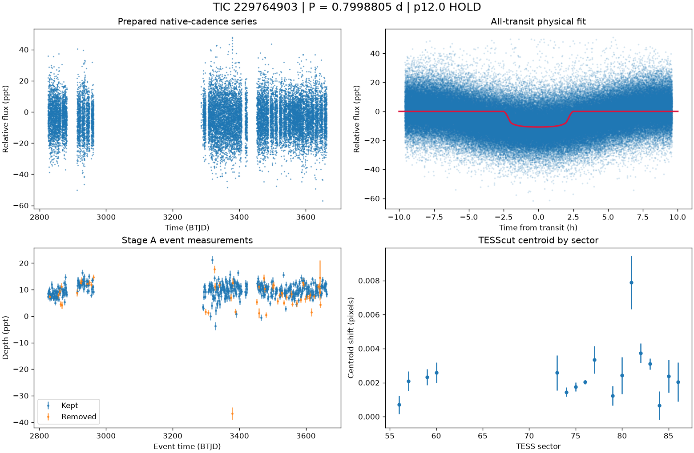

# TIC 229764903: P12 candidate review (tic229764903_P0.7999)

**HOLD** under p12.0: H1; NFPP 0.9993, FPP 1.0

This is a candidate packet. No external submission has been made; the user decides.

| Measurement | Value |
|---|---|
| Period | 0.799880533 +/- None d |
| Epoch | 2459825.658028481 +/- None BJD |
| Radius | 3.212 +/- None Earth radii |
| T14 | 5.008 +/- None h |
| Impact parameter | 0.00000 +/- None |
| Density prior / grazing | False / False |
| Transits / beta | 484 / 1.87 |
| FPP / NFPP | 1.0 / 0.9993313526583696 |
| fpp_uniform | False |
| Centroid | Centroid shift (weighted over 17 sectors): dcol = +0.001 px, drow = -0.001 px, total = 0.001 px (0.0 arcsec), significance = 10.9 sigma; 10 of 17 sectors flagged on their own. |

ExoFOP note draft: TessHunter P12 candidate: P = 0.799881 d, T0 = 2459825.65803 BJD, depth 10772 ppm, duration 5.01 h, TESS sectors 56-86 (17), preset survey_p10, rules p12.0. Verdict HOLD; not claimed: a validated planet or a resolved source. The field's validation bar (resolved source, localised repeated dimming, low FPP) is out of reach for TESS FFI photometry alone at Tmag 13.5; this is a candidate for follow-up, not a validated planet.

The field's validation bar (resolved source, localised repeated dimming, low FPP) is out of reach for TESS FFI photometry alone at Tmag 13.5; this is a candidate for follow-up, not a validated planet.

## p12.0 verdict tiers

**HOLD** on H1

| Condition | Fired | Detail |
|---|---|---|
| K0: hard stop: the star is catalogued at this TIC (REJECT) | no | hard stop FLAG |
| K1: Stage A fails the six criteria | no | Stage A PASS |
| K2: the secondary gate fails | no | secondary gate PASS (mode bound) |
| K3: Stage B phase-independent sector non-detection excludes the period | no | phase-independent exclusion False (17 sector(s) tested) |
| K4: Stage C fails | no | Stage C PASS (strongest): strongest peak 0.79989 d is within 1% of the survey period at SDE 24.2 |
| K5: the period is an integer alias of a deeper accepted signal or a catalogued period | no | no alias match among 2 accepted signals and 0 catalogued periods |
| K6: odd/even depth difference above 3 sigma | no | odd/even 0.49 sigma (255 odd, 251 even transits) |
| K7: pixel evidence places the dimming elsewhere or measures its absence | not measurable | K7a in 0 sector(s) (literal whole-cutout form: 0), K7b in 0 sector(s) (0 K7a-measurable, 0 K7b-measurable) |
| K8: the physical fit implies a stellar companion | no | Rp 3.212 Re (limit 16.81); density prior delta chi2 7676.947295997401, converged False, non-grazing True, rho_fit/rho_cat 0.007 |
| K9: artefact-carried under D review (numeric criterion plus the reviewer's decision) | not measurable | criterion does not hold: K9a in 0, K9b in 0 sector(s) of 0 measurable; reviewer decision not recorded |
| H1: TRICERATOPS NFPP at or above 0.5 | yes | NFPP 0.9993, FPP 1.0 |
| H2: the all-transit fit is unconverged or on the grazing rail | yes | singular fit covariance: parameter uncertainties are unavailable |
| H3: a D measurement did not execute and can be re-run | no | every D measurement executed |
| H4: the target is a VSX EA/EB/EW/ELL with no alias match | no | 0 VSX entr(ies) within 21 arcsec, 0 eclipsing class(es) |
| H5: the K9b fixed-aperture disagreement holds in exactly one measurable sector | not measurable | no K9b-measurable sector |
| H6: Stage C UNRESOLVED after its one recorded retry | no | Stage C PASS |

### Flags

- **F1**: [{"source_id": 2265334325083375232, "sep_arcsec": 24.9, "sep_px": 1.18, "G": 17.21414566040039, "delta_mag": 2.22, "max_depth_ppt_total_eclipse": 114.65, "required_eclipse_fraction": 0.0465}, {"source_id": 2265334325083374848, "sep_arcsec": 29.1, "sep_px": 1.38, "G": 17.928621292114258, "delta_mag": 3.35, "max_depth_ppt_total_eclipse": 43.63, "required_eclipse_fraction": 0.1222}, {"source_id": 2265333947125510272, "sep_arcsec": 49.0, "sep_px": 2.33, "G": 20.445270538330078, "delta_mag": 5.34, "max_depth_ppt_total_eclipse": 7.28, "required_eclipse_fraction": 0.7326}, {"source_id": 2265334320787143296, "sep_arcsec": 51.7, "sep_px": 2.46, "G": 18.648874282836914, "delta_mag": 3.68, "max_depth_ppt_total_eclipse": 32.68, "required_eclipse_fraction": 0.1632}, {"source_id": 2265333874110541696, "sep_arcsec": 53.4, "sep_px": 2.54, "G": 18.865203857421875, "delta_mag": 4.41, "max_depth_ppt_total_
- **F2**: {"ruwe": 1.1275005340576172, "ipd_frac_multi_peak": 0.0, "astrometric_excess_noise_sig": 1.3935832977294922, "non_single_star": 0.0, "phot_variable_flag": "NOT_AVAILABLE", "best_class_name": "", "duplicated_source": 0.0}
- **F3**: {"vsx": [], "simbad": [{"main_id": "2MASS J18462769+6948545", "otype": "PM*", "sp_type": "", "sep_arcsec": 0.0}]}
- **F4**: {"fpp": 1.0, "nfpp": 0.9993313526583696, "available": true, "fpp_uniform": false, "sectors": [56, 57, 59], "caveats": "binned fold; circular aperture from Tmag; first three selected sectors; probabilities are conditional on TRICERATOPS's astrophysical scenarios and do not price instrumental artefacts"}
- **F5**: {"localisation": "not_measurable", "n_sectors_measurable": 0, "per_sector": [{"sector": 56, "centroid_sigma": 1.2950702581539173, "centroid_shift_px": 0.0006983864427328744}, {"sector": 57, "centroid_sigma": 3.6608384619257723, "centroid_shift_px": 0.0020849925583059643}, {"sector": 59, "centroid_sigma": 5.0129753180296355, "centroid_shift_px": 0.002334926386008798}, {"sector": 60, "centroid_sigma": 4.277212326504833, "centroid_shift_px": 0.002580001427476147}, {"sector": 73, "centroid_sigma": 2.508142310138147, "centroid_shift_px": 0.0025803062511648494}, {"sector": 74, "centroid_sigma": 5.291238555826537, "centroid_shift_px": 0.0014444018335519144}, {"sector": 75, "centroid_sigma": 6.682240826916244, "centroid_shift_px": 0.001745433719018344}, {"sector": 76, "centroid_sigma": 15.935253513996248, "centroid_shift_px": 0.0020379054163710392}, {"sector": 77, "centroid_sigma": 4.14636459293
- **F6**: [{"period_days": "11.198748458088753", "depth_ppt": "5.615635704847074", "snr": "29.534127577996358", "verdict": "ambiguous / manual vetting required", "stitch_snr": "29.534127577996358", "passes_pregate": "True"}]
- **F7**: {"status": "FLAG", "tic_matches": [{"source": "spoc_tce", "label": "TCE s0014-s0060 pn1", "detail": "P=189.376d SNR=8.4", "ephemerides": []}, {"source": "spoc_tce", "label": "TCE s0014-s0086 pn1", "detail": "P=157.098d SNR=8.8", "ephemerides": []}, {"source": "spoc_tce", "label": "TCE s0055-s0055 pn1", "detail": "P=18.2082d SNR=6.7", "ephemerides": []}], "neighbour_matches": [], "tce_association": null}
- **F8**: {"n_observed": 533, "n_excluded": 113, "n_kept": 419, "removed_by_class": {"dip_absent_in_sap": 11, "pdc_gap": 15, "scattered_light_ramp": 34, "scattered_light_flag": 66, "momentum_dump": 23, "sector_orbit_edge": 15, "quality_flagged": 6, "sap_baseline_ramp": 29}, "strongest_event_removed": false}
- **F9**: 10 Gaia neighbour(s) within 63 arcsec could produce the depth by total eclipse (nearest 24.9 arcsec, G 17.21414566040039, needing an eclipse of 5% of its light). Seeing-limited ground photometry at the predicted epochs, resolving each of them, would settle the source. TESS pixel evidence is not measurable for this candidate (no usable fixed-aperture sector); the localisation rests entirely on external photometry. TRICERATOPS FPP 1, NFPP 0.999 on the binned fold; a low value does not price instrumental artefacts. Statistical validation additionally needs a resolved source, repeated localised dimming and a low FPP with the scene fixed; this candidate is submitted as a candidate, not as a validated planet.
- **F10**: {"word": "K10_FLAG", "or_variants": ["K10e", "K10s"], "or_fired": false, "K10e": {"fired": false, "measurable": true, "detail": "n_excluded / n_observed = 113/533 = 0.212 (> 0.5 fires)", "n_observed": 533, "n_excluded": 113, "fraction": 0.21200750469043153}, "K10s": {"fired": false, "measurable": true, "detail": "SAP 6.732 +/- 0.045 ppt vs corrected 9.751 +/- 0.053 ppt; SAP < 0.5x False; difference > 3 sigma True; kept events in 17 sector(s)", "det_ppt": 9.751, "det_err_ppt": 0.053, "sap_ppt": 6.732, "sap_err_ppt": 0.045, "quadrature_err_ppt": 0.06952697318307478, "kept_sectors": [56, 57, 59, 60, 73, 74, 75, 76, 77, 79, 80, 81, 82, 83, 84, 85, 86], "sap_below_half": false, "difference_significant": true, "kept_sectors_ge_2": true}, "deciding": false}
