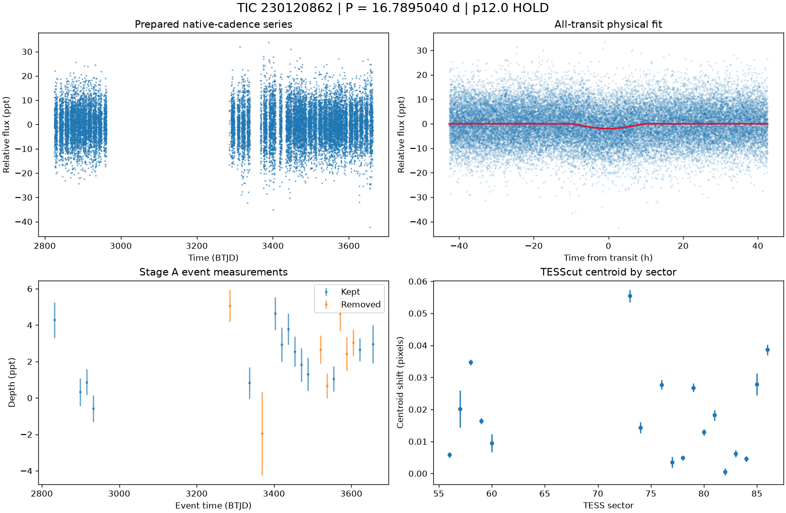

# TIC 230120862: P12 candidate review (tic230120862_P16.7959)

**HOLD** under p12.0: H1; NFPP 0.9893, FPP 0.9999999999999999

This is a candidate packet. No external submission has been made; the user decides.

| Measurement | Value |
|---|---|
| Period | 16.789504005 +/- 0.0011374177993224582 d |
| Epoch | 2459832.498212183 +/- 0.0404910602271293 BJD |
| Radius | 6.102 +/- 141.175 Earth radii |
| T14 | 21.307 +/- 28.634 h |
| Impact parameter | 1.10000 +/- 4.090714693535161 |
| Density prior / grazing | False / True |
| Transits / beta | 22 / 1.03 |
| FPP / NFPP | 0.9999999999999999 / 0.9892742935482218 |
| fpp_uniform | False |
| Centroid | Centroid shift (weighted over 18 sectors): dcol = +0.002 px, drow = -0.005 px, total = 0.006 px (0.1 arcsec), significance = 20.4 sigma; 16 of 18 sectors flagged on their own. |

ExoFOP note draft: TessHunter P12 candidate: P = 16.789504 d, T0 = 2459832.49821 BJD, depth 2008 ppm, duration 21.31 h, TESS sectors 56-86 (18), preset survey_p10, rules p12.0. Verdict HOLD; not claimed: a validated planet or a resolved source. The field's validation bar (resolved source, localised repeated dimming, low FPP) is out of reach for TESS FFI photometry alone at Tmag 13.5; this is a candidate for follow-up, not a validated planet.

The field's validation bar (resolved source, localised repeated dimming, low FPP) is out of reach for TESS FFI photometry alone at Tmag 13.5; this is a candidate for follow-up, not a validated planet.

## p12.0 verdict tiers

**HOLD** on H1

| Condition | Fired | Detail |
|---|---|---|
| K0: hard stop: the star is catalogued at this TIC (REJECT) | no | hard stop CLEAN |
| K1: Stage A fails the six criteria | no | Stage A PASS |
| K2: the secondary gate fails | no | secondary gate PASS (mode bound) |
| K3: Stage B phase-independent sector non-detection excludes the period | no | phase-independent exclusion False (14 sector(s) tested) |
| K4: Stage C fails | no | Stage C PASS (strongest): strongest peak 16.79142 d is within 1% of the survey period at SDE 16.7 |
| K5: the period is an integer alias of a deeper accepted signal or a catalogued period | no | no alias match among 9 accepted signals and 0 catalogued periods |
| K6: odd/even depth difference above 3 sigma | no | odd/even 1.61 sigma (12 odd, 12 even transits) |
| K7: pixel evidence places the dimming elsewhere or measures its absence | no | K7a in 0 sector(s) (literal whole-cutout form: 2), K7b in 0 sector(s) (9 K7a-measurable, 2 K7b-measurable) |
| K8: the physical fit implies a stellar companion | no | Rp 6.102 Re (limit 16.81); density prior delta chi2 152.87256833744686, converged True, non-grazing False, rho_fit/rho_cat 0.0 |
| K9: artefact-carried under D review (numeric criterion plus the reviewer's decision) | no | criterion holds: K9a in 15, K9b in 11 sector(s) of 15 measurable; reviewer decision not recorded |
| H1: TRICERATOPS NFPP at or above 0.5 | yes | NFPP 0.9893, FPP 0.9999999999999999 |
| H2: the all-transit fit is unconverged or on the grazing rail | yes | converged; grazing rail with b_err 4.090714693535161, T14 21.307 +/- 28.634 h |
| H3: a D measurement did not execute and can be re-run | no | every D measurement executed |
| H4: the target is a VSX EA/EB/EW/ELL with no alias match | no | 0 VSX entr(ies) within 21 arcsec, 0 eclipsing class(es) |
| H5: the K9b fixed-aperture disagreement holds in exactly one measurable sector | no | K9b disagreement in 11 of 15 measurable sector(s) |
| H6: Stage C UNRESOLVED after its one recorded retry | no | Stage C PASS |

### Flags

- **F1**: [{"source_id": 1650289751254643840, "sep_arcsec": 16.4, "sep_px": 0.78, "G": 19.7037296295166, "delta_mag": 5.01, "max_depth_ppt_total_eclipse": 9.78, "required_eclipse_fraction": 0.1329}, {"source_id": 1650289785614977152, "sep_arcsec": 17.9, "sep_px": 0.85, "G": 20.596153259277344, "delta_mag": 5.7, "max_depth_ppt_total_eclipse": 5.2, "required_eclipse_fraction": 0.2499}, {"source_id": 1650289746960524672, "sep_arcsec": 27.2, "sep_px": 1.29, "G": 19.149606704711914, "delta_mag": 4.94, "max_depth_ppt_total_eclipse": 10.49, "required_eclipse_fraction": 0.1239}, {"source_id": 1650289540802091392, "sep_arcsec": 34.3, "sep_px": 1.64, "G": 19.10416030883789, "delta_mag": 4.39, "max_depth_ppt_total_eclipse": 17.16, "required_eclipse_fraction": 0.0757}, {"source_id": 1650289785615496960, "sep_arcsec": 42.5, "sep_px": 2.03, "G": 16.595901489257812, "delta_mag": 2.0, "max_depth_ppt_total_eclipse
- **F2**: {"ruwe": 1.1714476346969604, "ipd_frac_multi_peak": 0.0, "astrometric_excess_noise_sig": 1.6241040229797363, "non_single_star": 0.0, "phot_variable_flag": "NOT_AVAILABLE", "best_class_name": "", "duplicated_source": 0.0}
- **F3**: {"vsx": [], "simbad": [{"main_id": "2MASS J16403040+7018088", "otype": "PM*", "sp_type": "", "sep_arcsec": 0.0}]}
- **F4**: {"fpp": 0.9999999999999999, "nfpp": 0.9892742935482218, "available": true, "fpp_uniform": false, "sectors": [56, 57, 58], "caveats": "binned fold; circular aperture from Tmag; first three selected sectors; probabilities are conditional on TRICERATOPS's astrophysical scenarios and do not price instrumental artefacts"}
- **F5**: {"localisation": "unlocalised", "n_sectors_measurable": 15, "per_sector": [{"sector": 56, "net_depth_ppt": -2.1461, "net_err_ppt": 0.3545, "k7_absent": null, "note": "unmeasurable: 0.5 x D_ref 0.947 < 3 sigma_s 1.063 ppt", "k7_elsewhere": false, "difference_max_dist_target_px": 0.925, "centroid_sigma": 6.48512797950468, "centroid_shift_px": 0.00579950664504469}, {"sector": 57, "centroid_sigma": 3.47376586136517, "centroid_shift_px": 0.02013424989670818}, {"sector": 58, "net_depth_ppt": -11.0971, "net_err_ppt": 0.6664, "k7_absent": null, "note": "unmeasurable: 0.5 x D_ref 0.947 < 3 sigma_s 1.999 ppt", "k7_elsewhere": null, "difference_max_dist_target_px": 2.799, "centroid_sigma": 37.15842197955217, "centroid_shift_px": 0.034685954356739164}, {"sector": 59, "net_depth_ppt": 0.0992, "net_err_ppt": 0.3, "k7_absent": false, "note": "net 0.099 +/- 0.300 ppt against 0.5 x D_ref 0.947 ppt: consi
- **F6**: [{"period_days": "2.8016656456884386", "depth_ppt": "0.9052835321845554", "snr": "10.643601715282799", "verdict": "promising planet candidate", "stitch_snr": "10.25883914621971", "passes_pregate": "True"}, {"period_days": "23.34572540994388", "depth_ppt": "3.3227897822145627", "snr": "7.174907673580557", "verdict": "ambiguous / manual vetting required", "stitch_snr": "7.174907673580557", "passes_pregate": "True"}, {"period_days": "14.02722416758758", "depth_ppt": "1.3546456604884558", "snr": "6.721415465136575", "verdict": "promising planet candidate", "stitch_snr": "6.721415465136575", "passes_pregate": "False"}, {"period_days": "13.201941405445577", "depth_ppt": "3.4347890460971926", "snr": "6.563029839522583", "verdict": "promising planet candidate", "stitch_snr": "6.563029839522583", "passes_pregate": "False"}, {"period_days": "14.711295946240261", "depth_ppt": "2.7834891617179713", 
- **F7**: {"status": "CLEAN", "tic_matches": [], "neighbour_matches": [], "tce_association": null}
- **F8**: {"n_observed": 27, "n_excluded": 13, "n_kept": 14, "removed_by_class": {"dip_absent_in_sap": 0, "pdc_gap": 1, "scattered_light_ramp": 2, "scattered_light_flag": 7, "momentum_dump": 1, "sector_orbit_edge": 1, "quality_flagged": 0, "sap_baseline_ramp": 6}, "strongest_event_removed": true}
- **F9**: 8 Gaia neighbour(s) within 63 arcsec could produce the depth by total eclipse (nearest 16.4 arcsec, G 19.7037296295166, needing an eclipse of 13% of its light). Seeing-limited ground photometry at the predicted epochs, resolving each of them, would settle the source. TESS fixed-aperture photometry is consistent with the target in 15 sector(s) but cannot separate the target from the listed neighbours. TRICERATOPS FPP 1, NFPP 0.989 on the binned fold; a low value does not price instrumental artefacts. The fit is grazing; a constrained geometry needs higher-precision photometry. Statistical validation additionally needs a resolved source, repeated localised dimming and a low FPP with the scene fixed; this candidate is submitted as a candidate, not as a validated planet.
- **F10**: {"word": "K10_FLAG", "or_variants": ["K10e", "K10s"], "or_fired": true, "K10e": {"fired": false, "measurable": true, "detail": "n_excluded / n_observed = 13/27 = 0.481 (> 0.5 fires)", "n_observed": 27, "n_excluded": 13, "fraction": 0.48148148148148145}, "K10s": {"fired": true, "measurable": true, "detail": "SAP 0.806 +/- 0.205 ppt vs corrected 1.894 +/- 0.218 ppt; SAP < 0.5x True; difference > 3 sigma True; kept events in 11 sector(s)", "det_ppt": 1.894, "det_err_ppt": 0.218, "sap_ppt": 0.806, "sap_err_ppt": 0.205, "quadrature_err_ppt": 0.2992473892952117, "kept_sectors": [56, 58, 59, 74, 77, 78, 79, 80, 82, 85, 86], "sap_below_half": true, "difference_significant": true, "kept_sectors_ge_2": true}, "deciding": false}
