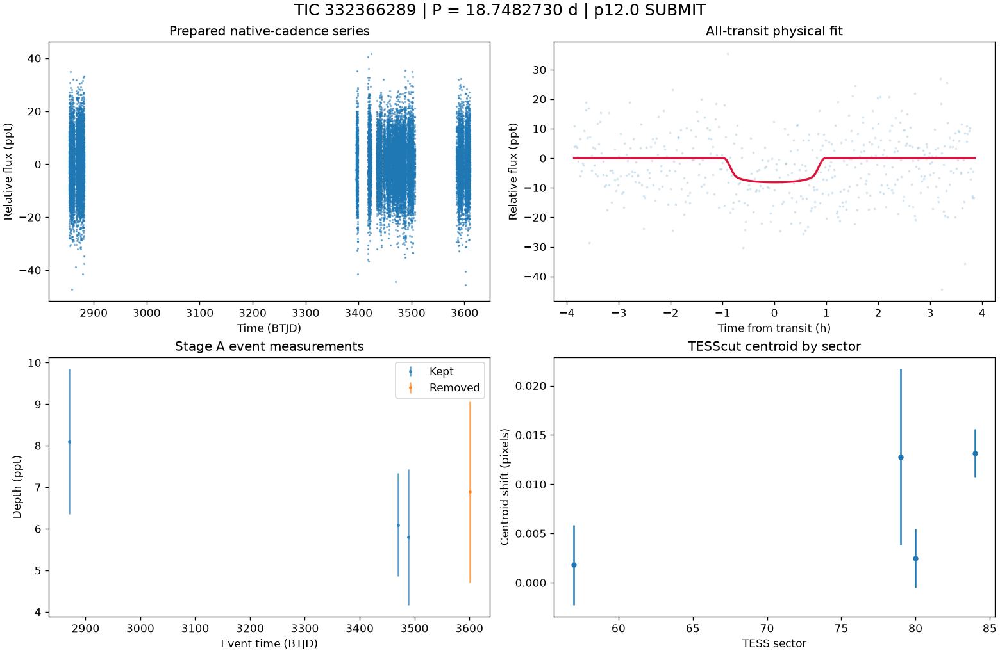

# TIC 332366289: P12 candidate review (tic332366289_P18.7481)

**SUBMIT** (candidate tier 2: pixel-supported candidate) under p12.0: no condition; every measured condition passes

This is a candidate packet. No external submission has been made; the user decides.

| Measurement | Value |
|---|---|
| Period | 18.748273038 +/- 0.00018556567112793171 d |
| Epoch | 2459869.852493756 +/- 0.0053882258523593385 BJD |
| Radius | 2.449 +/- 0.305 Earth radii |
| T14 | 1.93 +/- 0.229 h |
| Impact parameter | 0.54006 +/- 0.10564612382840273 |
| Density prior / grazing | True / False |
| Transits / beta | 4 / 1.0 |
| FPP / NFPP | 0.048611849678553254 / 0.0 |
| fpp_uniform | False |
| Centroid | Centroid shift (weighted over 4 sectors): dcol = -0.006 px, drow = -0.002 px, total = 0.006 px (0.1 arcsec), significance = 3.8 sigma; 1 of 4 sectors flagged on their own. |

ExoFOP note draft: TessHunter P12 candidate: P = 18.748273 d, T0 = 2459869.85249 BJD, depth 8152 ppm, duration 1.93 h, TESS sectors 57-84 (6), preset survey_p10, rules p12.0. Verdict SUBMIT tier 2; not claimed: a validated planet or a resolved source. The field's validation bar (resolved source, localised repeated dimming, low FPP) is out of reach for TESS FFI photometry alone at Tmag 13.5; this is a candidate for follow-up, not a validated planet.

The field's validation bar (resolved source, localised repeated dimming, low FPP) is out of reach for TESS FFI photometry alone at Tmag 13.5; this is a candidate for follow-up, not a validated planet.

## p12.0 verdict tiers

**SUBMIT** on no condition

| Condition | Fired | Detail |
|---|---|---|
| K0: hard stop: the star is catalogued at this TIC (REJECT) | no | hard stop CLEAN |
| K1: Stage A fails the six criteria | no | Stage A PASS |
| K2: the secondary gate fails | no | secondary gate PASS (mode bound) |
| K3: Stage B phase-independent sector non-detection excludes the period | no | phase-independent exclusion False (1 sector(s) tested) |
| K4: Stage C fails | no | Stage C PASS (strongest): strongest peak 18.74835 d is within 1% of the survey period at SDE 10.8 |
| K5: the period is an integer alias of a deeper accepted signal or a catalogued period | no | no alias match among 14 accepted signals and 0 catalogued periods |
| K6: odd/even depth difference above 3 sigma | no | odd/even 0.65 sigma (2 odd, 2 even transits) |
| K7: pixel evidence places the dimming elsewhere or measures its absence | not measurable | K7a in 0 sector(s) (literal whole-cutout form: 0), K7b in 0 sector(s) (0 K7a-measurable, 0 K7b-measurable) |
| K8: the physical fit implies a stellar companion | no | Rp 2.449 Re (limit 16.81); density prior delta chi2 0.5620344600642966, converged True, non-grazing True, rho_fit/rho_cat 1.688 |
| K9: artefact-carried under D review (numeric criterion plus the reviewer's decision) | no | criterion does not hold: K9a in 3, K9b in 0 sector(s) of 4 measurable; reviewer decision not recorded |
| H1: TRICERATOPS NFPP at or above 0.5 | no | NFPP 0, FPP 0.048611849678553254 |
| H2: the all-transit fit is unconverged or on the grazing rail | no | converged |
| H3: a D measurement did not execute and can be re-run | no | every D measurement executed |
| H4: the target is a VSX EA/EB/EW/ELL with no alias match | no | 0 VSX entr(ies) within 21 arcsec, 0 eclipsing class(es) |
| H5: the K9b fixed-aperture disagreement holds in exactly one measurable sector | no | K9b disagreement in 0 of 4 measurable sector(s) |
| H6: Stage C UNRESOLVED after its one recorded retry | no | Stage C PASS |

### Flags

- **F1**: [{"source_id": 1415338306971353600, "sep_arcsec": 25.7, "sep_px": 1.22, "G": 20.401439666748047, "delta_mag": 5.41, "max_depth_ppt_total_eclipse": 6.82, "required_eclipse_fraction": 0.8476}, {"source_id": 1415338337035983488, "sep_arcsec": 33.6, "sep_px": 1.6, "G": 19.719402313232422, "delta_mag": 5.1, "max_depth_ppt_total_eclipse": 9.04, "required_eclipse_fraction": 0.6394}, {"source_id": 1415338337035990528, "sep_arcsec": 39.2, "sep_px": 1.87, "G": 18.963878631591797, "delta_mag": 4.4, "max_depth_ppt_total_eclipse": 17.15, "required_eclipse_fraction": 0.3371}, {"source_id": 1415338405755460480, "sep_arcsec": 47.8, "sep_px": 2.28, "G": 18.515827178955078, "delta_mag": 4.11, "max_depth_ppt_total_eclipse": 22.13, "required_eclipse_fraction": 0.2612}]
- **F2**: {"ruwe": 1.0966936349868774, "ipd_frac_multi_peak": 0.0, "astrometric_excess_noise_sig": 2.165614604949951, "non_single_star": 0.0, "phot_variable_flag": "NOT_AVAILABLE", "best_class_name": "", "duplicated_source": 0.0}
- **F3**: {"vsx": [], "simbad": [{"main_id": "Gaia DR3 1415338513130475136", "otype": "PM*", "sp_type": "", "sep_arcsec": 0.0}]}
- **F4**: {"fpp": 0.048611849678553254, "nfpp": 0.0, "available": true, "fpp_uniform": false, "sectors": [57, 77, 78], "caveats": "binned fold; circular aperture from Tmag; first three selected sectors; probabilities are conditional on TRICERATOPS's astrophysical scenarios and do not price instrumental artefacts"}
- **F5**: {"localisation": "unlocalised", "n_sectors_measurable": 4, "per_sector": [{"sector": 57, "net_depth_ppt": 5.5572, "net_err_ppt": 2.0701, "k7_absent": null, "note": "unmeasurable: 0.5 x D_ref 3.300 < 3 sigma_s 6.210 ppt", "k7_elsewhere": null, "difference_max_dist_target_px": 0.975, "centroid_sigma": 0.45077140808824556, "centroid_shift_px": 0.0018317219282664755}, {"sector": 77, "centroid_sigma": 0.0, "centroid_shift_px": 0.0}, {"sector": 78, "centroid_sigma": 0.0, "centroid_shift_px": 0.0}, {"sector": 79, "net_depth_ppt": -0.5763, "net_err_ppt": 1.4079, "k7_absent": null, "note": "unmeasurable: 0.5 x D_ref 3.300 < 3 sigma_s 4.224 ppt", "k7_elsewhere": null, "difference_max_dist_target_px": 2.926, "centroid_sigma": 1.4305152898413886, "centroid_shift_px": 0.012776668338338446}, {"sector": 80, "net_depth_ppt": 3.772, "net_err_ppt": 1.9222, "k7_absent": null, "note": "unmeasurable: 0.5 x D
- **F6**: [{"period_days": "27.328428819835562", "depth_ppt": "5.196797474857549", "snr": "7.3656546159827965", "verdict": "ambiguous / manual vetting required", "stitch_snr": "7.099485621543694", "passes_pregate": "False"}, {"period_days": "14.571888156379137", "depth_ppt": "3.051960217171476", "snr": "7.293273191245426", "verdict": "promising planet candidate", "stitch_snr": "7.293273191245426", "passes_pregate": "True"}, {"period_days": "25.06989216440334", "depth_ppt": "4.422936730344997", "snr": "6.988720264677921", "verdict": "promising planet candidate", "stitch_snr": "6.824976743445252", "passes_pregate": "False"}, {"period_days": "17.842978675404183", "depth_ppt": "7.886194436384107", "snr": "6.689832576944206", "verdict": "promising planet candidate", "stitch_snr": "6.060898365497981", "passes_pregate": "False"}, {"period_days": "17.323271538812786", "depth_ppt": "7.33443374873535", "snr
- **F7**: {"status": "CLEAN", "tic_matches": [], "neighbour_matches": [], "tce_association": null}
- **F8**: {"n_observed": 4, "n_excluded": 1, "n_kept": 3, "removed_by_class": {"dip_absent_in_sap": 0, "pdc_gap": 1, "scattered_light_ramp": 0, "scattered_light_flag": 1, "momentum_dump": 0, "sector_orbit_edge": 0, "quality_flagged": 0, "sap_baseline_ramp": 0}, "strongest_event_removed": false}
- **F9**: 4 Gaia neighbour(s) within 63 arcsec could produce the depth by total eclipse (nearest 25.7 arcsec, G 20.401439666748047, needing an eclipse of 85% of its light). Seeing-limited ground photometry at the predicted epochs, resolving each of them, would settle the source. TESS fixed-aperture photometry is consistent with the target in 4 sector(s) but cannot separate the target from the listed neighbours. TRICERATOPS FPP 0.0486, NFPP 0 on the binned fold; a low value does not price instrumental artefacts. Statistical validation additionally needs a resolved source, repeated localised dimming and a low FPP with the scene fixed; this candidate is submitted as a candidate, not as a validated planet.
- **F10**: {"word": "K10_FLAG", "or_variants": ["K10e", "K10s"], "or_fired": false, "K10e": {"fired": false, "measurable": true, "detail": "n_excluded / n_observed = 1/4 = 0.250 (> 0.5 fires)", "n_observed": 4, "n_excluded": 1, "fraction": 0.25}, "K10s": {"fired": false, "measurable": true, "detail": "SAP 3.755 +/- 0.838 ppt vs corrected 6.500 +/- 0.859 ppt; SAP < 0.5x False; difference > 3 sigma False; kept events in 3 sector(s)", "det_ppt": 6.5, "det_err_ppt": 0.859, "sap_ppt": 3.755, "sap_err_ppt": 0.838, "quadrature_err_ppt": 1.2000520822031018, "kept_sectors": [57, 79, 80], "sap_below_half": false, "difference_significant": false, "kept_sectors_ge_2": true}, "deciding": false}
