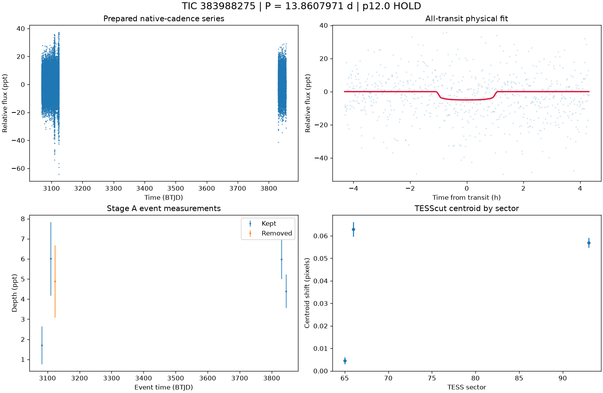

# TIC 383988275: P12 candidate review (tic383988275_P13.8609)

**HOLD** under p12.0: H1; NFPP 0.9078, FPP 0.9168758144536524

This is a candidate packet. No external submission has been made; the user decides.

| Measurement | Value |
|---|---|
| Period | 13.860797070 +/- 0.00017805644585678783 d |
| Epoch | 2460082.018438302 +/- 0.007401805105393234 BJD |
| Radius | 2.336 +/- 0.366 Earth radii |
| T14 | 2.155 +/- 0.458 h |
| Impact parameter | 0.28688 +/- 0.3801266386896367 |
| Density prior / grazing | True / False |
| Transits / beta | 5 / 1.31 |
| FPP / NFPP | 0.9168758144536524 / 0.9077875478019533 |
| fpp_uniform | False |
| Centroid | Centroid shift (weighted over 3 sectors): dcol = -0.015 px, drow = -0.019 px, total = 0.024 px (0.5 arcsec), significance = 21.2 sigma; 3 of 3 sectors flagged on their own. |

ExoFOP note draft: TessHunter P12 candidate: P = 13.860797 d, T0 = 2460082.01844 BJD, depth 5023 ppm, duration 2.15 h, TESS sectors 65-93 (3), preset survey_p10, rules p12.0. Verdict HOLD; not claimed: a validated planet or a resolved source. The field's validation bar (resolved source, localised repeated dimming, low FPP) is out of reach for TESS FFI photometry alone at Tmag 13.5; this is a candidate for follow-up, not a validated planet.

The field's validation bar (resolved source, localised repeated dimming, low FPP) is out of reach for TESS FFI photometry alone at Tmag 13.5; this is a candidate for follow-up, not a validated planet.

## p12.0 verdict tiers

**HOLD** on H1

| Condition | Fired | Detail |
|---|---|---|
| K0: hard stop: the star is catalogued at this TIC (REJECT) | no | hard stop CLEAN |
| K1: Stage A fails the six criteria | no | Stage A PASS |
| K2: the secondary gate fails | no | secondary gate PASS (mode bound) |
| K3: Stage B phase-independent sector non-detection excludes the period | no | phase-independent exclusion False (3 sector(s) tested) |
| K4: Stage C fails | no | Stage C PASS (strongest): strongest peak 13.86073 d is within 1% of the survey period at SDE 12.6 |
| K5: the period is an integer alias of a deeper accepted signal or a catalogued period | no | no alias match among 11 accepted signals and 0 catalogued periods |
| K6: odd/even depth difference above 3 sigma | no | odd/even 1.20 sigma (3 odd, 3 even transits) |
| K7: pixel evidence places the dimming elsewhere or measures its absence | no | K7a in 0 sector(s) (literal whole-cutout form: 1), K7b in 0 sector(s) (3 K7a-measurable, 0 K7b-measurable) |
| K8: the physical fit implies a stellar companion | no | Rp 2.336 Re (limit 16.81); density prior delta chi2 -0.07170003619694398, converged True, non-grazing True, rho_fit/rho_cat 0.776 |
| K9: artefact-carried under D review (numeric criterion plus the reviewer's decision) | not measurable | criterion does not hold: K9a in 1, K9b in 0 sector(s) of 1 measurable; reviewer decision not recorded |
| H1: TRICERATOPS NFPP at or above 0.5 | yes | NFPP 0.9078, FPP 0.9168758144536524 |
| H2: the all-transit fit is unconverged or on the grazing rail | no | converged |
| H3: a D measurement did not execute and can be re-run | no | every D measurement executed |
| H4: the target is a VSX EA/EB/EW/ELL with no alias match | no | 0 VSX entr(ies) within 21 arcsec, 0 eclipsing class(es) |
| H5: the K9b fixed-aperture disagreement holds in exactly one measurable sector | no | K9b disagreement in 0 of 1 measurable sector(s) |
| H6: Stage C UNRESOLVED after its one recorded retry | no | Stage C PASS |

### Flags

- **F1**: [{"source_id": 5769049210710770816, "sep_arcsec": 9.0, "sep_px": 0.43, "G": 20.376319885253906, "delta_mag": 6.08, "max_depth_ppt_total_eclipse": 3.69, "required_eclipse_fraction": 0.9283}, {"source_id": 5769049240774466176, "sep_arcsec": 16.3, "sep_px": 0.78, "G": 19.441442489624023, "delta_mag": 5.62, "max_depth_ppt_total_eclipse": 5.63, "required_eclipse_fraction": 0.6084}, {"source_id": 5769049412573159168, "sep_arcsec": 22.6, "sep_px": 1.08, "G": 18.59516716003418, "delta_mag": 4.77, "max_depth_ppt_total_eclipse": 12.24, "required_eclipse_fraction": 0.2799}, {"source_id": 5769049206414720768, "sep_arcsec": 26.3, "sep_px": 1.25, "G": 20.08942222595215, "delta_mag": 5.74, "max_depth_ppt_total_eclipse": 5.05, "required_eclipse_fraction": 0.6783}, {"source_id": 5769049412573526528, "sep_arcsec": 26.8, "sep_px": 1.27, "G": 16.643630981445312, "delta_mag": 2.66, "max_depth_ppt_total_eclip
- **F2**: {"ruwe": 1.101607322692871, "ipd_frac_multi_peak": 0.0, "astrometric_excess_noise_sig": 1.1673765182495117, "non_single_star": 0.0, "phot_variable_flag": "NOT_AVAILABLE", "best_class_name": "", "duplicated_source": 0.0}
- **F3**: {"vsx": [], "simbad": [{"main_id": "UPM J1557-8159", "otype": "PM*", "sp_type": "", "sep_arcsec": 0.0}]}
- **F4**: {"fpp": 0.9168758144536524, "nfpp": 0.9077875478019533, "available": true, "fpp_uniform": false, "sectors": [65, 66, 93], "caveats": "binned fold; circular aperture from Tmag; first three selected sectors; probabilities are conditional on TRICERATOPS's astrophysical scenarios and do not price instrumental artefacts"}
- **F5**: {"localisation": "unlocalised", "n_sectors_measurable": 1, "per_sector": [{"sector": 65, "net_depth_ppt": 0.4197, "net_err_ppt": 1.1613, "k7_absent": null, "note": "unmeasurable: 0.5 x D_ref 2.136 < 3 sigma_s 3.484 ppt", "k7_elsewhere": false, "difference_max_dist_target_px": 0.884, "centroid_sigma": 3.082842406846084, "centroid_shift_px": 0.004564608858436327}, {"sector": 66, "net_depth_ppt": null, "net_err_ppt": null, "k7_absent": null, "note": "unmeasurable: sector unmeasurable: Insufficient aperture or background pixels", "k7_elsewhere": false, "difference_max_dist_target_px": 1.904, "centroid_sigma": 19.584736849276638, "centroid_shift_px": 0.06291886404499589}, {"sector": 93, "net_depth_ppt": null, "net_err_ppt": null, "k7_absent": null, "note": "unmeasurable: sector unmeasurable: Insufficient aperture or background pixels", "k7_elsewhere": false, "difference_max_dist_target_px": 2
- **F6**: [{"period_days": "12.188526270881752", "depth_ppt": "11.258580111909723", "snr": "8.132900603338822", "verdict": "promising planet candidate", "stitch_snr": "6.6176794997675685", "passes_pregate": "False"}, {"period_days": "24.31513279195187", "depth_ppt": "6.988712410794843", "snr": "7.865441953003305", "verdict": "promising planet candidate", "stitch_snr": "7.414221700993808", "passes_pregate": "True"}, {"period_days": "14.166342394899171", "depth_ppt": "9.936971263417275", "snr": "7.468045511447029", "verdict": "promising planet candidate", "stitch_snr": "7.291811547780892", "passes_pregate": "False"}, {"period_days": "13.33172643527624", "depth_ppt": "4.660750840835112", "snr": "7.159598013793393", "verdict": "promising planet candidate", "stitch_snr": "7.159598013793393", "passes_pregate": "True"}, {"period_days": "26.51063087477042", "depth_ppt": "17.049014200989596", "snr": "7.074
- **F7**: {"status": "CLEAN", "tic_matches": [], "neighbour_matches": [], "tce_association": null}
- **F8**: {"n_observed": 6, "n_excluded": 2, "n_kept": 4, "removed_by_class": {"dip_absent_in_sap": 0, "pdc_gap": 0, "scattered_light_ramp": 0, "scattered_light_flag": 0, "momentum_dump": 0, "sector_orbit_edge": 0, "quality_flagged": 1, "sap_baseline_ramp": 2}, "strongest_event_removed": false}
- **F9**: 25 Gaia neighbour(s) within 63 arcsec could produce the depth by total eclipse (nearest 9.0 arcsec, G 20.376319885253906, needing an eclipse of 93% of its light). Seeing-limited ground photometry at the predicted epochs, resolving each of them, would settle the source. TESS fixed-aperture photometry is consistent with the target in 1 sector(s) but cannot separate the target from the listed neighbours. TRICERATOPS FPP 0.917, NFPP 0.908 on the binned fold; a low value does not price instrumental artefacts. Statistical validation additionally needs a resolved source, repeated localised dimming and a low FPP with the scene fixed; this candidate is submitted as a candidate, not as a validated planet.
- **F10**: {"word": "K10_FLAG", "or_variants": ["K10e", "K10s"], "or_fired": false, "K10e": {"fired": false, "measurable": true, "detail": "n_excluded / n_observed = 2/6 = 0.333 (> 0.5 fires)", "n_observed": 6, "n_excluded": 2, "fraction": 0.3333333333333333}, "K10s": {"fired": false, "measurable": true, "detail": "SAP 5.317 +/- 0.504 ppt vs corrected 4.165 +/- 0.506 ppt; SAP < 0.5x False; difference > 3 sigma False; kept events in 3 sector(s)", "det_ppt": 4.165, "det_err_ppt": 0.506, "sap_ppt": 5.317, "sap_err_ppt": 0.504, "quadrature_err_ppt": 0.7141792492084882, "kept_sectors": [65, 66, 93], "sap_below_half": false, "difference_significant": false, "kept_sectors_ge_2": true}, "deciding": false}
