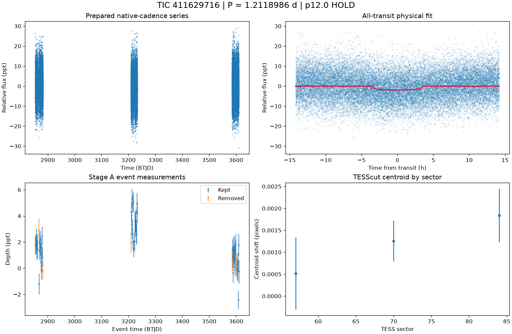

# TIC 411629716: P12 candidate review (tic411629716_P1.2184)

**HOLD** under p12.0: H2; singular fit covariance: parameter uncertainties are unavailable

This is a candidate packet. No external submission has been made; the user decides.

| Measurement | Value |
|---|---|
| Period | 1.211898613 +/- None d |
| Epoch | 2459853.933386937 +/- None BJD |
| Radius | 1.186 +/- None Earth radii |
| T14 | 7.094 +/- None h |
| Impact parameter | 0.00000 +/- None |
| Density prior / grazing | False / False |
| Transits / beta | 60 / 1.5 |
| FPP / NFPP | 0.9999999999999992 / 0.0023537980546466833 |
| fpp_uniform | False |
| Centroid | Centroid shift (weighted over 3 sectors): dcol = +0.000 px, drow = -0.001 px, total = 0.001 px (0.0 arcsec), significance = 1.8 sigma; 1 of 3 sectors flagged on their own. |

ExoFOP note draft: TessHunter P12 candidate: P = 1.211899 d, T0 = 2459853.93339 BJD, depth 1886 ppm, duration 7.09 h, TESS sectors 57-84 (3), preset survey_p10, rules p12.0. Verdict HOLD; not claimed: a validated planet or a resolved source. The field's validation bar (resolved source, localised repeated dimming, low FPP) is out of reach for TESS FFI photometry alone at Tmag 13.5; this is a candidate for follow-up, not a validated planet.

The field's validation bar (resolved source, localised repeated dimming, low FPP) is out of reach for TESS FFI photometry alone at Tmag 13.5; this is a candidate for follow-up, not a validated planet.

## p12.0 verdict tiers

**HOLD** on H2

| Condition | Fired | Detail |
|---|---|---|
| K0: hard stop: the star is catalogued at this TIC (REJECT) | no | hard stop FLAG |
| K1: Stage A fails the six criteria | no | Stage A PASS |
| K2: the secondary gate fails | no | secondary gate PASS (mode bound) |
| K3: Stage B phase-independent sector non-detection excludes the period | no | phase-independent exclusion False (3 sector(s) tested) |
| K4: Stage C fails | no | Stage C PASS (strongest): strongest peak 1.21185 d is within 1% of the survey period at SDE 11.3 |
| K5: the period is an integer alias of a deeper accepted signal or a catalogued period | no | no alias match among 10 accepted signals and 0 catalogued periods |
| K6: odd/even depth difference above 3 sigma | no | odd/even 0.48 sigma (33 odd, 32 even transits) |
| K7: pixel evidence places the dimming elsewhere or measures its absence | no | K7a in 0 sector(s) (literal whole-cutout form: 0), K7b in 0 sector(s) (3 K7a-measurable, 1 K7b-measurable) |
| K8: the physical fit implies a stellar companion | no | Rp 1.186 Re (limit 16.81); density prior delta chi2 133.2746273814264, converged False, non-grazing True, rho_fit/rho_cat 0.002 |
| K9: artefact-carried under D review (numeric criterion plus the reviewer's decision) | no | criterion holds: K9a in 3, K9b in 3 sector(s) of 3 measurable; reviewer decision not recorded |
| H1: TRICERATOPS NFPP at or above 0.5 | no | NFPP 0.002354, FPP 0.9999999999999992 |
| H2: the all-transit fit is unconverged or on the grazing rail | yes | singular fit covariance: parameter uncertainties are unavailable |
| H3: a D measurement did not execute and can be re-run | no | every D measurement executed |
| H4: the target is a VSX EA/EB/EW/ELL with no alias match | no | 0 VSX entr(ies) within 21 arcsec, 0 eclipsing class(es) |
| H5: the K9b fixed-aperture disagreement holds in exactly one measurable sector | no | K9b disagreement in 3 of 3 measurable sector(s) |
| H6: Stage C UNRESOLVED after its one recorded retry | no | Stage C PASS |

### Flags

- **F1**: [{"source_id": 2786376903913441792, "sep_arcsec": 43.0, "sep_px": 2.05, "G": 20.84752082824707, "delta_mag": 6.38, "max_depth_ppt_total_eclipse": 2.8, "required_eclipse_fraction": 0.7269}, {"source_id": 2786376903912143488, "sep_arcsec": 47.0, "sep_px": 2.24, "G": 19.582475662231445, "delta_mag": 5.47, "max_depth_ppt_total_eclipse": 6.46, "required_eclipse_fraction": 0.3151}, {"source_id": 2786376903912143744, "sep_arcsec": 47.2, "sep_px": 2.25, "G": 19.730438232421875, "delta_mag": 5.75, "max_depth_ppt_total_eclipse": 5.0, "required_eclipse_fraction": 0.4071}, {"source_id": 2786376113638137472, "sep_arcsec": 52.6, "sep_px": 2.51, "G": 19.766550064086914, "delta_mag": 5.48, "max_depth_ppt_total_eclipse": 6.4, "required_eclipse_fraction": 0.318}]
- **F2**: {"ruwe": 1.1376159191131592, "ipd_frac_multi_peak": 0.0, "astrometric_excess_noise_sig": 2.4209280014038086, "non_single_star": 0.0, "phot_variable_flag": "NOT_AVAILABLE", "best_class_name": "", "duplicated_source": 0.0}
- **F3**: {"vsx": [], "simbad": [{"main_id": "LSPM J0122+1926", "otype": "PM*", "sp_type": "", "sep_arcsec": 0.0}]}
- **F4**: {"fpp": 0.9999999999999992, "nfpp": 0.0023537980546466833, "available": true, "fpp_uniform": false, "sectors": [57, 70, 84], "caveats": "binned fold; circular aperture from Tmag; first three selected sectors; probabilities are conditional on TRICERATOPS's astrophysical scenarios and do not price instrumental artefacts"}
- **F5**: {"localisation": "unlocalised", "n_sectors_measurable": 3, "per_sector": [{"sector": 57, "net_depth_ppt": 4.3555, "net_err_ppt": 0.204, "k7_absent": false, "note": "net 4.355 +/- 0.204 ppt against 0.5 x D_ref 0.909 ppt: consistent with the diluted depth", "k7_elsewhere": false, "difference_max_dist_target_px": 0.474, "centroid_sigma": 0.6323255340926978, "centroid_shift_px": 0.0005184516579674057}, {"sector": 70, "net_depth_ppt": 9.6743, "net_err_ppt": 0.3559, "k7_absent": null, "note": "unmeasurable: 0.5 x D_ref 0.909 < 3 sigma_s 1.068 ppt", "k7_elsewhere": false, "difference_max_dist_target_px": 0.484, "centroid_sigma": 2.7153537732550994, "centroid_shift_px": 0.0012542668216625422}, {"sector": 84, "net_depth_ppt": 3.4977, "net_err_ppt": 0.309, "k7_absent": null, "note": "unmeasurable: 0.5 x D_ref 0.909 < 3 sigma_s 0.927 ppt", "k7_elsewhere": false, "difference_max_dist_target_px": 0.8
- **F6**: [{"period_days": "14.680985578769558", "depth_ppt": "2.720702784448964", "snr": "8.603764462019083", "verdict": "promising planet candidate", "stitch_snr": "8.603764462019083", "passes_pregate": "True"}, {"period_days": "12.118616054946104", "depth_ppt": "2.7533138852563623", "snr": "8.52541351413344", "verdict": "promising planet candidate", "stitch_snr": "8.52541351413344", "passes_pregate": "True"}, {"period_days": "9.695945814401998", "depth_ppt": "10.424172088663108", "snr": "7.660040532388604", "verdict": "ambiguous / manual vetting required", "stitch_snr": "9.566261848206004", "passes_pregate": "True"}, {"period_days": "6.108784369717863", "depth_ppt": "3.1363948467841394", "snr": "7.070937951719954", "verdict": "promising planet candidate", "stitch_snr": "10.037525091106605", "passes_pregate": "True"}, {"period_days": "18.76699549521496", "depth_ppt": "3.3014247142563407", "snr":
- **F7**: {"status": "FLAG", "tic_matches": [{"source": "spoc_tce", "label": "TCE s0043-s0043 pn1", "detail": "P=16.7553d SNR=12.2", "ephemerides": []}], "neighbour_matches": [], "tce_association": null}
- **F8**: {"n_observed": 63, "n_excluded": 10, "n_kept": 53, "removed_by_class": {"dip_absent_in_sap": 0, "pdc_gap": 2, "scattered_light_ramp": 3, "scattered_light_flag": 4, "momentum_dump": 2, "sector_orbit_edge": 1, "quality_flagged": 0, "sap_baseline_ramp": 6}, "strongest_event_removed": false}
- **F9**: 4 Gaia neighbour(s) within 63 arcsec could produce the depth by total eclipse (nearest 43.0 arcsec, G 20.84752082824707, needing an eclipse of 73% of its light). Seeing-limited ground photometry at the predicted epochs, resolving each of them, would settle the source. TESS fixed-aperture photometry is consistent with the target in 3 sector(s) but cannot separate the target from the listed neighbours. TRICERATOPS FPP 1, NFPP 0.00235 on the binned fold; a low value does not price instrumental artefacts. Statistical validation additionally needs a resolved source, repeated localised dimming and a low FPP with the scene fixed; this candidate is submitted as a candidate, not as a validated planet.
- **F10**: {"word": "K10_FLAG", "or_variants": ["K10e", "K10s"], "or_fired": false, "K10e": {"fired": false, "measurable": true, "detail": "n_excluded / n_observed = 10/63 = 0.159 (> 0.5 fires)", "n_observed": 63, "n_excluded": 10, "fraction": 0.15873015873015872}, "K10s": {"fired": false, "measurable": true, "detail": "SAP 1.437 +/- 0.101 ppt vs corrected 1.819 +/- 0.105 ppt; SAP < 0.5x False; difference > 3 sigma False; kept events in 3 sector(s)", "det_ppt": 1.819, "det_err_ppt": 0.105, "sap_ppt": 1.437, "sap_err_ppt": 0.101, "quadrature_err_ppt": 0.14569145479402695, "kept_sectors": [57, 70, 84], "sap_below_half": false, "difference_significant": false, "kept_sectors_ge_2": true}, "deciding": false}
