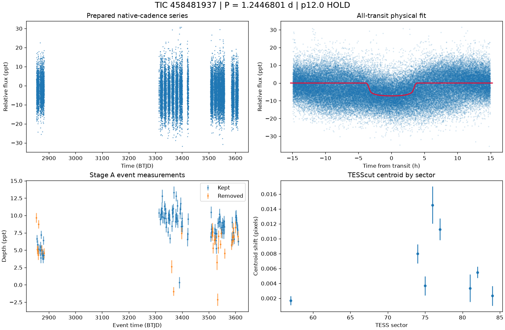

# TIC 458481937: P12 candidate review (tic458481937_P1.2423)

**HOLD** under p12.0: H2; singular fit covariance: parameter uncertainties are unavailable

This is a candidate packet. No external submission has been made; the user decides.

| Measurement | Value |
|---|---|
| Period | 1.244680086 +/- None d |
| Epoch | 2459853.624929064 +/- None BJD |
| Radius | 2.176 +/- None Earth radii |
| T14 | 7.632 +/- None h |
| Impact parameter | 0.00000 +/- None |
| Density prior / grazing | False / False |
| Transits / beta | 124 / 3.32 |
| FPP / NFPP | 1.0 / 2.294683275510687e-10 |
| fpp_uniform | False |
| Centroid | Centroid shift (weighted over 8 sectors): dcol = -0.001 px, drow = -0.001 px, total = 0.002 px (0.0 arcsec), significance = 4.3 sigma; 4 of 8 sectors flagged on their own. |

ExoFOP note draft: TessHunter P12 candidate: P = 1.244680 d, T0 = 2459853.62493 BJD, depth 7236 ppm, duration 7.63 h, TESS sectors 57-84 (8), preset survey_p10, rules p12.0. Verdict HOLD; not claimed: a validated planet or a resolved source. The field's validation bar (resolved source, localised repeated dimming, low FPP) is out of reach for TESS FFI photometry alone at Tmag 13.5; this is a candidate for follow-up, not a validated planet.

The field's validation bar (resolved source, localised repeated dimming, low FPP) is out of reach for TESS FFI photometry alone at Tmag 13.5; this is a candidate for follow-up, not a validated planet.

## p12.0 verdict tiers

**HOLD** on H2

| Condition | Fired | Detail |
|---|---|---|
| K0: hard stop: the star is catalogued at this TIC (REJECT) | no | hard stop FLAG |
| K1: Stage A fails the six criteria | no | Stage A PASS |
| K2: the secondary gate fails | no | secondary gate PASS (mode bound) |
| K3: Stage B phase-independent sector non-detection excludes the period | no | phase-independent exclusion False (8 sector(s) tested) |
| K4: Stage C fails | no | Stage C PASS (strongest): strongest peak 1.24463 d is within 1% of the survey period at SDE 17.6 |
| K5: the period is an integer alias of a deeper accepted signal or a catalogued period | no | no alias match among 2 accepted signals and 0 catalogued periods |
| K6: odd/even depth difference above 3 sigma | no | odd/even 0.88 sigma (72 odd, 71 even transits) |
| K7: pixel evidence places the dimming elsewhere or measures its absence | not measurable | K7a in 0 sector(s) (literal whole-cutout form: 0), K7b in 0 sector(s) (0 K7a-measurable, 0 K7b-measurable) |
| K8: the physical fit implies a stellar companion | no | Rp 2.176 Re (limit 16.81); density prior delta chi2 895.6610747427058, converged False, non-grazing True, rho_fit/rho_cat 0.002 |
| K9: artefact-carried under D review (numeric criterion plus the reviewer's decision) | not measurable | criterion does not hold: K9a in 0, K9b in 0 sector(s) of 0 measurable; reviewer decision not recorded |
| H1: TRICERATOPS NFPP at or above 0.5 | no | NFPP 2.295e-10, FPP 1.0 |
| H2: the all-transit fit is unconverged or on the grazing rail | yes | singular fit covariance: parameter uncertainties are unavailable |
| H3: a D measurement did not execute and can be re-run | no | every D measurement executed |
| H4: the target is a VSX EA/EB/EW/ELL with no alias match | no | 0 VSX entr(ies) within 21 arcsec, 0 eclipsing class(es) |
| H5: the K9b fixed-aperture disagreement holds in exactly one measurable sector | not measurable | no K9b-measurable sector |
| H6: Stage C UNRESOLVED after its one recorded retry | no | Stage C PASS |

### Flags

- **F1**: [{"source_id": 1641497884481832192, "sep_arcsec": 26.1, "sep_px": 1.24, "G": 17.603282928466797, "delta_mag": 3.61, "max_depth_ppt_total_eclipse": 34.63, "required_eclipse_fraction": 0.1393}, {"source_id": 1641497781402616704, "sep_arcsec": 36.5, "sep_px": 1.74, "G": 17.395214080810547, "delta_mag": 3.79, "max_depth_ppt_total_eclipse": 29.65, "required_eclipse_fraction": 0.1628}, {"source_id": 1641497953201309184, "sep_arcsec": 51.9, "sep_px": 2.47, "G": 15.10657787322998, "delta_mag": 1.44, "max_depth_ppt_total_eclipse": 210.02, "required_eclipse_fraction": 0.023}, {"source_id": 1641497777106853248, "sep_arcsec": 54.8, "sep_px": 2.61, "G": 20.03912353515625, "delta_mag": 5.66, "max_depth_ppt_total_eclipse": 5.42, "required_eclipse_fraction": 0.8903}, {"source_id": 1641497884481832960, "sep_arcsec": 57.4, "sep_px": 2.73, "G": 15.668553352355957, "delta_mag": 1.91, "max_depth_ppt_total_ec
- **F2**: {"ruwe": 1.1351463794708252, "ipd_frac_multi_peak": 1.0, "astrometric_excess_noise_sig": 0.5250383019447327, "non_single_star": 0.0, "phot_variable_flag": "NOT_AVAILABLE", "best_class_name": "", "duplicated_source": 0.0}
- **F3**: {"vsx": [], "simbad": [{"main_id": "LP   68-215", "otype": "PM*", "sp_type": "", "sep_arcsec": 0.0}]}
- **F4**: {"fpp": 1.0, "nfpp": 2.294683275510687e-10, "available": true, "fpp_uniform": false, "sectors": [57, 74, 75], "caveats": "binned fold; circular aperture from Tmag; first three selected sectors; probabilities are conditional on TRICERATOPS's astrophysical scenarios and do not price instrumental artefacts"}
- **F5**: {"localisation": "not_measurable", "n_sectors_measurable": 0, "per_sector": [{"sector": 57, "centroid_sigma": 2.8058867653049355, "centroid_shift_px": 0.0016860670130238245}, {"sector": 74, "centroid_sigma": 6.248645976071809, "centroid_shift_px": 0.007978491143804646}, {"sector": 75, "centroid_sigma": 2.872780721069058, "centroid_shift_px": 0.003686683354331577}, {"sector": 76, "centroid_sigma": 5.810258840422935, "centroid_shift_px": 0.01452507280551985}, {"sector": 77, "centroid_sigma": 7.714294654244161, "centroid_shift_px": 0.011259594948861319}, {"sector": 81, "centroid_sigma": 1.8072570203896, "centroid_shift_px": 0.0033598313446027363}, {"sector": 82, "centroid_sigma": 7.424035612878101, "centroid_shift_px": 0.005496312893290012}, {"sector": 84, "centroid_sigma": 1.768218250536067, "centroid_shift_px": 0.00234138168709501}]}
- **F6**: [{"period_days": "11.178899517267261", "depth_ppt": "4.204438474555811", "snr": "24.29448912749092", "verdict": "promising planet candidate", "stitch_snr": "24.29448912749092", "passes_pregate": "True"}]
- **F7**: {"status": "FLAG", "tic_matches": [{"source": "spoc_tce", "label": "TCE s0014-s0019 pn1", "detail": "P=1.24183d SNR=8.6", "ephemerides": []}, {"source": "spoc_tce", "label": "TCE s0014-s0019 pn2", "detail": "P=1.24166d SNR=-1.0", "ephemerides": []}, {"source": "spoc_tce", "label": "TCE s0014-s0023 pn1", "detail": "P=1.24194d SNR=10.4", "ephemerides": []}, {"source": "spoc_tce", "label": "TCE s0014-s0023 pn2", "detail": "P=1.24192d SNR=14.5", "ephemerides": []}, {"source": "spoc_tce", "label": "TCE s0014-s0026 pn1", "detail": "P=1.24215d SNR=10.6", "ephemerides": []}, {"source": "spoc_tce", "label": "TCE s0014-s0026 pn2", "detail": "P=1.24225d SNR=16.4", "ephemerides": []}, {"source": "spoc_tce", "label": "TCE s0014-s0041 pn1", "detail": "P=1.24201d SNR=12.0", "ephemerides": []}, {"source": "spoc_tce", "label": "TCE s0014-s0050 pn1", "detail": "P=1.24202d SNR=9.1", "ephemerides": []}, {"s
- **F8**: {"n_observed": 158, "n_excluded": 61, "n_kept": 93, "removed_by_class": {"dip_absent_in_sap": 22, "pdc_gap": 3, "scattered_light_ramp": 14, "scattered_light_flag": 29, "momentum_dump": 6, "sector_orbit_edge": 5, "quality_flagged": 1, "sap_baseline_ramp": 4}, "strongest_event_removed": false}
- **F9**: 6 Gaia neighbour(s) within 63 arcsec could produce the depth by total eclipse (nearest 26.1 arcsec, G 17.603282928466797, needing an eclipse of 14% of its light). Seeing-limited ground photometry at the predicted epochs, resolving each of them, would settle the source. TESS pixel evidence is not measurable for this candidate (no usable fixed-aperture sector); the localisation rests entirely on external photometry. TRICERATOPS FPP 1, NFPP 2.29e-10 on the binned fold; a low value does not price instrumental artefacts. Statistical validation additionally needs a resolved source, repeated localised dimming and a low FPP with the scene fixed; this candidate is submitted as a candidate, not as a validated planet.
- **F10**: {"word": "K10_FLAG", "or_variants": ["K10e", "K10s"], "or_fired": true, "K10e": {"fired": false, "measurable": true, "detail": "n_excluded / n_observed = 61/158 = 0.386 (> 0.5 fires)", "n_observed": 158, "n_excluded": 61, "fraction": 0.3860759493670886}, "K10s": {"fired": true, "measurable": true, "detail": "SAP 3.936 +/- 0.061 ppt vs corrected 8.236 +/- 0.079 ppt; SAP < 0.5x True; difference > 3 sigma True; kept events in 8 sector(s)", "det_ppt": 8.236, "det_err_ppt": 0.079, "sap_ppt": 3.936, "sap_err_ppt": 0.061, "quadrature_err_ppt": 0.09980981915623333, "kept_sectors": [57, 74, 75, 76, 77, 81, 82, 84], "sap_below_half": true, "difference_significant": true, "kept_sectors_ge_2": true}, "deciding": false}
