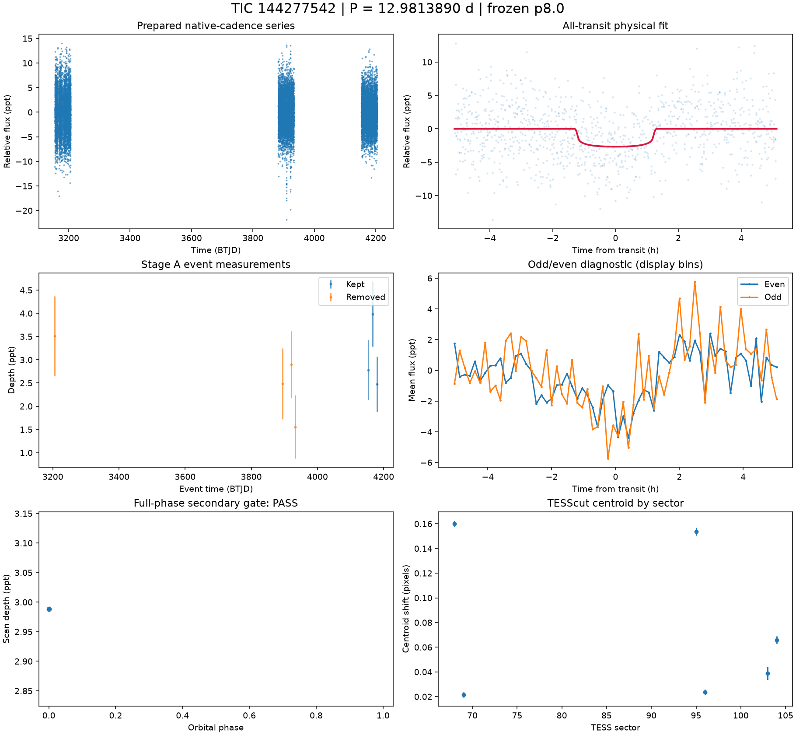
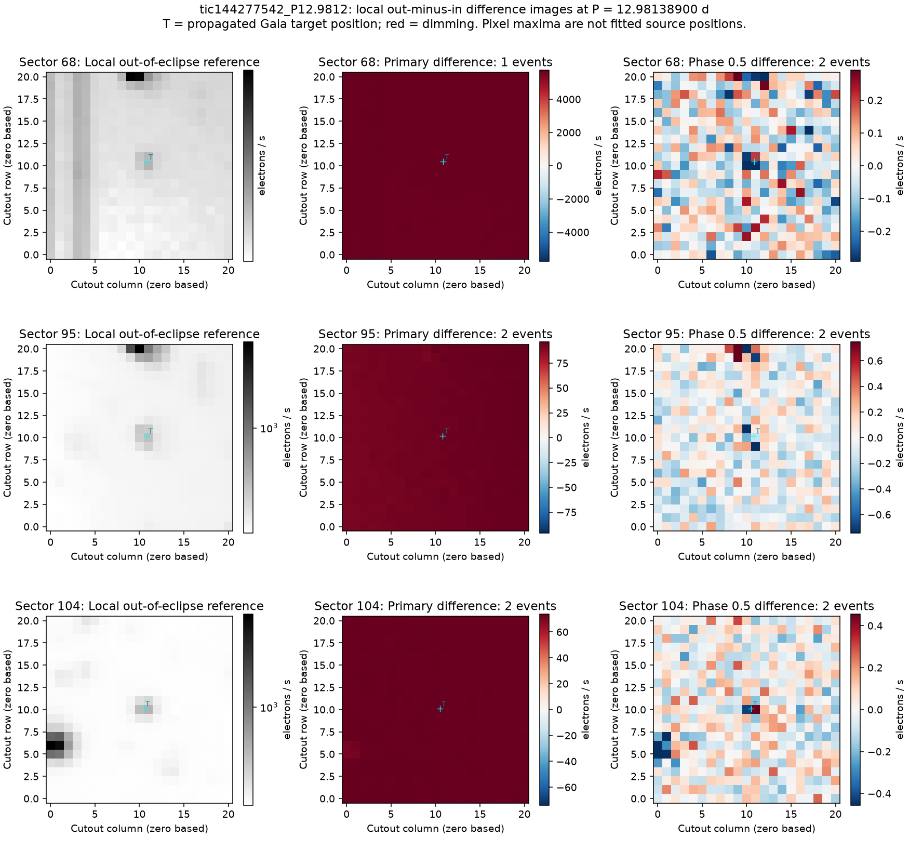
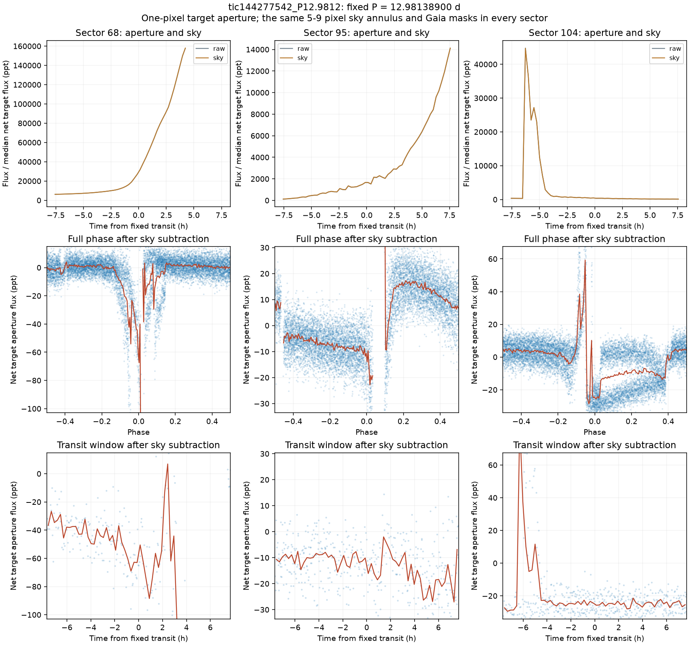

# TIC 144277542 — P8 candidate review

**KILL** (final): Background/correction artifact. Diffuse event difference images and raw-aperture changes tracking the sky do not reproduce the fitted shallow target dip: the fixed sky-subtracted depths in sectors 95 and 104 are 0.584 +/- 1.353 and -0.481 +/- 0.720 ppt, while sector 68 has a broad unstable 33.178 +/- 4.424-ppt change [M].

This is a candidate audit. No external submission has been made.

V2 rank 5; score 1.2253. Rank does not determine the verdict.

| Measurement | Value |
|---|---|
| Period | 12.981388999 ± 0.00012624287275869294 d |
| Epoch | 2460167.287570139 ± 0.008577592364062256 BJD |
| Radius | 2.253 ± 0.26 Earth radii |
| T14 | 2.563 ± 2.574 h |
| Impact parameter | 0.00002 ± 2362.0151252802166 |
| Density prior / grazing | True / False |
| Transits / beta | 7 / 1.14 |
| FPP / NFPP | 0.04720982470459667 / 0.0 |
| fpp_uniform | False |
| Centroid | Centroid shift (weighted over 6 sectors): dcol = +0.060 px, drow = +0.004 px, total = 0.061 px (1.3 arcsec), significance = 55.3 sigma; 6 of 6 sectors flagged on their own. |

Gaia: Gaia: 1 sources within 1 arcmin; target RUWE 1.2617647647857666, var flag VARIABLE, NSS 0.0, dup 0.0, ipd_multi_peak 0.0, class SOLAR_LIKE; 0 neighbour(s) within 3 px bright enough to make the depth; SIMBAD 0 (); VSX 1

Cached P8 target and resolved-neighbour assessment. TRICERATOPS also uses its TIC scene and separately cached wider Gaia field-star population; the P8 cone is not that population.

FPP: TRICERATOPS 1.1.0: FPP 0.0472, NFPP 0.0000 over 15 scenarios and 34 TIC stars within 10 px; aperture circular_from_tmag; 100000 draws; fold binned (150 points, error 1249 ppm); sectors [68, 69, 95].

[Form fields](ctoi_fields.json), [physical fit](fit.json), [pixel and FPP record](expensive.json), [cached neighbours](neighbours.json). Stage A, secondary, B, C and D records are alongside these files.

Completeness and population assumptions: [P8 completeness](../../../COMPLETENESS_P8.md) and [population](../../../POPULATION_P8.md). The calibration ends after A and the secondary gate; no calibrated B/C/D efficiency is claimed.

## Pixel follow-up

Pixel review supports KILL as a background/correction artifact. Primary-event difference images show diffuse changes across the cutout instead of a stable stellar point source. The sky-subtracted target aperture does not reproduce the fitted 2.672-ppt maximum dip in sectors 95 and 104: fixed-ephemeris box depths are 0.584 +/- 1.353 and -0.481 +/- 0.720 ppt [M]. Sector 68 has a broad, unstable 33.178 +/- 4.424-ppt change alongside a very large sky variation [M], inconsistent with the fitted shallow transit. Raw aperture variations closely follow the sky. This is an instrumental rejection, not a source-localized EB classification.

To reconsider: independent photometry must show repeated dimming localized to a stellar source while the background remains stable. These box errors use local point scatter and are not a formal exclusion probability including correlated noise.

[Measurements and provenance](pixel_followup.json).

Primary and phase-0.5 difference images at the accepted physical-fit ephemeris; Gaia positions are propagated to the sector epoch.

Fixed target aperture and sky variations, full phase and transit windows after sky subtraction. All sectors use the same aperture and background geometry. The Gaia mask uses a 300-arcsec cone covering the target aperture and background annulus.
