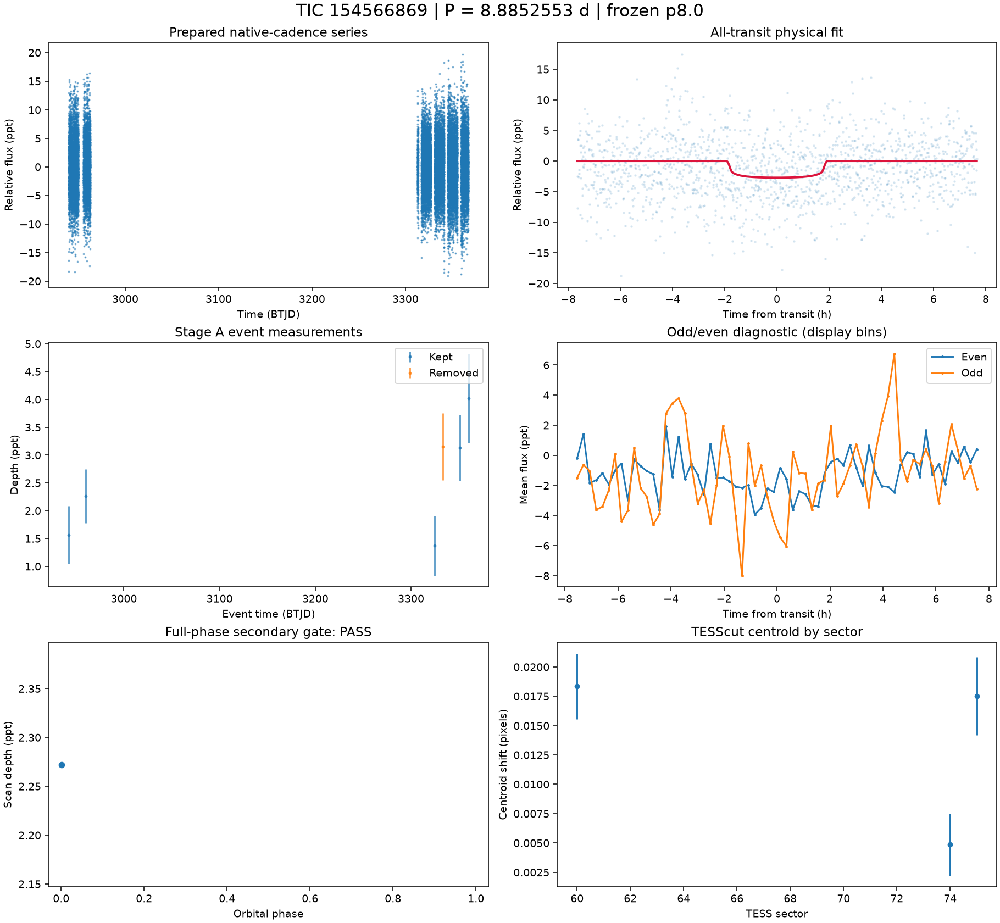
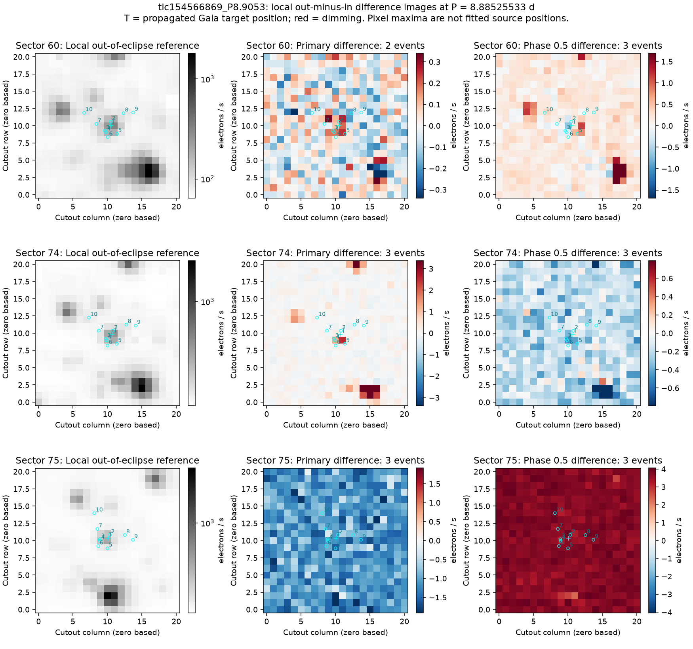
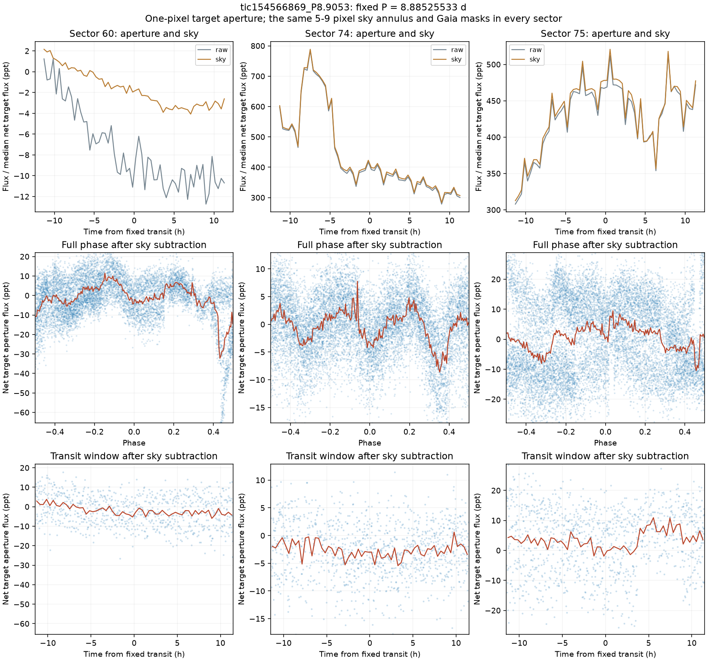

# TIC 154566869 — P8 candidate review

**HOLD** (final): Source unresolved. Target-aperture dimming varies across sectors and is mixed with background changes; the difference images do not isolate a unique eclipsing source. FPP is 0.988154 and NFPP is 0.918773 [M], so the current evidence does not support a planet interpretation. The density prior is rejected and transit geometry remains poorly constrained.

This is a candidate audit. No external submission has been made.

V2 rank 3; score 1.503. Rank does not determine the verdict.

| Measurement | Value |
|---|---|
| Period | 8.885255332 ± 0.00021221664437999857 d |
| Epoch | 2459942.360624076 ± 0.007362511814997891 BJD |
| Radius | 1.505 ± 0.357 Earth radii |
| T14 | 3.83 ± 4.443 h |
| Impact parameter | 0.12354 ± 11.311903899078684 |
| Density prior / grazing | False / False |
| Transits / beta | 6 / 1.48 |
| FPP / NFPP | 0.9881538497113276 / 0.9187734924382233 |
| fpp_uniform | False |
| Centroid | Centroid shift (weighted over 3 sectors): dcol = +0.009 px, drow = -0.000 px, total = 0.009 px (0.2 arcsec), significance = 5.6 sigma; 2 of 3 sectors flagged on their own. |

Gaia: Gaia: 9 sources within 1 arcmin; target RUWE 1.171926736831665, var flag NOT_AVAILABLE, NSS 0.0, dup 0.0, ipd_multi_peak 0.0, class -; 8 neighbour(s) within 3 px bright enough to make the depth; SIMBAD 1 (PM*); VSX 0

Cached P8 target and resolved-neighbour assessment. TRICERATOPS also uses its TIC scene and separately cached wider Gaia field-star population; the P8 cone is not that population.

FPP: TRICERATOPS 1.1.0: FPP 0.9882, NFPP 0.9188 over 27 scenarios and 46 TIC stars within 10 px; aperture circular_from_tmag; 100000 draws; fold binned (150 points, error 1251 ppm); sectors [60, 74, 75].

[Form fields](ctoi_fields.json), [physical fit](fit.json), [pixel and FPP record](expensive.json), [cached neighbours](neighbours.json). Stage A, secondary, B, C and D records are alongside these files.

Completeness and population assumptions: [P8 completeness](../../../COMPLETENESS_P8.md) and [population](../../../POPULATION_P8.md). The calibration ends after A and the secondary gate; no calibrated B/C/D efficiency is claimed.

## Pixel follow-up

Pixel review supports HOLD. The radius-one-pixel target aperture retains positive box depths of 3.694 +/- 0.822, 2.076 +/- 0.355 and 5.740 +/- 0.827 ppt in sectors 60, 74 and 75 [M], but the folds have broad, changing structure rather than a stable isolated transit. The difference images do not identify a unique source, and background changes confound a simple centroid interpretation. The pixel follow-up does not resolve the nearby-source ambiguity or the poorly constrained fit geometry. No additional clean EB report is justified.

To reconsider: independently reproduce a repeated localized transit while fitting the variable sky/background and nearby sources, and obtain useful transit-geometry uncertainties.

[Measurements and provenance](pixel_followup.json).

Primary and phase-0.5 difference images at the accepted physical-fit ephemeris; Gaia positions are propagated to the sector epoch.

Fixed target aperture and sky variations, full phase and transit windows after sky subtraction. All sectors use the same aperture and background geometry. The Gaia mask uses a 300-arcsec cone covering the target aperture and background annulus.
