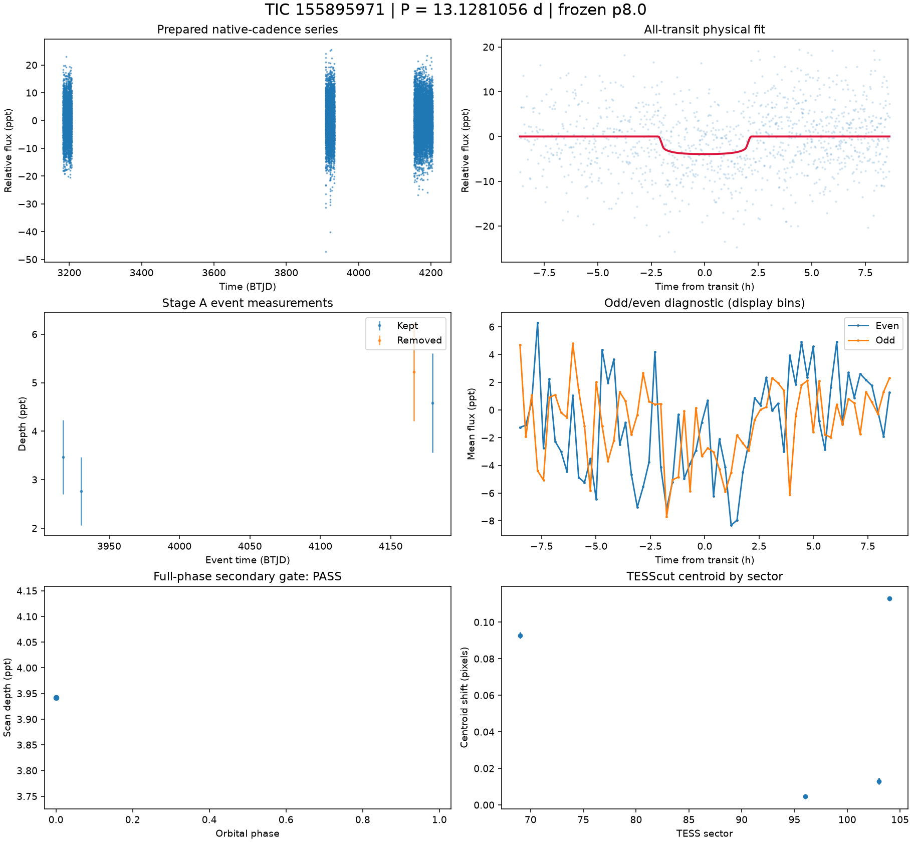
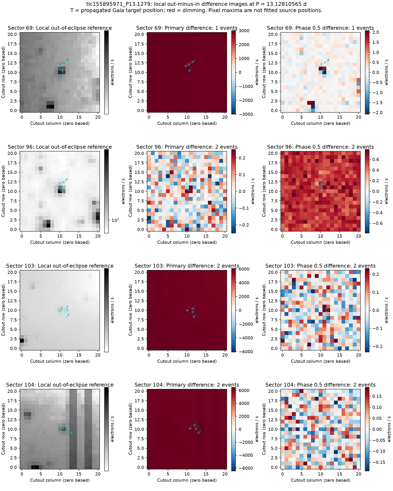
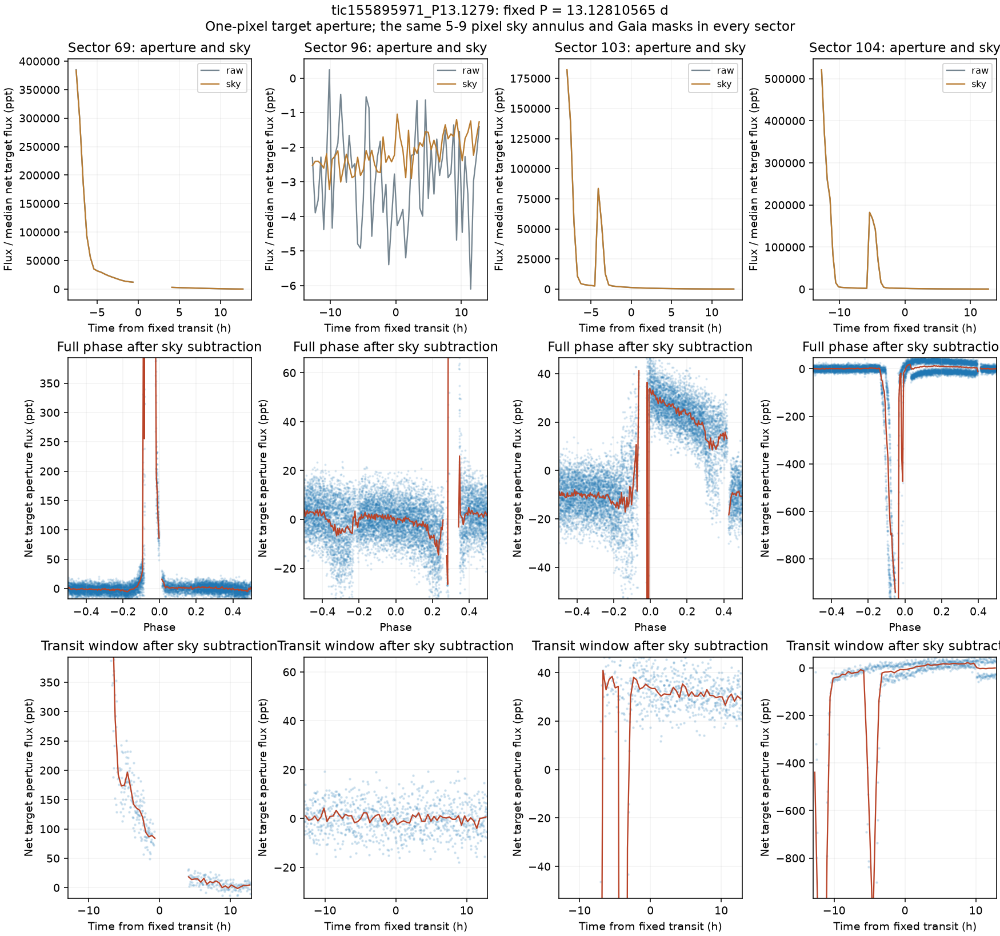

# TIC 155895971 — P8 candidate review

**KILL** (final): Background/correction artifact. Three primary-event difference images are dominated by whole-cutout background changes, and the fixed target aperture alternates between large brightening, a weak dip and unstable gap-adjacent structure instead of a repeatable transit [M]. FPP 0.000659 is conditional on astrophysical hypotheses and does not account for this instrumental evidence.

This is a candidate audit. No external submission has been made.

V2 rank 6; score 1.1963. Rank does not determine the verdict.

| Measurement | Value |
|---|---|
| Period | 13.128105649 ± 0.0004743061783958103 d |
| Epoch | 2460195.045187952 ± 0.030234980670136954 BJD |
| Radius | 1.706 ± 0.326 Earth radii |
| T14 | 4.315 ± 4.85 h |
| Impact parameter | 0.02566 ± 40.73917591018276 |
| Density prior / grazing | False / False |
| Transits / beta | 4 / 1.07 |
| FPP / NFPP | 0.0006589646025492168 / 5.5302725293218e-06 |
| fpp_uniform | False |
| Centroid | Centroid shift (weighted over 4 sectors): dcol = +0.028 px, drow = +0.014 px, total = 0.032 px (0.7 arcsec), significance = 41.9 sigma; 4 of 4 sectors flagged on their own. |

Gaia: Gaia: 6 sources within 1 arcmin; target RUWE 1.0796840190887451, var flag NOT_AVAILABLE, NSS 0.0, dup 1.0, ipd_multi_peak 0.0, class -; 4 neighbour(s) within 3 px bright enough to make the depth; SIMBAD 1 (PM*); VSX 0

Cached P8 target and resolved-neighbour assessment. TRICERATOPS also uses its TIC scene and separately cached wider Gaia field-star population; the P8 cone is not that population.

FPP: TRICERATOPS 1.1.0: FPP 0.0007, NFPP 0.0000 over 18 scenarios and 31 TIC stars within 10 px; aperture circular_from_tmag; 100000 draws; fold binned (150 points, error 1798 ppm); sectors [69, 96, 103].

[Form fields](ctoi_fields.json), [physical fit](fit.json), [pixel and FPP record](expensive.json), [cached neighbours](neighbours.json). Stage A, secondary, B, C and D records are alongside these files.

Completeness and population assumptions: [P8 completeness](../../../COMPLETENESS_P8.md) and [population](../../../POPULATION_P8.md). The calibration ends after A and the secondary gate; no calibrated B/C/D efficiency is claimed.

## Pixel follow-up

Pixel review supports KILL as a background/correction artifact. Primary-event difference images in sectors 69, 103 and 104 are dominated by diffuse changes across the cutout; sector 96 has weak structure near the target, without a consistent point source across sectors. The fixed, sky-subtracted target aperture gives brightening in sectors 69 and 103 (-82.209 +/- 2.104 and -3.273 +/- 0.562 ppt), a weak 1.266 +/- 0.533-ppt dip in sector 96, and an unstable 8.857 +/- 3.257-ppt change in sector 104 [M]. Large raw-aperture and sky ramps closely track one another; gap-adjacent excursions and broad steps do not reproduce a stable, localized transit at the accepted ephemeris. These pixel measurements do not support the fitted 3.926-ppt maximum dip. The verdict is based on instrumental evidence; astrophysical FPP does not include these instrumental hypotheses.

To reconsider: independent photometry must reproduce repeated dimming localized to a stellar source with stable background, including a consistent depth and transit shape across sectors. The fixed-box errors describe local point scatter and omit some correlated noise.

[Measurements and provenance](pixel_followup.json).

Primary and phase-0.5 difference images at the accepted physical-fit ephemeris; Gaia positions are propagated to each sector epoch.

Fixed target aperture and sky variations, full phase and transit windows after sky subtraction. All four sectors use the same aperture and background geometry with a 300-arcsec Gaia cone covering the target aperture and background annulus.
