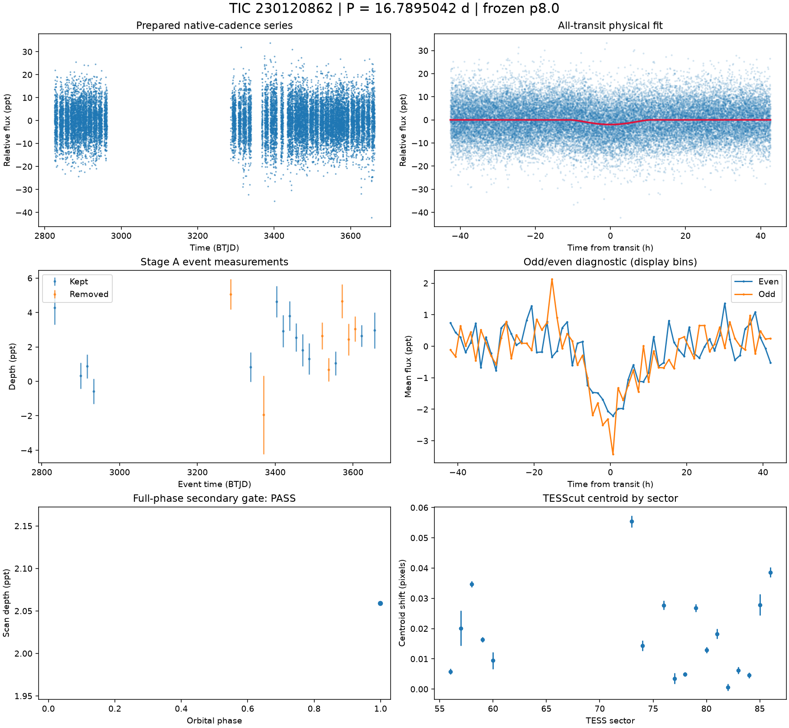
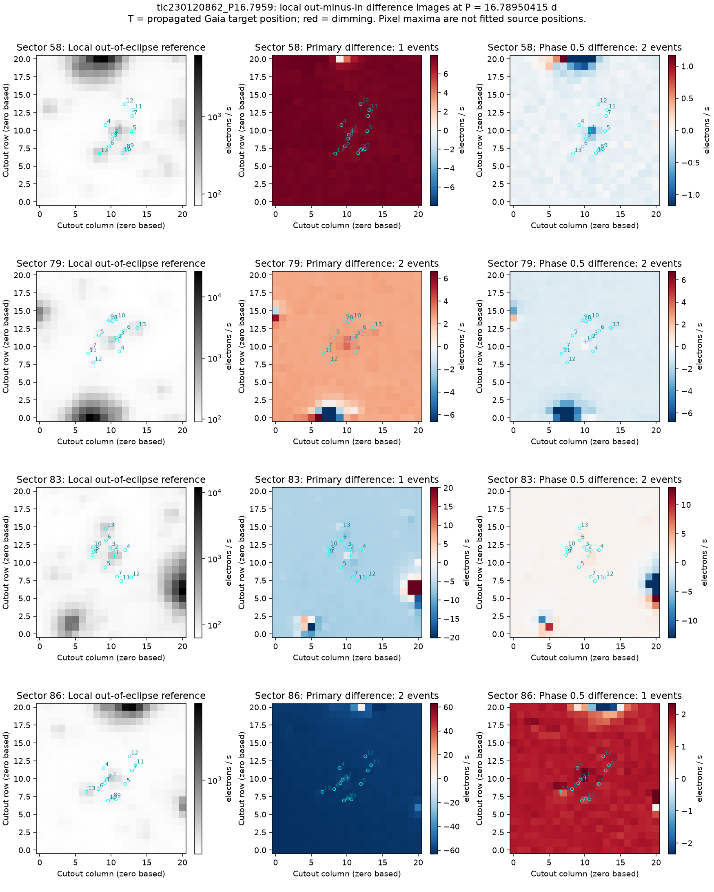
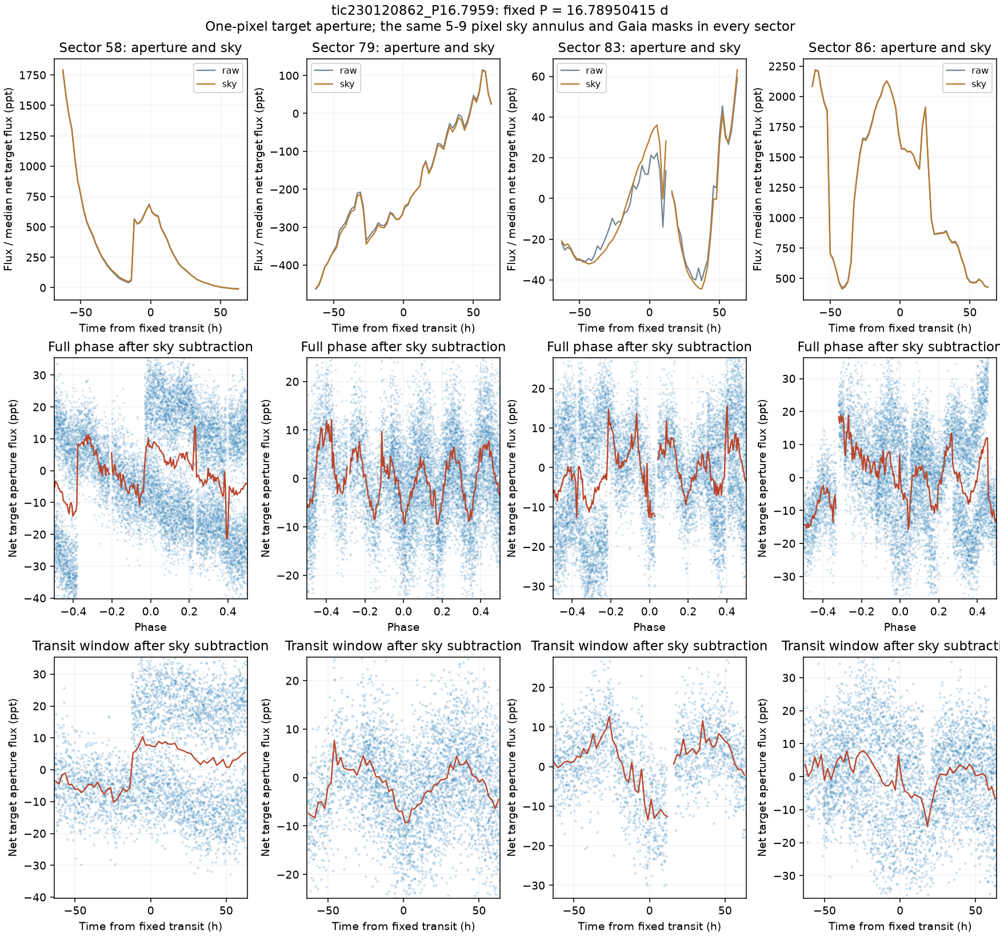
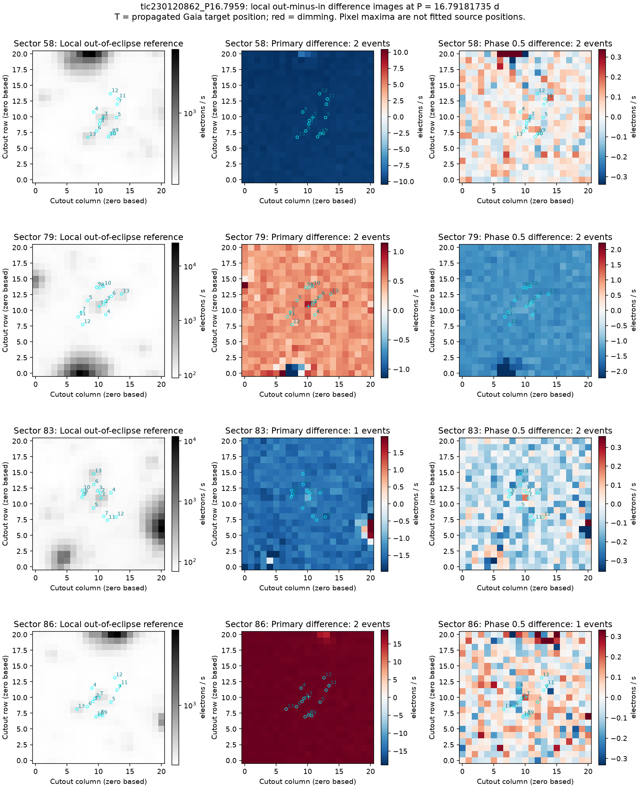
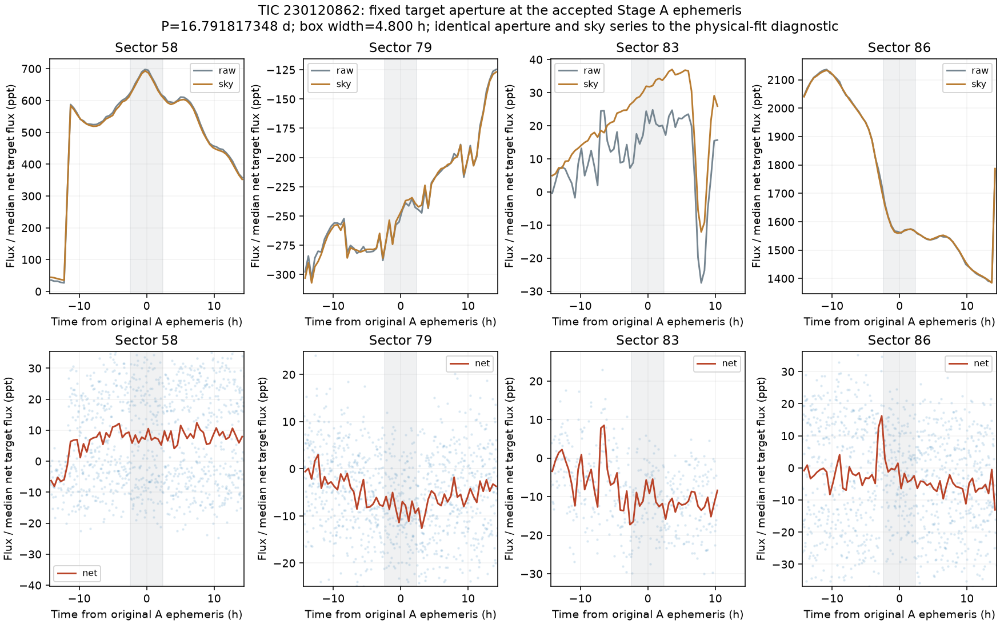

# TIC 230120862 — P8 candidate review

**KILL** (final): Background/correction artifact. Difference images are dominated by changing diffuse background at both the physical-fit and original Stage A ephemerides. At the original 4.8-hour Stage A window, fixed-aperture depths are -6.620 +/-1.397, 5.083 +/-0.699, 7.158 +/-1.110 and -3.283 +/-1.643 ppt in sectors 58, 79, 83 and 86 [M], with raw changes tracking sky ramps and no stable isolated transit. The physical fit reaches a grazing rail and has unusably large geometry uncertainties.

This is a candidate audit. No external submission has been made.

V2 rank 1; score 1.746. Rank does not determine the verdict.

| Measurement | Value |
|---|---|
| Period | 16.789504153 ± 0.001137360552089849 d |
| Epoch | 2459832.498212183 ± 0.040489014551961355 BJD |
| Radius | 6.102 ± 141.165 Earth radii |
| T14 | 21.307 ± 28.634 h |
| Impact parameter | 1.10000 ± 4.090419743289161 |
| Density prior / grazing | False / True |
| Transits / beta | 22 / 1.03 |
| FPP / NFPP | 0.9999999999999999 / 0.9455965723553045 |
| fpp_uniform | False |
| Centroid | Centroid shift (weighted over 18 sectors): dcol = +0.002 px, drow = -0.005 px, total = 0.006 px (0.1 arcsec), significance = 20.4 sigma; 16 of 18 sectors flagged on their own. |

Gaia: Gaia: 9 sources within 1 arcmin; target RUWE 1.1714476346969604, var flag NOT_AVAILABLE, NSS 0.0, dup 0.0, ipd_multi_peak 0.0, class -; 8 neighbour(s) within 3 px bright enough to make the depth; SIMBAD 1 (PM*); VSX 0

Cached P8 target and resolved-neighbour assessment. TRICERATOPS also uses its TIC scene and separately cached wider Gaia field-star population; the P8 cone is not that population.

FPP: TRICERATOPS 1.1.0: FPP 1.0000, NFPP 0.9456 over 36 scenarios and 58 TIC stars within 10 px; aperture circular_from_tmag; 100000 draws; fold binned (150 points, error 511 ppm); sectors [56, 57, 58].

[Form fields](ctoi_fields.json), [physical fit](fit.json), [pixel and FPP record](expensive.json), [cached neighbours](neighbours.json). Stage A, secondary, B, C and D records are alongside these files.

Completeness and population assumptions: [P8 completeness](../../../COMPLETENESS_P8.md) and [population](../../../POPULATION_P8.md). The calibration ends after A and the secondary gate; no calibrated B/C/D efficiency is claimed.

## Pixel follow-up

KILL supported by the pixel evidence. The physical fit has b=1.099999, T14=21.307 +/-28.634 h and Rp=6.102 +/-141.165 Earth radii, with the density prior rejected at delta chi-squared 152.873 [M]. The grazing-rail problem recurs; those covariance errors are not physical confidence bounds. At that fit, aperture depths are -11.097 +/-0.666, 4.726 +/-0.331, 12.441 +/-0.442 and 4.202 +/-0.441 ppt [M]. The unchanged earlier Stage A ephemeris also shows sign changes, broad steps and ramps. Sector 58 brightens across a pre-transit step; sector 79 has broad changing structure; sector 83 steps down without isolated recovery; sector 86 follows large sky ramps. Primary differences are whole-cutout signals with no stable dimming PSF. FPP is 1.0 and NFPP 0.945597; all 18 sectors have usable centroids, with combined significance 20.367 sigma [M]. No unique eclipsing source is localized.

Independent photometry with a stable background must reproduce localized, repeated dimming at the candidate ephemeris and permit a constrained physical fit. Fixed-aperture depths remain diluted and their point-scatter errors omit correlated noise. The current measurements do not support a separate clean EB report.

[Measurements and provenance](pixel_followup.json).

Difference images at the physical-fit ephemeris.

Fixed target aperture, sky and folded data at the physical-fit ephemeris.

Difference-image check at the unchanged earlier accepted Stage A ephemeris.

Identical target/sky series at the original 4.8-hour Stage A window; shading marks the fixed box.
