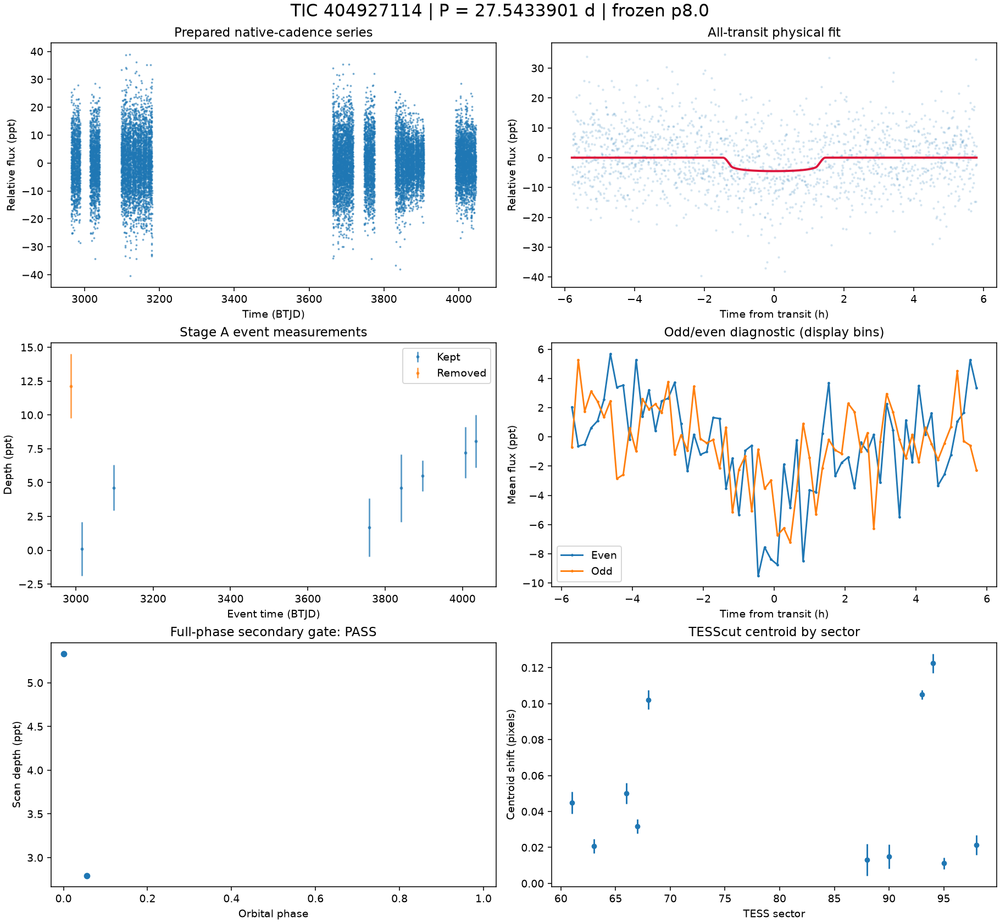
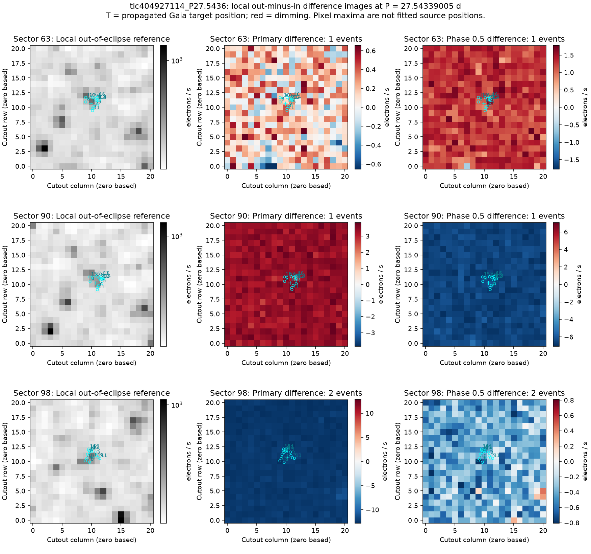
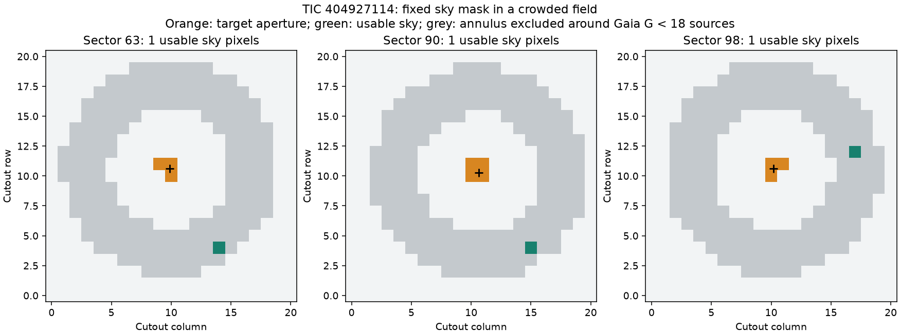

# TIC 404927114 — P8 candidate review

**HOLD** (final): Source unresolved in a crowded variable-star field. The primary difference images are weak/mixed in sector 63 and dominated by diffuse background changes in sectors 90 and 98. The fixed sky annulus leaves only one usable pixel per sector, below the required 16, so a reliable target-aperture depth could not be extracted. FPP is 0.201585 and NFPP is 0.169895 [M]; source localization is inadequate for submission.

This is a candidate audit. No external submission has been made.

V2 rank 4; score 1.4486. Rank does not determine the verdict.

| Measurement | Value |
|---|---|
| Period | 27.543390053 ± 0.0002485035541247843 d |
| Epoch | 2459987.928697499 ± 0.006997371079042699 BJD |
| Radius | 3.079 ± 0.375 Earth radii |
| T14 | 2.899 ± 0.327 h |
| Impact parameter | 0.55243 ± 0.08937668354443128 |
| Density prior / grazing | True / False |
| Transits / beta | 8 / 1.12 |
| FPP / NFPP | 0.20158499315424983 / 0.16989521969841298 |
| fpp_uniform | False |
| Centroid | Centroid shift (weighted over 11 sectors): dcol = +0.018 px, drow = -0.033 px, total = 0.038 px (0.8 arcsec), significance = 28.7 sigma; 9 of 11 sectors flagged on their own. |

Gaia: Gaia: 123 sources within 1 arcmin; target RUWE 1.1008936166763306, var flag VARIABLE, NSS 0.0, dup 0.0, ipd_multi_peak 0.0, class SOLAR_LIKE; 42 neighbour(s) within 3 px bright enough to make the depth; SIMBAD 2 (PM*, EB*); VSX 1

Cached P8 target and resolved-neighbour assessment. TRICERATOPS also uses its TIC scene and separately cached wider Gaia field-star population; the P8 cone is not that population.

FPP: TRICERATOPS 1.1.0: FPP 0.2016, NFPP 0.1699 over 54 scenarios and 1485 TIC stars within 10 px; aperture circular_from_tmag; 100000 draws; fold binned (150 points, error 2332 ppm); sectors [61, 63, 66].

[Form fields](ctoi_fields.json), [physical fit](fit.json), [pixel and FPP record](expensive.json), [cached neighbours](neighbours.json). Stage A, secondary, B, C and D records are alongside these files.

Completeness and population assumptions: [P8 completeness](../../../COMPLETENESS_P8.md) and [population](../../../POPULATION_P8.md). The calibration ends after A and the secondary gate; no calibrated B/C/D efficiency is claimed.

## Pixel follow-up

HOLD. The adopted density-prior fit gives P=27.543390053 d, Rp=3.079 +/-0.375 Earth radii, b=0.552 +/-0.089 and T14=2.899 +/-0.327 h [M]. That fit does not resolve the source. The 300-arcsec cone contains 3429 Gaia sources, including 215 with G<18, and the target is a cached Gaia/VSX ROT variable. No repeatable isolated dimming PSF is established: sector 63 is weak/mixed, sector 90 has whole-cutout primary dimming, and sector 98 has whole-cutout primary brightening. The fixed mask leaves one sky pixel in every reviewed sector. All 12 requested sectors now have TESScut data; 11 support a centroid measurement, with combined significance 28.701 sigma [M]. This centroid shift is not a fitted source position.

Source-resolving photometry or a validated crowded-field PSF/difference-image analysis must separate the target from neighbours and background, then show repeatable dimming near 27.5434 d with consistent depth. The present fixed-annulus method cannot supply that deblending. A satisfactory transit geometry alone does not resolve the contamination.

[Measurements and provenance](pixel_followup.json).

Difference images at the physical-fit ephemeris. The dense Gaia field prevents unique source localization.

Fixed target aperture and background mask: one sky pixel survives in each sector; the minimum is 16. No target-aperture depth is reported.
