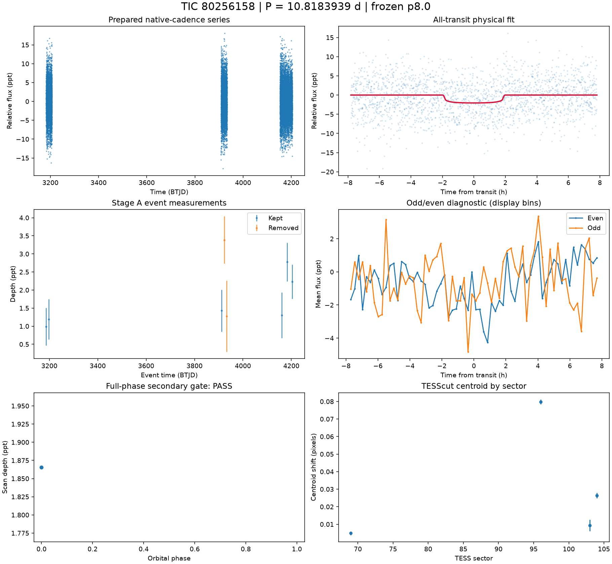
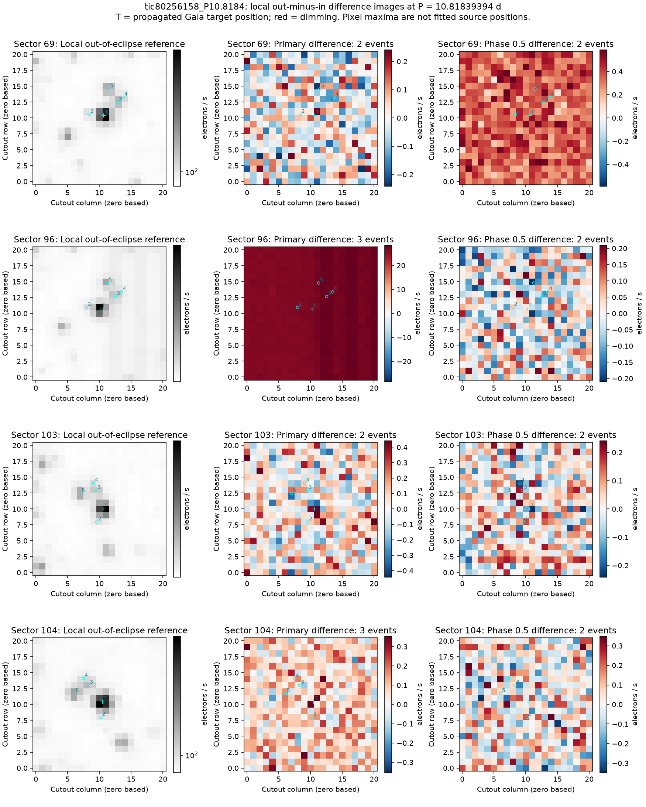
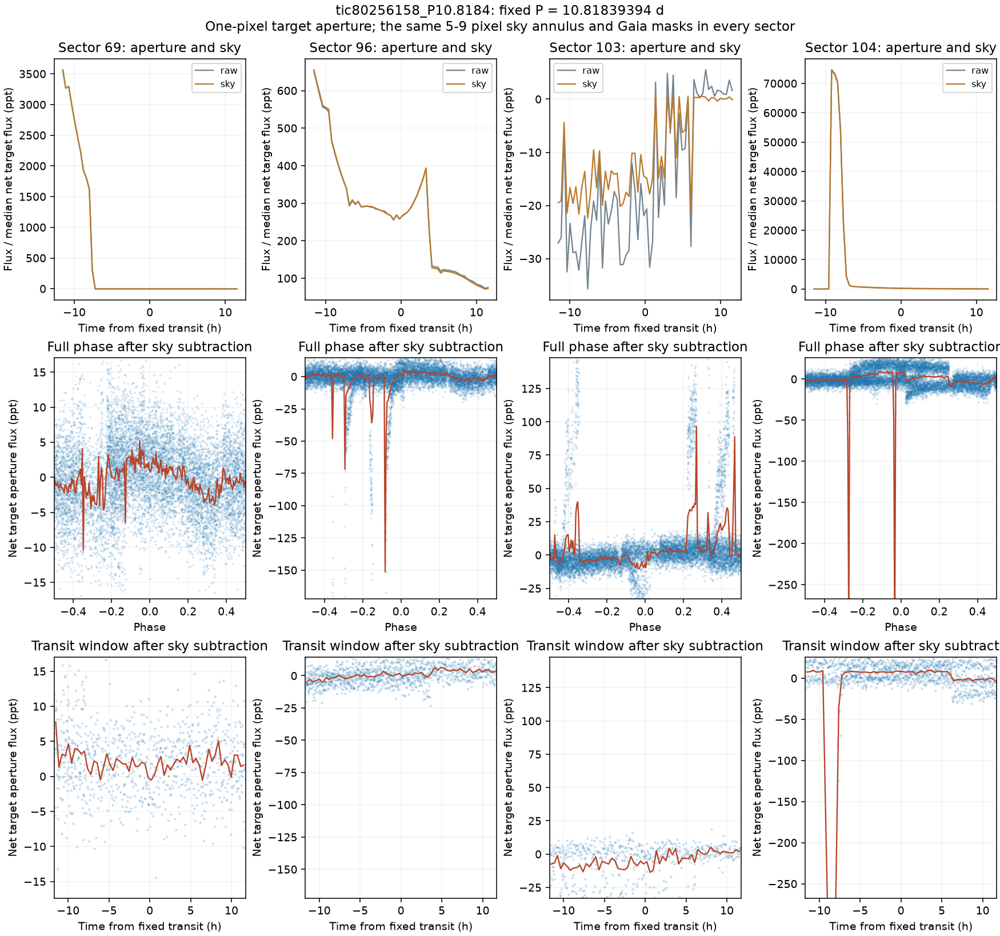

# TIC 80256158 — P8 candidate review

**KILL** (final): Background/correction artifact. The fixed target-aperture depths change sign across sectors (1.012, -1.011, 6.578 and -5.333 ppt), with raw variations tracking sky ramps and broad steps [M]. Difference images do not repeat a stable dimming point source or the fitted shallow transit.

This is a candidate audit. No external submission has been made.

V2 rank 2; score 1.7106. Rank does not determine the verdict.

| Measurement | Value |
|---|---|
| Period | 10.818393943 ± 0.00011318900702270288 d |
| Epoch | 2460186.829973109 ± 0.008103059032922038 BJD |
| Radius | 1.7 ± 0.426 Earth radii |
| T14 | 3.907 ± 4.568 h |
| Impact parameter | 0.07663 ± 19.765123669081124 |
| Density prior / grazing | False / False |
| Transits / beta | 8 / 1.24 |
| FPP / NFPP | 0.2112196219119783 / 0.03453354721600477 |
| fpp_uniform | False |
| Centroid | Centroid shift (weighted over 4 sectors): dcol = +0.012 px, drow = +0.021 px, total = 0.024 px (0.5 arcsec), significance = 34.2 sigma; 3 of 4 sectors flagged on their own. |

Gaia: Gaia: 4 sources within 1 arcmin; target RUWE 1.2273283004760742, var flag NOT_AVAILABLE, NSS 0.0, dup 0.0, ipd_multi_peak 0.0, class -; 2 neighbour(s) within 3 px bright enough to make the depth; SIMBAD 1 (PM*); VSX 0

Cached P8 target and resolved-neighbour assessment. TRICERATOPS also uses its TIC scene and separately cached wider Gaia field-star population; the P8 cone is not that population.

FPP: TRICERATOPS 1.1.0: FPP 0.2112, NFPP 0.0345 over 21 scenarios and 20 TIC stars within 10 px; aperture circular_from_tmag; 100000 draws; fold binned (150 points, error 994 ppm); sectors [69, 96, 103].

[Form fields](ctoi_fields.json), [physical fit](fit.json), [pixel and FPP record](expensive.json), [cached neighbours](neighbours.json). Stage A, secondary, B, C and D records are alongside these files.

Completeness and population assumptions: [P8 completeness](../../../COMPLETENESS_P8.md) and [population](../../../POPULATION_P8.md). The calibration ends after A and the secondary gate; no calibrated B/C/D efficiency is claimed.

## Pixel follow-up

Pixel review supports KILL as a background/correction artifact. Primary-event difference images do not repeat a stable dimming point source: sector 69 has weak positive target structure, sector 96 is dominated by a diffuse whole-cutout change, and sectors 103 and 104 show mixed positive/negative structure around the target. The sky-subtracted fixed aperture has depths of 1.012 +/- 0.395, -1.011 +/- 0.486, 6.578 +/- 0.766 and -5.333 +/- 1.132 ppt in sectors 69, 96, 103 and 104 respectively [M]. Raw aperture and sky variations closely track one another. Sector 103 has a broad step/trend, sector 96 brightens through the window, and sector 104 contains a large excursion before the window and brightening within it. These changes do not reproduce a stable transit with the fitted 2.058-ppt maximum depth. No particular nearby star is localized as an eclipsing source.

To reconsider: independent photometry must show repeated dimming localized to a stellar source, with a stable background and consistent depth and transit shape across sectors. Fixed-box errors use local point scatter and omit some correlated noise.

[Measurements and provenance](pixel_followup.json).

Primary and phase-0.5 difference images at the accepted physical-fit ephemeris; Gaia positions are propagated to each sector epoch.

Fixed target aperture and sky variations, full phase and transit windows after sky subtraction. All four sectors use the same aperture and background geometry with a 300-arcsec Gaia cone covering the target aperture and background annulus.
