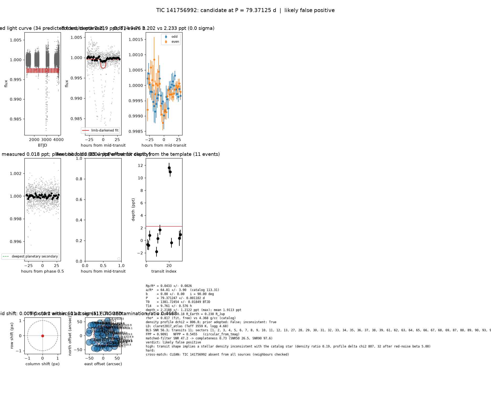

# Candidate packet: TIC 141756992, P = 79.37125 d

Generated 2026-09-03 07:17 UTC by tesshunter. This is a CANDIDATE. Nothing in this packet is a detection; the automated checks are necessary, not sufficient. The human reviews and submits.

**Automated verdict:** likely false positive (light curve only: ambiguous / manual vetting required)  
**FPP / NFPP (TRICERATOPS):** 0.9091 / 0.5455 — above 0.5, does not proceed to submission

## Fitted parameters (limb-darkened transit fit)

| parameter | value |
|---|---|
| period | 79.371247 +/- 0.001102 d |
| epoch | 1381.72454 +/- 0.01849 BTJD = 2458381.72454 BJD |
| duration T14 | 9.761 +/- 0.576 h |
| depth (model maximum) | 2.2188 +/- 1.2122 ppt (shape-degenerate error 0.2723 ppt) |
| depth (duration-averaged) | 1.9113 ppt |
| Rp/R* | 0.0433 +/- 0.0026 |
| a/R* | 64.81 +/- 3.90 (catalog density gives 113.31 +/- 2.02) |
| impact parameter | 0.00 +/- 0.00 ; inclination 90.00 deg |
| Rp | 2.67 +/- 0.18 R_Earth = 0.238 +/- 0.016 R_Jup (R* = 0.565 +/- 0.017 R_Sun) |
| stellar density | fit (free) 0.817 g/cc vs catalog 4.368 +/- 0.233 g/cc; ratio 0.19, profile delta chi2 806.8; prior adopted: False; inconsistent: True |
| limb darkening | u1 = 0.290, u2 = 0.358 (claret2017_atlas (Teff 3559 K, logg 4.68)) |
| fit | least_squares, 1179 points, 11 transits, reduced chi2 31.62, delta BIC vs flat 2179 |
| BLS | SNR 56.3, box depth 2.428 ppt, 11 transits observed, alias label P |

## Vetting checks

| check | result |
|---|---|
| odd/even (median) | pass (0.0 sigma) |
| odd/even (fit template) | odd 2.202 +/- 2.303 ppt (5 events), even 2.233 +/- 1.913 ppt (6 events), difference 0.0 sigma, 1% of the mean |
| secondary at phase 0.5 | 0.0177 ppt measured; deepest planetary secondary at the fitted a/R* 0.0004 ppt; not detected |
| a/R* consistency | FLAG — free-fit a/R* = 64.81 (b = 0.00) against 113.31 +/- 2.02 from the catalog density (0.817 vs 4.368 g/cc, ratio 0.19; profile delta chi2 806.8 with a/R* held in the catalog range, 32.3 after the red-noi |
| V-shape | none (t_flat/t_total 0.55); fitted geometry grazing: False |
| per-unit depths | FLAG |
| centroid | shift 0.009 px, 11.2 sigma FLAG |
| contamination | flagged, 86 neighbours checked |
| FPP / NFPP | 0.9091 / 0.5455 (TRICERATOPS 1.1.0: FPP 0.9091, NFPP 0.5455 over 33 scenarios and 574 TIC stars within 10 px; aperture circular_from_tmag; 100000 draws; fold binned (118 points, error 484 ppm); sectors [1, 2, 3].) |

Flags: transit shape implies a stellar density inconsistent with the catalog star (density ratio 0.19, profile delta chi2 807, 32 after red-noise beta 5.00) — diluted eclipse, grazing stellar companion or blend; in-transit centroid shift 0.009 px (0.2 arcsec, 11.2 sigma) over 14 sector(s) — signal may sit on a neighbour; TRICERATOPS nearby false-positive probability 0.545 >= 0.1; nearby star could produce the signal: 4 high-risk and 3 medium-risk neighbour(s) of 86 checked; per-unit transit depths disagree by > 3σ across observing units

## Completeness at this SNR

Matched-filter SNR 47.2 on this star's detrended data binned to 30 min: the P2 completeness curve (`docs/COMPLETENESS.md`, 2100 injections on 300 stars, config survey_v1) recovers 0.73 of injected signals at this SNR (SNR50 = 26.5, SNR90 = 97.6; the 20-50 bin recovered 237/368). Curve measured in P2 with batman injections into the survey preset (survey_v1: FFI stitches binned to 30 min, periods 1-40 d, Rp/R* 0.01-0.12); the matched-filter SNR here is computed on this candidate's own detrended data with the same definition. Outside that regime the number is an extrapolation.

## Star and neighbours

TIC 141756992: Teff 3559 K, log g 4.68, R = 0.565 +/- 0.017 R_Sun, M = 0.558 +/- 0.020 M_Sun, Tmag 10.94, TIC contamination ratio 0.4668 (source tic; assumed errors: False).

| ID | dstArcSec | Tmag | GAIAmag | gaiabp | gaiarp | Teff | rad | contratio | disposition |
|---|---|---|---|---|---|---|---|---|---|
| 141756992 | 0.00 | 10.94 | 12.32 | 13.27 | 10.98 | 3559.00 | 0.56 | 0.47 | n/a |
| 735327716 | 0.75 | 12.72 | 13.15 | n/a | n/a | n/a | n/a | n/a | n/a |
| 735327710 | 11.40 | 19.81 | 20.25 | 20.20 | 19.35 | n/a | n/a | n/a | n/a |
| 735327715 | 19.12 | 20.10 | 20.63 | 20.92 | 19.89 | n/a | n/a | n/a | n/a |
| 735327714 | 20.42 | 20.61 | 20.91 | 20.80 | 20.23 | n/a | n/a | n/a | n/a |
| 735327774 | 21.21 | 20.58 | 20.97 | 20.90 | 20.15 | n/a | n/a | n/a | n/a |
| 735327712 | 21.73 | 20.14 | 20.28 | 20.39 | 20.09 | n/a | n/a | n/a | n/a |
| 735327772 | 21.86 | 19.34 | 20.14 | 20.70 | 19.03 | n/a | n/a | n/a | n/a |
| 141756999 | 21.97 | 12.26 | 12.66 | 12.96 | 12.20 | 6514.00 | 1.72 | 2.54 | n/a |
| 735327711 | 22.65 | 19.77 | 20.14 | 20.37 | 19.67 | n/a | n/a | n/a | n/a |
| 141756997 | 22.87 | 16.34 | 17.39 | 18.36 | 16.36 | 3773.00 | 0.68 | n/a | n/a |
| 735327776 | 24.23 | 18.98 | 19.64 | 20.17 | 18.88 | 4949.00 | 0.51 | n/a | n/a |
| 735327709 | 27.52 | 19.63 | 20.34 | 20.37 | 18.93 | n/a | n/a | n/a | n/a |
| 735327775 | 27.53 | 20.61 | 21.04 | n/a | n/a | n/a | n/a | n/a | n/a |
| 735327707 | 27.74 | 18.27 | 18.23 | 18.19 | 18.16 | n/a | n/a | n/a | n/a |
| 735327773 | 30.09 | 20.77 | 20.94 | 20.45 | 20.13 | n/a | n/a | n/a | n/a |
| 735327713 | 32.42 | 20.08 | 20.44 | 20.39 | 19.70 | n/a | n/a | n/a | n/a |
| 141757002 | 32.82 | 15.72 | 16.61 | 17.51 | 15.68 | 4090.00 | 8.54 | n/a | n/a |
| 735327694 | 35.33 | 18.40 | 19.03 | 19.60 | 18.37 | 5097.00 | 0.63 | n/a | n/a |
| 141756983 | 36.71 | 14.65 | 15.25 | 15.76 | 14.59 | 5236.00 | 0.86 | n/a | n/a |
| 735327769 | 36.98 | 18.32 | 18.98 | 19.50 | 18.21 | 4959.00 | 0.70 | n/a | n/a |
| 735327704 | 39.23 | 18.72 | 19.41 | 20.04 | 18.69 | 4827.00 | 0.61 | n/a | n/a |
| 735327768 | 39.79 | 19.59 | 20.07 | 20.40 | 19.49 | n/a | n/a | n/a | n/a |
| 735327770 | 40.22 | 18.44 | 19.02 | 19.32 | 18.20 | n/a | n/a | n/a | n/a |
| 735327771 | 40.38 | 20.09 | 20.52 | n/a | n/a | n/a | n/a | n/a | n/a |

## Cross-match

CLEAN: TIC 141756992 absent from all sources (neighbours checked)  
Catalog versions: `ctoi=2026-09-03:f6964541;nasa_ps=2026-09-03:85f3c196;nasa_pscomppars=2026-09-03:4843e49c;spoc_tce=2026-09-03:e580dde7;tess_eb=2026-09-03:43555226;toi=2026-09-03:4704bb7c`

## Data

Sectors [1, 2, 3, 4, 5, 6, 7, 8, 9, 10, 11, 12, 13, 27, 28, 29, 30, 31, 32, 33, 34, 35, 36, 37, 38, 39, 61, 62, 63, 64, 65, 66, 67, 68, 69, 87, 88, 89, 90, 93, 94, 95, 96, 97, 98]; 50743 raw and 48992 cleaned cadences; products: TESS-SPOC s1, TESS-SPOC s2, TESS-SPOC s3, TESS-SPOC s4, TESS-SPOC s5, TESS-SPOC s6.

## Figure



## ExoFOP CTOI fields

```json
{
 "target": "TIC 141756992",
 "tic_id": 141756992,
 "discovery_source": "TESS",
 "period_days": 79.37124731795733,
 "period_err_days": 0.0011020270318579468,
 "epoch_bjd": 2458381.7245427915,
 "epoch_err_days": 0.018489785460067944,
 "depth_ppm": 2218.8277670143198,
 "depth_err_ppm": 1212.2489095165524,
 "duration_hours": 9.76145484027451,
 "duration_err_hours": 0.5762091619944626,
 "disposition": "PC",
 "tag": "FILL_ME: YYYYMMDD_username_tesshunter_NNN",
 "candidate_name": null,
 "paper_url": null,
 "notes": "Survey rank 8 (frozen score 3.5); survey stitch SNR 56.79779925096805, 13.0 transits."
}
```

_The pipeline finds candidates. It does not submit._
