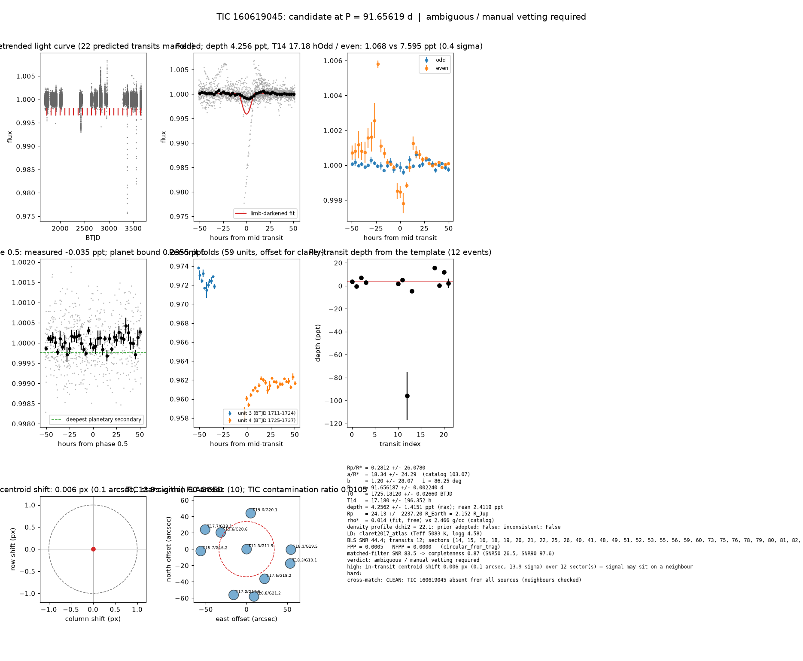

# Candidate packet: TIC 160619045, P = 91.65619 d

Generated 2026-09-03 07:15 UTC by tesshunter. This is a CANDIDATE. Nothing in this packet is a detection; the automated checks are necessary, not sufficient. The human reviews and submits.

**Automated verdict:** ambiguous / manual vetting required (light curve only: promising planet candidate)  
**FPP / NFPP (TRICERATOPS):** 0.0005 / 0.0000

## Fitted parameters (limb-darkened transit fit)

| parameter | value |
|---|---|
| period | 91.656187 +/- 0.002240 d |
| epoch | 1725.18120 +/- 0.02660 BTJD = 2458725.18120 BJD |
| duration T14 | 17.180 +/- 196.352 h |
| depth (model maximum) | 4.2562 +/- 1.4151 ppt (shape-degenerate error 63.5151 ppt) |
| depth (duration-averaged) | 2.4119 ppt |
| Rp/R* | 0.2812 +/- 26.0780 |
| a/R* | 18.34 +/- 24.29 (catalog density gives 103.07 +/- 8.48) |
| impact parameter | 1.20 +/- 28.07 ; inclination 86.25 deg |
| Rp | 24.13 +/- 2237.20 R_Earth = 2.152 +/- 199.591 R_Jup (R* = 0.787 +/- 0.046 R_Sun) |
| stellar density | fit (free) 0.014 g/cc vs catalog 2.466 +/- 0.608 g/cc; ratio 0.01, profile delta chi2 22.1; prior adopted: False; inconsistent: False |
| limb darkening | u1 = 0.419, u2 = 0.210 (claret2017_atlas (Teff 5083 K, logg 4.58)) |
| fit | least_squares, 1018 points, 12 transits, reduced chi2 1.98, delta BIC vs flat 249 |
| BLS | SNR 44.4, box depth 2.038 ppt, 11 transits observed, alias label P |

## Vetting checks

| check | result |
|---|---|
| odd/even (median) | pass (0.4 sigma) |
| odd/even (fit template) | odd 1.068 +/- 1.348 ppt (6 events), even 7.595 +/- 17.463 ppt (6 events), difference 0.4 sigma, 151% of the mean |
| secondary at phase 0.5 | -0.0353 ppt measured; deepest planetary secondary at the fitted a/R* 0.2355 ppt; not detected |
| a/R* consistency | pass — free-fit a/R* = 18.34 (b = 1.20) against 103.07 +/- 8.48 from the catalog density (0.014 vs 2.466 g/cc, ratio 0.01; profile delta chi2 22.1 with a/R* held in the catalog range, 1.1 after the red-noise |
| V-shape | none (t_flat/t_total 0.40); fitted geometry grazing: True |
| per-unit depths | FLAG |
| centroid | shift 0.006 px, 13.9 sigma FLAG |
| contamination | flagged, 24 neighbours checked |
| FPP / NFPP | 0.0005 / 0.0000 (TRICERATOPS 1.1.0: FPP 0.0005, NFPP 0.0000 over 15 scenarios and 65 TIC stars within 10 px; aperture circular_from_tmag; 100000 draws; fold binned (150 points, error 346 ppm); sectors [14, 15, 16].) |

Flags: in-transit centroid shift 0.006 px (0.1 arcsec, 13.9 sigma) over 12 sector(s) — signal may sit on a neighbour; per-unit transit depths disagree by > 3σ across observing units

## Completeness at this SNR

Matched-filter SNR 83.5 on this star's detrended data binned to 30 min: the P2 completeness curve (`docs/COMPLETENESS.md`, 2100 injections on 300 stars, config survey_v1) recovers 0.87 of injected signals at this SNR (SNR50 = 26.5, SNR90 = 97.6; the 50-1000000000.0 bin recovered 586/658). Curve measured in P2 with batman injections into the survey preset (survey_v1: FFI stitches binned to 30 min, periods 1-40 d, Rp/R* 0.01-0.12); the matched-filter SNR here is computed on this candidate's own detrended data with the same definition. Outside that regime the number is an extrapolation.

## Star and neighbours

TIC 160619045: Teff 5083 K, log g 4.58, R = 0.787 +/- 0.046 R_Sun, M = 0.851 +/- 0.104 M_Sun, Tmag 11.31, TIC contamination ratio 0.0105 (source tic; assumed errors: False).

| ID | dstArcSec | Tmag | GAIAmag | gaiabp | gaiarp | Teff | rad | contratio | disposition |
|---|---|---|---|---|---|---|---|---|---|
| 160619045 | 0.00 | 11.31 | 11.87 | 12.35 | 11.26 | 5083.00 | 0.79 | 0.01 | n/a |
| 1201372898 | 37.65 | 19.64 | 20.60 | 21.25 | 19.13 | n/a | n/a | n/a | n/a |
| 1201372896 | 42.53 | 17.64 | 18.17 | 18.60 | 17.57 | 5261.00 | 0.54 | n/a | n/a |
| 1201372900 | 44.34 | 19.56 | 20.15 | 20.51 | 19.36 | n/a | n/a | n/a | n/a |
| 160619044 | 54.29 | 18.35 | 19.49 | 20.94 | 18.23 | 3395.00 | n/a | n/a | n/a |
| 1201372897 | 56.19 | 17.67 | 18.05 | 18.33 | 17.61 | 6217.00 | n/a | n/a | n/a |
| 160619042 | 56.23 | 15.67 | 16.20 | 16.64 | 15.61 | 5304.00 | 0.69 | n/a | n/a |
| 1201372899 | 56.26 | 18.29 | 19.05 | 19.76 | 18.21 | 4312.00 | 0.51 | n/a | n/a |
| 160619039 | 58.27 | 16.95 | 17.59 | 18.14 | 16.90 | 4780.00 | 0.64 | n/a | n/a |
| 1201372890 | 58.74 | 20.75 | 21.18 | n/a | n/a | n/a | n/a | n/a | n/a |

## Cross-match

CLEAN: TIC 160619045 absent from all sources (neighbours checked)  
Catalog versions: `ctoi=2026-09-03:f6964541;nasa_ps=2026-09-03:85f3c196;nasa_pscomppars=2026-09-03:4843e49c;spoc_tce=2026-09-03:e580dde7;tess_eb=2026-09-03:43555226;toi=2026-09-03:4704bb7c`

## Data

Sectors [14, 15, 16, 18, 19, 20, 21, 22, 25, 26, 40, 41, 48, 49, 51, 52, 53, 55, 56, 59, 60, 73, 75, 76, 78, 79, 80, 81, 82, 83, 86]; 32441 raw and 32379 cleaned cadences; products: SPOC s14, SPOC s15, SPOC s16, SPOC s18, SPOC s19, SPOC s20.

## Figure



## ExoFOP CTOI fields

```json
{
 "target": "TIC 160619045",
 "tic_id": 160619045,
 "discovery_source": "TESS",
 "period_days": 91.65618681998666,
 "period_err_days": 0.002239810923619686,
 "epoch_bjd": 2458725.18119989,
 "epoch_err_days": 0.026596253502407935,
 "depth_ppm": 4256.172768516531,
 "depth_err_ppm": 1415.149390607766,
 "duration_hours": 17.179907581563835,
 "duration_err_hours": 196.3524218440499,
 "disposition": "PC",
 "tag": "FILL_ME: YYYYMMDD_username_tesshunter_NNN",
 "candidate_name": null,
 "paper_url": null,
 "notes": "Survey rank 10 (frozen score 3.4307); survey stitch SNR 44.39650502103475, 11.0 transits."
}
```

_The pipeline finds candidates. It does not submit._
