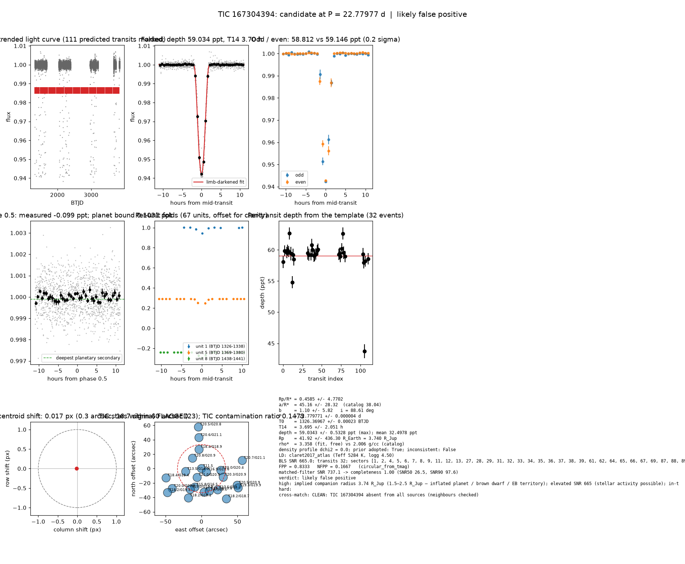

# Candidate packet: TIC 167304394, P = 22.77977 d

Generated 2026-09-03 07:08 UTC by tesshunter. This is a CANDIDATE. Nothing in this packet is a detection; the automated checks are necessary, not sufficient. The human reviews and submits.

**Automated verdict:** likely false positive (light curve only: ambiguous / manual vetting required)  
**FPP / NFPP (TRICERATOPS):** 0.8333 / 0.1667 — above 0.5, does not proceed to submission

## Fitted parameters (limb-darkened transit fit)

| parameter | value |
|---|---|
| period | 22.779771 +/- 0.000004 d |
| epoch | 1326.36967 +/- 0.00023 BTJD = 2458326.36967 BJD |
| duration T14 | 3.695 +/- 2.051 h |
| depth (model maximum) | 59.0343 +/- 0.5328 ppt (shape-degenerate error 109.7585 ppt) |
| depth (duration-averaged) | 32.4978 ppt |
| Rp/R* | 0.4585 +/- 4.7702 |
| a/R* | 45.16 +/- 28.32 (catalog density gives 38.04 +/- 10.10) |
| impact parameter | 1.10 +/- 5.82 ; inclination 88.61 deg |
| Rp | 41.92 +/- 436.30 R_Earth = 3.740 +/- 38.925 R_Jup (R* = 0.838 +/- 0.206 R_Sun) |
| stellar density | fit (free) 3.358 g/cc vs catalog 2.006 +/- 1.598 g/cc; ratio 1.67, profile delta chi2 0.0; prior adopted: True; inconsistent: False |
| limb darkening | u1 = 0.383, u2 = 0.233 (claret2017_atlas (Teff 5284 K, logg 4.50)) |
| fit | least_squares, 916 points, 32 transits, reduced chi2 4.57, delta BIC vs flat 462722 |
| BLS | SNR 665.0, box depth 42.192 ppt, 32 transits observed, alias label P |

## Vetting checks

| check | result |
|---|---|
| odd/even (median) | pass (0.2 sigma) |
| odd/even (fit template) | odd 58.812 +/- 1.499 ppt (11 events), even 59.146 +/- 0.306 ppt (21 events), difference 0.2 sigma, 1% of the mean |
| secondary at phase 0.5 | -0.0992 ppt measured; deepest planetary secondary at the fitted a/R* 0.1031 ppt; not detected |
| a/R* consistency | pass — free-fit a/R* = 45.16 (b = 1.10) against 38.04 +/- 10.10 from the catalog density (3.358 vs 2.006 g/cc, ratio 1.67; profile delta chi2 0.0 with a/R* held in the catalog range, 0.0 after the red-noise  |
| V-shape | medium (t_flat/t_total 0.15); fitted geometry grazing: True |
| per-unit depths | FLAG |
| centroid | shift 0.017 px, 16.7 sigma FLAG |
| contamination | flagged, 42 neighbours checked |
| FPP / NFPP | 0.8333 / 0.1667 (TRICERATOPS 1.1.0: FPP 0.8333, NFPP 0.1667 over 18 scenarios and 240 TIC stars within 10 px; aperture circular_from_tmag; 100000 draws; fold binned (45 points, error 129 ppm); sectors [1, 2, 4].) |

Flags: implied companion radius 3.74 R_Jup (1.5–2.5 R_Jup — inflated planet / brown dwarf / EB territory); elevated SNR 665 (stellar activity possible); in-transit centroid shift 0.017 px (0.3 arcsec, 16.7 sigma) over 32 sector(s) — signal may sit on a neighbour; TRICERATOPS nearby false-positive probability 0.167 >= 0.1; nearby star could produce the signal: 2 high-risk and 0 medium-risk neighbour(s) of 42 checked; per-unit transit depths disagree by > 3σ across observing units; V-shape tendency (t_flat/t_total = 0.15 < 0.3)

## Completeness at this SNR

Matched-filter SNR 737.1 on this star's detrended data binned to 30 min: the P2 completeness curve (`docs/COMPLETENESS.md`, 2100 injections on 300 stars, config survey_v1) recovers 1.00 of injected signals at this SNR (SNR50 = 26.5, SNR90 = 97.6; the 50-1000000000.0 bin recovered 586/658). Curve measured in P2 with batman injections into the survey preset (survey_v1: FFI stitches binned to 30 min, periods 1-40 d, Rp/R* 0.01-0.12); the matched-filter SNR here is computed on this candidate's own detrended data with the same definition. Outside that regime the number is an extrapolation.

## Star and neighbours

TIC 167304394: Teff 5284 K, log g n/a, R = 0.838 +/- 0.206 R_Sun, M = n/a M_Sun, Tmag 11.47, TIC contamination ratio 0.1473 (source tic; assumed errors: False).

| ID | dstArcSec | Tmag | GAIAmag | gaiabp | gaiarp | Teff | rad | contratio | disposition |
|---|---|---|---|---|---|---|---|---|---|
| 167304394 | 0.00 | 11.47 | n/a | n/a | n/a | 5283.53 | 0.84 | 0.15 | n/a |
| 167304392 | 8.33 | 16.91 | 17.60 | 18.21 | 16.84 | 4616.00 | 0.81 | n/a | n/a |
| 736590142 | 13.73 | 20.99 | 20.87 | 20.21 | 20.34 | n/a | n/a | n/a | n/a |
| 736590144 | 18.97 | 20.76 | 20.91 | 20.96 | 20.67 | n/a | n/a | n/a | n/a |
| 167304393 | 22.25 | 13.50 | 14.04 | 14.49 | 13.45 | 5307.00 | 2.25 | n/a | n/a |
| 736590148 | 26.72 | 18.37 | 18.94 | 19.27 | 18.15 | n/a | n/a | n/a | n/a |
| 736590141 | 27.00 | 19.97 | 20.39 | 20.59 | 19.78 | n/a | n/a | n/a | n/a |
| 167304391 | 27.36 | 15.77 | 16.53 | 17.26 | 15.71 | 4358.00 | 5.47 | n/a | n/a |
| 736590143 | 32.53 | 20.32 | 20.87 | 21.39 | 20.34 | n/a | n/a | n/a | n/a |
| 736590117 | 32.80 | 18.99 | 19.84 | 20.71 | 18.93 | 4029.00 | n/a | n/a | n/a |
| 167304386 | 32.97 | 17.44 | 18.10 | 18.68 | 17.37 | 4718.00 | 1.06 | n/a | n/a |
| 736590140 | 33.09 | 19.07 | 19.60 | 19.96 | 18.94 | 5364.00 | n/a | n/a | n/a |
| 167304390 | 37.10 | 17.45 | 18.16 | 18.80 | 17.38 | 4535.00 | 0.46 | n/a | n/a |
| 736590147 | 43.13 | 20.63 | 21.06 | n/a | n/a | n/a | n/a | n/a | n/a |
| 167304384 | 44.66 | 18.16 | 19.12 | 20.15 | 18.03 | n/a | n/a | n/a | n/a |
| 736590833 | 49.10 | 20.01 | 20.78 | 21.48 | 19.91 | n/a | n/a | n/a | n/a |
| 736590832 | 50.80 | 18.45 | 19.42 | 20.50 | 18.37 | 3804.00 | 0.45 | n/a | n/a |
| 736590134 | 54.48 | 18.19 | 18.75 | 19.18 | 18.10 | 5231.00 | 0.59 | n/a | n/a |
| 736590139 | 54.70 | 20.52 | 20.95 | n/a | n/a | n/a | n/a | n/a | n/a |
| 736590135 | 57.56 | 19.31 | 19.93 | 20.36 | 19.14 | 4912.00 | n/a | n/a | n/a |
| 736590145 | 57.73 | 20.71 | 21.14 | n/a | n/a | n/a | n/a | n/a | n/a |
| 167304387 | 57.76 | 18.20 | 19.26 | 20.40 | 18.02 | 3640.00 | 0.40 | n/a | n/a |
| 736590146 | 57.79 | 20.47 | 20.80 | 20.93 | 20.29 | n/a | n/a | n/a | n/a |

## Cross-match

CLEAN: TIC 167304394 absent from all sources (neighbours checked)  
Catalog versions: `ctoi=2026-09-03:f6964541;nasa_ps=2026-09-03:85f3c196;nasa_pscomppars=2026-09-03:4843e49c;spoc_tce=2026-09-03:e580dde7;tess_eb=2026-09-03:43555226;toi=2026-09-03:4704bb7c`

## Data

Sectors [1, 2, 4, 5, 6, 7, 8, 9, 11, 12, 13, 27, 28, 29, 31, 32, 33, 34, 35, 36, 37, 38, 39, 61, 62, 64, 65, 66, 67, 69, 87, 88, 89, 93]; 34511 raw and 34511 cleaned cadences; products: QLP s1, QLP s2, QLP s4, QLP s5, QLP s6, QLP s7.

## Figure



## ExoFOP CTOI fields

```json
{
 "target": "TIC 167304394",
 "tic_id": 167304394,
 "discovery_source": "TESS",
 "period_days": 22.77977057431056,
 "period_err_days": 3.846885750565677e-06,
 "epoch_bjd": 2458326.369670795,
 "epoch_err_days": 0.0002260697921337553,
 "depth_ppm": 59034.33271635705,
 "depth_err_ppm": 532.7650653128044,
 "duration_hours": 3.69510582600482,
 "duration_err_hours": 2.051129062895301,
 "disposition": "PC",
 "tag": "FILL_ME: YYYYMMDD_username_tesshunter_NNN",
 "candidate_name": null,
 "paper_url": null,
 "notes": "Survey rank 1 (frozen score 3.5); survey stitch SNR 659.875517196826, 32.0 transits."
}
```

_The pipeline finds candidates. It does not submit._
