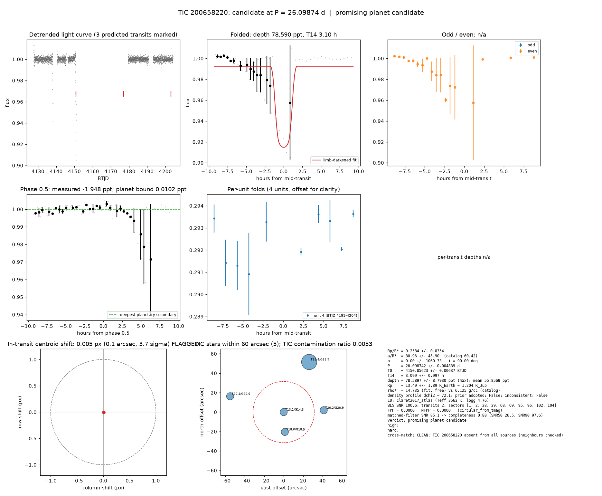

# Candidate packet: TIC 200658220, P = 26.09874 d

Generated 2026-09-03 10:11 UTC by tesshunter. This is a CANDIDATE. Nothing in this packet is a detection; the automated checks are necessary, not sufficient. The human reviews and submits.

**Automated verdict:** promising planet candidate (light curve only: promising planet candidate)  
**FPP / NFPP (TRICERATOPS):** 0.0000 / 0.0000

## Fitted parameters (limb-darkened transit fit)

| parameter | value |
|---|---|
| period | 26.098742 +/- 0.004839 d |
| epoch | 4150.85623 +/- 0.00637 BTJD = 2461150.85623 BJD |
| duration T14 | 3.099 +/- 0.997 h |
| depth (model maximum) | 78.5897 +/- 8.7930 ppt (shape-degenerate error 28.7123 ppt) |
| depth (duration-averaged) | 55.8569 ppt |
| Rp/R* | 0.2584 +/- 0.0354 |
| a/R* | 80.96 +/- 45.90 (catalog density gives 60.42 +/- 0.95) |
| impact parameter | 0.00 +/- 1060.33 ; inclination 90.00 deg |
| Rp | 13.49 +/- 1.89 R_Earth = 1.204 +/- 0.169 R_Jup (R* = 0.479 +/- 0.014 R_Sun) |
| stellar density | fit (free) 14.735 g/cc vs catalog 6.125 +/- 0.288 g/cc; ratio 2.41, profile delta chi2 72.1; prior adopted: False; inconsistent: False |
| limb darkening | u1 = 0.281, u2 = 0.365 (claret2017_atlas (Teff 3563 K, logg 4.76)) |
| fit | least_squares, 42 points, 2 transits, reduced chi2 69.06, delta BIC vs flat 4917 |
| BLS | SNR 100.6, box depth 74.905 ppt, 2 transits observed, alias label P |

## Vetting checks

| check | result |
|---|---|
| odd/even (median) | pass (0.0 sigma) |
| odd/even (fit template) | no odd transit inside the window |
| secondary at phase 0.5 | -1.9482 ppt measured; deepest planetary secondary at the fitted a/R* 0.0102 ppt; not detected |
| a/R* consistency | pass — free-fit a/R* = 80.96 (b = 0.00) against 60.42 +/- 0.95 from the catalog density (14.735 vs 6.125 g/cc, ratio 2.41; profile delta chi2 72.1 with a/R* held in the catalog range, 72.1 after the red-nois |
| V-shape | none (t_flat/t_total n/a); fitted geometry grazing: False |
| per-unit depths | pass |
| centroid | shift 0.005 px, 3.7 sigma FLAG |
| contamination | flagged, 17 neighbours checked |
| FPP / NFPP | 0.0000 / 0.0000 (TRICERATOPS 1.1.0: FPP 0.0000, NFPP 0.0000 over 18 scenarios and 44 TIC stars within 10 px; aperture circular_from_tmag; 100000 draws; fold binned (54 points, error 2636 ppm); sectors [1, 2, 28].) |

Flags: in-transit centroid shift 0.005 px (0.1 arcsec, 3.7 sigma) over 10 sector(s) (below 4 sigma)

## Completeness at this SNR

Matched-filter SNR 85.1 on this star's detrended data binned to 30 min: the P2 completeness curve (`docs/COMPLETENESS.md`, 2100 injections on 300 stars, config survey_v1) recovers 0.88 of injected signals at this SNR (SNR50 = 26.5, SNR90 = 97.6; the 50-1000000000.0 bin recovered 586/658). Curve measured in P2 with batman injections into the survey preset (survey_v1: FFI stitches binned to 30 min, periods 1-40 d, Rp/R* 0.01-0.12); the matched-filter SNR here is computed on this candidate's own detrended data with the same definition. Outside that regime the number is an extrapolation.

## Star and neighbours

TIC 200658220: Teff 3563 K, log g 4.76, R = 0.479 +/- 0.014 R_Sun, M = 0.477 +/- 0.020 M_Sun, Tmag 13.14, TIC contamination ratio 0.0053 (source tic; assumed errors: False).

| ID | dstArcSec | Tmag | GAIAmag | gaiabp | gaiarp | Teff | rad | contratio | disposition |
|---|---|---|---|---|---|---|---|---|---|
| 200658220 | 0.00 | 13.14 | 14.26 | 15.46 | 13.18 | 3563.00 | 0.48 | 0.01 | n/a |
| 616115226 | 20.44 | 18.01 | 18.54 | 18.95 | 17.94 | 5258.00 | 0.53 | n/a | n/a |
| 616115228 | 41.27 | 20.18 | 20.89 | 21.18 | 19.76 | n/a | n/a | n/a | n/a |
| 616115227 | 57.45 | 20.36 | 20.65 | 20.79 | 20.25 | n/a | n/a | n/a | n/a |
| 200658222 | 57.84 | 11.44 | 11.88 | 12.22 | 11.39 | 5782.00 | 1.63 | 0.02 | n/a |

## Cross-match

CLEAN: TIC 200658220 absent from all sources (neighbours checked)  
Catalog versions: `ctoi=2026-09-03:f6964541;nasa_ps=2026-09-03:85f3c196;nasa_pscomppars=2026-09-03:4843e49c;spoc_tce=2026-09-03:e580dde7;tess_eb=2026-09-03:43555226;toi=2026-09-03:4704bb7c`

## Data

Sectors [1, 2, 28, 29, 68, 69, 95, 96, 102, 104]; 1982 raw and 1982 cleaned cadences; products: TESS-SPOC s1, TESS-SPOC s2, TESS-SPOC s28, QLP s29, QLP s68, QLP s69.

## Figure



## ExoFOP CTOI fields

```json
{
 "target": "TIC 200658220",
 "tic_id": 200658220,
 "discovery_source": "TESS",
 "period_days": 26.098742232897113,
 "period_err_days": 0.004839150120790709,
 "epoch_bjd": 2461150.8562329737,
 "epoch_err_days": 0.006373474816632704,
 "depth_ppm": 78589.69762801094,
 "depth_err_ppm": 8793.008731417665,
 "duration_hours": 3.099340383446146,
 "duration_err_hours": 0.9969657992762424,
 "disposition": "PC",
 "tag": "FILL_ME: YYYYMMDD_username_tesshunter_NNN",
 "candidate_name": null,
 "paper_url": null,
 "notes": "Survey rank 20 (frozen score 2.9687); survey stitch SNR 41.92212119335612, 7.0 transits."
}
```

_The pipeline finds candidates. It does not submit._
