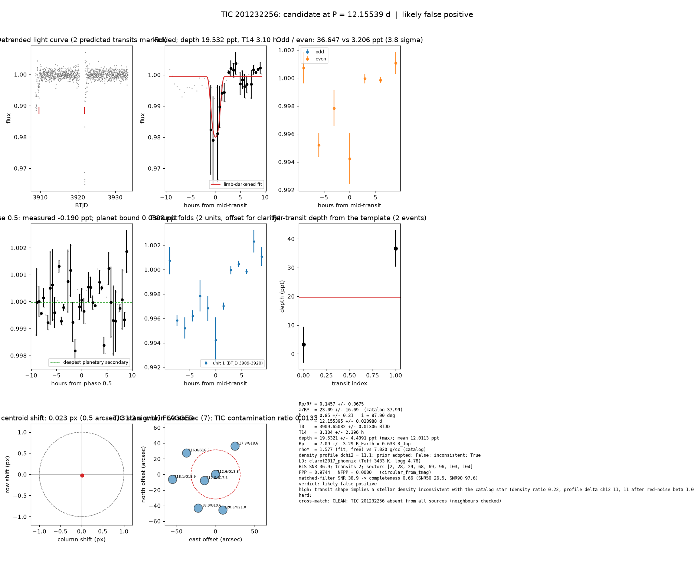

# Candidate packet: TIC 201232256, P = 12.15539 d

Generated 2026-09-03 10:06 UTC by tesshunter. This is a CANDIDATE. Nothing in this packet is a detection; the automated checks are necessary, not sufficient. The human reviews and submits.

**Automated verdict:** likely false positive (light curve only: ambiguous / manual vetting required)  
**FPP / NFPP (TRICERATOPS):** 0.9744 / 0.0000 — above 0.5, does not proceed to submission

## Fitted parameters (limb-darkened transit fit)

| parameter | value |
|---|---|
| period | 12.155395 +/- 0.020988 d |
| epoch | 3909.65082 +/- 0.01306 BTJD = 2460909.65082 BJD |
| duration T14 | 3.104 +/- 2.396 h |
| depth (model maximum) | 19.5321 +/- 4.4391 ppt (shape-degenerate error 17.8710 ppt) |
| depth (duration-averaged) | 12.0113 ppt |
| Rp/R* | 0.1457 +/- 0.0675 |
| a/R* | 23.09 +/- 16.69 (catalog density gives 37.99 +/- 0.55) |
| impact parameter | 0.85 +/- 0.31 ; inclination 87.90 deg |
| Rp | 7.09 +/- 3.29 R_Earth = 0.633 +/- 0.294 R_Jup (R* = 0.446 +/- 0.013 R_Sun) |
| stellar density | fit (free) 1.577 g/cc vs catalog 7.020 +/- 0.306 g/cc; ratio 0.22, profile delta chi2 11.1; prior adopted: False; inconsistent: True |
| limb darkening | u1 = 0.170, u2 = 0.437 (claret2017_phoenix (Teff 3433 K, logg 4.78)) |
| fit | least_squares, 22 points, 2 transits, reduced chi2 93.18, delta BIC vs flat 1017 |
| BLS | SNR 36.9, box depth 22.554 ppt, 2 transits observed, alias label P |

## Vetting checks

| check | result |
|---|---|
| odd/even (median) | pass (0.0 sigma) |
| odd/even (fit template) | odd 36.647 +/- 6.354 ppt (1 events), even 3.206 +/- 6.204 ppt (1 events), difference 3.8 sigma, 168% of the mean |
| secondary at phase 0.5 | -0.1901 ppt measured; deepest planetary secondary at the fitted a/R* 0.0398 ppt; not detected |
| a/R* consistency | FLAG — free-fit a/R* = 23.09 (b = 0.85) against 37.99 +/- 0.55 from the catalog density (1.577 vs 7.020 g/cc, ratio 0.22; profile delta chi2 11.1 with a/R* held in the catalog range, 11.1 after the red-noise |
| V-shape | none (t_flat/t_total n/a); fitted geometry grazing: False |
| per-unit depths | pass |
| centroid | shift 0.023 px, 31.2 sigma FLAG |
| contamination | flagged, 10 neighbours checked |
| FPP / NFPP | 0.9744 / 0.0000 (TRICERATOPS 1.1.0: FPP 0.9744, NFPP 0.0000 over 15 scenarios and 31 TIC stars within 10 px; aperture circular_from_tmag; 100000 draws; fold binned (22 points, error 2430 ppm); sectors [2, 28, 29].) |

Flags: transit shape implies a stellar density inconsistent with the catalog star (density ratio 0.22, profile delta chi2 11, 11 after red-noise beta 1.00) — diluted eclipse, grazing stellar companion or blend; in-transit centroid shift 0.023 px (0.5 arcsec, 31.2 sigma) over 8 sector(s) — signal may sit on a neighbour

## Completeness at this SNR

Matched-filter SNR 38.9 on this star's detrended data binned to 30 min: the P2 completeness curve (`docs/COMPLETENESS.md`, 2100 injections on 300 stars, config survey_v1) recovers 0.66 of injected signals at this SNR (SNR50 = 26.5, SNR90 = 97.6; the 20-50 bin recovered 237/368). Curve measured in P2 with batman injections into the survey preset (survey_v1: FFI stitches binned to 30 min, periods 1-40 d, Rp/R* 0.01-0.12); the matched-filter SNR here is computed on this candidate's own detrended data with the same definition. Outside that regime the number is an extrapolation.

## Star and neighbours

TIC 201232256: Teff 3433 K, log g 4.78, R = 0.446 +/- 0.013 R_Sun, M = 0.443 +/- 0.020 M_Sun, Tmag 12.63, TIC contamination ratio 0.0133 (source tic; assumed errors: False).

| ID | dstArcSec | Tmag | GAIAmag | gaiabp | gaiarp | Teff | rad | contratio | disposition |
|---|---|---|---|---|---|---|---|---|---|
| 201232256 | 0.00 | 12.63 | 13.83 | 15.18 | 12.68 | 3433.00 | 0.45 | 0.01 | n/a |
| 201232258 | 16.30 | 17.02 | 17.51 | 17.90 | 16.96 | 5440.00 | 0.59 | n/a | n/a |
| 201232254 | 43.97 | 17.31 | 18.62 | 20.07 | 17.38 | 3331.00 | 0.31 | n/a | n/a |
| 201232255 | 46.18 | 16.02 | 16.49 | 16.85 | 15.96 | 5606.00 | 0.73 | n/a | n/a |
| 2055543037 | 46.76 | 20.61 | 21.04 | n/a | n/a | n/a | n/a | n/a | n/a |
| 2055543038 | 48.75 | 18.87 | 19.62 | 20.15 | 18.62 | n/a | n/a | n/a | n/a |
| 201232257 | 55.48 | 18.09 | 18.93 | 19.74 | 17.99 | 4017.00 | 0.71 | n/a | n/a |

## Cross-match

CLEAN: TIC 201232256 absent from all sources (neighbours checked)  
Catalog versions: `ctoi=2026-09-03:f6964541;nasa_ps=2026-09-03:85f3c196;nasa_pscomppars=2026-09-03:4843e49c;spoc_tce=2026-09-03:e580dde7;tess_eb=2026-09-03:43555226;toi=2026-09-03:4704bb7c`

## Data

Sectors [2, 28, 29, 68, 69, 96, 103, 104]; 1095 raw and 1095 cleaned cadences; products: TESS-SPOC s2, TESS-SPOC s28, TESS-SPOC s29, TESS-SPOC s68, TESS-SPOC s69, QLP s96.

## Figure



## ExoFOP CTOI fields

```json
{
 "target": "TIC 201232256",
 "tic_id": 201232256,
 "discovery_source": "TESS",
 "period_days": 12.155394553304129,
 "period_err_days": 0.020988326121763257,
 "epoch_bjd": 2460909.6508181132,
 "epoch_err_days": 0.01305634151821647,
 "depth_ppm": 19532.059872960475,
 "depth_err_ppm": 4439.1014330371645,
 "duration_hours": 3.1042387977622417,
 "duration_err_hours": 2.396333573126963,
 "disposition": "PC",
 "tag": "FILL_ME: YYYYMMDD_username_tesshunter_NNN",
 "candidate_name": null,
 "paper_url": null,
 "notes": "Survey rank 13 (frozen score 3.0743); survey stitch SNR 24.096415632497727, 11.0 transits."
}
```

_The pipeline finds candidates. It does not submit._
