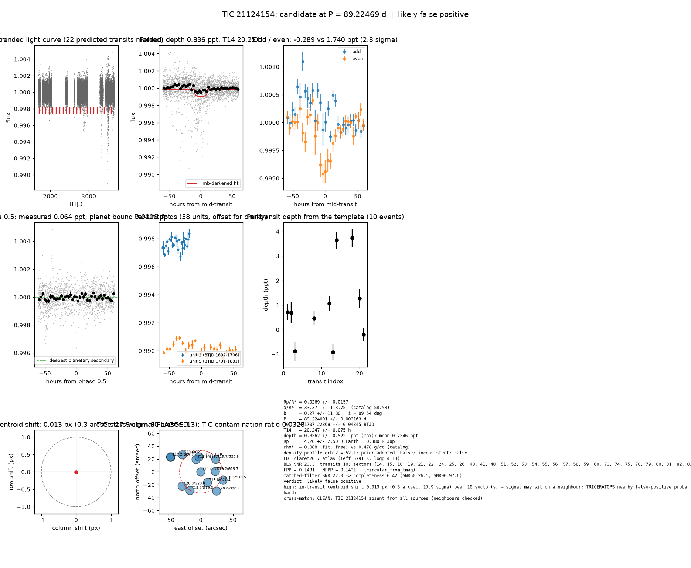

# Candidate packet: TIC 21124154, P = 89.22469 d

Generated 2026-09-03 07:46 UTC by tesshunter. This is a CANDIDATE. Nothing in this packet is a detection; the automated checks are necessary, not sufficient. The human reviews and submits.

**Automated verdict:** likely false positive (light curve only: promising planet candidate)  
**FPP / NFPP (TRICERATOPS):** 0.1431 / 0.1431

## Fitted parameters (limb-darkened transit fit)

| parameter | value |
|---|---|
| period | 89.224691 +/- 0.003163 d |
| epoch | 1707.22369 +/- 0.04345 BTJD = 2458707.22369 BJD |
| duration T14 | 20.247 +/- 6.075 h |
| depth (model maximum) | 0.8362 +/- 0.5221 ppt (shape-degenerate error 0.2890 ppt) |
| depth (duration-averaged) | 0.7346 ppt |
| Rp/R* | 0.0269 +/- 0.0157 |
| a/R* | 33.37 +/- 113.75 (catalog density gives 58.58 +/- 4.10) |
| impact parameter | 0.27 +/- 11.80 ; inclination 89.54 deg |
| Rp | 4.26 +/- 2.50 R_Earth = 0.380 +/- 0.223 R_Jup (R* = 1.453 +/- 0.071 R_Sun) |
| stellar density | fit (free) 0.088 g/cc vs catalog 0.478 +/- 0.100 g/cc; ratio 0.18, profile delta chi2 52.1; prior adopted: False; inconsistent: False |
| limb darkening | u1 = 0.295, u2 = 0.282 (claret2017_atlas (Teff 5791 K, logg 4.13)) |
| fit | least_squares, 1200 points, 10 transits, reduced chi2 6.13, delta BIC vs flat 244 |
| BLS | SNR 23.3, box depth 1.012 ppt, 10 transits observed, alias label P |

## Vetting checks

| check | result |
|---|---|
| odd/even (median) | pass (2.8 sigma) |
| odd/even (fit template) | odd -0.289 +/- 0.384 ppt (4 events), even 1.740 +/- 0.607 ppt (6 events), difference 2.8 sigma, 200% of the mean |
| secondary at phase 0.5 | 0.0637 ppt measured; deepest planetary secondary at the fitted a/R* 0.0006 ppt; not detected |
| a/R* consistency | pass — free-fit a/R* = 33.37 (b = 0.27) against 58.58 +/- 4.10 from the catalog density (0.088 vs 0.478 g/cc, ratio 0.18; profile delta chi2 52.1 with a/R* held in the catalog range, 2.1 after the red-noise  |
| V-shape | none (t_flat/t_total n/a); fitted geometry grazing: False |
| per-unit depths | FLAG |
| centroid | shift 0.013 px, 17.9 sigma FLAG |
| contamination | flagged, 30 neighbours checked |
| FPP / NFPP | 0.1431 / 0.1431 (TRICERATOPS 1.1.0: FPP 0.1431, NFPP 0.1431 over 21 scenarios and 102 TIC stars within 10 px; aperture circular_from_tmag; 100000 draws; fold binned (150 points, error 254 ppm); sectors [14, 15, 18].) |

Flags: in-transit centroid shift 0.013 px (0.3 arcsec, 17.9 sigma) over 10 sector(s) — signal may sit on a neighbour; TRICERATOPS nearby false-positive probability 0.143 >= 0.1; nearby star could produce the signal: 5 high-risk and 5 medium-risk neighbour(s) of 30 checked; per-unit transit depths disagree by > 3σ across observing units

## Completeness at this SNR

Matched-filter SNR 22.0 on this star's detrended data binned to 30 min: the P2 completeness curve (`docs/COMPLETENESS.md`, 2100 injections on 300 stars, config survey_v1) recovers 0.42 of injected signals at this SNR (SNR50 = 26.5, SNR90 = 97.6; the 20-50 bin recovered 237/368). Curve measured in P2 with batman injections into the survey preset (survey_v1: FFI stitches binned to 30 min, periods 1-40 d, Rp/R* 0.01-0.12); the matched-filter SNR here is computed on this candidate's own detrended data with the same definition. Outside that regime the number is an extrapolation.

## Star and neighbours

TIC 21124154: Teff 5791 K, log g 4.13, R = 1.453 +/- 0.071 R_Sun, M = 1.040 +/- 0.127 M_Sun, Tmag 11.56, TIC contamination ratio 0.0328 (source tic; assumed errors: False).

| ID | dstArcSec | Tmag | GAIAmag | gaiabp | gaiarp | Teff | rad | contratio | disposition |
|---|---|---|---|---|---|---|---|---|---|
| 21124154 | 0.00 | 11.56 | 12.00 | 12.35 | 11.51 | 5791.00 | 1.45 | 0.03 | n/a |
| 1551275837 | 19.66 | 19.82 | 20.40 | 20.92 | 19.79 | 5026.00 | n/a | n/a | n/a |
| 1551275839 | 20.66 | 18.90 | 19.74 | 20.62 | 18.86 | 4031.00 | n/a | n/a | n/a |
| 21124155 | 22.52 | 15.18 | 15.67 | 16.08 | 15.12 | 5469.00 | 1.02 | n/a | n/a |
| 21124160 | 23.51 | 17.30 | 18.01 | 18.69 | 17.26 | 4465.00 | 0.70 | n/a | n/a |
| 1551275838 | 30.40 | 19.68 | 20.46 | 21.23 | 19.62 | 4222.00 | n/a | n/a | n/a |
| 1551275834 | 33.55 | 18.38 | 19.34 | 20.46 | 18.38 | 3821.00 | 0.82 | n/a | n/a |
| 1551275835 | 36.57 | 19.95 | 20.84 | 21.42 | 19.53 | n/a | n/a | n/a | n/a |
| 21124152 | 36.80 | 18.89 | 19.47 | 18.62 | 17.49 | n/a | n/a | n/a | n/a |
| 1551275832 | 38.75 | 20.00 | 20.82 | 20.31 | 18.58 | n/a | n/a | n/a | n/a |
| 1551275836 | 39.01 | 20.58 | 21.01 | n/a | n/a | n/a | n/a | n/a | n/a |
| 21124258 | 51.98 | 17.17 | 17.72 | 18.10 | 17.03 | 5186.00 | n/a | n/a | SPLIT |
| 500570659 | 52.42 | 19.66 | 20.09 | n/a | n/a | n/a | n/a | n/a | n/a |

## Cross-match

CLEAN: TIC 21124154 absent from all sources (neighbours checked)  
Catalog versions: `ctoi=2026-09-03:f6964541;nasa_ps=2026-09-03:85f3c196;nasa_pscomppars=2026-09-03:4843e49c;spoc_tce=2026-09-03:e580dde7;tess_eb=2026-09-03:43555226;toi=2026-09-03:4704bb7c`

## Data

Sectors [14, 15, 18, 19, 21, 22, 24, 25, 26, 40, 41, 48, 51, 52, 53, 54, 55, 56, 57, 58, 59, 60, 73, 74, 75, 78, 79, 80, 81, 82, 83, 85, 86]; 35207 raw and 33771 cleaned cadences; products: TESS-SPOC s14, TESS-SPOC s15, TESS-SPOC s18, TESS-SPOC s19, TESS-SPOC s21, TESS-SPOC s22.

## Figure



## ExoFOP CTOI fields

```json
{
 "target": "TIC 21124154",
 "tic_id": 21124154,
 "discovery_source": "TESS",
 "period_days": 89.22469090261255,
 "period_err_days": 0.0031633253477233313,
 "epoch_bjd": 2458707.2236901275,
 "epoch_err_days": 0.04344982810271137,
 "depth_ppm": 836.1697863020768,
 "depth_err_ppm": 522.1260374801155,
 "duration_hours": 20.247476898399484,
 "duration_err_hours": 6.075174505382298,
 "disposition": "PC",
 "tag": "FILL_ME: YYYYMMDD_username_tesshunter_NNN",
 "candidate_name": null,
 "paper_url": null,
 "notes": "Survey rank 24 (frozen score 3.0765); survey stitch SNR 24.184886341894124, 10.0 transits."
}
```

_The pipeline finds candidates. It does not submit._
