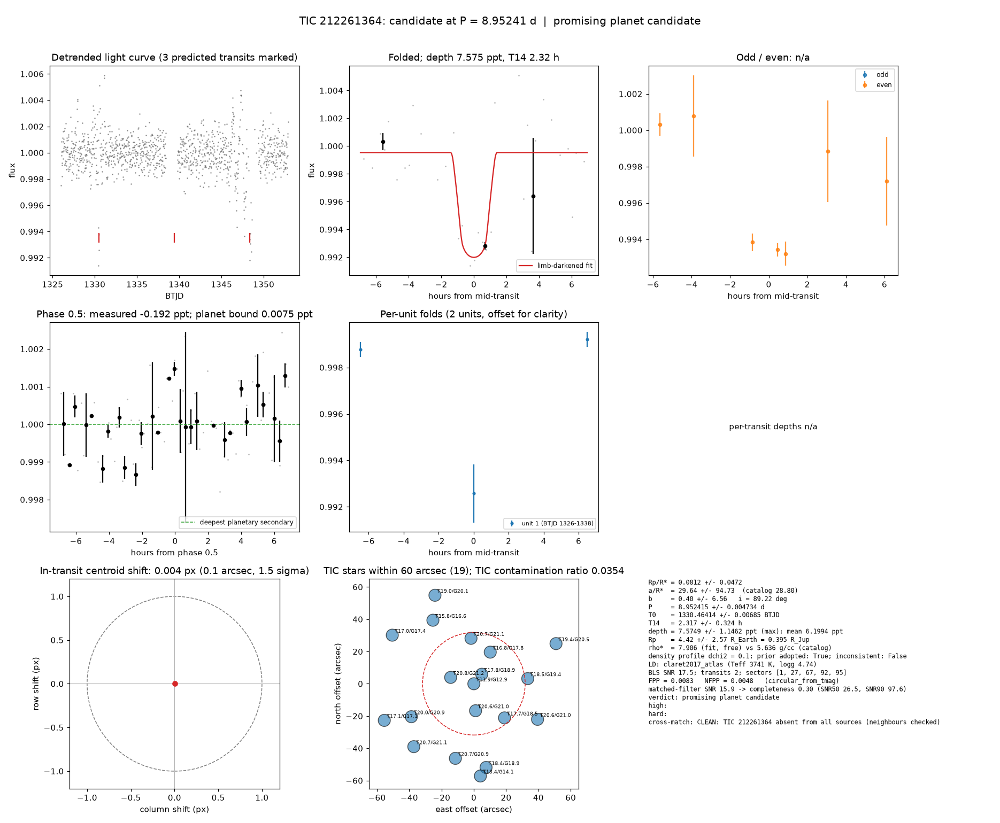

# Candidate packet: TIC 212261364, P = 8.95241 d

Generated 2026-09-03 06:14 UTC by tesshunter. This is a CANDIDATE. Nothing in this packet is a detection; the automated checks are necessary, not sufficient. The human reviews and submits.

**Automated verdict:** promising planet candidate (light curve only: promising planet candidate)  
**FPP / NFPP (TRICERATOPS):** 0.0083 / 0.0048

## Fitted parameters (limb-darkened transit fit)

| parameter | value |
|---|---|
| period | 8.952415 +/- 0.004734 d |
| epoch | 1330.46414 +/- 0.00685 BTJD = 2458330.46414 BJD |
| duration T14 | 2.317 +/- 0.324 h |
| depth (model maximum) | 7.5749 +/- 1.1462 ppt (shape-degenerate error 5.9181 ppt) |
| depth (duration-averaged) | 6.1994 ppt |
| Rp/R* | 0.0812 +/- 0.0472 |
| a/R* | 29.64 +/- 94.73 (catalog density gives 28.80 +/- 0.46) |
| impact parameter | 0.40 +/- 6.56 ; inclination 89.22 deg |
| Rp | 4.42 +/- 2.57 R_Earth = 0.395 +/- 0.230 R_Jup (R* = 0.499 +/- 0.015 R_Sun) |
| stellar density | fit (free) 7.906 g/cc vs catalog 5.636 +/- 0.270 g/cc; ratio 1.40, profile delta chi2 0.1; prior adopted: True; inconsistent: False |
| limb darkening | u1 = 0.274, u2 = 0.363 (claret2017_atlas (Teff 3741 K, logg 4.74)) |
| fit | least_squares, 35 points, 2 transits, reduced chi2 8.36, delta BIC vs flat 263 |
| BLS | SNR 17.5, box depth 6.921 ppt, 2 transits observed, alias label P |

## Vetting checks

| check | result |
|---|---|
| odd/even (median) | pass (0.0 sigma) |
| odd/even (fit template) | no odd transit inside the window |
| secondary at phase 0.5 | -0.1916 ppt measured; deepest planetary secondary at the fitted a/R* 0.0075 ppt; not detected |
| a/R* consistency | pass — free-fit a/R* = 32.24 (b = 0.00) against 28.80 +/- 0.46 from the catalog density (7.906 vs 5.636 g/cc, ratio 1.40; profile delta chi2 0.1 with a/R* held in the catalog range, 0.1 after the red-noise b |
| V-shape | none (t_flat/t_total n/a); fitted geometry grazing: False |
| per-unit depths | pass |
| centroid | shift 0.004 px, 1.5 sigma |
| contamination | flagged, 48 neighbours checked |
| FPP / NFPP | 0.0083 / 0.0048 (TRICERATOPS 1.1.0: FPP 0.0083, NFPP 0.0048 over 18 scenarios and 126 TIC stars within 10 px; aperture circular_from_tmag; 100000 draws; fold binned (34 points, error 2169 ppm); sectors [1, 27, 67].) |

Flags: none

## Completeness at this SNR

Matched-filter SNR 15.9 on this star's detrended data binned to 30 min: the P2 completeness curve (`docs/COMPLETENESS.md`, 2100 injections on 300 stars, config survey_v1) recovers 0.30 of injected signals at this SNR (SNR50 = 26.5, SNR90 = 97.6; the 12-20 bin recovered 77/207). Curve measured in P2 with batman injections into the survey preset (survey_v1: FFI stitches binned to 30 min, periods 1-40 d, Rp/R* 0.01-0.12); the matched-filter SNR here is computed on this candidate's own detrended data with the same definition. Outside that regime the number is an extrapolation.

## Star and neighbours

TIC 212261364: Teff 3741 K, log g 4.74, R = 0.499 +/- 0.015 R_Sun, M = 0.497 +/- 0.020 M_Sun, Tmag 11.92, TIC contamination ratio 0.0354 (source tic; assumed errors: False).

| ID | dstArcSec | Tmag | GAIAmag | gaiabp | gaiarp | Teff | rad | contratio | disposition |
|---|---|---|---|---|---|---|---|---|---|
| 212261364 | 0.00 | 11.92 | 12.94 | 13.97 | 11.94 | 3741.00 | 0.50 | 0.04 | n/a |
| 212261367 | 7.64 | 17.80 | 18.85 | 19.99 | 17.64 | 3658.00 | n/a | n/a | n/a |
| 1992665711 | 14.91 | 20.76 | 21.19 | n/a | n/a | n/a | n/a | n/a | n/a |
| 1992665712 | 16.74 | 20.62 | 21.05 | n/a | n/a | n/a | n/a | n/a | n/a |
| 212261369 | 22.07 | 16.83 | 17.77 | 18.66 | 16.83 | 3935.00 | 0.61 | n/a | n/a |
| 1992665713 | 28.23 | 20.70 | 21.13 | n/a | n/a | n/a | n/a | n/a | n/a |
| 1992665709 | 28.42 | 17.73 | 18.45 | 19.12 | 17.67 | 4499.00 | n/a | n/a | n/a |
| 1992665710 | 33.55 | 18.51 | 19.40 | 20.33 | 18.44 | 3979.00 | 0.47 | n/a | n/a |
| 1992665695 | 43.77 | 20.04 | 20.95 | 21.66 | 19.69 | n/a | n/a | n/a | n/a |
| 1992665708 | 45.21 | 20.58 | 21.01 | n/a | n/a | n/a | n/a | n/a | n/a |
| 212261372 | 46.84 | 15.78 | 16.56 | 17.31 | 15.72 | 4295.00 | 0.67 | n/a | n/a |
| 1992665697 | 47.63 | 20.69 | 20.90 | 20.54 | 20.12 | n/a | n/a | n/a | n/a |
| 1992665693 | 52.43 | 18.44 | 18.89 | 19.22 | 18.35 | 5835.00 | n/a | n/a | n/a |
| 1992665696 | 53.89 | 20.68 | 21.11 | n/a | n/a | n/a | n/a | n/a | n/a |
| 1992665718 | 56.66 | 19.45 | 20.48 | 21.59 | 19.30 | 3703.00 | 0.69 | n/a | n/a |
| 212261356 | 57.33 | 13.38 | 14.12 | 14.83 | 13.32 | 4369.00 | 0.63 | n/a | n/a |
| 212261371 | 58.84 | 17.00 | 17.43 | 17.76 | 16.95 | 6024.00 | 0.66 | n/a | n/a |
| 1992665719 | 59.92 | 18.98 | 20.07 | 21.33 | 18.85 | 3585.00 | n/a | n/a | n/a |
| 1992665701 | 59.95 | 17.09 | 17.11 | 17.14 | 17.03 | n/a | n/a | n/a | n/a |

## Cross-match

CLEAN: TIC 212261364 absent from all sources (neighbours checked)  
Catalog versions: `ctoi=2026-09-03:f6964541;nasa_ps=2026-09-03:85f3c196;nasa_pscomppars=2026-09-03:4843e49c;spoc_tce=2026-09-03:e580dde7;tess_eb=2026-09-03:43555226;toi=2026-09-03:4704bb7c`

## Data

Sectors [1, 27, 67, 92, 95]; 1136 raw and 1121 cleaned cadences; products: TESS-SPOC s1, TESS-SPOC s27, TESS-SPOC s67, QLP s92, QLP s95.

## Figure



## ExoFOP CTOI fields

```json
{
 "target": "TIC 212261364",
 "tic_id": 212261364,
 "discovery_source": "TESS",
 "period_days": 8.952414938882496,
 "period_err_days": 0.004734089349274201,
 "epoch_bjd": 2458330.464142836,
 "epoch_err_days": 0.006846353622326635,
 "depth_ppm": 7574.897410772552,
 "depth_err_ppm": 1146.16134450155,
 "duration_hours": 2.3166150390139,
 "duration_err_hours": 0.32384511575298036,
 "disposition": "PC",
 "tag": "FILL_ME: YYYYMMDD_username_tesshunter_NNN",
 "candidate_name": null,
 "paper_url": null,
 "notes": "Survey rank 3 (frozen score 3.5); survey stitch SNR 120.16704033491457, 10.0 transits."
}
```

_The pipeline finds candidates. It does not submit._
