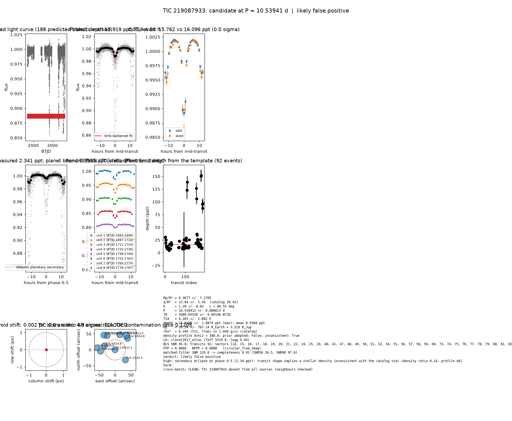

# Candidate packet: TIC 219087933, P = 10.53941 d

Generated 2026-09-03 07:05 UTC by tesshunter. This is a CANDIDATE. Nothing in this packet is a detection; the automated checks are necessary, not sufficient. The human reviews and submits.

**Automated verdict:** likely false positive (light curve only: likely false positive)  
**FPP / NFPP (TRICERATOPS):** 0.9660 / 0.0000 — above 0.5, does not proceed to submission

## Fitted parameters (limb-darkened transit fit)

| parameter | value |
|---|---|
| period | 10.539412 +/- 0.000013 d |
| epoch | 1689.05530 +/- 0.00146 BTJD = 2458689.05530 BJD |
| duration T14 | 4.203 +/- 2.882 h |
| depth (model maximum) | 15.9189 +/- 1.0874 ppt (shape-degenerate error 68.6611 ppt) |
| depth (duration-averaged) | 8.9368 ppt |
| Rp/R* | 0.3677 +/- 7.1705 |
| a/R* | 12.64 +/- 5.56 (catalog density gives 20.42 +/- 1.53) |
| impact parameter | 1.20 +/- 8.03 ; inclination 84.55 deg |
| Rp | 39.34 +/- 767.14 R_Earth = 3.510 +/- 68.440 R_Jup (R* = 0.981 +/- 0.053 R_Sun) |
| stellar density | fit (free) 0.344 g/cc vs catalog 1.449 +/- 0.325 g/cc; ratio 0.24, profile delta chi2 340.8; prior adopted: False; inconsistent: True |
| limb darkening | u1 = 0.343, u2 = 0.256 (claret2017_atlas (Teff 5519 K, logg 4.44)) |
| fit | least_squares, 2532 points, 92 transits, reduced chi2 22.60, delta BIC vs flat 95108 |
| BLS | SNR 95.8, box depth 10.695 ppt, 91 transits observed, alias label P |

## Vetting checks

| check | result |
|---|---|
| odd/even (median) | pass (0.0 sigma) |
| odd/even (fit template) | odd 15.762 +/- 4.815 ppt (48 events), even 16.096 +/- 5.325 ppt (44 events), difference 0.0 sigma, 2% of the mean |
| secondary at phase 0.5 | 2.3410 ppt measured; deepest planetary secondary at the fitted a/R* 0.8595 ppt; STELLAR |
| a/R* consistency | FLAG — free-fit a/R* = 12.64 (b = 1.20) against 20.42 +/- 1.53 from the catalog density (0.344 vs 1.449 g/cc, ratio 0.24; profile delta chi2 340.8 with a/R* held in the catalog range, 13.6 after the red-nois |
| V-shape | medium (t_flat/t_total 0.20); fitted geometry grazing: True |
| per-unit depths | FLAG |
| centroid | shift 0.002 px, 4.9 sigma FLAG |
| contamination | flagged, 32 neighbours checked |
| FPP / NFPP | 0.9660 / 0.0000 (TRICERATOPS 1.1.0: FPP 0.9660, NFPP 0.0000 over 18 scenarios and 72 TIC stars within 10 px; aperture circular_from_tmag; 100000 draws; fold binned (51 points, error 1582 ppm); sectors [14, 15, 16].) |

Flags: secondary eclipse at phase 0.5 (2.34 ppt); transit shape implies a stellar density inconsistent with the catalog star (density ratio 0.24, profile delta chi2 341, 14 after red-noise beta 5.00) — diluted eclipse, grazing stellar companion or blend; in-transit centroid shift 0.002 px (0.0 arcsec, 4.9 sigma) over 40 sector(s) — signal may sit on a neighbour; per-unit transit depths disagree by > 3σ across observing units; V-shape tendency (t_flat/t_total = 0.20 < 0.3)

## Completeness at this SNR

Matched-filter SNR 120.0 on this star's detrended data binned to 30 min: the P2 completeness curve (`docs/COMPLETENESS.md`, 2100 injections on 300 stars, config survey_v1) recovers 0.93 of injected signals at this SNR (SNR50 = 26.5, SNR90 = 97.6; the 50-1000000000.0 bin recovered 586/658). Curve measured in P2 with batman injections into the survey preset (survey_v1: FFI stitches binned to 30 min, periods 1-40 d, Rp/R* 0.01-0.12); the matched-filter SNR here is computed on this candidate's own detrended data with the same definition. Outside that regime the number is an extrapolation.

## Star and neighbours

TIC 219087933: Teff 5519 K, log g 4.44, R = 0.981 +/- 0.053 R_Sun, M = 0.970 +/- 0.121 M_Sun, Tmag 11.77, TIC contamination ratio 0.1205 (source tic; assumed errors: False).

| ID | dstArcSec | Tmag | GAIAmag | gaiabp | gaiarp | Teff | rad | contratio | disposition |
|---|---|---|---|---|---|---|---|---|---|
| 219087933 | 0.00 | 11.77 | 12.25 | 12.64 | 11.72 | 5519.00 | 0.98 | 0.12 | n/a |
| 1401009697 | 35.91 | 18.94 | 19.80 | 20.60 | 18.78 | 3988.00 | n/a | n/a | n/a |
| 219087937 | 45.67 | 15.71 | 16.28 | 16.76 | 15.65 | 5058.00 | 0.79 | n/a | n/a |
| 1401009677 | 45.67 | 19.42 | 20.22 | 21.03 | 19.37 | 4134.00 | n/a | n/a | n/a |
| 1401009687 | 49.40 | 19.85 | 20.27 | 20.61 | 19.80 | n/a | n/a | n/a | n/a |
| 1401009696 | 51.07 | 19.06 | 19.61 | 20.07 | 19.01 | 5194.00 | n/a | n/a | n/a |
| 219087929 | 53.23 | 14.31 | 14.85 | 15.28 | 14.24 | n/a | n/a | n/a | n/a |
| 219087928 | 57.22 | 11.56 | 11.99 | 12.33 | 11.51 | 5858.00 | 1.74 | 0.18 | n/a |
| 219087932 | 57.35 | 18.50 | 19.58 | 20.83 | 18.33 | 3542.00 | n/a | n/a | n/a |
| 1401009698 | 58.20 | 19.73 | 20.71 | 21.51 | 19.33 | n/a | n/a | n/a | n/a |

## Cross-match

CLEAN: TIC 219087933 absent from all sources (neighbours checked)  
Catalog versions: `ctoi=2026-09-03:f6964541;nasa_ps=2026-09-03:85f3c196;nasa_pscomppars=2026-09-03:4843e49c;spoc_tce=2026-09-03:e580dde7;tess_eb=2026-09-03:43555226;toi=2026-09-03:4704bb7c`

## Data

Sectors [14, 15, 16, 17, 18, 19, 20, 21, 22, 24, 25, 26, 40, 41, 47, 48, 49, 50, 51, 52, 54, 55, 56, 57, 58, 59, 60, 73, 74, 75, 76, 77, 78, 79, 80, 81, 82, 83, 84, 85, 86]; 43936 raw and 43136 cleaned cadences; products: TESS-SPOC s14, TESS-SPOC s15, TESS-SPOC s16, TESS-SPOC s17, TESS-SPOC s18, TESS-SPOC s19.

## Figure



## ExoFOP CTOI fields

```json
{
 "target": "TIC 219087933",
 "tic_id": 219087933,
 "discovery_source": "TESS",
 "period_days": 10.539412047529652,
 "period_err_days": 1.2563103790056793e-05,
 "epoch_bjd": 2458689.0552976057,
 "epoch_err_days": 0.0014631243497428348,
 "depth_ppm": 15918.930181978098,
 "depth_err_ppm": 1087.3969207824055,
 "duration_hours": 4.2025864547208185,
 "duration_err_hours": 2.88194919926878,
 "disposition": "PC",
 "tag": "FILL_ME: YYYYMMDD_username_tesshunter_NNN",
 "candidate_name": null,
 "paper_url": null,
 "notes": "Survey rank 4 (frozen score 3.5); survey stitch SNR 94.89573847786555, 91.0 transits."
}
```

_The pipeline finds candidates. It does not submit._
