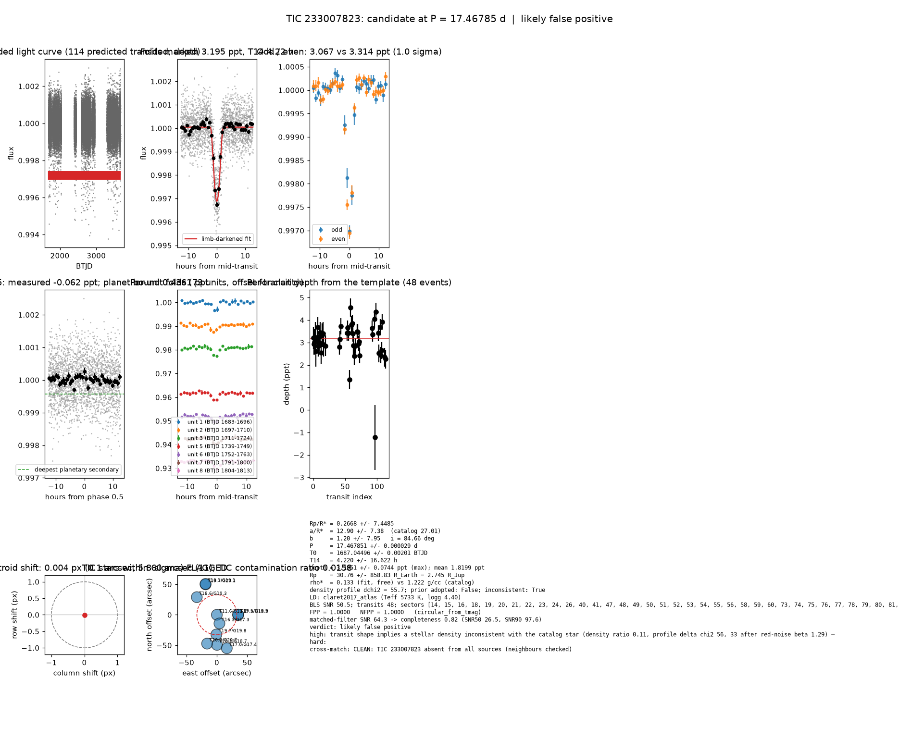

# Candidate packet: TIC 233007823, P = 17.46785 d

Generated 2026-09-03 07:03 UTC by tesshunter. This is a CANDIDATE. Nothing in this packet is a detection; the automated checks are necessary, not sufficient. The human reviews and submits.

**Automated verdict:** likely false positive (light curve only: ambiguous / manual vetting required)  
**FPP / NFPP (TRICERATOPS):** 1.0000 / 1.0000 — above 0.5, does not proceed to submission

## Fitted parameters (limb-darkened transit fit)

| parameter | value |
|---|---|
| period | 17.467851 +/- 0.000029 d |
| epoch | 1687.04496 +/- 0.00201 BTJD = 2458687.04496 BJD |
| duration T14 | 4.220 +/- 16.622 h |
| depth (model maximum) | 3.1951 +/- 0.0744 ppt (shape-degenerate error 61.8597 ppt) |
| depth (duration-averaged) | 1.8199 ppt |
| Rp/R* | 0.2668 +/- 7.4485 |
| a/R* | 12.90 +/- 7.38 (catalog density gives 27.01 +/- 1.97) |
| impact parameter | 1.20 +/- 7.95 ; inclination 84.66 deg |
| Rp | 30.76 +/- 858.83 R_Earth = 2.745 +/- 76.620 R_Jup (R* = 1.057 +/- 0.053 R_Sun) |
| stellar density | fit (free) 0.133 g/cc vs catalog 1.222 +/- 0.267 g/cc; ratio 0.11, profile delta chi2 55.7; prior adopted: False; inconsistent: True |
| limb darkening | u1 = 0.308, u2 = 0.274 (claret2017_atlas (Teff 5733 K, logg 4.40)) |
| fit | least_squares, 1792 points, 48 transits, reduced chi2 1.13, delta BIC vs flat 2859 |
| BLS | SNR 50.5, box depth 1.900 ppt, 48 transits observed, alias label P |

## Vetting checks

| check | result |
|---|---|
| odd/even (median) | pass (1.0 sigma) |
| odd/even (fit template) | odd 3.067 +/- 0.222 ppt (23 events), even 3.314 +/- 0.118 ppt (25 events), difference 1.0 sigma, 8% of the mean |
| secondary at phase 0.5 | -0.0616 ppt measured; deepest planetary secondary at the fitted a/R* 0.4361 ppt; not detected |
| a/R* consistency | FLAG — free-fit a/R* = 12.90 (b = 1.20) against 27.01 +/- 1.97 from the catalog density (0.133 vs 1.222 g/cc, ratio 0.11; profile delta chi2 55.7 with a/R* held in the catalog range, 33.3 after the red-noise |
| V-shape | none (t_flat/t_total 0.30); fitted geometry grazing: True |
| per-unit depths | FLAG |
| centroid | shift 0.004 px, 5.8 sigma FLAG |
| contamination | flagged, 18 neighbours checked |
| FPP / NFPP | 1.0000 / 1.0000 (TRICERATOPS 1.1.0: FPP 1.0000, NFPP 1.0000 over 18 scenarios and 52 TIC stars within 10 px; aperture circular_from_tmag; 100000 draws; fold binned (51 points, error 96 ppm); sectors [14, 15, 16].) |

Flags: transit shape implies a stellar density inconsistent with the catalog star (density ratio 0.11, profile delta chi2 56, 33 after red-noise beta 1.29) — diluted eclipse, grazing stellar companion or blend; in-transit centroid shift 0.004 px (0.1 arcsec, 5.8 sigma) over 38 sector(s) — signal may sit on a neighbour; TRICERATOPS nearby false-positive probability 1.000 >= 0.1; nearby star could produce the signal: 3 high-risk and 1 medium-risk neighbour(s) of 18 checked; per-unit transit depths disagree by > 3σ across observing units

## Completeness at this SNR

Matched-filter SNR 64.3 on this star's detrended data binned to 30 min: the P2 completeness curve (`docs/COMPLETENESS.md`, 2100 injections on 300 stars, config survey_v1) recovers 0.82 of injected signals at this SNR (SNR50 = 26.5, SNR90 = 97.6; the 50-1000000000.0 bin recovered 586/658). Curve measured in P2 with batman injections into the survey preset (survey_v1: FFI stitches binned to 30 min, periods 1-40 d, Rp/R* 0.01-0.12); the matched-filter SNR here is computed on this candidate's own detrended data with the same definition. Outside that regime the number is an extrapolation.

## Star and neighbours

TIC 233007823: Teff 5733 K, log g 4.40, R = 1.057 +/- 0.053 R_Sun, M = 1.024 +/- 0.127 M_Sun, Tmag 11.63, TIC contamination ratio 0.0158 (source tic; assumed errors: False).

| ID | dstArcSec | Tmag | GAIAmag | gaiabp | gaiarp | Teff | rad | contratio | disposition |
|---|---|---|---|---|---|---|---|---|---|
| 233007823 | 0.00 | 11.63 | 12.09 | 12.44 | 11.58 | 5733.00 | 1.06 | 0.02 | n/a |
| 233007825 | 14.76 | 16.31 | 17.31 | 18.27 | 16.32 | 3811.00 | 0.55 | n/a | n/a |
| 1201364193 | 32.28 | 19.74 | 19.85 | 19.80 | 19.57 | n/a | n/a | n/a | n/a |
| 233007824 | 34.85 | 17.27 | 18.28 | 19.27 | 17.00 | n/a | n/a | n/a | SPLIT |
| 512586009 | 34.87 | 19.51 | 19.94 | n/a | n/a | n/a | n/a | n/a | n/a |
| 1201364197 | 43.80 | 18.61 | 19.31 | 19.88 | 18.49 | 4559.00 | n/a | n/a | n/a |
| 1201364192 | 49.36 | 18.20 | 18.70 | 19.05 | 18.09 | 5525.00 | n/a | n/a | n/a |
| 1201364196 | 49.92 | 20.03 | 20.65 | 20.85 | 19.63 | n/a | n/a | n/a | n/a |
| 512586008 | 53.17 | 19.66 | 20.09 | n/a | n/a | n/a | n/a | n/a | n/a |
| 233007822 | 53.94 | 18.10 | 19.15 | 20.10 | 17.69 | n/a | n/a | n/a | SPLIT |
| 233007828 | 57.21 | 17.00 | 17.40 | 17.69 | 16.93 | 6153.00 | 0.74 | n/a | n/a |

## Cross-match

CLEAN: TIC 233007823 absent from all sources (neighbours checked)  
Catalog versions: `ctoi=2026-09-03:f6964541;nasa_ps=2026-09-03:85f3c196;nasa_pscomppars=2026-09-03:4843e49c;spoc_tce=2026-09-03:e580dde7;tess_eb=2026-09-03:43555226;toi=2026-09-03:4704bb7c`

## Data

Sectors [14, 15, 16, 18, 19, 20, 21, 22, 23, 24, 26, 40, 41, 47, 48, 49, 50, 51, 52, 53, 54, 55, 56, 58, 59, 60, 73, 74, 75, 76, 77, 78, 79, 80, 81, 82, 83, 85, 86]; 40593 raw and 39926 cleaned cadences; products: TESS-SPOC s14, TESS-SPOC s15, TESS-SPOC s16, TESS-SPOC s18, TESS-SPOC s19, TESS-SPOC s20.

## Figure



## ExoFOP CTOI fields

```json
{
 "target": "TIC 233007823",
 "tic_id": 233007823,
 "discovery_source": "TESS",
 "period_days": 17.467851015178613,
 "period_err_days": 2.8730107073656627e-05,
 "epoch_bjd": 2458687.0449587447,
 "epoch_err_days": 0.0020140541670458662,
 "depth_ppm": 3195.069062265965,
 "depth_err_ppm": 74.43227501676148,
 "duration_hours": 4.219946214972007,
 "duration_err_hours": 16.62226414107583,
 "disposition": "PC",
 "tag": "FILL_ME: YYYYMMDD_username_tesshunter_NNN",
 "candidate_name": null,
 "paper_url": null,
 "notes": "Survey rank 6 (frozen score 3.5); survey stitch SNR 59.06869340096735, 47.0 transits."
}
```

_The pipeline finds candidates. It does not submit._
