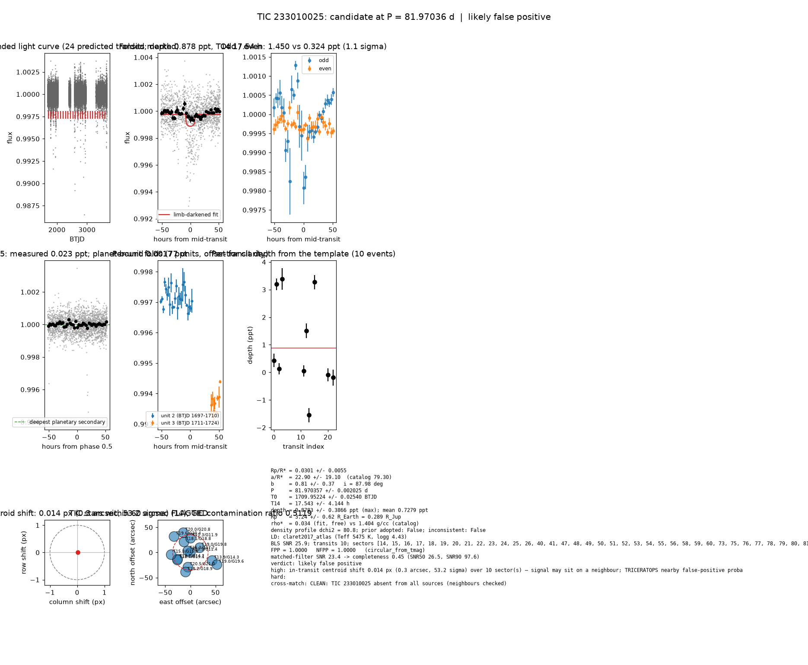

# Candidate packet: TIC 233010025, P = 81.97036 d

Generated 2026-09-03 07:40 UTC by tesshunter. This is a CANDIDATE. Nothing in this packet is a detection; the automated checks are necessary, not sufficient. The human reviews and submits.

**Automated verdict:** likely false positive (light curve only: promising planet candidate)  
**FPP / NFPP (TRICERATOPS):** 1.0000 / 1.0000 — above 0.5, does not proceed to submission

## Fitted parameters (limb-darkened transit fit)

| parameter | value |
|---|---|
| period | 81.970357 +/- 0.002025 d |
| epoch | 1709.95224 +/- 0.02540 BTJD = 2458709.95224 BJD |
| duration T14 | 17.543 +/- 4.144 h |
| depth (model maximum) | 0.8783 +/- 0.3866 ppt (shape-degenerate error 0.2132 ppt) |
| depth (duration-averaged) | 0.7279 ppt |
| Rp/R* | 0.0301 +/- 0.0055 |
| a/R* | 22.90 +/- 19.10 (catalog density gives 79.30 +/- 5.92) |
| impact parameter | 0.81 +/- 0.37 ; inclination 87.98 deg |
| Rp | 3.24 +/- 0.62 R_Earth = 0.289 +/- 0.055 R_Jup (R* = 0.987 +/- 0.051 R_Sun) |
| stellar density | fit (free) 0.034 g/cc vs catalog 1.404 +/- 0.314 g/cc; ratio 0.02, profile delta chi2 80.8; prior adopted: False; inconsistent: False |
| limb darkening | u1 = 0.350, u2 = 0.252 (claret2017_atlas (Teff 5475 K, logg 4.43)) |
| fit | least_squares, 1127 points, 10 transits, reduced chi2 5.34, delta BIC vs flat 481 |
| BLS | SNR 25.9, box depth 1.017 ppt, 10 transits observed, alias label P |

## Vetting checks

| check | result |
|---|---|
| odd/even (median) | pass (1.1 sigma) |
| odd/even (fit template) | odd 1.450 +/- 1.021 ppt (5 events), even 0.324 +/- 0.307 ppt (5 events), difference 1.1 sigma, 127% of the mean |
| secondary at phase 0.5 | 0.0229 ppt measured; deepest planetary secondary at the fitted a/R* 0.0017 ppt; not detected |
| a/R* consistency | pass — free-fit a/R* = 22.90 (b = 0.81) against 79.30 +/- 5.92 from the catalog density (0.034 vs 1.404 g/cc, ratio 0.02; profile delta chi2 80.8 with a/R* held in the catalog range, 3.2 after the red-noise  |
| V-shape | none (t_flat/t_total 0.70); fitted geometry grazing: False |
| per-unit depths | FLAG |
| centroid | shift 0.014 px, 53.2 sigma FLAG |
| contamination | flagged, 20 neighbours checked |
| FPP / NFPP | 1.0000 / 1.0000 (TRICERATOPS 1.1.0: FPP 1.0000, NFPP 1.0000 over 36 scenarios and 73 TIC stars within 10 px; aperture circular_from_tmag; 100000 draws; fold binned (150 points, error 276 ppm); sectors [14, 15, 16].) |

Flags: in-transit centroid shift 0.014 px (0.3 arcsec, 53.2 sigma) over 10 sector(s) — signal may sit on a neighbour; TRICERATOPS nearby false-positive probability 1.000 >= 0.1; nearby star could produce the signal: 3 high-risk and 3 medium-risk neighbour(s) of 20 checked; per-unit transit depths disagree by > 3σ across observing units

## Completeness at this SNR

Matched-filter SNR 23.4 on this star's detrended data binned to 30 min: the P2 completeness curve (`docs/COMPLETENESS.md`, 2100 injections on 300 stars, config survey_v1) recovers 0.45 of injected signals at this SNR (SNR50 = 26.5, SNR90 = 97.6; the 20-50 bin recovered 237/368). Curve measured in P2 with batman injections into the survey preset (survey_v1: FFI stitches binned to 30 min, periods 1-40 d, Rp/R* 0.01-0.12); the matched-filter SNR here is computed on this candidate's own detrended data with the same definition. Outside that regime the number is an extrapolation.

## Star and neighbours

TIC 233010025: Teff 5475 K, log g 4.43, R = 0.987 +/- 0.051 R_Sun, M = 0.958 +/- 0.118 M_Sun, Tmag 10.94, TIC contamination ratio 0.5119 (source tic; assumed errors: False).

| ID | dstArcSec | Tmag | GAIAmag | gaiabp | gaiarp | Teff | rad | contratio | disposition |
|---|---|---|---|---|---|---|---|---|---|
| 233010025 | 0.00 | 10.94 | 11.43 | 11.84 | 10.89 | 5475.00 | 0.99 | 0.51 | n/a |
| 233010026 | 6.13 | 16.32 | 17.74 | 18.60 | 16.36 | 3589.00 | 0.28 | n/a | n/a |
| 1201371639 | 20.81 | 19.04 | 19.82 | 20.41 | 18.82 | n/a | n/a | n/a | n/a |
| 1201371633 | 24.51 | 18.05 | 18.79 | 19.46 | 17.96 | 4418.00 | 0.47 | n/a | n/a |
| 233010030 | 28.46 | 11.35 | 11.91 | 12.39 | 11.30 | 5163.00 | 3.45 | n/a | n/a |
| 233010022 | 28.89 | 13.70 | 14.22 | 14.64 | 13.64 | 5406.00 | 0.95 | n/a | n/a |
| 1201371634 | 29.65 | 20.52 | 20.95 | n/a | n/a | n/a | n/a | n/a | n/a |
| 1201371635 | 29.78 | 18.70 | 19.13 | n/a | n/a | n/a | n/a | n/a | n/a |
| 233010024 | 38.44 | 15.33 | 15.79 | 16.15 | 15.27 | 5758.00 | 0.96 | n/a | n/a |
| 1201371631 | 40.01 | 18.18 | 18.92 | 19.59 | 18.09 | 4405.00 | 0.50 | n/a | n/a |
| 1201371638 | 41.76 | 19.99 | 20.79 | 21.18 | 19.50 | n/a | n/a | n/a | n/a |
| 1201371644 | 45.47 | 19.65 | 20.44 | 21.00 | 19.35 | n/a | n/a | n/a | n/a |
| 233010021 | 46.11 | 13.90 | 14.29 | 14.57 | 13.84 | 6250.00 | 1.25 | n/a | n/a |
| 1201371636 | 58.06 | 18.98 | 19.59 | 20.06 | 18.86 | 4909.00 | n/a | n/a | n/a |

## Cross-match

CLEAN: TIC 233010025 absent from all sources (neighbours checked)  
Catalog versions: `ctoi=2026-09-03:f6964541;nasa_ps=2026-09-03:85f3c196;nasa_pscomppars=2026-09-03:4843e49c;spoc_tce=2026-09-03:e580dde7;tess_eb=2026-09-03:43555226;toi=2026-09-03:4704bb7c`

## Data

Sectors [14, 15, 16, 17, 18, 19, 20, 21, 22, 23, 24, 25, 26, 40, 41, 47, 48, 49, 50, 51, 52, 53, 54, 55, 56, 58, 59, 60, 73, 75, 76, 77, 78, 79, 80, 81, 82, 83, 85, 86]; 41651 raw and 41467 cleaned cadences; products: SPOC s14, SPOC s15, SPOC s16, SPOC s17, SPOC s18, SPOC s19.

## Figure



## ExoFOP CTOI fields

```json
{
 "target": "TIC 233010025",
 "tic_id": 233010025,
 "discovery_source": "TESS",
 "period_days": 81.97035656587674,
 "period_err_days": 0.0020250850344668823,
 "epoch_bjd": 2458709.9522387837,
 "epoch_err_days": 0.025404015439743268,
 "depth_ppm": 878.2702027431144,
 "depth_err_ppm": 386.5653564716984,
 "duration_hours": 17.54283197557872,
 "duration_err_hours": 4.144324422834564,
 "disposition": "PC",
 "tag": "FILL_ME: YYYYMMDD_username_tesshunter_NNN",
 "candidate_name": null,
 "paper_url": null,
 "notes": "Survey rank 21 (frozen score 3.1156); survey stitch SNR 25.86614129841047, 10.0 transits."
}
```

_The pipeline finds candidates. It does not submit._
