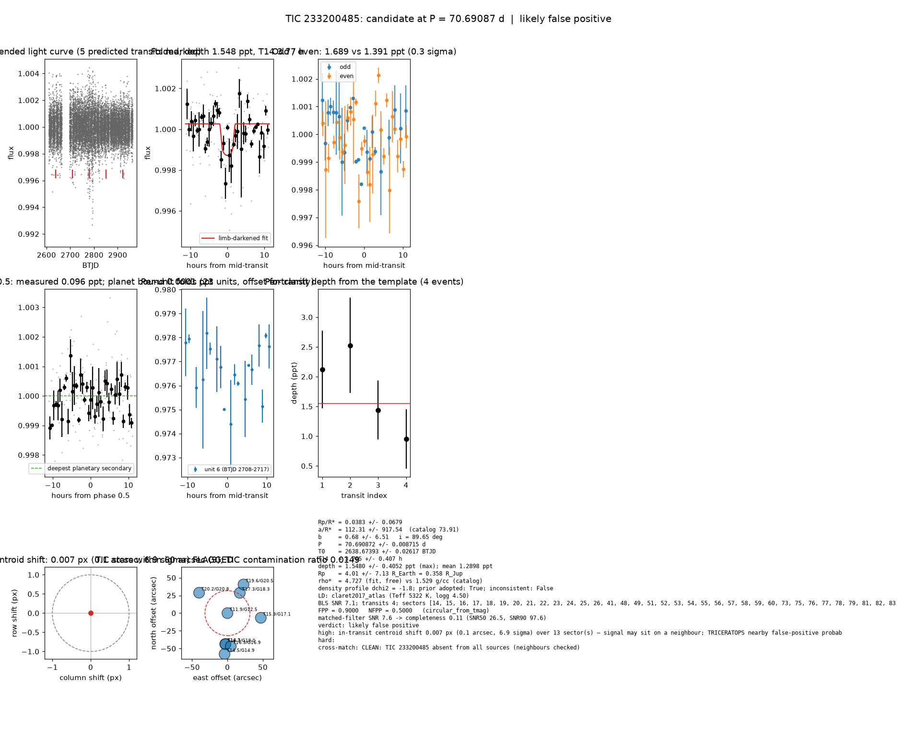

# Candidate packet: TIC 233200485, P = 70.69087 d

Generated 2026-09-03 06:55 UTC by tesshunter. This is a CANDIDATE. Nothing in this packet is a detection; the automated checks are necessary, not sufficient. The human reviews and submits.

**Automated verdict:** likely false positive (light curve only: promising planet candidate)  
**FPP / NFPP (TRICERATOPS):** 0.9000 / 0.5000 — above 0.5, does not proceed to submission

## Fitted parameters (limb-darkened transit fit)

| parameter | value |
|---|---|
| period | 70.690872 +/- 0.008715 d |
| epoch | 2638.67393 +/- 0.02617 BTJD = 2459638.67393 BJD |
| duration T14 | 3.765 +/- 0.407 h |
| depth (model maximum) | 1.5480 +/- 0.4052 ppt (shape-degenerate error 6.5836 ppt) |
| depth (duration-averaged) | 1.2898 ppt |
| Rp/R* | 0.0383 +/- 0.0679 |
| a/R* | 112.31 +/- 917.54 (catalog density gives 73.91 +/- 10.45) |
| impact parameter | 0.68 +/- 6.51 ; inclination 89.65 deg |
| Rp | 4.01 +/- 7.13 R_Earth = 0.358 +/- 0.636 R_Jup (R* = 0.960 R_Sun) |
| stellar density | fit (free) 4.727 g/cc vs catalog 1.529 +/- 0.649 g/cc; ratio 3.09, profile delta chi2 -1.8; prior adopted: True; inconsistent: False |
| limb darkening | u1 = 0.377, u2 = 0.236 (claret2017_atlas (Teff 5322 K, logg 4.50)) |
| fit | least_squares, 136 points, 4 transits, reduced chi2 1.70, delta BIC vs flat 14 |
| BLS | SNR 7.1, box depth 1.359 ppt, 4 transits observed, alias label P |

## Vetting checks

| check | result |
|---|---|
| odd/even (median) | pass (0.3 sigma) |
| odd/even (fit template) | odd 1.689 +/- 0.394 ppt (2 events), even 1.391 +/- 0.786 ppt (2 events), difference 0.3 sigma, 19% of the mean |
| secondary at phase 0.5 | 0.0964 ppt measured; deepest planetary secondary at the fitted a/R* 0.0001 ppt; not detected |
| a/R* consistency | pass — free-fit a/R* = 107.67 (b = 0.43) against 73.91 +/- 10.45 from the catalog density (4.727 vs 1.529 g/cc, ratio 3.09; profile delta chi2 -1.8 with a/R* held in the catalog range, -0.9 after the red-noi |
| V-shape | none (t_flat/t_total n/a); fitted geometry grazing: False |
| per-unit depths | pass |
| centroid | shift 0.007 px, 6.9 sigma FLAG |
| contamination | flagged, 23 neighbours checked |
| FPP / NFPP | 0.9000 / 0.5000 (TRICERATOPS 1.1.0: FPP 0.9000, NFPP 0.5000 over 30 scenarios and 77 TIC stars within 10 px; aperture circular_from_tmag; 100000 draws; fold binned (45 points, error 797 ppm); sectors [14, 15, 16].) |

Flags: in-transit centroid shift 0.007 px (0.1 arcsec, 6.9 sigma) over 13 sector(s) — signal may sit on a neighbour; TRICERATOPS nearby false-positive probability 0.500 >= 0.1; nearby star could produce the signal: 5 high-risk and 4 medium-risk neighbour(s) of 23 checked

## Completeness at this SNR

Matched-filter SNR 7.6 on this star's detrended data binned to 30 min: the P2 completeness curve (`docs/COMPLETENESS.md`, 2100 injections on 300 stars, config survey_v1) recovers 0.11 of injected signals at this SNR (SNR50 = 26.5, SNR90 = 97.6; the 7.1-9 bin recovered 6/96). Curve measured in P2 with batman injections into the survey preset (survey_v1: FFI stitches binned to 30 min, periods 1-40 d, Rp/R* 0.01-0.12); the matched-filter SNR here is computed on this candidate's own detrended data with the same definition. Outside that regime the number is an extrapolation.

## Star and neighbours

TIC 233200485: Teff 5322 K, log g n/a, R = 0.960 R_Sun, M = n/a M_Sun, Tmag 11.94, TIC contamination ratio 0.0149 (source tic; assumed errors: True).

| ID | dstArcSec | Tmag | GAIAmag | gaiabp | gaiarp | Teff | rad | contratio | disposition |
|---|---|---|---|---|---|---|---|---|---|
| 233200485 | 0.00 | 11.94 | 12.48 | 12.93 | 11.89 | 5322.00 | 0.96 | 0.01 | n/a |
| 233200484 | 33.54 | 17.30 | 18.35 | 19.44 | 17.32 | 3674.00 | 0.44 | n/a | n/a |
| 10001432100 | 43.74 | 16.71 | n/a | n/a | n/a | n/a | n/a | n/a | n/a |
| 233200490 | 43.97 | 18.30 | 19.05 | 18.42 | 16.90 | n/a | n/a | n/a | n/a |
| 1401031637 | 46.39 | 19.59 | 20.53 | 21.45 | 19.42 | 3857.00 | n/a | n/a | n/a |
| 233200491 | 46.95 | 16.27 | 16.89 | 17.42 | 16.21 | 4839.00 | 0.75 | n/a | n/a |
| 233200486 | 47.56 | 15.88 | 17.07 | 18.36 | 15.93 | 3471.00 | 0.48 | 0.21 | n/a |
| 1401026964 | 49.34 | 20.15 | 20.85 | 21.04 | 19.63 | n/a | n/a | n/a | n/a |
| 233200492 | 57.92 | 14.52 | 14.92 | 15.21 | 14.45 | 6069.00 | 1.06 | n/a | n/a |

## Cross-match

CLEAN: TIC 233200485 absent from all sources (neighbours checked)  
Catalog versions: `ctoi=2026-09-03:f6964541;nasa_ps=2026-09-03:85f3c196;nasa_pscomppars=2026-09-03:4843e49c;spoc_tce=2026-09-03:e580dde7;tess_eb=2026-09-03:43555226;toi=2026-09-03:4704bb7c`

## Data

Sectors [14, 15, 16, 17, 18, 19, 20, 21, 22, 23, 24, 25, 26, 41, 48, 49, 51, 52, 53, 54, 55, 56, 57, 58, 59, 60, 73, 75, 76, 77, 78, 79, 81, 82, 83, 84, 85, 86]; 12685 raw and 12669 cleaned cadences; products: QLP s14, QLP s15, QLP s16, QLP s17, QLP s18, QLP s19.

## Figure



## ExoFOP CTOI fields

```json
{
 "target": "TIC 233200485",
 "tic_id": 233200485,
 "discovery_source": "TESS",
 "period_days": 70.69087166930838,
 "period_err_days": 0.0087145327734102,
 "epoch_bjd": 2459638.673928146,
 "epoch_err_days": 0.02616853339772633,
 "depth_ppm": 1547.965417101671,
 "depth_err_ppm": 405.23188154204814,
 "duration_hours": 3.7651795276950497,
 "duration_err_hours": 0.4074380796527956,
 "disposition": "PC",
 "tag": "FILL_ME: YYYYMMDD_username_tesshunter_NNN",
 "candidate_name": null,
 "paper_url": null,
 "notes": "Survey rank 2 (frozen score 3.5); survey stitch SNR 124.13718590067971, 13.0 transits."
}
```

_The pipeline finds candidates. It does not submit._
