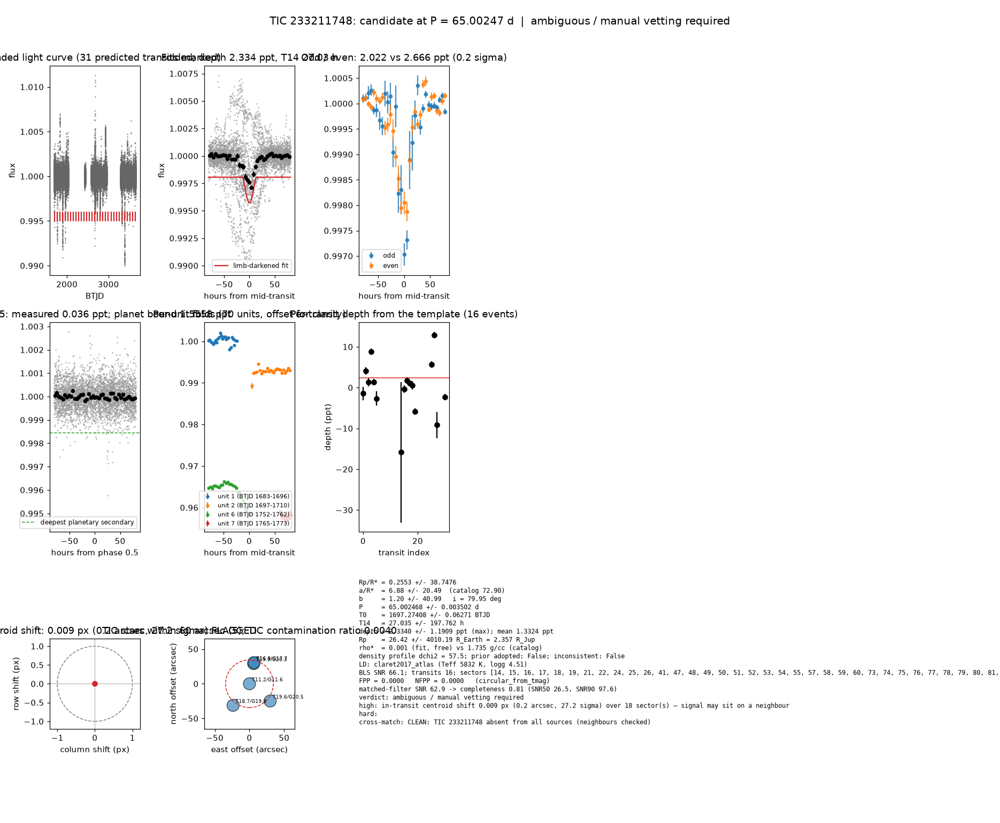

# Candidate packet: TIC 233211748, P = 65.00247 d

Generated 2026-09-03 07:04 UTC by tesshunter. This is a CANDIDATE. Nothing in this packet is a detection; the automated checks are necessary, not sufficient. The human reviews and submits.

**Automated verdict:** ambiguous / manual vetting required (light curve only: promising planet candidate)  
**FPP / NFPP (TRICERATOPS):** 0.0000 / 0.0000

## Fitted parameters (limb-darkened transit fit)

| parameter | value |
|---|---|
| period | 65.002468 +/- 0.003502 d |
| epoch | 1697.27408 +/- 0.06271 BTJD = 2458697.27408 BJD |
| duration T14 | 27.035 +/- 197.762 h |
| depth (model maximum) | 2.3340 +/- 1.1909 ppt (shape-degenerate error 60.1024 ppt) |
| depth (duration-averaged) | 1.3324 ppt |
| Rp/R* | 0.2553 +/- 38.7476 |
| a/R* | 6.88 +/- 20.49 (catalog density gives 72.90 +/- 4.99) |
| impact parameter | 1.20 +/- 40.99 ; inclination 79.95 deg |
| Rp | 26.42 +/- 4010.19 R_Earth = 2.357 +/- 357.767 R_Jup (R* = 0.949 +/- 0.046 R_Sun) |
| stellar density | fit (free) 0.001 g/cc vs catalog 1.735 +/- 0.356 g/cc; ratio 0.00, profile delta chi2 57.5; prior adopted: False; inconsistent: False |
| limb darkening | u1 = 0.295, u2 = 0.280 (claret2017_atlas (Teff 5832 K, logg 4.51)) |
| fit | least_squares, 1830 points, 16 transits, reduced chi2 2.13, delta BIC vs flat 114 |
| BLS | SNR 66.1, box depth 2.408 ppt, 15 transits observed, alias label P |

## Vetting checks

| check | result |
|---|---|
| odd/even (median) | pass (0.2 sigma) |
| odd/even (fit template) | odd 2.022 +/- 2.130 ppt (8 events), even 2.666 +/- 2.774 ppt (8 events), difference 0.2 sigma, 27% of the mean |
| secondary at phase 0.5 | 0.0359 ppt measured; deepest planetary secondary at the fitted a/R* 1.5558 ppt; not detected |
| a/R* consistency | pass — free-fit a/R* = 6.88 (b = 1.20) against 72.90 +/- 4.99 from the catalog density (0.001 vs 1.735 g/cc, ratio 0.00; profile delta chi2 57.5 with a/R* held in the catalog range, 2.3 after the red-noise b |
| V-shape | none (t_flat/t_total 0.90); fitted geometry grazing: True |
| per-unit depths | FLAG |
| centroid | shift 0.009 px, 27.2 sigma FLAG |
| contamination | flagged, 16 neighbours checked |
| FPP / NFPP | 0.0000 / 0.0000 (TRICERATOPS 1.1.0: FPP 0.0000, NFPP 0.0000 over 18 scenarios and 71 TIC stars within 10 px; aperture circular_from_tmag; 100000 draws; fold binned (150 points, error 217 ppm); sectors [14, 15, 16].) |

Flags: in-transit centroid shift 0.009 px (0.2 arcsec, 27.2 sigma) over 18 sector(s) — signal may sit on a neighbour; per-unit transit depths disagree by > 3σ across observing units

## Completeness at this SNR

Matched-filter SNR 62.9 on this star's detrended data binned to 30 min: the P2 completeness curve (`docs/COMPLETENESS.md`, 2100 injections on 300 stars, config survey_v1) recovers 0.81 of injected signals at this SNR (SNR50 = 26.5, SNR90 = 97.6; the 50-1000000000.0 bin recovered 586/658). Curve measured in P2 with batman injections into the survey preset (survey_v1: FFI stitches binned to 30 min, periods 1-40 d, Rp/R* 0.01-0.12); the matched-filter SNR here is computed on this candidate's own detrended data with the same definition. Outside that regime the number is an extrapolation.

## Star and neighbours

TIC 233211748: Teff 5832 K, log g 4.51, R = 0.949 +/- 0.046 R_Sun, M = 1.051 +/- 0.126 M_Sun, Tmag 11.18, TIC contamination ratio 0.0040 (source tic; assumed errors: False).

| ID | dstArcSec | Tmag | GAIAmag | gaiabp | gaiarp | Teff | rad | contratio | disposition |
|---|---|---|---|---|---|---|---|---|---|
| 233211748 | 0.00 | 11.18 | 11.61 | 11.95 | 11.12 | 5832.00 | 0.95 | 0.00 | n/a |
| 1401029072 | 29.69 | 19.89 | 20.32 | n/a | n/a | n/a | n/a | n/a | n/a |
| 233211750 | 31.34 | 16.87 | 17.66 | 18.40 | 16.77 | 4206.00 | 0.75 | n/a | n/a |
| 1401029068 | 38.95 | 19.57 | 20.46 | 21.31 | 19.40 | 3957.00 | n/a | n/a | n/a |
| 1401029067 | 39.08 | 18.74 | 19.81 | 21.07 | 18.62 | 3592.00 | 0.44 | n/a | n/a |

## Cross-match

CLEAN: TIC 233211748 absent from all sources (neighbours checked)  
Catalog versions: `ctoi=2026-09-03:f6964541;nasa_ps=2026-09-03:85f3c196;nasa_pscomppars=2026-09-03:4843e49c;spoc_tce=2026-09-03:e580dde7;tess_eb=2026-09-03:43555226;toi=2026-09-03:4704bb7c`

## Data

Sectors [14, 15, 16, 17, 18, 19, 21, 22, 24, 25, 26, 41, 47, 48, 49, 50, 51, 52, 53, 54, 55, 57, 58, 59, 60, 73, 74, 75, 76, 77, 78, 79, 80, 81, 82, 84, 85, 86]; 39335 raw and 39306 cleaned cadences; products: SPOC s14, SPOC s15, SPOC s16, SPOC s17, SPOC s18, SPOC s19.

## Figure



## ExoFOP CTOI fields

```json
{
 "target": "TIC 233211748",
 "tic_id": 233211748,
 "discovery_source": "TESS",
 "period_days": 65.00246806373288,
 "period_err_days": 0.0035021458830263937,
 "epoch_bjd": 2458697.2740813186,
 "epoch_err_days": 0.06270610316191735,
 "depth_ppm": 2333.9699768868404,
 "depth_err_ppm": 1190.8714760548353,
 "duration_hours": 27.03481102691091,
 "duration_err_hours": 197.76169213178386,
 "disposition": "PC",
 "tag": "FILL_ME: YYYYMMDD_username_tesshunter_NNN",
 "candidate_name": null,
 "paper_url": null,
 "notes": "Survey rank 5 (frozen score 3.5); survey stitch SNR 71.77518812734995, 15.0 transits."
}
```

_The pipeline finds candidates. It does not submit._
