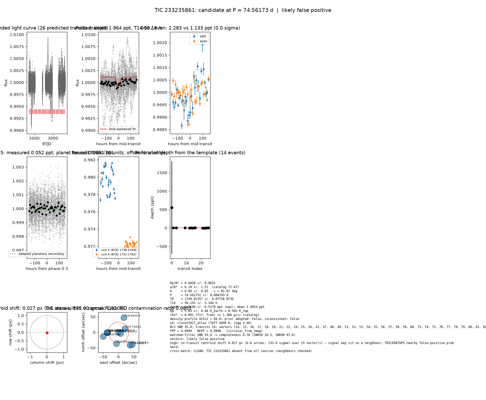

# Candidate packet: TIC 233235861, P = 74.56173 d

Generated 2026-09-03 07:31 UTC by tesshunter. This is a CANDIDATE. Nothing in this packet is a detection; the automated checks are necessary, not sufficient. The human reviews and submits.

**Automated verdict:** likely false positive (light curve only: promising planet candidate)  
**FPP / NFPP (TRICERATOPS):** 0.9999 / 0.9998 — above 0.5, does not proceed to submission

## Fitted parameters (limb-darkened transit fit)

| parameter | value |
|---|---|
| period | 74.561731 +/- 0.004793 d |
| epoch | 1749.82357 +/- 0.07756 BTJD = 2458749.82357 BJD |
| duration T14 | 50.155 +/- 5.144 h |
| depth (model maximum) | 1.8640 +/- 0.5278 ppt (shape-degenerate error 0.2578 ppt) |
| depth (duration-averaged) | 1.4054 ppt |
| Rp/R* | 0.0458 +/- 0.0031 |
| a/R* | 6.19 +/- 1.51 (catalog density gives 72.67 +/- 5.62) |
| impact parameter | 0.90 +/- 0.05 ; inclination 81.67 deg |
| Rp | 5.63 +/- 0.46 R_Earth = 0.502 +/- 0.041 R_Jup (R* = 1.128 +/- 0.050 R_Sun) |
| stellar density | fit (free) 0.001 g/cc vs catalog 1.306 +/- 0.303 g/cc; ratio 0.00, profile delta chi2 89.8; prior adopted: False; inconsistent: False |
| limb darkening | u1 = 0.217, u2 = 0.311 (claret2017_atlas (Teff 6499 K, logg 4.46)) |
| fit | least_squares, 1587 points, 14 transits, reduced chi2 1.32, delta BIC vs flat 121 |
| BLS | SNR 35.8, box depth 2.067 ppt, 13 transits observed, alias label P |

## Vetting checks

| check | result |
|---|---|
| odd/even (median) | pass (0.0 sigma) |
| odd/even (fit template) | odd 2.283 +/- 1.080 ppt (8 events), even 1.133 +/- 91.942 ppt (6 events), difference 0.0 sigma, 67% of the mean |
| secondary at phase 0.5 | 0.0521 ppt measured; deepest planetary secondary at the fitted a/R* 0.0691 ppt; not detected |
| a/R* consistency | pass — free-fit a/R* = 6.19 (b = 0.90) against 72.67 +/- 5.62 from the catalog density (0.001 vs 1.306 g/cc, ratio 0.00; profile delta chi2 89.8 with a/R* held in the catalog range, 3.6 after the red-noise b |
| V-shape | none (t_flat/t_total 0.30); fitted geometry grazing: False |
| per-unit depths | FLAG |
| centroid | shift 0.027 px, 135.0 sigma FLAG |
| contamination | flagged, 17 neighbours checked |
| FPP / NFPP | 0.9999 / 0.9998 (TRICERATOPS 1.1.0: FPP 0.9999, NFPP 0.9998 over 21 scenarios and 71 TIC stars within 10 px; aperture circular_from_tmag; 100000 draws; fold binned (150 points, error 648 ppm); sectors [14, 15, 16].) |

Flags: in-transit centroid shift 0.027 px (0.6 arcsec, 135.0 sigma) over 15 sector(s) — signal may sit on a neighbour; TRICERATOPS nearby false-positive probability 1.000 >= 0.1; nearby star could produce the signal: 3 high-risk and 2 medium-risk neighbour(s) of 17 checked; per-unit transit depths disagree by > 3σ across observing units

## Completeness at this SNR

Matched-filter SNR 55.4 on this star's detrended data binned to 30 min: the P2 completeness curve (`docs/COMPLETENESS.md`, 2100 injections on 300 stars, config survey_v1) recovers 0.78 of injected signals at this SNR (SNR50 = 26.5, SNR90 = 97.6; the 50-1000000000.0 bin recovered 586/658). Curve measured in P2 with batman injections into the survey preset (survey_v1: FFI stitches binned to 30 min, periods 1-40 d, Rp/R* 0.01-0.12); the matched-filter SNR here is computed on this candidate's own detrended data with the same definition. Outside that regime the number is an extrapolation.

## Star and neighbours

TIC 233235861: Teff 6499 K, log g 4.46, R = 1.128 +/- 0.050 R_Sun, M = 1.330 +/- 0.218 M_Sun, Tmag 11.52, TIC contamination ratio 0.0851 (source tic; assumed errors: False).

| ID | dstArcSec | Tmag | GAIAmag | gaiabp | gaiarp | Teff | rad | contratio | disposition |
|---|---|---|---|---|---|---|---|---|---|
| 233235861 | 0.00 | 11.52 | 11.86 | 12.11 | 11.47 | 6499.00 | 1.13 | 0.09 | n/a |
| 233235863 | 7.78 | 15.39 | 16.00 | 16.53 | 15.32 | 4903.00 | 1.06 | n/a | n/a |
| 1401014097 | 23.88 | 19.66 | 20.21 | 20.69 | 19.64 | 5254.00 | n/a | n/a | n/a |
| 233235862 | 34.39 | 13.78 | 14.81 | 15.82 | 13.80 | 3751.00 | 0.61 | 0.29 | n/a |
| 1401014101 | 36.12 | 18.11 | 18.54 | n/a | n/a | n/a | n/a | n/a | n/a |
| 1401014089 | 37.05 | 19.83 | 20.36 | 20.73 | 19.72 | n/a | n/a | n/a | n/a |
| 1401014100 | 37.38 | 19.10 | 19.53 | n/a | n/a | n/a | n/a | n/a | n/a |
| 1401014098 | 50.37 | 18.64 | 19.56 | 20.53 | 18.55 | 3913.00 | 0.49 | n/a | n/a |
| 233235865 | 50.79 | 18.19 | 19.35 | 20.87 | 18.09 | 3351.00 | n/a | n/a | n/a |
| 1401014091 | 56.07 | 19.38 | 20.45 | 21.53 | 19.05 | n/a | n/a | n/a | n/a |
| 233235869 | 59.35 | 17.36 | 18.43 | 19.46 | 17.38 | 3703.00 | 0.62 | n/a | n/a |

## Cross-match

CLEAN: TIC 233235861 absent from all sources (neighbours checked)  
Catalog versions: `ctoi=2026-09-03:f6964541;nasa_ps=2026-09-03:85f3c196;nasa_pscomppars=2026-09-03:4843e49c;spoc_tce=2026-09-03:e580dde7;tess_eb=2026-09-03:43555226;toi=2026-09-03:4704bb7c`

## Data

Sectors [14, 15, 16, 17, 18, 19, 21, 22, 24, 25, 26, 41, 47, 48, 49, 51, 52, 53, 54, 55, 56, 57, 58, 59, 60, 73, 74, 75, 76, 77, 78, 79, 80, 81, 82, 83, 84, 85, 86]; 41535 raw and 40633 cleaned cadences; products: TESS-SPOC s14, TESS-SPOC s15, TESS-SPOC s16, TESS-SPOC s17, TESS-SPOC s18, TESS-SPOC s19.

## Figure



## ExoFOP CTOI fields

```json
{
 "target": "TIC 233235861",
 "tic_id": 233235861,
 "discovery_source": "TESS",
 "period_days": 74.56173137778661,
 "period_err_days": 0.004793403257632111,
 "epoch_bjd": 2458749.8235671236,
 "epoch_err_days": 0.0775563429009146,
 "depth_ppm": 1863.9600219585438,
 "depth_err_ppm": 527.7676086186235,
 "duration_hours": 50.15504602167306,
 "duration_err_hours": 5.144164055172273,
 "disposition": "PC",
 "tag": "FILL_ME: YYYYMMDD_username_tesshunter_NNN",
 "candidate_name": null,
 "paper_url": null,
 "notes": "Survey rank 15 (frozen score 3.2706); survey stitch SNR 33.74140621551941, 13.0 transits."
}
```

_The pipeline finds candidates. It does not submit._
