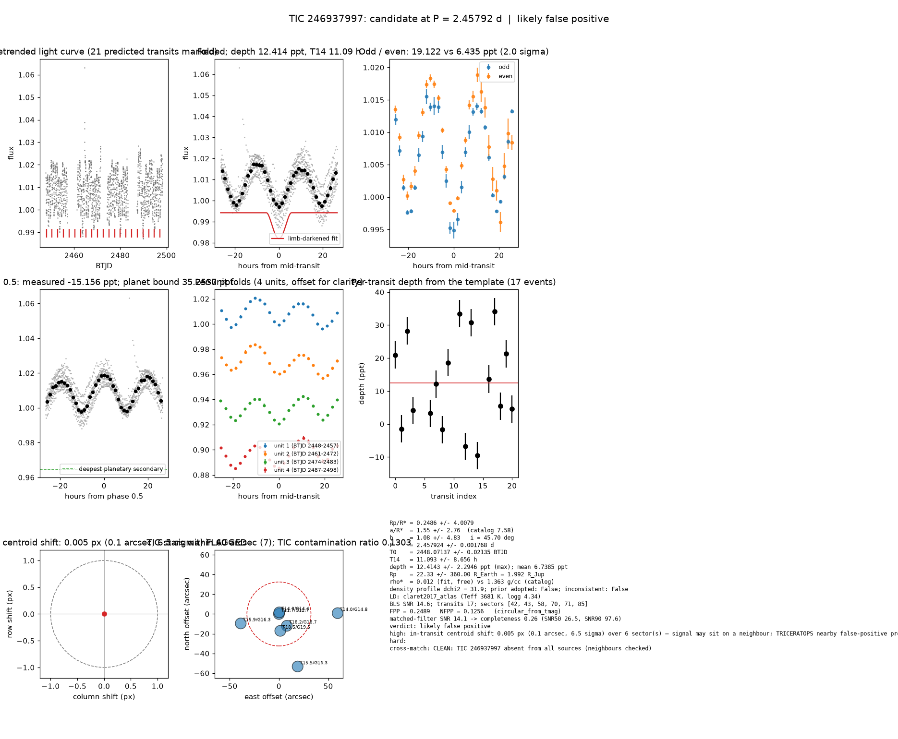

# Candidate packet: TIC 246937997, P = 2.45792 d

Generated 2026-09-03 07:49 UTC by tesshunter. This is a CANDIDATE. Nothing in this packet is a detection; the automated checks are necessary, not sufficient. The human reviews and submits.

**Automated verdict:** likely false positive (light curve only: promising planet candidate)  
**FPP / NFPP (TRICERATOPS):** 0.2489 / 0.1256

## Fitted parameters (limb-darkened transit fit)

| parameter | value |
|---|---|
| period | 2.457924 +/- 0.001768 d |
| epoch | 2448.07137 +/- 0.02135 BTJD = 2459448.07137 BJD |
| duration T14 | 11.093 +/- 8.656 h |
| depth (model maximum) | 12.4143 +/- 2.2946 ppt (shape-degenerate error 85.3541 ppt) |
| depth (duration-averaged) | 6.7385 ppt |
| Rp/R* | 0.2486 +/- 4.0079 |
| a/R* | 1.55 +/- 2.76 (catalog density gives 7.58 +/- 1.16) |
| impact parameter | 1.08 +/- 4.83 ; inclination 45.70 deg |
| Rp | 22.33 +/- 360.00 R_Earth = 1.992 +/- 32.117 R_Jup (R* = 0.823 +/- 0.105 R_Sun) |
| stellar density | fit (free) 0.012 g/cc vs catalog 1.363 +/- 0.624 g/cc; ratio 0.01, profile delta chi2 31.9; prior adopted: False; inconsistent: False |
| limb darkening | u1 = 0.358, u2 = 0.300 (claret2017_atlas (Teff 3681 K, logg 4.34)) |
| fit | least_squares, 1364 points, 17 transits, reduced chi2 0.78, delta BIC vs flat 85 |
| BLS | SNR 14.6, box depth 9.084 ppt, 17 transits observed, alias label P |

## Vetting checks

| check | result |
|---|---|
| odd/even (median) | pass (2.0 sigma) |
| odd/even (fit template) | odd 19.122 +/- 4.754 ppt (8 events), even 6.435 +/- 4.162 ppt (9 events), difference 2.0 sigma, 99% of the mean |
| secondary at phase 0.5 | -15.1562 ppt measured; deepest planetary secondary at the fitted a/R* 35.2537 ppt; not detected |
| a/R* consistency | pass — free-fit a/R* = 1.55 (b = 1.08) against 7.58 +/- 1.16 from the catalog density (0.012 vs 1.363 g/cc, ratio 0.01; profile delta chi2 31.9 with a/R* held in the catalog range, 6.1 after the red-noise be |
| V-shape | none (t_flat/t_total n/a); fitted geometry grazing: True |
| per-unit depths | pass |
| centroid | shift 0.005 px, 6.5 sigma FLAG |
| contamination | flagged, 17 neighbours checked |
| FPP / NFPP | 0.2489 / 0.1256 (TRICERATOPS 1.1.0: FPP 0.2489, NFPP 0.1256 over 18 scenarios and 43 TIC stars within 10 px; aperture circular_from_tmag; 100000 draws; fold binned (107 points, error 8840 ppm); sectors [42, 43, 58].) |

Flags: in-transit centroid shift 0.005 px (0.1 arcsec, 6.5 sigma) over 6 sector(s) — signal may sit on a neighbour; TRICERATOPS nearby false-positive probability 0.126 >= 0.1; nearby star could produce the signal: 3 high-risk and 0 medium-risk neighbour(s) of 17 checked; high duration/period ratio (0.119)

## Completeness at this SNR

Matched-filter SNR 14.1 on this star's detrended data binned to 30 min: the P2 completeness curve (`docs/COMPLETENESS.md`, 2100 injections on 300 stars, config survey_v1) recovers 0.26 of injected signals at this SNR (SNR50 = 26.5, SNR90 = 97.6; the 12-20 bin recovered 77/207). Curve measured in P2 with batman injections into the survey preset (survey_v1: FFI stitches binned to 30 min, periods 1-40 d, Rp/R* 0.01-0.12); the matched-filter SNR here is computed on this candidate's own detrended data with the same definition. Outside that regime the number is an extrapolation.

## Star and neighbours

TIC 246937997: Teff 3681 K, log g 4.34, R = 0.823 +/- 0.105 R_Sun, M = 0.540 +/- 0.085 M_Sun, Tmag 11.74, TIC contamination ratio 0.1303 (source tic; assumed errors: False).

| ID | dstArcSec | Tmag | GAIAmag | gaiabp | gaiarp | Teff | rad | contratio | disposition |
|---|---|---|---|---|---|---|---|---|---|
| 246937997 | 0.00 | 11.74 | 12.74 | 13.81 | 11.56 | 3681.00 | 0.82 | 0.13 | n/a |
| 620277659 | 1.64 | 13.99 | 14.42 | n/a | n/a | n/a | n/a | n/a | n/a |
| 620277658 | 14.41 | 18.22 | 18.71 | 19.05 | 18.11 | 5726.00 | n/a | n/a | n/a |
| 620277657 | 17.15 | 18.48 | 19.52 | 20.59 | 18.27 | 3702.00 | n/a | n/a | n/a |
| 246938000 | 39.90 | 15.86 | 16.31 | 16.65 | 15.80 | 6022.00 | 1.33 | n/a | n/a |
| 246938003 | 56.51 | 15.51 | 16.29 | 17.03 | 15.45 | 4348.00 | 0.71 | n/a | n/a |
| 246937996 | 59.45 | 14.03 | 14.76 | 15.45 | 13.97 | 4481.00 | 1.04 | n/a | n/a |

## Cross-match

CLEAN: TIC 246937997 absent from all sources (neighbours checked)  
Catalog versions: `ctoi=2026-09-03:f6964541;nasa_ps=2026-09-03:85f3c196;nasa_pscomppars=2026-09-03:4843e49c;spoc_tce=2026-09-03:e580dde7;tess_eb=2026-09-03:43555226;toi=2026-09-03:4704bb7c`

## Data

Sectors [42, 43, 58, 70, 71, 85]; 1892 raw and 1890 cleaned cadences; products: TESS-SPOC s42, TESS-SPOC s43, TESS-SPOC s58, TESS-SPOC s70, TESS-SPOC s71, TESS-SPOC s85.

## Figure



## ExoFOP CTOI fields

```json
{
 "target": "TIC 246937997",
 "tic_id": 246937997,
 "discovery_source": "TESS",
 "period_days": 2.457924025891604,
 "period_err_days": 0.0017684666071175103,
 "epoch_bjd": 2459448.0713671604,
 "epoch_err_days": 0.02134597642640219,
 "depth_ppm": 12414.349236792521,
 "depth_err_ppm": 2294.6142218128134,
 "duration_hours": 11.092694566749387,
 "duration_err_hours": 8.65550374560118,
 "disposition": "PC",
 "tag": "FILL_ME: YYYYMMDD_username_tesshunter_NNN",
 "candidate_name": null,
 "paper_url": null,
 "notes": "Survey rank 27 (frozen score 3.0411); survey stitch SNR 22.76176713425142, 53.0 transits."
}
```

_The pipeline finds candidates. It does not submit._
