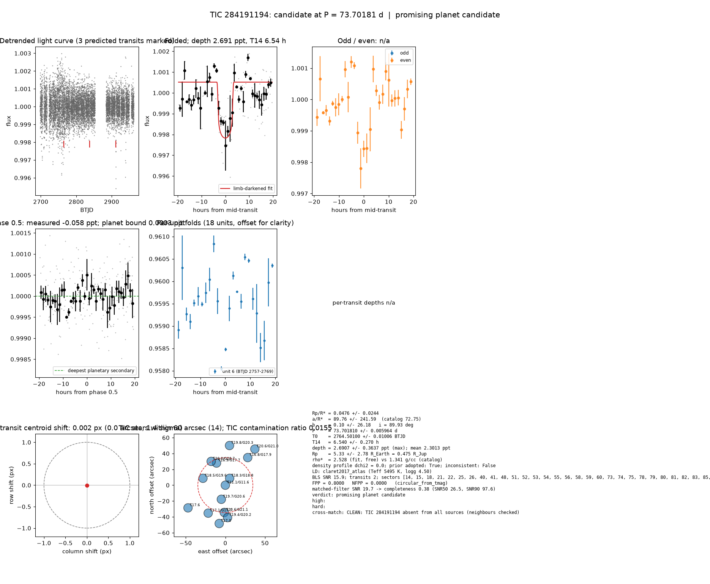

# Candidate packet: TIC 284191194, P = 73.70181 d

Generated 2026-09-03 07:27 UTC by tesshunter. This is a CANDIDATE. Nothing in this packet is a detection; the automated checks are necessary, not sufficient. The human reviews and submits.

**Automated verdict:** promising planet candidate (light curve only: promising planet candidate)  
**FPP / NFPP (TRICERATOPS):** 0.8000 / 0.0000 — above 0.5, does not proceed to submission

## Fitted parameters (limb-darkened transit fit)

| parameter | value |
|---|---|
| period | 73.701810 +/- 0.005964 d |
| epoch | 2764.50100 +/- 0.01006 BTJD = 2459764.50100 BJD |
| duration T14 | 6.540 +/- 0.270 h |
| depth (model maximum) | 2.6907 +/- 0.3637 ppt (shape-degenerate error 0.8659 ppt) |
| depth (duration-averaged) | 2.3013 ppt |
| Rp/R* | 0.0476 +/- 0.0244 |
| a/R* | 89.76 +/- 241.59 (catalog density gives 72.75 +/- 10.29) |
| impact parameter | 0.10 +/- 26.18 ; inclination 89.93 deg |
| Rp | 5.33 +/- 2.78 R_Earth = 0.475 +/- 0.248 R_Jup (R* = 1.025 R_Sun) |
| stellar density | fit (free) 2.528 g/cc vs catalog 1.341 +/- 0.569 g/cc; ratio 1.89, profile delta chi2 0.0; prior adopted: True; inconsistent: False |
| limb darkening | u1 = 0.347, u2 = 0.253 (claret2017_atlas (Teff 5495 K, logg 4.50)) |
| fit | least_squares, 81 points, 2 transits, reduced chi2 1.99, delta BIC vs flat 194 |
| BLS | SNR 15.9, box depth 2.440 ppt, 2 transits observed, alias label P |

## Vetting checks

| check | result |
|---|---|
| odd/even (median) | pass (0.0 sigma) |
| odd/even (fit template) | no odd transit inside the window |
| secondary at phase 0.5 | -0.0583 ppt measured; deepest planetary secondary at the fitted a/R* 0.0003 ppt; not detected |
| a/R* consistency | pass — free-fit a/R* = 89.87 (b = 0.09) against 72.75 +/- 10.29 from the catalog density (2.528 vs 1.341 g/cc, ratio 1.89; profile delta chi2 0.0 with a/R* held in the catalog range, 0.0 after the red-noise  |
| V-shape | none (t_flat/t_total 0.70); fitted geometry grazing: False |
| per-unit depths | pass |
| centroid | shift 0.002 px, 1.4 sigma |
| contamination | flagged, 27 neighbours checked |
| FPP / NFPP | 0.8000 / 0.0000 (TRICERATOPS 1.1.0: FPP 0.8000, NFPP 0.0000 over 15 scenarios and 113 TIC stars within 10 px; aperture circular_from_tmag; 100000 draws; fold binned (49 points, error 540 ppm); sectors [14, 15, 18].) |

Flags: none

## Completeness at this SNR

Matched-filter SNR 19.7 on this star's detrended data binned to 30 min: the P2 completeness curve (`docs/COMPLETENESS.md`, 2100 injections on 300 stars, config survey_v1) recovers 0.38 of injected signals at this SNR (SNR50 = 26.5, SNR90 = 97.6; the 12-20 bin recovered 77/207). Curve measured in P2 with batman injections into the survey preset (survey_v1: FFI stitches binned to 30 min, periods 1-40 d, Rp/R* 0.01-0.12); the matched-filter SNR here is computed on this candidate's own detrended data with the same definition. Outside that regime the number is an extrapolation.

## Star and neighbours

TIC 284191194: Teff 5495 K, log g n/a, R = 1.025 R_Sun, M = n/a M_Sun, Tmag 11.09, TIC contamination ratio 0.0155 (source tic; assumed errors: True).

| ID | dstArcSec | Tmag | GAIAmag | gaiabp | gaiarp | Teff | rad | contratio | disposition |
|---|---|---|---|---|---|---|---|---|---|
| 284191194 | 0.00 | 11.09 | 11.56 | 11.94 | 11.04 | 5495.00 | 1.03 | 0.02 | n/a |
| 1551267253 | 10.26 | 18.32 | 18.83 | 19.16 | 18.16 | 5387.00 | n/a | n/a | n/a |
| 1551267187 | 18.50 | 19.69 | 20.59 | 21.30 | 19.38 | n/a | n/a | n/a | n/a |
| 1551267242 | 29.54 | 18.53 | 19.60 | 20.81 | 18.38 | 3593.00 | 0.59 | n/a | n/a |
| 284191202 | 30.07 | 16.86 | 17.66 | 18.46 | 16.79 | 4141.00 | 0.67 | n/a | n/a |
| 1551267188 | 34.47 | 20.64 | 21.07 | n/a | n/a | n/a | n/a | n/a | n/a |
| 1551267244 | 34.95 | 20.05 | 20.72 | 21.38 | 20.05 | 4636.00 | n/a | n/a | n/a |
| 1551267189 | 41.01 | 19.44 | 20.19 | 20.41 | 18.87 | n/a | n/a | n/a | n/a |
| 284191188 | 41.39 | 17.08 | 17.66 | 18.16 | 17.03 | 5049.00 | 0.75 | n/a | n/a |
| 284191207 | 44.84 | 16.75 | 17.90 | 19.05 | 16.79 | 3576.00 | 0.50 | n/a | n/a |
| 284191187 | 49.00 | 16.96 | n/a | n/a | n/a | n/a | n/a | n/a | n/a |
| 1551267256 | 50.33 | 19.80 | 20.34 | 20.56 | 19.51 | n/a | n/a | n/a | n/a |
| 284191190 | 55.10 | 17.60 | n/a | n/a | n/a | n/a | n/a | n/a | n/a |
| 1551267255 | 58.86 | 20.57 | 21.00 | n/a | n/a | n/a | n/a | n/a | n/a |

## Cross-match

CLEAN: TIC 284191194 absent from all sources (neighbours checked)  
Catalog versions: `ctoi=2026-09-03:f6964541;nasa_ps=2026-09-03:85f3c196;nasa_pscomppars=2026-09-03:4843e49c;spoc_tce=2026-09-03:e580dde7;tess_eb=2026-09-03:43555226;toi=2026-09-03:4704bb7c`

## Data

Sectors [14, 15, 18, 21, 22, 25, 26, 40, 41, 48, 51, 52, 53, 54, 55, 56, 58, 59, 60, 73, 74, 75, 78, 79, 80, 81, 82, 83, 85, 86]; 9440 raw and 9432 cleaned cadences; products: QLP s14, QLP s15, QLP s18, QLP s21, QLP s22, QLP s25.

## Figure



## ExoFOP CTOI fields

```json
{
 "target": "TIC 284191194",
 "tic_id": 284191194,
 "discovery_source": "TESS",
 "period_days": 73.70181045926937,
 "period_err_days": 0.005964215510512702,
 "epoch_bjd": 2459764.501004952,
 "epoch_err_days": 0.010058294938411007,
 "depth_ppm": 2690.7290757193227,
 "depth_err_ppm": 363.69883922904387,
 "duration_hours": 6.540419760088591,
 "duration_err_hours": 0.2704106853066877,
 "disposition": "PC",
 "tag": "FILL_ME: YYYYMMDD_username_tesshunter_NNN",
 "candidate_name": null,
 "paper_url": null,
 "notes": "Survey rank 13 (frozen score 3.3117); survey stitch SNR 36.202290776739545, 10.0 transits."
}
```

_The pipeline finds candidates. It does not submit._
