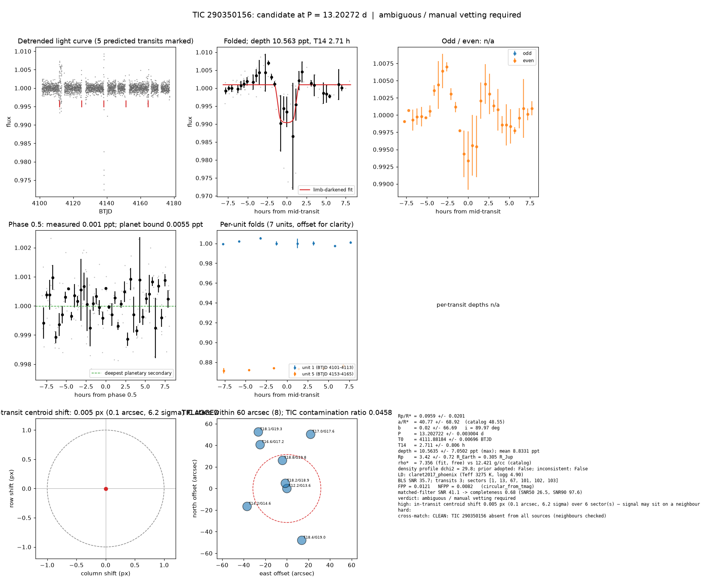

# Candidate packet: TIC 290350156, P = 13.20272 d

Generated 2026-09-03 07:52 UTC by tesshunter. This is a CANDIDATE. Nothing in this packet is a detection; the automated checks are necessary, not sufficient. The human reviews and submits.

**Automated verdict:** ambiguous / manual vetting required (light curve only: promising planet candidate)  
**FPP / NFPP (TRICERATOPS):** 0.0121 / 0.0082

## Fitted parameters (limb-darkened transit fit)

| parameter | value |
|---|---|
| period | 13.202722 +/- 0.003004 d |
| epoch | 4111.88184 +/- 0.00696 BTJD = 2461111.88184 BJD |
| duration T14 | 2.711 +/- 0.806 h |
| depth (model maximum) | 10.5635 +/- 7.0502 ppt (shape-degenerate error 2.4659 ppt) |
| depth (duration-averaged) | 8.8331 ppt |
| Rp/R* | 0.0959 +/- 0.0201 |
| a/R* | 40.77 +/- 68.92 (catalog density gives 48.55 +/- 0.39) |
| impact parameter | 0.02 +/- 66.69 ; inclination 89.97 deg |
| Rp | 3.42 +/- 0.72 R_Earth = 0.305 +/- 0.065 R_Jup (R* = 0.327 +/- 0.010 R_Sun) |
| stellar density | fit (free) 7.356 g/cc vs catalog 12.421 +/- 0.299 g/cc; ratio 0.59, profile delta chi2 29.8; prior adopted: False; inconsistent: False |
| limb darkening | u1 = 0.156, u2 = 0.463 (claret2017_phoenix (Teff 3275 K, logg 4.90)) |
| fit | least_squares, 79 points, 3 transits, reduced chi2 24.26, delta BIC vs flat 1099 |
| BLS | SNR 35.7, box depth 8.810 ppt, 3 transits observed, alias label P/2 |

## Vetting checks

| check | result |
|---|---|
| odd/even (median) | pass (0.0 sigma) |
| odd/even (fit template) | no odd transit inside the window |
| secondary at phase 0.5 | 0.0005 ppt measured; deepest planetary secondary at the fitted a/R* 0.0055 ppt; not detected |
| a/R* consistency | pass — free-fit a/R* = 40.77 (b = 0.02) against 48.55 +/- 0.39 from the catalog density (7.356 vs 12.421 g/cc, ratio 0.59; profile delta chi2 29.8 with a/R* held in the catalog range, 1.2 after the red-noise |
| V-shape | none (t_flat/t_total 0.65); fitted geometry grazing: False |
| per-unit depths | FLAG |
| centroid | shift 0.005 px, 6.2 sigma FLAG |
| contamination | flagged, 38 neighbours checked |
| FPP / NFPP | 0.0121 / 0.0082 (TRICERATOPS 1.1.0: FPP 0.0121, NFPP 0.0082 over 18 scenarios and 113 TIC stars within 10 px; aperture circular_from_tmag; 100000 draws; fold binned (31 points, error 2312 ppm); sectors [1, 13, 67].) |

Flags: in-transit centroid shift 0.005 px (0.1 arcsec, 6.2 sigma) over 6 sector(s) — signal may sit on a neighbour; per-unit transit depths disagree by > 3σ across observing units

## Completeness at this SNR

Matched-filter SNR 41.1 on this star's detrended data binned to 30 min: the P2 completeness curve (`docs/COMPLETENESS.md`, 2100 injections on 300 stars, config survey_v1) recovers 0.68 of injected signals at this SNR (SNR50 = 26.5, SNR90 = 97.6; the 20-50 bin recovered 237/368). Curve measured in P2 with batman injections into the survey preset (survey_v1: FFI stitches binned to 30 min, periods 1-40 d, Rp/R* 0.01-0.12); the matched-filter SNR here is computed on this candidate's own detrended data with the same definition. Outside that regime the number is an extrapolation.

## Star and neighbours

TIC 290350156: Teff 3275 K, log g 4.90, R = 0.327 +/- 0.010 R_Sun, M = 0.307 +/- 0.020 M_Sun, Tmag 12.24, TIC contamination ratio 0.0458 (source tic; assumed errors: False).

| ID | dstArcSec | Tmag | GAIAmag | gaiabp | gaiarp | Teff | rad | contratio | disposition |
|---|---|---|---|---|---|---|---|---|---|
| 290350156 | 0.00 | 12.24 | 13.55 | 15.13 | 12.33 | 3275.00 | 0.33 | 0.05 | n/a |
| 2026021919 | 5.05 | 18.23 | 18.93 | 19.51 | 18.11 | 4565.00 | 0.48 | n/a | n/a |
| 2026021920 | 26.35 | 18.85 | 19.76 | 20.61 | 18.65 | 3938.00 | n/a | n/a | n/a |
| 290350153 | 40.45 | 14.16 | 14.63 | 15.00 | 14.09 | 5714.00 | 1.29 | n/a | n/a |
| 290350158 | 47.60 | 16.60 | 17.19 | 17.70 | 16.54 | 5016.00 | 0.85 | n/a | n/a |
| 2026021916 | 49.95 | 18.43 | 18.99 | 19.50 | 18.41 | 5197.00 | n/a | n/a | n/a |
| 290350159 | 54.85 | 17.01 | 17.61 | 18.13 | 16.95 | 4993.00 | 1.93 | n/a | n/a |
| 290350160 | 58.73 | 18.11 | 19.28 | 20.83 | 18.02 | 3353.00 | 0.46 | n/a | n/a |

## Cross-match

CLEAN: TIC 290350156 absent from all sources (neighbours checked)  
Catalog versions: `ctoi=2026-09-03:f6964541;nasa_ps=2026-09-03:85f3c196;nasa_pscomppars=2026-09-03:4843e49c;spoc_tce=2026-09-03:e580dde7;tess_eb=2026-09-03:43555226;toi=2026-09-03:4704bb7c`

## Data

Sectors [1, 13, 67, 101, 102, 103]; 3047 raw and 3045 cleaned cadences; products: SPOC s1, SPOC s13, SPOC s67, QLP s101, QLP s102, QLP s103.

## Figure



## ExoFOP CTOI fields

```json
{
 "target": "TIC 290350156",
 "tic_id": 290350156,
 "discovery_source": "TESS",
 "period_days": 13.202721984620776,
 "period_err_days": 0.003003962410108704,
 "epoch_bjd": 2461111.881839309,
 "epoch_err_days": 0.006960685904548217,
 "depth_ppm": 10563.468681477729,
 "depth_err_ppm": 7050.228419903925,
 "duration_hours": 2.7107557860350626,
 "duration_err_hours": 0.805846161733704,
 "disposition": "PC",
 "tag": "FILL_ME: YYYYMMDD_username_tesshunter_NNN",
 "candidate_name": null,
 "paper_url": null,
 "notes": "Survey rank 30 (frozen score 2.9941); survey stitch SNR 26.82711022673783, 9.0 transits."
}
```

_The pipeline finds candidates. It does not submit._
