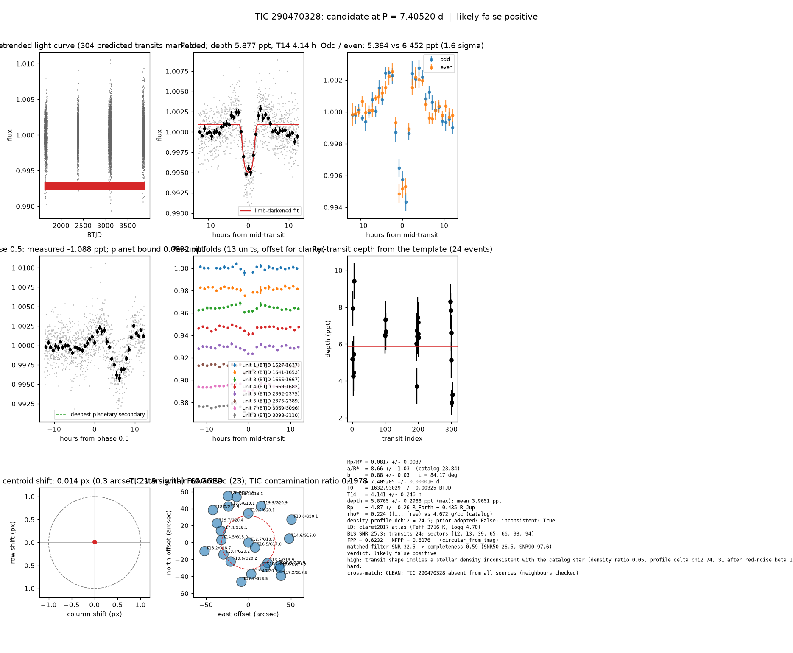

# Candidate packet: TIC 290470328, P = 7.40520 d

Generated 2026-09-03 07:37 UTC by tesshunter. This is a CANDIDATE. Nothing in this packet is a detection; the automated checks are necessary, not sufficient. The human reviews and submits.

**Automated verdict:** likely false positive (light curve only: ambiguous / manual vetting required)  
**FPP / NFPP (TRICERATOPS):** 0.6232 / 0.6176 — above 0.5, does not proceed to submission

## Fitted parameters (limb-darkened transit fit)

| parameter | value |
|---|---|
| period | 7.405205 +/- 0.000016 d |
| epoch | 1632.93029 +/- 0.00325 BTJD = 2458632.93029 BJD |
| duration T14 | 4.141 +/- 0.246 h |
| depth (model maximum) | 5.8765 +/- 0.2988 ppt (shape-degenerate error 0.4886 ppt) |
| depth (duration-averaged) | 3.9651 ppt |
| Rp/R* | 0.0817 +/- 0.0037 |
| a/R* | 8.66 +/- 1.03 (catalog density gives 23.84 +/- 0.41) |
| impact parameter | 0.88 +/- 0.03 ; inclination 84.17 deg |
| Rp | 4.87 +/- 0.26 R_Earth = 0.435 +/- 0.023 R_Jup (R* = 0.547 +/- 0.016 R_Sun) |
| stellar density | fit (free) 0.224 g/cc vs catalog 4.672 +/- 0.240 g/cc; ratio 0.05, profile delta chi2 74.5; prior adopted: False; inconsistent: True |
| limb darkening | u1 = 0.282, u2 = 0.358 (claret2017_atlas (Teff 3716 K, logg 4.70)) |
| fit | least_squares, 891 points, 24 transits, reduced chi2 1.38, delta BIC vs flat 1015 |
| BLS | SNR 25.3, box depth 3.850 ppt, 24 transits observed, alias label P |

## Vetting checks

| check | result |
|---|---|
| odd/even (median) | pass (1.6 sigma) |
| odd/even (fit template) | odd 5.384 +/- 0.497 ppt (12 events), even 6.452 +/- 0.442 ppt (12 events), difference 1.6 sigma, 18% of the mean |
| secondary at phase 0.5 | -1.0883 ppt measured; deepest planetary secondary at the fitted a/R* 0.0892 ppt; not detected |
| a/R* consistency | FLAG — free-fit a/R* = 8.66 (b = 0.88) against 23.84 +/- 0.41 from the catalog density (0.224 vs 4.672 g/cc, ratio 0.05; profile delta chi2 74.5 with a/R* held in the catalog range, 31.2 after the red-noise  |
| V-shape | none (t_flat/t_total 0.45); fitted geometry grazing: False |
| per-unit depths | FLAG |
| centroid | shift 0.014 px, 21.9 sigma FLAG |
| contamination | flagged, 70 neighbours checked |
| FPP / NFPP | 0.6232 / 0.6176 (TRICERATOPS 1.1.0: FPP 0.6232, NFPP 0.6176 over 33 scenarios and 210 TIC stars within 10 px; aperture circular_from_tmag; 100000 draws; fold binned (50 points, error 866 ppm); sectors [12, 13, 39].) |

Flags: transit shape implies a stellar density inconsistent with the catalog star (density ratio 0.05, profile delta chi2 74, 31 after red-noise beta 1.54) — diluted eclipse, grazing stellar companion or blend; in-transit centroid shift 0.014 px (0.3 arcsec, 21.9 sigma) over 7 sector(s) — signal may sit on a neighbour; TRICERATOPS nearby false-positive probability 0.618 >= 0.1; nearby star could produce the signal: 5 high-risk and 4 medium-risk neighbour(s) of 70 checked; per-unit transit depths disagree by > 3σ across observing units

## Completeness at this SNR

Matched-filter SNR 32.5 on this star's detrended data binned to 30 min: the P2 completeness curve (`docs/COMPLETENESS.md`, 2100 injections on 300 stars, config survey_v1) recovers 0.59 of injected signals at this SNR (SNR50 = 26.5, SNR90 = 97.6; the 20-50 bin recovered 237/368). Curve measured in P2 with batman injections into the survey preset (survey_v1: FFI stitches binned to 30 min, periods 1-40 d, Rp/R* 0.01-0.12); the matched-filter SNR here is computed on this candidate's own detrended data with the same definition. Outside that regime the number is an extrapolation.

## Star and neighbours

TIC 290470328: Teff 3716 K, log g 4.70, R = 0.547 +/- 0.016 R_Sun, M = 0.543 +/- 0.020 M_Sun, Tmag 12.68, TIC contamination ratio 0.1978 (source tic; assumed errors: False).

| ID | dstArcSec | Tmag | GAIAmag | gaiabp | gaiarp | Teff | rad | contratio | disposition |
|---|---|---|---|---|---|---|---|---|---|
| 290470328 | 0.00 | 12.68 | 13.71 | 14.77 | 12.70 | 3716.00 | 0.55 | 0.20 | n/a |
| 290470330 | 9.79 | 16.47 | 17.00 | 17.44 | 16.42 | 5472.00 | 1.49 | n/a | n/a |
| 1103877828 | 30.78 | 19.56 | 20.23 | 20.69 | 19.34 | n/a | n/a | n/a | n/a |
| 290470327 | 32.06 | 14.45 | 15.00 | 15.44 | 14.39 | 5368.00 | 0.79 | n/a | n/a |
| 1103877861 | 32.70 | 19.39 | 20.15 | 20.86 | 19.29 | n/a | n/a | n/a | n/a |
| 290470331 | 33.10 | 13.39 | 13.89 | 14.29 | 13.32 | n/a | n/a | n/a | n/a |
| 1103877869 | 34.31 | 19.50 | 20.13 | 20.63 | 19.39 | n/a | n/a | n/a | n/a |
| 290470333 | 34.89 | 16.14 | 17.46 | 18.93 | 16.21 | 3319.00 | 0.38 | n/a | n/a |
| 290470324 | 35.36 | 17.36 | 18.06 | 18.71 | 17.31 | 4600.00 | 0.56 | n/a | n/a |
| 1103877827 | 37.38 | 19.40 | 20.23 | 20.91 | 19.17 | n/a | n/a | n/a | n/a |
| 1103877862 | 43.53 | 19.72 | 20.43 | 21.20 | 19.79 | 4607.00 | n/a | n/a | n/a |
| 1103877829 | 45.44 | 20.01 | 20.87 | 21.76 | 19.96 | 4046.00 | n/a | n/a | n/a |
| 1103877870 | 45.44 | 19.86 | 20.93 | 22.46 | 20.00 | n/a | n/a | n/a | n/a |
| 1103877826 | 47.11 | 17.94 | 18.47 | 18.89 | 17.87 | 5481.00 | n/a | n/a | n/a |
| 1103877830 | 47.99 | 18.66 | 19.19 | 19.65 | 18.64 | 5500.00 | n/a | n/a | n/a |
| 290470326 | 48.27 | 14.56 | 14.99 | 15.31 | 14.50 | 6125.00 | 1.36 | n/a | n/a |
| 1103877868 | 48.60 | 18.55 | 19.15 | 19.69 | 18.53 | 5117.00 | n/a | n/a | n/a |
| 1103877860 | 52.76 | 18.18 | 18.66 | 19.09 | 18.17 | 5757.00 | n/a | n/a | n/a |
| 290470334 | 54.99 | 17.18 | 17.75 | 18.24 | 17.14 | 5240.00 | 0.86 | n/a | n/a |
| 290470318 | 55.43 | 14.07 | 14.59 | 14.82 | 13.83 | n/a | n/a | n/a | n/a |
| 1103877867 | 56.77 | 18.05 | 18.94 | 19.86 | 17.99 | 3997.00 | 0.56 | n/a | n/a |
| 1103877854 | 57.64 | 19.57 | 20.08 | 20.46 | 19.48 | 5595.00 | n/a | n/a | n/a |
| 1103877871 | 59.91 | 20.20 | 20.48 | 20.56 | 20.03 | n/a | n/a | n/a | n/a |

## Cross-match

CLEAN: TIC 290470328 absent from all sources (neighbours checked)  
Catalog versions: `ctoi=2026-09-03:f6964541;nasa_ps=2026-09-03:85f3c196;nasa_pscomppars=2026-09-03:4843e49c;spoc_tce=2026-09-03:e580dde7;tess_eb=2026-09-03:43555226;toi=2026-09-03:4704bb7c`

## Data

Sectors [12, 13, 39, 65, 66, 93, 94]; 7728 raw and 7688 cleaned cadences; products: QLP s12, QLP s13, QLP s39, QLP s65, QLP s66, QLP s93.

## Figure



## ExoFOP CTOI fields

```json
{
 "target": "TIC 290470328",
 "tic_id": 290470328,
 "discovery_source": "TESS",
 "period_days": 7.405204556571207,
 "period_err_days": 1.581582519595034e-05,
 "epoch_bjd": 2458632.93028945,
 "epoch_err_days": 0.003254776497419212,
 "depth_ppm": 5876.5269680070005,
 "depth_err_ppm": 298.8117908234141,
 "duration_hours": 4.1408316541062575,
 "duration_err_hours": 0.24639230806847387,
 "disposition": "PC",
 "tag": "FILL_ME: YYYYMMDD_username_tesshunter_NNN",
 "candidate_name": null,
 "paper_url": null,
 "notes": "Survey rank 22 (frozen score 3.1028); survey stitch SNR 25.30060556025186, 24.0 transits."
}
```

_The pipeline finds candidates. It does not submit._
