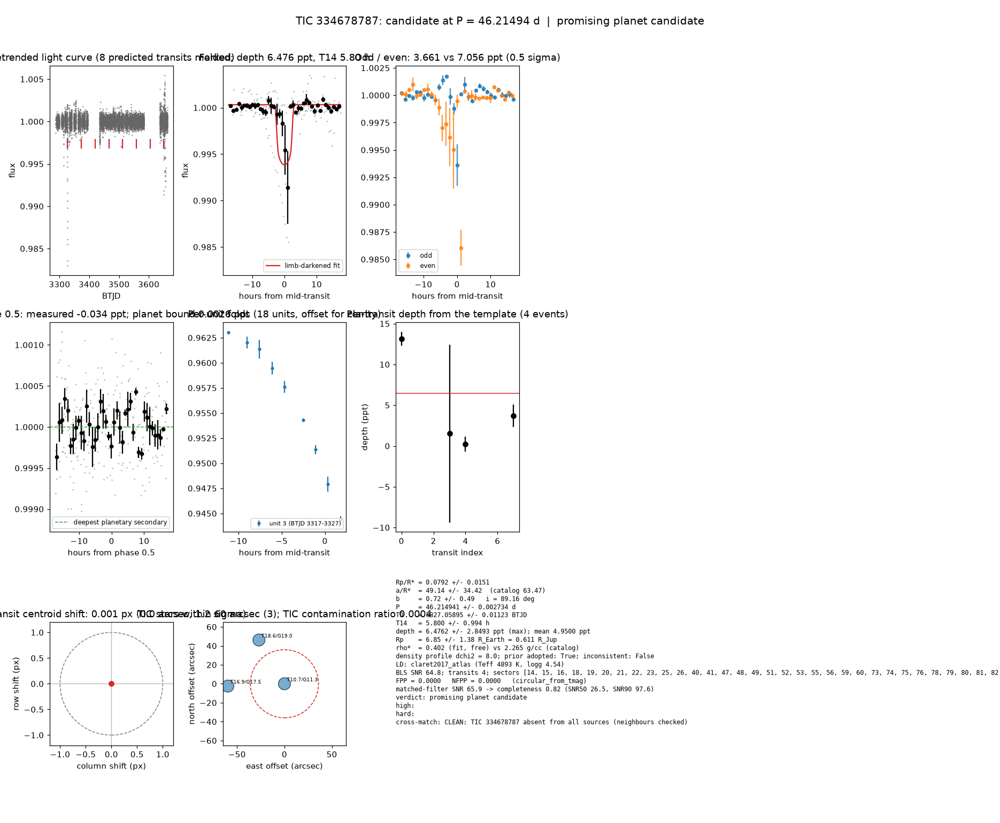

# Candidate packet: TIC 334678787, P = 46.21494 d

Generated 2026-09-03 07:37 UTC by tesshunter. This is a CANDIDATE. Nothing in this packet is a detection; the automated checks are necessary, not sufficient. The human reviews and submits.

**Automated verdict:** promising planet candidate (light curve only: promising planet candidate)  
**FPP / NFPP (TRICERATOPS):** 0.0000 / 0.0000

## Fitted parameters (limb-darkened transit fit)

| parameter | value |
|---|---|
| period | 46.214941 +/- 0.002734 d |
| epoch | 3327.05895 +/- 0.01123 BTJD = 2460327.05895 BJD |
| duration T14 | 5.800 +/- 0.994 h |
| depth (model maximum) | 6.4762 +/- 2.8493 ppt (shape-degenerate error 1.7591 ppt) |
| depth (duration-averaged) | 4.9500 ppt |
| Rp/R* | 0.0792 +/- 0.0151 |
| a/R* | 49.14 +/- 34.42 (catalog density gives 63.47 +/- 5.42) |
| impact parameter | 0.72 +/- 0.49 ; inclination 89.16 deg |
| Rp | 6.85 +/- 1.38 R_Earth = 0.611 +/- 0.123 R_Jup (R* = 0.793 +/- 0.051 R_Sun) |
| stellar density | fit (free) 0.402 g/cc vs catalog 2.265 +/- 0.580 g/cc; ratio 0.18, profile delta chi2 8.0; prior adopted: True; inconsistent: False |
| limb darkening | u1 = 0.452, u2 = 0.189 (claret2017_atlas (Teff 4893 K, logg 4.54)) |
| fit | least_squares, 176 points, 4 transits, reduced chi2 29.83, delta BIC vs flat 3267 |
| BLS | SNR 64.8, box depth 6.158 ppt, 3 transits observed, alias label P/2 |

## Vetting checks

| check | result |
|---|---|
| odd/even (median) | pass (1.8 sigma) |
| odd/even (fit template) | odd 3.661 +/- 1.371 ppt (2 events), even 7.056 +/- 6.459 ppt (2 events), difference 0.5 sigma, 63% of the mean |
| secondary at phase 0.5 | -0.0339 ppt measured; deepest planetary secondary at the fitted a/R* 0.0026 ppt; not detected |
| a/R* consistency | pass — free-fit a/R* = 35.66 (b = 0.87) against 63.47 +/- 5.42 from the catalog density (0.402 vs 2.265 g/cc, ratio 0.18; profile delta chi2 8.0 with a/R* held in the catalog range, 0.3 after the red-noise b |
| V-shape | none (t_flat/t_total 0.80); fitted geometry grazing: False |
| per-unit depths | FLAG |
| centroid | shift 0.001 px, 1.2 sigma |
| contamination | pass, 12 neighbours checked |
| FPP / NFPP | 0.0000 / 0.0000 (TRICERATOPS 1.1.0: FPP 0.0000, NFPP 0.0000 over 15 scenarios and 62 TIC stars within 10 px; aperture circular_from_tmag; 100000 draws; fold binned (69 points, error 541 ppm); sectors [14, 15, 16].) |

Flags: per-unit transit depths disagree by > 3σ across observing units

## Completeness at this SNR

Matched-filter SNR 65.9 on this star's detrended data binned to 30 min: the P2 completeness curve (`docs/COMPLETENESS.md`, 2100 injections on 300 stars, config survey_v1) recovers 0.82 of injected signals at this SNR (SNR50 = 26.5, SNR90 = 97.6; the 50-1000000000.0 bin recovered 586/658). Curve measured in P2 with batman injections into the survey preset (survey_v1: FFI stitches binned to 30 min, periods 1-40 d, Rp/R* 0.01-0.12); the matched-filter SNR here is computed on this candidate's own detrended data with the same definition. Outside that regime the number is an extrapolation.

## Star and neighbours

TIC 334678787: Teff 4893 K, log g 4.54, R = 0.793 +/- 0.051 R_Sun, M = 0.800 +/- 0.092 M_Sun, Tmag 10.73, TIC contamination ratio 0.0004 (source tic; assumed errors: False).

| ID | dstArcSec | Tmag | GAIAmag | gaiabp | gaiarp | Teff | rad | contratio | disposition |
|---|---|---|---|---|---|---|---|---|---|
| 334678787 | 0.00 | 10.73 | 11.33 | 11.85 | 10.68 | 4893.00 | 0.79 | 0.00 | n/a |
| 1201370536 | 53.42 | 18.56 | 18.96 | 18.92 | 18.16 | n/a | n/a | n/a | n/a |
| 334678786 | 59.76 | 16.94 | 17.49 | 17.84 | 16.78 | n/a | n/a | n/a | n/a |

## Cross-match

CLEAN: TIC 334678787 absent from all sources (neighbours checked)  
Catalog versions: `ctoi=2026-09-03:f6964541;nasa_ps=2026-09-03:85f3c196;nasa_pscomppars=2026-09-03:4843e49c;spoc_tce=2026-09-03:e580dde7;tess_eb=2026-09-03:43555226;toi=2026-09-03:4704bb7c`

## Data

Sectors [14, 15, 16, 18, 19, 20, 21, 22, 23, 25, 26, 40, 41, 47, 48, 49, 51, 52, 53, 55, 56, 59, 60, 73, 74, 75, 76, 78, 79, 80, 81, 82, 83, 86]; 10339 raw and 10294 cleaned cadences; products: TESS-SPOC s14, TESS-SPOC s15, TESS-SPOC s16, TESS-SPOC s18, TESS-SPOC s19, TESS-SPOC s20.

## Figure



## ExoFOP CTOI fields

```json
{
 "target": "TIC 334678787",
 "tic_id": 334678787,
 "discovery_source": "TESS",
 "period_days": 46.21494098574883,
 "period_err_days": 0.002733941986136086,
 "epoch_bjd": 2460327.0589548023,
 "epoch_err_days": 0.01123260260182272,
 "depth_ppm": 6476.209945764366,
 "depth_err_ppm": 2849.3173533205577,
 "duration_hours": 5.800452755704891,
 "duration_err_hours": 0.9942178910299331,
 "disposition": "PC",
 "tag": "FILL_ME: YYYYMMDD_username_tesshunter_NNN",
 "candidate_name": null,
 "paper_url": null,
 "notes": "Survey rank 20 (frozen score 3.1232); survey stitch SNR 26.203988956473957, 13.0 transits."
}
```

_The pipeline finds candidates. It does not submit._
