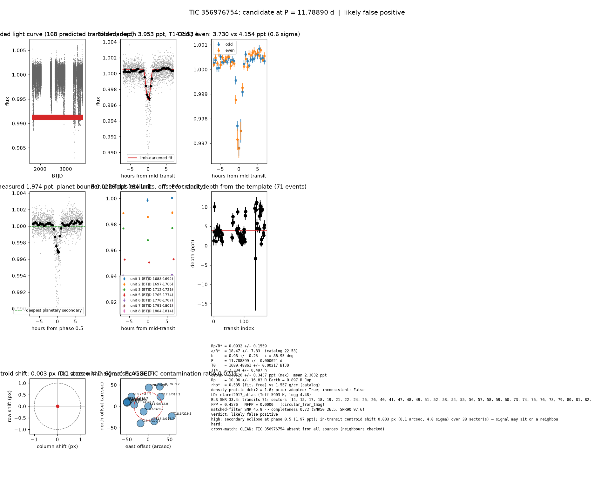

# Candidate packet: TIC 356976754, P = 11.78890 d

Generated 2026-09-03 07:29 UTC by tesshunter. This is a CANDIDATE. Nothing in this packet is a detection; the automated checks are necessary, not sufficient. The human reviews and submits.

**Automated verdict:** likely false positive (light curve only: ambiguous / manual vetting required)  
**FPP / NFPP (TRICERATOPS):** 0.4576 / 0.0000

## Fitted parameters (limb-darkened transit fit)

| parameter | value |
|---|---|
| period | 11.788899 +/- 0.000021 d |
| epoch | 1689.48861 +/- 0.00217 BTJD = 2458689.48861 BJD |
| duration T14 | 2.334 +/- 0.497 h |
| depth (model maximum) | 3.9526 +/- 0.3437 ppt (shape-degenerate error 19.7082 ppt) |
| depth (duration-averaged) | 2.3032 ppt |
| Rp/R* | 0.0932 +/- 0.1559 |
| a/R* | 18.47 +/- 7.83 (catalog density gives 22.53 +/- 1.49) |
| impact parameter | 0.98 +/- 0.25 ; inclination 86.95 deg |
| Rp | 10.06 +/- 16.83 R_Earth = 0.897 +/- 1.501 R_Jup (R* = 0.989 +/- 0.042 R_Sun) |
| stellar density | fit (free) 0.585 g/cc vs catalog 1.557 +/- 0.310 g/cc; ratio 0.38, profile delta chi2 1.6; prior adopted: True; inconsistent: False |
| limb darkening | u1 = 0.285, u2 = 0.286 (claret2017_atlas (Teff 5903 K, logg 4.48)) |
| fit | least_squares, 904 points, 71 transits, reduced chi2 3.85, delta BIC vs flat 2730 |
| BLS | SNR 33.4, box depth 2.776 ppt, 70 transits observed, alias label P |

## Vetting checks

| check | result |
|---|---|
| odd/even (median) | pass (0.6 sigma) |
| odd/even (fit template) | odd 3.730 +/- 0.511 ppt (32 events), even 4.154 +/- 0.543 ppt (39 events), difference 0.6 sigma, 11% of the mean |
| secondary at phase 0.5 | 1.9739 ppt measured; deepest planetary secondary at the fitted a/R* 0.0256 ppt; STELLAR |
| a/R* consistency | pass — free-fit a/R* = 16.26 (b = 1.20) against 22.53 +/- 1.49 from the catalog density (0.585 vs 1.557 g/cc, ratio 0.38; profile delta chi2 1.6 with a/R* held in the catalog range, 0.2 after the red-noise b |
| V-shape | none (t_flat/t_total 0.55); fitted geometry grazing: True |
| per-unit depths | FLAG |
| centroid | shift 0.003 px, 4.0 sigma FLAG |
| contamination | flagged, 31 neighbours checked |
| FPP / NFPP | 0.4576 / 0.0000 (TRICERATOPS 1.1.0: FPP 0.4576, NFPP 0.0000 over 15 scenarios and 119 TIC stars within 10 px; aperture circular_from_tmag; 100000 draws; fold binned (28 points, error 215 ppm); sectors [14, 15, 17].) |

Flags: secondary eclipse at phase 0.5 (1.97 ppt); in-transit centroid shift 0.003 px (0.1 arcsec, 4.0 sigma) over 38 sector(s) — signal may sit on a neighbour; per-unit transit depths disagree by > 3σ across observing units

## Completeness at this SNR

Matched-filter SNR 45.9 on this star's detrended data binned to 30 min: the P2 completeness curve (`docs/COMPLETENESS.md`, 2100 injections on 300 stars, config survey_v1) recovers 0.72 of injected signals at this SNR (SNR50 = 26.5, SNR90 = 97.6; the 20-50 bin recovered 237/368). Curve measured in P2 with batman injections into the survey preset (survey_v1: FFI stitches binned to 30 min, periods 1-40 d, Rp/R* 0.01-0.12); the matched-filter SNR here is computed on this candidate's own detrended data with the same definition. Outside that regime the number is an extrapolation.

## Star and neighbours

TIC 356976754: Teff 5903 K, log g 4.48, R = 0.989 +/- 0.042 R_Sun, M = 1.070 +/- 0.131 M_Sun, Tmag 11.62, TIC contamination ratio 0.0211 (source tic; assumed errors: False).

| ID | dstArcSec | Tmag | GAIAmag | gaiabp | gaiarp | Teff | rad | contratio | disposition |
|---|---|---|---|---|---|---|---|---|---|
| 356976754 | 0.00 | 11.62 | 12.04 | 12.37 | 11.57 | 5902.99 | 0.99 | 0.02 | n/a |
| 1551320697 | 16.47 | 19.58 | 20.25 | 20.61 | 19.27 | n/a | n/a | n/a | n/a |
| 1551320693 | 32.72 | 19.72 | 20.66 | 21.49 | 19.42 | n/a | n/a | n/a | n/a |
| 356976192 | 36.31 | 17.46 | 18.18 | 18.84 | 17.37 | 4421.00 | 0.50 | n/a | n/a |
| 356976745 | 37.84 | 17.22 | 17.71 | 18.14 | 17.19 | 5511.00 | 0.55 | n/a | n/a |
| 1551320701 | 43.64 | 20.19 | 20.71 | 20.74 | 19.74 | n/a | n/a | n/a | n/a |
| 1551320686 | 43.70 | 19.84 | 20.81 | 21.53 | 19.40 | n/a | n/a | n/a | n/a |
| 1551320695 | 45.08 | 18.91 | 19.88 | 20.92 | 18.77 | n/a | n/a | n/a | n/a |
| 356976758 | 48.01 | 15.69 | 16.65 | 17.57 | 15.70 | 3893.00 | 0.69 | 0.41 | n/a |
| 356976757 | 50.25 | 16.63 | 17.95 | 19.16 | 16.69 | 3443.00 | 0.49 | n/a | n/a |
| 1551320696 | 50.82 | 18.95 | 19.38 | n/a | n/a | n/a | n/a | n/a | n/a |
| 356976766 | 53.34 | 18.08 | 19.18 | 20.51 | 17.94 | 3493.00 | 0.45 | n/a | n/a |
| 356976201 | 59.76 | 18.34 | 19.48 | 20.93 | 18.25 | 3413.00 | n/a | n/a | n/a |

## Cross-match

CLEAN: TIC 356976754 absent from all sources (neighbours checked)  
Catalog versions: `ctoi=2026-09-03:f6964541;nasa_ps=2026-09-03:85f3c196;nasa_pscomppars=2026-09-03:4843e49c;spoc_tce=2026-09-03:e580dde7;tess_eb=2026-09-03:43555226;toi=2026-09-03:4704bb7c`

## Data

Sectors [14, 15, 17, 18, 19, 21, 22, 24, 25, 26, 40, 41, 47, 48, 49, 51, 52, 53, 54, 55, 56, 57, 58, 59, 60, 73, 74, 75, 76, 78, 79, 80, 81, 82, 83, 84, 85, 86]; 40537 raw and 38916 cleaned cadences; products: TESS-SPOC s14, TESS-SPOC s15, TESS-SPOC s17, TESS-SPOC s18, TESS-SPOC s19, TESS-SPOC s21.

## Figure



## ExoFOP CTOI fields

```json
{
 "target": "TIC 356976754",
 "tic_id": 356976754,
 "discovery_source": "TESS",
 "period_days": 11.788899081451463,
 "period_err_days": 2.110820253390845e-05,
 "epoch_bjd": 2458689.488606073,
 "epoch_err_days": 0.0021716575565404518,
 "depth_ppm": 3952.5514090358315,
 "depth_err_ppm": 343.710701294197,
 "duration_hours": 2.3335407704019353,
 "duration_err_hours": 0.4969763642216387,
 "disposition": "PC",
 "tag": "FILL_ME: YYYYMMDD_username_tesshunter_NNN",
 "candidate_name": null,
 "paper_url": null,
 "notes": "Survey rank 16 (frozen score 3.2683); survey stitch SNR 33.60628280994332, 67.0 transits."
}
```

_The pipeline finds candidates. It does not submit._
