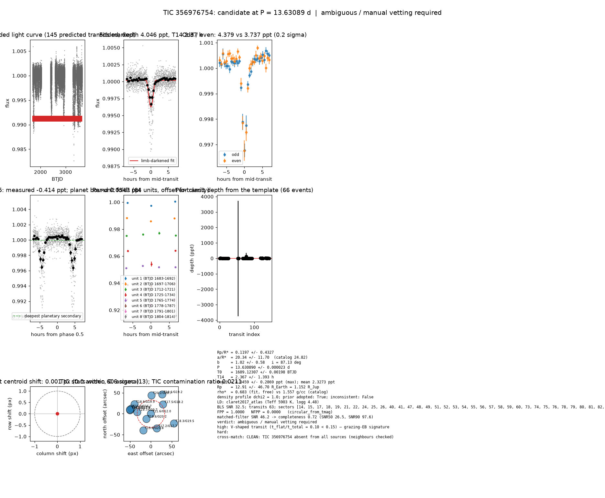

# Candidate packet: TIC 356976754, P = 13.63089 d

Generated 2026-09-03 07:29 UTC by tesshunter. This is a CANDIDATE. Nothing in this packet is a detection; the automated checks are necessary, not sufficient. The human reviews and submits.

**Automated verdict:** ambiguous / manual vetting required (light curve only: ambiguous / manual vetting required)  
**FPP / NFPP (TRICERATOPS):** 1.0000 / 0.0000 — above 0.5, does not proceed to submission

## Fitted parameters (limb-darkened transit fit)

| parameter | value |
|---|---|
| period | 13.630890 +/- 0.000023 d |
| epoch | 1689.12307 +/- 0.00198 BTJD = 2458689.12307 BJD |
| duration T14 | 2.367 +/- 1.393 h |
| depth (model maximum) | 4.0459 +/- 0.2869 ppt (shape-degenerate error 56.0433 ppt) |
| depth (duration-averaged) | 2.3273 ppt |
| Rp/R* | 0.1197 +/- 0.4327 |
| a/R* | 20.34 +/- 11.70 (catalog density gives 24.82 +/- 1.65) |
| impact parameter | 1.02 +/- 0.58 ; inclination 87.13 deg |
| Rp | 12.91 +/- 46.70 R_Earth = 1.152 +/- 4.167 R_Jup (R* = 0.989 +/- 0.042 R_Sun) |
| stellar density | fit (free) 0.683 g/cc vs catalog 1.557 +/- 0.310 g/cc; ratio 0.44, profile delta chi2 1.0; prior adopted: True; inconsistent: False |
| limb darkening | u1 = 0.285, u2 = 0.286 (claret2017_atlas (Teff 5903 K, logg 4.48)) |
| fit | least_squares, 1115 points, 63 transits, reduced chi2 3.01, delta BIC vs flat 2744 |
| BLS | SNR 32.5, box depth 2.489 ppt, 60 transits observed, alias label P |

## Vetting checks

| check | result |
|---|---|
| odd/even (median) | pass (0.2 sigma) |
| odd/even (fit template) | odd 4.379 +/- 3.875 ppt (33 events), even 3.737 +/- 0.506 ppt (33 events), difference 0.2 sigma, 16% of the mean |
| secondary at phase 0.5 | -0.4145 ppt measured; deepest planetary secondary at the fitted a/R* 0.0347 ppt; not detected |
| a/R* consistency | pass — free-fit a/R* = 18.86 (b = 1.20) against 24.82 +/- 1.65 from the catalog density (0.683 vs 1.557 g/cc, ratio 0.44; profile delta chi2 1.0 with a/R* held in the catalog range, 0.2 after the red-noise b |
| V-shape | high (t_flat/t_total 0.10); fitted geometry grazing: True |
| per-unit depths | FLAG |
| centroid | shift 0.001 px, 0.6 sigma |
| contamination | flagged, 31 neighbours checked |
| FPP / NFPP | 1.0000 / 0.0000 (TRICERATOPS 1.1.0: FPP 1.0000, NFPP 0.0000 over 15 scenarios and 119 TIC stars within 10 px; aperture circular_from_tmag; 100000 draws; fold binned (29 points, error 94 ppm); sectors [14, 15, 17].) |

Flags: V-shaped transit (t_flat/t_total = 0.10 < 0.15) — grazing-EB signature; per-unit transit depths disagree by > 3σ across observing units

## Completeness at this SNR

Matched-filter SNR 46.2 on this star's detrended data binned to 30 min: the P2 completeness curve (`docs/COMPLETENESS.md`, 2100 injections on 300 stars, config survey_v1) recovers 0.72 of injected signals at this SNR (SNR50 = 26.5, SNR90 = 97.6; the 20-50 bin recovered 237/368). Curve measured in P2 with batman injections into the survey preset (survey_v1: FFI stitches binned to 30 min, periods 1-40 d, Rp/R* 0.01-0.12); the matched-filter SNR here is computed on this candidate's own detrended data with the same definition. Outside that regime the number is an extrapolation.

## Star and neighbours

TIC 356976754: Teff 5903 K, log g 4.48, R = 0.989 +/- 0.042 R_Sun, M = 1.070 +/- 0.131 M_Sun, Tmag 11.62, TIC contamination ratio 0.0211 (source tic; assumed errors: False).

| ID | dstArcSec | Tmag | GAIAmag | gaiabp | gaiarp | Teff | rad | contratio | disposition |
|---|---|---|---|---|---|---|---|---|---|
| 356976754 | 0.00 | 11.62 | 12.04 | 12.37 | 11.57 | 5902.99 | 0.99 | 0.02 | n/a |
| 1551320697 | 16.47 | 19.58 | 20.25 | 20.61 | 19.27 | n/a | n/a | n/a | n/a |
| 1551320693 | 32.72 | 19.72 | 20.66 | 21.49 | 19.42 | n/a | n/a | n/a | n/a |
| 356976192 | 36.31 | 17.46 | 18.18 | 18.84 | 17.37 | 4421.00 | 0.50 | n/a | n/a |
| 356976745 | 37.84 | 17.22 | 17.71 | 18.14 | 17.19 | 5511.00 | 0.55 | n/a | n/a |
| 1551320701 | 43.64 | 20.19 | 20.71 | 20.74 | 19.74 | n/a | n/a | n/a | n/a |
| 1551320686 | 43.70 | 19.84 | 20.81 | 21.53 | 19.40 | n/a | n/a | n/a | n/a |
| 1551320695 | 45.08 | 18.91 | 19.88 | 20.92 | 18.77 | n/a | n/a | n/a | n/a |
| 356976758 | 48.01 | 15.69 | 16.65 | 17.57 | 15.70 | 3893.00 | 0.69 | 0.41 | n/a |
| 356976757 | 50.25 | 16.63 | 17.95 | 19.16 | 16.69 | 3443.00 | 0.49 | n/a | n/a |
| 1551320696 | 50.82 | 18.95 | 19.38 | n/a | n/a | n/a | n/a | n/a | n/a |
| 356976766 | 53.34 | 18.08 | 19.18 | 20.51 | 17.94 | 3493.00 | 0.45 | n/a | n/a |
| 356976201 | 59.76 | 18.34 | 19.48 | 20.93 | 18.25 | 3413.00 | n/a | n/a | n/a |

## Cross-match

CLEAN: TIC 356976754 absent from all sources (neighbours checked)  
Catalog versions: `ctoi=2026-09-03:f6964541;nasa_ps=2026-09-03:85f3c196;nasa_pscomppars=2026-09-03:4843e49c;spoc_tce=2026-09-03:e580dde7;tess_eb=2026-09-03:43555226;toi=2026-09-03:4704bb7c`

## Data

Sectors [14, 15, 17, 18, 19, 21, 22, 24, 25, 26, 40, 41, 47, 48, 49, 51, 52, 53, 54, 55, 56, 57, 58, 59, 60, 73, 74, 75, 76, 78, 79, 80, 81, 82, 83, 84, 85, 86]; 40537 raw and 38916 cleaned cadences; products: TESS-SPOC s14, TESS-SPOC s15, TESS-SPOC s17, TESS-SPOC s18, TESS-SPOC s19, TESS-SPOC s21.

## Figure



## ExoFOP CTOI fields

```json
{
 "target": "TIC 356976754",
 "tic_id": 356976754,
 "discovery_source": "TESS",
 "period_days": 13.630890045176423,
 "period_err_days": 2.327669823157763e-05,
 "epoch_bjd": 2458689.1230650353,
 "epoch_err_days": 0.0019844926680303125,
 "depth_ppm": 4045.915955810053,
 "depth_err_ppm": 286.89360845824757,
 "duration_hours": 2.3671703559105994,
 "duration_err_hours": 1.3934638123580647,
 "disposition": "PC",
 "tag": "FILL_ME: YYYYMMDD_username_tesshunter_NNN",
 "candidate_name": null,
 "paper_url": null,
 "notes": "Survey rank 17 (frozen score 3.2488); survey stitch SNR 32.50156719563403, 60.0 transits."
}
```

_The pipeline finds candidates. It does not submit._
