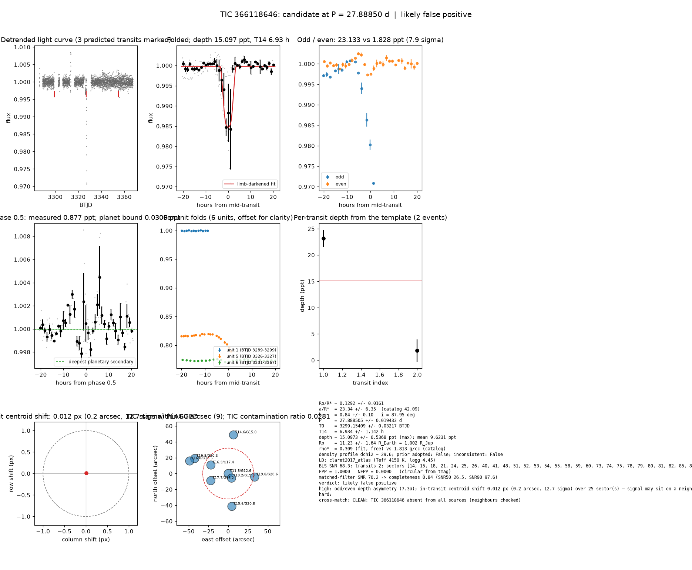

# Candidate packet: TIC 366118646, P = 27.88850 d

Generated 2026-09-03 07:54 UTC by tesshunter. This is a CANDIDATE. Nothing in this packet is a detection; the automated checks are necessary, not sufficient. The human reviews and submits.

**Automated verdict:** likely false positive (light curve only: ambiguous / manual vetting required)  
**FPP / NFPP (TRICERATOPS):** 1.0000 / 0.0000 — above 0.5, does not proceed to submission

## Fitted parameters (limb-darkened transit fit)

| parameter | value |
|---|---|
| period | 27.888505 +/- 0.019433 d |
| epoch | 3299.15409 +/- 0.03217 BTJD = 2460299.15409 BJD |
| duration T14 | 6.934 +/- 1.142 h |
| depth (model maximum) | 15.0973 +/- 6.5368 ppt (shape-degenerate error 3.5703 ppt) |
| depth (duration-averaged) | 9.6231 ppt |
| Rp/R* | 0.1292 +/- 0.0161 |
| a/R* | 23.34 +/- 6.35 (catalog density gives 42.09 +/- 3.91) |
| impact parameter | 0.84 +/- 0.10 ; inclination 87.95 deg |
| Rp | 11.23 +/- 1.64 R_Earth = 1.002 +/- 0.146 R_Jup (R* = 0.797 +/- 0.061 R_Sun) |
| stellar density | fit (free) 0.309 g/cc vs catalog 1.813 +/- 0.506 g/cc; ratio 0.17, profile delta chi2 29.6; prior adopted: False; inconsistent: False |
| limb darkening | u1 = 0.478, u2 = 0.193 (claret2017_atlas (Teff 4150 K, logg 4.45)) |
| fit | least_squares, 92 points, 2 transits, reduced chi2 36.17, delta BIC vs flat 3720 |
| BLS | SNR 68.3, box depth 13.637 ppt, 2 transits observed, alias label P |

## Vetting checks

| check | result |
|---|---|
| odd/even (median) | FLAG (7.3 sigma) |
| odd/even (fit template) | odd 23.133 +/- 1.657 ppt (1 events), even 1.828 +/- 2.128 ppt (1 events), difference 7.9 sigma, 171% of the mean |
| secondary at phase 0.5 | 0.8771 ppt measured; deepest planetary secondary at the fitted a/R* 0.0306 ppt; not detected |
| a/R* consistency | pass — free-fit a/R* = 23.34 (b = 0.84) against 42.09 +/- 3.91 from the catalog density (0.309 vs 1.813 g/cc, ratio 0.17; profile delta chi2 29.6 with a/R* held in the catalog range, 1.2 after the red-noise  |
| V-shape | none (t_flat/t_total 0.85); fitted geometry grazing: False |
| per-unit depths | FLAG |
| centroid | shift 0.012 px, 12.7 sigma FLAG |
| contamination | flagged, 34 neighbours checked |
| FPP / NFPP | 1.0000 / 0.0000 (TRICERATOPS 1.1.0: FPP 1.0000, NFPP 0.0000 over 15 scenarios and 117 TIC stars within 10 px; aperture circular_from_tmag; 100000 draws; fold binned (43 points, error 1046 ppm); sectors [14, 15, 18].) |

Flags: odd/even depth asymmetry (7.3σ); in-transit centroid shift 0.012 px (0.2 arcsec, 12.7 sigma) over 25 sector(s) — signal may sit on a neighbour; per-unit transit depths disagree by > 3σ across observing units

## Completeness at this SNR

Matched-filter SNR 70.2 on this star's detrended data binned to 30 min: the P2 completeness curve (`docs/COMPLETENESS.md`, 2100 injections on 300 stars, config survey_v1) recovers 0.84 of injected signals at this SNR (SNR50 = 26.5, SNR90 = 97.6; the 50-1000000000.0 bin recovered 586/658). Curve measured in P2 with batman injections into the survey preset (survey_v1: FFI stitches binned to 30 min, periods 1-40 d, Rp/R* 0.01-0.12); the matched-filter SNR here is computed on this candidate's own detrended data with the same definition. Outside that regime the number is an extrapolation.

## Star and neighbours

TIC 366118646: Teff 4150 K, log g 4.45, R = 0.797 +/- 0.061 R_Sun, M = 0.650 +/- 0.082 M_Sun, Tmag 11.82, TIC contamination ratio 0.0281 (source tic; assumed errors: False).

| ID | dstArcSec | Tmag | GAIAmag | gaiabp | gaiarp | Teff | rad | contratio | disposition |
|---|---|---|---|---|---|---|---|---|---|
| 366118646 | 0.00 | 11.82 | 12.58 | 13.33 | 11.76 | 4150.14 | 0.80 | 0.03 | n/a |
| 1551272520 | 7.18 | 19.19 | 19.94 | 20.35 | 18.80 | n/a | n/a | n/a | n/a |
| 1551272515 | 23.68 | 17.74 | 18.23 | 18.63 | 17.69 | 5514.00 | 0.74 | n/a | n/a |
| 366118644 | 24.31 | 16.32 | 17.36 | 18.38 | 16.34 | 3738.00 | 0.51 | n/a | n/a |
| 1551272497 | 33.77 | 19.80 | 20.61 | 21.28 | 19.62 | 4133.00 | n/a | n/a | n/a |
| 1551272498 | 41.70 | 19.64 | 20.78 | 22.33 | 19.61 | 3392.00 | n/a | n/a | n/a |
| 1551272516 | 46.27 | 19.77 | 20.33 | 20.71 | 19.63 | 5159.00 | n/a | n/a | n/a |
| 366118641 | 49.19 | 14.56 | 14.97 | 15.27 | 14.50 | 5954.33 | 1.30 | n/a | n/a |
| 366118643 | 51.12 | 15.98 | 16.46 | 16.85 | 15.93 | 5584.00 | 0.90 | n/a | n/a |

## Cross-match

CLEAN: TIC 366118646 absent from all sources (neighbours checked)  
Catalog versions: `ctoi=2026-09-03:f6964541;nasa_ps=2026-09-03:85f3c196;nasa_pscomppars=2026-09-03:4843e49c;spoc_tce=2026-09-03:e580dde7;tess_eb=2026-09-03:43555226;toi=2026-09-03:4704bb7c`

## Data

Sectors [14, 15, 18, 21, 24, 25, 26, 40, 41, 48, 51, 52, 53, 54, 55, 58, 59, 60, 73, 74, 75, 78, 79, 80, 81, 82, 85, 86]; 3045 raw and 2993 cleaned cadences; products: TESS-SPOC s14, TESS-SPOC s15, TESS-SPOC s18, TESS-SPOC s21, TESS-SPOC s24, TESS-SPOC s25.

## Figure



## ExoFOP CTOI fields

```json
{
 "target": "TIC 366118646",
 "tic_id": 366118646,
 "discovery_source": "TESS",
 "period_days": 27.888504664386907,
 "period_err_days": 0.019433398055005106,
 "epoch_bjd": 2460299.154086711,
 "epoch_err_days": 0.03216826031006842,
 "depth_ppm": 15097.333546298498,
 "depth_err_ppm": 6536.75820038133,
 "duration_hours": 6.933575608198661,
 "duration_err_hours": 1.1419087177699756,
 "disposition": "PC",
 "tag": "FILL_ME: YYYYMMDD_username_tesshunter_NNN",
 "candidate_name": null,
 "paper_url": null,
 "notes": "Survey rank 29 (frozen score 2.9944); survey stitch SNR 21.009067684863712, 21.0 transits."
}
```

_The pipeline finds candidates. It does not submit._
