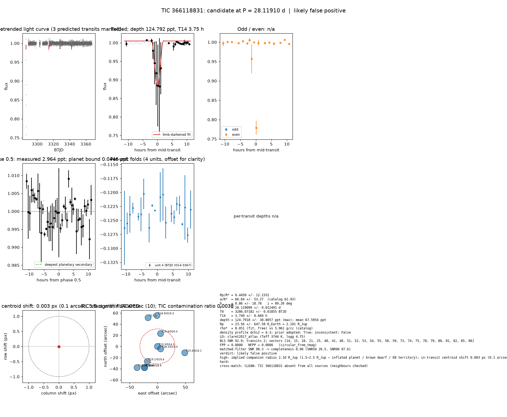

# Candidate packet: TIC 366118831, P = 28.11910 d

Generated 2026-09-03 07:25 UTC by tesshunter. This is a CANDIDATE. Nothing in this packet is a detection; the automated checks are necessary, not sufficient. The human reviews and submits.

**Automated verdict:** likely false positive (light curve only: ambiguous / manual vetting required)  
**FPP / NFPP (TRICERATOPS):** 0.8000 / 0.0000 — above 0.5, does not proceed to submission

## Fitted parameters (limb-darkened transit fit)

| parameter | value |
|---|---|
| period | 28.119099 +/- 0.012491 d |
| epoch | 3286.07182 +/- 0.01855 BTJD = 2460286.07182 BJD |
| duration T14 | 3.749 +/- 0.669 h |
| depth (model maximum) | 124.7918 +/- 30.8057 ppt (shape-degenerate error 233.6140 ppt) |
| depth (duration-averaged) | 67.5954 ppt |
| Rp/R* | 0.4450 +/- 12.2331 |
| a/R* | 66.64 +/- 53.27 (catalog density gives 62.93 +/- 1.20) |
| impact parameter | 0.86 +/- 18.78 ; inclination 89.26 deg |
| Rp | 23.56 +/- 647.58 R_Earth = 2.101 +/- 57.774 R_Jup (R* = 0.485 +/- 0.017 R_Sun) |
| stellar density | fit (free) 8.051 g/cc vs catalog 5.961 +/- 0.342 g/cc; ratio 1.35, profile delta chi2 4.3; prior adopted: True; inconsistent: False |
| limb darkening | u1 = 0.272, u2 = 0.365 (claret2017_atlas (Teff 3744 K, logg 4.75)) |
| fit | least_squares, 20 points, 2 transits, reduced chi2 639.13, delta BIC vs flat 5026 |
| BLS | SNR 92.9, box depth 128.327 ppt, 2 transits observed, alias label P |

## Vetting checks

| check | result |
|---|---|
| odd/even (median) | pass (0.0 sigma) |
| odd/even (fit template) | no odd transit inside the window |
| secondary at phase 0.5 | 2.9642 ppt measured; deepest planetary secondary at the fitted a/R* 0.0446 ppt; not detected |
| a/R* consistency | pass — free-fit a/R* = 69.56 (b = 0.95) against 62.93 +/- 1.20 from the catalog density (8.051 vs 5.961 g/cc, ratio 1.35; profile delta chi2 4.3 with a/R* held in the catalog range, 4.3 after the red-noise b |
| V-shape | none (t_flat/t_total n/a); fitted geometry grazing: True |
| per-unit depths | pass |
| centroid | shift 0.003 px, 5.8 sigma FLAG |
| contamination | pass, 36 neighbours checked |
| FPP / NFPP | 0.8000 / 0.0000 (TRICERATOPS 1.1.0: FPP 0.8000, NFPP 0.0000 over 15 scenarios and 122 TIC stars within 10 px; aperture circular_from_tmag; 100000 draws; fold binned (64 points, error 4420 ppm); sectors [14, 15, 18].) |

Flags: implied companion radius 2.10 R_Jup (1.5–2.5 R_Jup — inflated planet / brown dwarf / EB territory); in-transit centroid shift 0.003 px (0.1 arcsec, 5.8 sigma) over 19 sector(s) — signal may sit on a neighbour

## Completeness at this SNR

Matched-filter SNR 98.3 on this star's detrended data binned to 30 min: the P2 completeness curve (`docs/COMPLETENESS.md`, 2100 injections on 300 stars, config survey_v1) recovers 0.90 of injected signals at this SNR (SNR50 = 26.5, SNR90 = 97.6; the 50-1000000000.0 bin recovered 586/658). Curve measured in P2 with batman injections into the survey preset (survey_v1: FFI stitches binned to 30 min, periods 1-40 d, Rp/R* 0.01-0.12); the matched-filter SNR here is computed on this candidate's own detrended data with the same definition. Outside that regime the number is an extrapolation.

## Star and neighbours

TIC 366118831: Teff 3744 K, log g 4.75, R = 0.485 +/- 0.017 R_Sun, M = 0.483 +/- 0.022 M_Sun, Tmag 13.30, TIC contamination ratio 0.0038 (source tic; assumed errors: False).

| ID | dstArcSec | Tmag | GAIAmag | gaiabp | gaiarp | Teff | rad | contratio | disposition |
|---|---|---|---|---|---|---|---|---|---|
| 366118831 | 0.00 | 13.30 | 14.33 | 15.35 | 13.32 | 3744.00 | 0.49 | 0.00 | n/a |
| 366118832 | 7.16 | 18.24 | 19.32 | 20.48 | 17.99 | n/a | n/a | n/a | n/a |
| 1551271097 | 23.65 | 19.38 | 20.04 | 20.57 | 19.26 | 4657.00 | n/a | n/a | n/a |
| 1551271096 | 32.53 | 19.06 | 19.43 | 19.66 | 18.96 | n/a | n/a | n/a | n/a |
| 10002273879 | 44.37 | 16.01 | n/a | n/a | n/a | n/a | n/a | n/a | n/a |
| 366118837 | 44.60 | 18.50 | 18.93 | n/a | n/a | n/a | n/a | n/a | n/a |
| 366118834 | 50.13 | 15.56 | 16.10 | 16.55 | 15.51 | 5251.00 | 0.84 | n/a | n/a |
| 1551271095 | 52.69 | 18.46 | 19.40 | 20.42 | 18.36 | n/a | n/a | n/a | n/a |
| 366118827 | 54.18 | 17.10 | n/a | n/a | n/a | n/a | n/a | n/a | n/a |
| 1551271147 | 55.47 | 18.92 | 19.27 | 19.56 | 18.90 | 6423.00 | n/a | n/a | n/a |

## Cross-match

CLEAN: TIC 366118831 absent from all sources (neighbours checked)  
Catalog versions: `ctoi=2026-09-03:f6964541;nasa_ps=2026-09-03:85f3c196;nasa_pscomppars=2026-09-03:4843e49c;spoc_tce=2026-09-03:e580dde7;tess_eb=2026-09-03:43555226;toi=2026-09-03:4704bb7c`

## Data

Sectors [14, 15, 18, 21, 25, 40, 41, 48, 51, 52, 53, 54, 55, 58, 59, 73, 74, 75, 78, 79, 80, 81, 82, 85, 86]; 3306 raw and 3304 cleaned cadences; products: QLP s14, QLP s15, QLP s18, QLP s21, QLP s25, QLP s40.

## Figure



## ExoFOP CTOI fields

```json
{
 "target": "TIC 366118831",
 "tic_id": 366118831,
 "discovery_source": "TESS",
 "period_days": 28.119099092051307,
 "period_err_days": 0.01249147607578555,
 "epoch_bjd": 2460286.0718221436,
 "epoch_err_days": 0.01855472404817345,
 "depth_ppm": 124791.75318190205,
 "depth_err_ppm": 30805.730828814892,
 "duration_hours": 3.7493341946248675,
 "duration_err_hours": 0.6693391382754963,
 "disposition": "PC",
 "tag": "FILL_ME: YYYYMMDD_username_tesshunter_NNN",
 "candidate_name": null,
 "paper_url": null,
 "notes": "Survey rank 14 (frozen score 3.3072); survey stitch SNR 35.92619723269371, 15.0 transits."
}
```

_The pipeline finds candidates. It does not submit._
