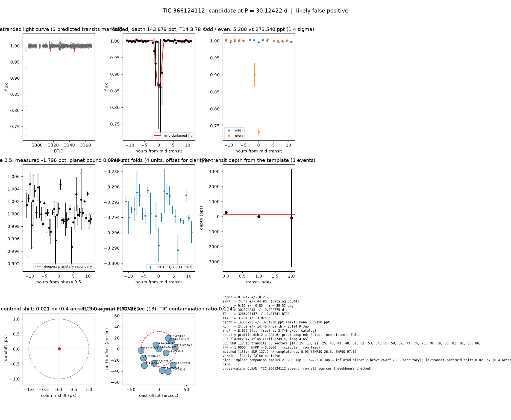

# Candidate packet: TIC 366124112, P = 30.12422 d

Generated 2026-09-03 07:23 UTC by tesshunter. This is a CANDIDATE. Nothing in this packet is a detection; the automated checks are necessary, not sufficient. The human reviews and submits.

**Automated verdict:** likely false positive (light curve only: ambiguous / manual vetting required)  
**FPP / NFPP (TRICERATOPS):** 1.0000 / 0.0000 — above 0.5, does not proceed to submission

## Fitted parameters (limb-darkened transit fit)

| parameter | value |
|---|---|
| period | 30.124218 +/- 0.022775 d |
| epoch | 3286.07157 +/- 0.01741 BTJD = 2460286.07157 BJD |
| duration T14 | 3.781 +/- 3.075 h |
| depth (model maximum) | 143.6793 +/- 32.1930 ppt (shape-degenerate error 161.3263 ppt) |
| depth (duration-averaged) | 80.9198 ppt |
| Rp/R* | 0.3717 +/- 0.2173 |
| a/R* | 74.47 +/- 44.90 (catalog density gives 56.44 +/- 1.03) |
| impact parameter | 0.62 +/- 0.85 ; inclination 89.52 deg |
| Rp | 24.59 +/- 14.40 R_Earth = 2.194 +/- 1.285 R_Jup (R* = 0.607 +/- 0.018 R_Sun) |
| stellar density | fit (free) 8.610 g/cc vs catalog 3.748 +/- 0.206 g/cc; ratio 2.30, profile delta chi2 223.6; prior adopted: False; inconsistent: False |
| limb darkening | u1 = 0.290, u2 = 0.351 (claret2017_atlas (Teff 3749 K, logg 4.65)) |
| fit | least_squares, 24 points, 3 transits, reduced chi2 830.17, delta BIC vs flat 9062 |
| BLS | SNR 117.1, box depth 149.357 ppt, 2 transits observed, alias label P |

## Vetting checks

| check | result |
|---|---|
| odd/even (median) | pass (0.0 sigma) |
| odd/even (fit template) | odd 5.200 +/- 46.273 ppt (1 events), even 273.540 +/- 184.022 ppt (2 events), difference 1.4 sigma, 193% of the mean |
| secondary at phase 0.5 | -1.7964 ppt measured; deepest planetary secondary at the fitted a/R* 0.0249 ppt; not detected |
| a/R* consistency | pass — free-fit a/R* = 74.47 (b = 0.62) against 56.44 +/- 1.03 from the catalog density (8.610 vs 3.748 g/cc, ratio 2.30; profile delta chi2 223.6 with a/R* held in the catalog range, 223.6 after the red-noi |
| V-shape | none (t_flat/t_total n/a); fitted geometry grazing: False |
| per-unit depths | pass |
| centroid | shift 0.021 px, 9.0 sigma FLAG |
| contamination | flagged, 41 neighbours checked |
| FPP / NFPP | 1.0000 / 0.0000 (TRICERATOPS 1.1.0: FPP 1.0000, NFPP 0.0000 over 18 scenarios and 109 TIC stars within 10 px; aperture circular_from_tmag; 100000 draws; fold binned (42 points, error 1589 ppm); sectors [14, 15, 18].) |

Flags: implied companion radius 2.19 R_Jup (1.5–2.5 R_Jup — inflated planet / brown dwarf / EB territory); in-transit centroid shift 0.021 px (0.4 arcsec, 9.0 sigma) over 20 sector(s) — signal may sit on a neighbour

## Completeness at this SNR

Matched-filter SNR 127.2 on this star's detrended data binned to 30 min: the P2 completeness curve (`docs/COMPLETENESS.md`, 2100 injections on 300 stars, config survey_v1) recovers 0.93 of injected signals at this SNR (SNR50 = 26.5, SNR90 = 97.6; the 50-1000000000.0 bin recovered 586/658). Curve measured in P2 with batman injections into the survey preset (survey_v1: FFI stitches binned to 30 min, periods 1-40 d, Rp/R* 0.01-0.12); the matched-filter SNR here is computed on this candidate's own detrended data with the same definition. Outside that regime the number is an extrapolation.

## Star and neighbours

TIC 366124112: Teff 3749 K, log g 4.65, R = 0.607 +/- 0.018 R_Sun, M = 0.593 +/- 0.020 M_Sun, Tmag 13.01, TIC contamination ratio 0.1141 (source tic; assumed errors: False).

| ID | dstArcSec | Tmag | GAIAmag | gaiabp | gaiarp | Teff | rad | contratio | disposition |
|---|---|---|---|---|---|---|---|---|---|
| 366124112 | 0.00 | 13.01 | 14.03 | 15.06 | 13.03 | 3749.00 | 0.61 | 0.11 | n/a |
| 1551271001 | 8.84 | 19.67 | 20.80 | 22.28 | 19.59 | n/a | n/a | n/a | n/a |
| 1551270999 | 15.11 | 18.10 | 18.60 | 18.98 | 18.03 | 5562.00 | 0.57 | n/a | n/a |
| 366124114 | 25.71 | 13.41 | 13.86 | 14.21 | 13.35 | 5793.00 | 1.00 | n/a | n/a |
| 1551270998 | 27.39 | 19.81 | 20.24 | n/a | n/a | n/a | n/a | n/a | n/a |
| 366124113 | 27.54 | 16.49 | 17.20 | 17.81 | 16.39 | 4514.00 | 0.62 | n/a | n/a |
| 1551271000 | 29.88 | 19.77 | 20.41 | 20.95 | 19.70 | 4825.00 | n/a | n/a | n/a |
| 366124111 | 31.97 | 18.11 | 19.13 | 20.28 | 18.03 | 3714.00 | 0.54 | n/a | n/a |
| 1551270990 | 32.15 | 19.76 | 20.49 | 21.01 | 19.53 | n/a | n/a | n/a | n/a |
| 1551270997 | 39.09 | 20.72 | 20.84 | 20.80 | 20.55 | n/a | n/a | n/a | n/a |
| 1551270996 | 39.36 | 18.38 | 19.33 | 20.40 | 18.34 | 3854.00 | 0.62 | n/a | n/a |
| 1551270989 | 39.70 | 19.60 | 20.03 | 20.26 | 19.45 | 5973.00 | n/a | n/a | n/a |
| 1551270994 | 44.49 | 20.81 | 21.24 | n/a | n/a | n/a | n/a | n/a | n/a |

## Cross-match

CLEAN: TIC 366124112 absent from all sources (neighbours checked)  
Catalog versions: `ctoi=2026-09-03:f6964541;nasa_ps=2026-09-03:85f3c196;nasa_pscomppars=2026-09-03:4843e49c;spoc_tce=2026-09-03:e580dde7;tess_eb=2026-09-03:43555226;toi=2026-09-03:4704bb7c`

## Data

Sectors [14, 15, 18, 21, 25, 40, 41, 48, 51, 52, 53, 54, 55, 58, 59, 73, 74, 75, 78, 79, 80, 81, 82, 85, 86]; 3306 raw and 3304 cleaned cadences; products: QLP s14, QLP s15, QLP s18, QLP s21, QLP s25, QLP s40.

## Figure



## ExoFOP CTOI fields

```json
{
 "target": "TIC 366124112",
 "tic_id": 366124112,
 "discovery_source": "TESS",
 "period_days": 30.124217983125202,
 "period_err_days": 0.022775223435782886,
 "epoch_bjd": 2460286.0715745105,
 "epoch_err_days": 0.01740547497093622,
 "depth_ppm": 143679.27069248655,
 "depth_err_ppm": 32192.96001468436,
 "duration_hours": 3.7806618238426606,
 "duration_err_hours": 3.075205646080658,
 "disposition": "PC",
 "tag": "FILL_ME: YYYYMMDD_username_tesshunter_NNN",
 "candidate_name": null,
 "paper_url": null,
 "notes": "Survey rank 11 (frozen score 3.3734); survey stitch SNR 40.241211812683396, 19.0 transits."
}
```

_The pipeline finds candidates. It does not submit._
