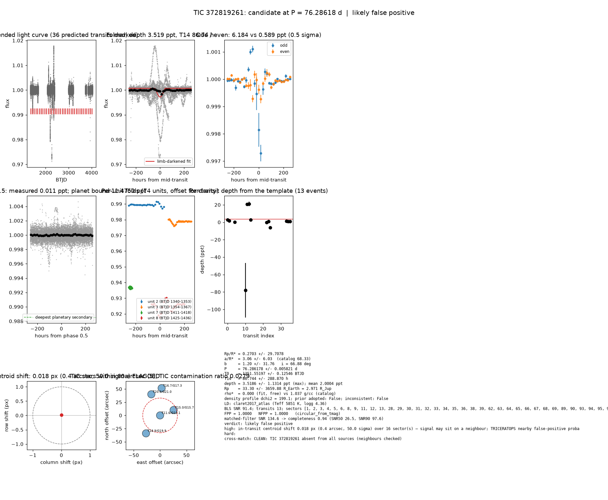

# Candidate packet: TIC 372819261, P = 76.28618 d

Generated 2026-09-03 07:41 UTC by tesshunter. This is a CANDIDATE. Nothing in this packet is a detection; the automated checks are necessary, not sufficient. The human reviews and submits.

**Automated verdict:** likely false positive (light curve only: promising planet candidate)  
**FPP / NFPP (TRICERATOPS):** 1.0000 / 1.0000 — above 0.5, does not proceed to submission

## Fitted parameters (limb-darkened transit fit)

| parameter | value |
|---|---|
| period | 76.286178 +/- 0.005821 d |
| epoch | 1351.55197 +/- 0.12546 BTJD = 2458351.55197 BJD |
| duration T14 | 86.744 +/- 288.870 h |
| depth (model maximum) | 3.5186 +/- 1.1314 ppt (shape-degenerate error 65.7451 ppt) |
| depth (duration-averaged) | 2.0004 ppt |
| Rp/R* | 0.2703 +/- 29.7078 |
| a/R* | 3.06 +/- 6.03 (catalog density gives 68.33 +/- 4.74) |
| impact parameter | 1.20 +/- 31.76 ; inclination 66.88 deg |
| Rp | 33.30 +/- 3659.88 R_Earth = 2.971 +/- 326.514 R_Jup (R* = 1.129 +/- 0.053 R_Sun) |
| stellar density | fit (free) 0.000 g/cc vs catalog 1.037 +/- 0.216 g/cc; ratio 0.00, profile delta chi2 199.1; prior adopted: False; inconsistent: False |
| limb darkening | u1 = 0.290, u2 = 0.283 (claret2017_atlas (Teff 5851 K, logg 4.36)) |
| fit | least_squares, 1231 points, 13 transits, reduced chi2 6.23, delta BIC vs flat 235 |
| BLS | SNR 91.4, box depth 4.497 ppt, 8 transits observed, alias label P |

## Vetting checks

| check | result |
|---|---|
| odd/even (median) | pass (0.5 sigma) |
| odd/even (fit template) | odd 6.184 +/- 3.181 ppt (6 events), even 0.589 +/- 12.015 ppt (7 events), difference 0.5 sigma, 165% of the mean |
| secondary at phase 0.5 | 0.0114 ppt measured; deepest planetary secondary at the fitted a/R* 11.4750 ppt; not detected |
| a/R* consistency | pass — free-fit a/R* = 3.06 (b = 1.20) against 68.33 +/- 4.74 from the catalog density (0.000 vs 1.037 g/cc, ratio 0.00; profile delta chi2 199.1 with a/R* held in the catalog range, 8.0 after the red-noise  |
| V-shape | none (t_flat/t_total n/a); fitted geometry grazing: True |
| per-unit depths | FLAG |
| centroid | shift 0.018 px, 50.0 sigma FLAG |
| contamination | flagged, 10 neighbours checked |
| FPP / NFPP | 1.0000 / 1.0000 (TRICERATOPS 1.1.0: FPP 1.0000, NFPP 1.0000 over 21 scenarios and 55 TIC stars within 10 px; aperture circular_from_tmag; 100000 draws; fold binned (150 points, error 267 ppm); sectors [1, 2, 3].) |

Flags: in-transit centroid shift 0.018 px (0.4 arcsec, 50.0 sigma) over 16 sector(s) — signal may sit on a neighbour; TRICERATOPS nearby false-positive probability 1.000 >= 0.1; nearby star could produce the signal: 1 high-risk and 2 medium-risk neighbour(s) of 10 checked; per-unit transit depths disagree by > 3σ across observing units

## Completeness at this SNR

Matched-filter SNR 134.6 on this star's detrended data binned to 30 min: the P2 completeness curve (`docs/COMPLETENESS.md`, 2100 injections on 300 stars, config survey_v1) recovers 0.94 of injected signals at this SNR (SNR50 = 26.5, SNR90 = 97.6; the 50-1000000000.0 bin recovered 586/658). Curve measured in P2 with batman injections into the survey preset (survey_v1: FFI stitches binned to 30 min, periods 1-40 d, Rp/R* 0.01-0.12); the matched-filter SNR here is computed on this candidate's own detrended data with the same definition. Outside that regime the number is an extrapolation.

## Star and neighbours

TIC 372819261: Teff 5851 K, log g 4.36, R = 1.129 +/- 0.053 R_Sun, M = 1.060 +/- 0.129 M_Sun, Tmag 11.63, TIC contamination ratio 0.0279 (source tic; assumed errors: False).

| ID | dstArcSec | Tmag | GAIAmag | gaiabp | gaiarp | Teff | rad | contratio | disposition |
|---|---|---|---|---|---|---|---|---|---|
| 372819261 | 0.00 | 11.63 | 12.07 | 12.41 | 11.58 | 5851.03 | 1.13 | 0.03 | n/a |
| 372819260 | 27.58 | 15.02 | 15.75 | 16.43 | 14.96 | 4408.00 | 0.77 | n/a | n/a |
| 684988520 | 43.16 | 18.90 | 19.92 | 20.98 | 18.65 | n/a | n/a | n/a | n/a |
| 684988554 | 43.26 | 20.59 | 21.02 | n/a | n/a | n/a | n/a | n/a | n/a |
| 372819257 | 51.72 | 16.66 | 17.35 | 17.98 | 16.60 | 4530.00 | 0.57 | n/a | n/a |

## Cross-match

CLEAN: TIC 372819261 absent from all sources (neighbours checked)  
Catalog versions: `ctoi=2026-09-03:f6964541;nasa_ps=2026-09-03:85f3c196;nasa_pscomppars=2026-09-03:4843e49c;spoc_tce=2026-09-03:e580dde7;tess_eb=2026-09-03:43555226;toi=2026-09-03:4704bb7c`

## Data

Sectors [1, 2, 3, 4, 5, 6, 8, 9, 11, 12, 13, 28, 29, 30, 31, 32, 33, 34, 35, 36, 38, 39, 62, 63, 64, 65, 66, 67, 68, 69, 89, 90, 93, 94, 95, 96, 97, 98]; 42948 raw and 41779 cleaned cadences; products: TESS-SPOC s1, TESS-SPOC s2, SPOC s3, TESS-SPOC s4, TESS-SPOC s5, SPOC s6.

## Figure



## ExoFOP CTOI fields

```json
{
 "target": "TIC 372819261",
 "tic_id": 372819261,
 "discovery_source": "TESS",
 "period_days": 76.28617835525769,
 "period_err_days": 0.0058207414099014755,
 "epoch_bjd": 2458351.551971269,
 "epoch_err_days": 0.1254646786854945,
 "depth_ppm": 3518.5887195816613,
 "depth_err_ppm": 1131.4009331602415,
 "duration_hours": 86.744229128128,
 "duration_err_hours": 288.87002122350606,
 "disposition": "PC",
 "tag": "FILL_ME: YYYYMMDD_username_tesshunter_NNN",
 "candidate_name": null,
 "paper_url": null,
 "notes": "Survey rank 18 (frozen score 3.2143); survey stitch SNR 91.44750712176469, 8.0 transits."
}
```

_The pipeline finds candidates. It does not submit._
