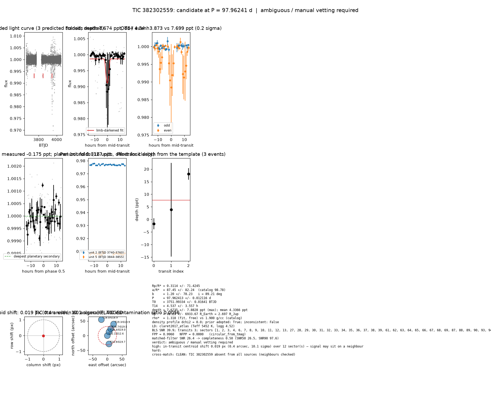

# Candidate packet: TIC 382302559, P = 97.96241 d

Generated 2026-09-03 08:01 UTC by tesshunter. This is a CANDIDATE. Nothing in this packet is a detection; the automated checks are necessary, not sufficient. The human reviews and submits.

**Automated verdict:** ambiguous / manual vetting required (light curve only: ambiguous / manual vetting required)  
**FPP / NFPP (TRICERATOPS):** 0.9960 / 0.0000 — above 0.5, does not proceed to submission

## Fitted parameters (limb-darkened transit fit)

| parameter | value |
|---|---|
| period | 97.962413 +/- 0.012116 d |
| epoch | 3751.99334 +/- 0.01641 BTJD = 2460751.99334 BJD |
| duration T14 | 4.537 +/- 3.557 h |
| depth (model maximum) | 7.6735 +/- 7.8828 ppt (shape-degenerate error 65.4939 ppt) |
| depth (duration-averaged) | 4.3366 ppt |
| Rp/R* | 0.3114 +/- 71.4245 |
| a/R* | 87.45 +/- 82.24 (catalog density gives 98.78 +/- 7.10) |
| impact parameter | 1.20 +/- 78.23 ; inclination 89.21 deg |
| Rp | 30.23 +/- 6933.67 R_Earth = 2.697 +/- 618.584 R_Jup (R* = 0.890 +/- 0.047 R_Sun) |
| stellar density | fit (free) 1.318 g/cc vs catalog 1.900 +/- 0.410 g/cc; ratio 0.69, profile delta chi2 0.0; prior adopted: True; inconsistent: False |
| limb darkening | u1 = 0.355, u2 = 0.249 (claret2017_atlas (Teff 5452 K, logg 4.52)) |
| fit | least_squares, 100 points, 3 transits, reduced chi2 23.33, delta BIC vs flat 444 |
| BLS | SNR 39.9, box depth 9.031 ppt, 2 transits observed, alias label P |

## Vetting checks

| check | result |
|---|---|
| odd/even (median) | pass (0.0 sigma) |
| odd/even (fit template) | odd 3.873 +/- 18.601 ppt (1 events), even 7.699 +/- 9.907 ppt (2 events), difference 0.2 sigma, 66% of the mean |
| secondary at phase 0.5 | -0.1753 ppt measured; deepest planetary secondary at the fitted a/R* 0.0127 ppt; not detected |
| a/R* consistency | pass — free-fit a/R* = 87.45 (b = 1.20) against 98.78 +/- 7.10 from the catalog density (1.318 vs 1.900 g/cc, ratio 0.69; profile delta chi2 0.0 with a/R* held in the catalog range, 0.0 after the red-noise b |
| V-shape | medium (t_flat/t_total 0.20); fitted geometry grazing: True |
| per-unit depths | FLAG |
| centroid | shift 0.019 px, 10.1 sigma FLAG |
| contamination | flagged, 37 neighbours checked |
| FPP / NFPP | 0.9960 / 0.0000 (TRICERATOPS 1.1.0: FPP 0.9960, NFPP 0.0000 over 15 scenarios and 100 TIC stars within 10 px; aperture circular_from_tmag; 100000 draws; fold binned (55 points, error 1475 ppm); sectors [1, 2, 3].) |

Flags: in-transit centroid shift 0.019 px (0.4 arcsec, 10.1 sigma) over 12 sector(s) — signal may sit on a neighbour; per-unit transit depths disagree by > 3σ across observing units; V-shape tendency (t_flat/t_total = 0.20 < 0.3)

## Completeness at this SNR

Matched-filter SNR 26.4 on this star's detrended data binned to 30 min: the P2 completeness curve (`docs/COMPLETENESS.md`, 2100 injections on 300 stars, config survey_v1) recovers 0.50 of injected signals at this SNR (SNR50 = 26.5, SNR90 = 97.6; the 20-50 bin recovered 237/368). Curve measured in P2 with batman injections into the survey preset (survey_v1: FFI stitches binned to 30 min, periods 1-40 d, Rp/R* 0.01-0.12); the matched-filter SNR here is computed on this candidate's own detrended data with the same definition. Outside that regime the number is an extrapolation.

## Star and neighbours

TIC 382302559: Teff 5452 K, log g 4.52, R = 0.890 +/- 0.047 R_Sun, M = 0.950 +/- 0.118 M_Sun, Tmag 12.05, TIC contamination ratio 0.0056 (source tic; assumed errors: False).

| ID | dstArcSec | Tmag | GAIAmag | gaiabp | gaiarp | Teff | rad | contratio | disposition |
|---|---|---|---|---|---|---|---|---|---|
| 382302559 | 0.00 | 12.05 | 12.56 | 12.97 | 12.00 | 5452.00 | 0.89 | 0.01 | n/a |
| 734522109 | 14.47 | 18.45 | 18.95 | 19.30 | 18.33 | 5487.00 | n/a | n/a | n/a |
| 734522108 | 26.07 | 18.66 | 19.47 | 20.05 | 18.34 | n/a | n/a | n/a | n/a |
| 734522106 | 29.01 | 18.90 | 19.67 | 20.28 | 18.70 | n/a | n/a | n/a | n/a |
| 382302560 | 44.85 | 19.26 | 19.94 | 19.33 | 17.96 | n/a | n/a | n/a | n/a |
| 382302562 | 58.31 | 17.97 | 18.94 | 20.04 | 17.91 | 3796.00 | 0.47 | n/a | n/a |

## Cross-match

CLEAN: TIC 382302559 absent from all sources (neighbours checked)  
Catalog versions: `ctoi=2026-09-03:f6964541;nasa_ps=2026-09-03:85f3c196;nasa_pscomppars=2026-09-03:4843e49c;spoc_tce=2026-09-03:e580dde7;tess_eb=2026-09-03:43555226;toi=2026-09-03:4704bb7c`

## Data

Sectors [1, 2, 3, 4, 6, 7, 8, 9, 10, 11, 12, 13, 27, 28, 29, 30, 31, 32, 33, 34, 35, 36, 37, 38, 39, 61, 62, 63, 64, 65, 66, 67, 68, 69, 87, 88, 89, 90, 93, 94, 95, 96, 97, 98]; 13805 raw and 13742 cleaned cadences; products: TESS-SPOC s1, TESS-SPOC s2, TESS-SPOC s3, TESS-SPOC s4, TESS-SPOC s6, TESS-SPOC s7.

## Figure



## ExoFOP CTOI fields

```json
{
 "target": "TIC 382302559",
 "tic_id": 382302559,
 "discovery_source": "TESS",
 "period_days": 97.96241309021067,
 "period_err_days": 0.012115961308169774,
 "epoch_bjd": 2460751.993338537,
 "epoch_err_days": 0.016405908102197244,
 "depth_ppm": 7673.540595148243,
 "depth_err_ppm": 7882.792659673562,
 "duration_hours": 4.5368321552030135,
 "duration_err_hours": 3.5568072489603964,
 "disposition": "PC",
 "tag": "FILL_ME: YYYYMMDD_username_tesshunter_NNN",
 "candidate_name": null,
 "paper_url": null,
 "notes": "Survey rank 28 (frozen score 3.0282); survey stitch SNR 22.26322865181442, 10.0 transits."
}
```

_The pipeline finds candidates. It does not submit._
