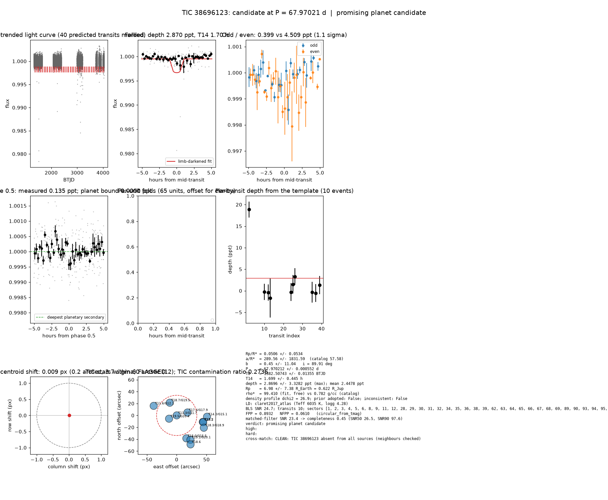

# Candidate packet: TIC 38696123, P = 67.97021 d

Generated 2026-09-03 07:48 UTC by tesshunter. This is a CANDIDATE. Nothing in this packet is a detection; the automated checks are necessary, not sufficient. The human reviews and submits.

**Automated verdict:** promising planet candidate (light curve only: promising planet candidate)  
**FPP / NFPP (TRICERATOPS):** 0.8932 / 0.0610 — above 0.5, does not proceed to submission

## Fitted parameters (limb-darkened transit fit)

| parameter | value |
|---|---|
| period | 67.970212 +/- 0.000552 d |
| epoch | 1382.50743 +/- 0.01355 BTJD = 2458382.50743 BJD |
| duration T14 | 1.699 +/- 0.445 h |
| depth (model maximum) | 2.8696 +/- 3.3282 ppt (shape-degenerate error 1.0605 ppt) |
| depth (duration-averaged) | 2.4478 ppt |
| Rp/R* | 0.0506 +/- 0.0534 |
| a/R* | 289.56 +/- 1831.59 (catalog density gives 57.58 +/- 4.16) |
| impact parameter | 0.45 +/- 11.04 ; inclination 89.91 deg |
| Rp | 6.98 +/- 7.38 R_Earth = 0.622 +/- 0.658 R_Jup (R* = 1.264 +/- 0.059 R_Sun) |
| stellar density | fit (free) 99.410 g/cc vs catalog 0.782 +/- 0.170 g/cc; ratio 127.17, profile delta chi2 26.9; prior adopted: False; inconsistent: False |
| limb darkening | u1 = 0.263, u2 = 0.296 (claret2017_atlas (Teff 6035 K, logg 4.28)) |
| fit | least_squares, 116 points, 10 transits, reduced chi2 27.35, delta BIC vs flat 349 |
| BLS | SNR 24.7, box depth 3.057 ppt, 10 transits observed, alias label P |

## Vetting checks

| check | result |
|---|---|
| odd/even (median) | pass (1.1 sigma) |
| odd/even (fit template) | odd 0.399 +/- 1.058 ppt (5 events), even 4.509 +/- 3.723 ppt (5 events), difference 1.1 sigma, 168% of the mean |
| secondary at phase 0.5 | 0.1351 ppt measured; deepest planetary secondary at the fitted a/R* 0.0000 ppt; not detected |
| a/R* consistency | pass — free-fit a/R* = 289.56 (b = 0.45) against 57.58 +/- 4.16 from the catalog density (99.410 vs 0.782 g/cc, ratio 127.17; profile delta chi2 26.9 with a/R* held in the catalog range, 1.1 after the red-no |
| V-shape | none (t_flat/t_total 0.85); fitted geometry grazing: False |
| per-unit depths | pass |
| centroid | shift 0.009 px, 3.7 sigma FLAG |
| contamination | flagged, 19 neighbours checked |
| FPP / NFPP | 0.8932 / 0.0610 (TRICERATOPS 1.1.0: FPP 0.8932, NFPP 0.0610 over 27 scenarios and 60 TIC stars within 10 px; aperture circular_from_tmag; 100000 draws; fold binned (21 points, error 275 ppm); sectors [1, 2, 3].) |

Flags: in-transit centroid shift 0.009 px (0.2 arcsec, 3.7 sigma) over 11 sector(s) (below 4 sigma)

## Completeness at this SNR

Matched-filter SNR 23.4 on this star's detrended data binned to 30 min: the P2 completeness curve (`docs/COMPLETENESS.md`, 2100 injections on 300 stars, config survey_v1) recovers 0.45 of injected signals at this SNR (SNR50 = 26.5, SNR90 = 97.6; the 20-50 bin recovered 237/368). Curve measured in P2 with batman injections into the survey preset (survey_v1: FFI stitches binned to 30 min, periods 1-40 d, Rp/R* 0.01-0.12); the matched-filter SNR here is computed on this candidate's own detrended data with the same definition. Outside that regime the number is an extrapolation.

## Star and neighbours

TIC 38696123: Teff 6035 K, log g 4.28, R = 1.264 +/- 0.059 R_Sun, M = 1.120 +/- 0.146 M_Sun, Tmag 11.33, TIC contamination ratio 0.2736 (source tic; assumed errors: False).

| ID | dstArcSec | Tmag | GAIAmag | gaiabp | gaiarp | Teff | rad | contratio | disposition |
|---|---|---|---|---|---|---|---|---|---|
| 38696123 | 0.00 | 11.33 | 11.73 | 12.03 | 11.28 | 6035.03 | 1.26 | 0.27 | n/a |
| 684981923 | 13.99 | 19.48 | 20.40 | 21.05 | 19.08 | n/a | n/a | n/a | n/a |
| 38696121 | 18.75 | 17.36 | 17.94 | 18.44 | 17.31 | 4977.00 | 1.29 | n/a | n/a |
| 684981922 | 24.29 | 18.72 | 19.52 | 20.26 | 18.59 | 4108.00 | n/a | n/a | n/a |
| 38696126 | 41.83 | 14.98 | 15.55 | 16.02 | 14.92 | 5050.00 | 3.35 | n/a | n/a |
| 38696119 | 41.85 | 11.63 | 12.06 | 12.40 | 11.58 | 5660.42 | 2.60 | 0.38 | n/a |
| 10000583891 | 45.16 | 17.09 | n/a | n/a | n/a | n/a | n/a | n/a | n/a |
| 38696125 | 45.91 | 18.20 | n/a | n/a | n/a | n/a | n/a | n/a | DUPLICATE |
| 684981916 | 46.98 | 19.13 | 20.09 | 21.01 | 18.93 | 3810.00 | n/a | n/a | n/a |
| 684981915 | 50.04 | 18.29 | 18.92 | 19.46 | 18.23 | 4780.00 | 0.55 | n/a | n/a |
| 38696124 | 50.92 | 14.05 | 15.06 | 16.05 | 14.06 | 3784.00 | 0.59 | 0.05 | n/a |
| 38696129 | 54.01 | 18.57 | n/a | n/a | n/a | n/a | n/a | n/a | n/a |

## Cross-match

CLEAN: TIC 38696123 absent from all sources (neighbours checked)  
Catalog versions: `ctoi=2026-09-03:f6964541;nasa_ps=2026-09-03:85f3c196;nasa_pscomppars=2026-09-03:4843e49c;spoc_tce=2026-09-03:e580dde7;tess_eb=2026-09-03:43555226;toi=2026-09-03:4704bb7c`

## Data

Sectors [1, 2, 3, 4, 5, 6, 8, 9, 11, 12, 28, 29, 30, 31, 32, 34, 35, 36, 38, 39, 62, 63, 64, 65, 66, 67, 68, 69, 89, 90, 93, 94, 95, 96, 98]; 38314 raw and 37312 cleaned cadences; products: TESS-SPOC s1, TESS-SPOC s2, SPOC s3, TESS-SPOC s4, TESS-SPOC s5, TESS-SPOC s6.

## Figure



## ExoFOP CTOI fields

```json
{
 "target": "TIC 38696123",
 "tic_id": 38696123,
 "discovery_source": "TESS",
 "period_days": 67.97021203236203,
 "period_err_days": 0.0005518465140821434,
 "epoch_bjd": 2458382.5074337022,
 "epoch_err_days": 0.013545801961659807,
 "depth_ppm": 2869.5522495175705,
 "depth_err_ppm": 3328.2211167995542,
 "duration_hours": 1.6987339570827957,
 "duration_err_hours": 0.44519468236918747,
 "disposition": "PC",
 "tag": "FILL_ME: YYYYMMDD_username_tesshunter_NNN",
 "candidate_name": null,
 "paper_url": null,
 "notes": "Survey rank 23 (frozen score 3.089); survey stitch SNR 24.70995218049849, 10.0 transits."
}
```

_The pipeline finds candidates. It does not submit._
