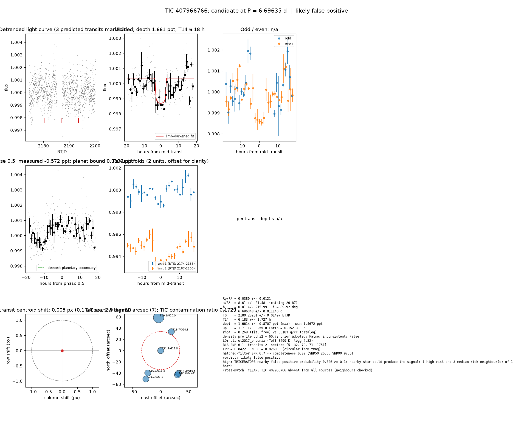

# Candidate packet: TIC 407966766, P = 6.69635 d

Generated 2026-09-03 07:32 UTC by tesshunter. This is a CANDIDATE. Nothing in this packet is a detection; the automated checks are necessary, not sufficient. The human reviews and submits.

**Automated verdict:** likely false positive (light curve only: promising planet candidate)  
**FPP / NFPP (TRICERATOPS):** 0.8422 / 0.8260 — above 0.5, does not proceed to submission

## Fitted parameters (limb-darkened transit fit)

| parameter | value |
|---|---|
| period | 6.696348 +/- 0.011140 d |
| epoch | 2180.23201 +/- 0.01497 BTJD = 2459180.23201 BJD |
| duration T14 | 6.183 +/- 1.727 h |
| depth (model maximum) | 1.6614 +/- 0.8707 ppt (shape-degenerate error 0.4718 ppt) |
| depth (duration-averaged) | 1.4672 ppt |
| Rp/R* | 0.0380 +/- 0.0121 |
| a/R* | 8.61 +/- 21.48 (catalog density gives 26.87 +/- 0.35) |
| impact parameter | 0.01 +/- 215.99 ; inclination 89.92 deg |
| Rp | 1.71 +/- 0.55 R_Earth = 0.152 +/- 0.049 R_Jup (R* = 0.411 +/- 0.012 R_Sun) |
| stellar density | fit (free) 0.269 g/cc vs catalog 8.183 +/- 0.322 g/cc; ratio 0.03, profile delta chi2 60.7; prior adopted: False; inconsistent: False |
| limb darkening | u1 = 0.173, u2 = 0.427 (claret2017_phoenix (Teff 3499 K, logg 4.82)) |
| fit | least_squares, 172 points, 2 transits, reduced chi2 3.21, delta BIC vs flat 80 |
| BLS | SNR 6.1, box depth 1.427 ppt, 2 transits observed, alias label P |

## Vetting checks

| check | result |
|---|---|
| odd/even (median) | pass (0.0 sigma) |
| odd/even (fit template) | no odd transit inside the window |
| secondary at phase 0.5 | -0.5724 ppt measured; deepest planetary secondary at the fitted a/R* 0.0196 ppt; not detected |
| a/R* consistency | pass — free-fit a/R* = 8.61 (b = 0.01) against 26.87 +/- 0.35 from the catalog density (0.269 vs 8.183 g/cc, ratio 0.03; profile delta chi2 60.7 with a/R* held in the catalog range, 5.8 after the red-noise b |
| V-shape | none (t_flat/t_total 0.65); fitted geometry grazing: False |
| per-unit depths | pass |
| centroid | shift 0.005 px, 2.9 sigma |
| contamination | flagged, 15 neighbours checked |
| FPP / NFPP | 0.8422 / 0.8260 (TRICERATOPS 1.1.0: FPP 0.8422, NFPP 0.8260 over 21 scenarios and 46 TIC stars within 10 px; aperture circular_from_tmag; 100000 draws; fold binned (74 points, error 560 ppm); sectors [5, 32, 70].) |

Flags: TRICERATOPS nearby false-positive probability 0.826 >= 0.1; nearby star could produce the signal: 1 high-risk and 3 medium-risk neighbour(s) of 15 checked

## Completeness at this SNR

Matched-filter SNR 6.7 on this star's detrended data binned to 30 min: the P2 completeness curve (`docs/COMPLETENESS.md`, 2100 injections on 300 stars, config survey_v1) recovers 0.09 of injected signals at this SNR (SNR50 = 26.5, SNR90 = 97.6; the 5-7.1 bin recovered 0/131). Curve measured in P2 with batman injections into the survey preset (survey_v1: FFI stitches binned to 30 min, periods 1-40 d, Rp/R* 0.01-0.12); the matched-filter SNR here is computed on this candidate's own detrended data with the same definition. Outside that regime the number is an extrapolation.

## Star and neighbours

TIC 407966766: Teff 3499 K, log g 4.82, R = 0.411 +/- 0.012 R_Sun, M = 0.404 +/- 0.020 M_Sun, Tmag 11.31, TIC contamination ratio 0.1729 (source tic; assumed errors: False).

| ID | dstArcSec | Tmag | GAIAmag | gaiabp | gaiarp | Teff | rad | contratio | disposition |
|---|---|---|---|---|---|---|---|---|---|
| 407966766 | 0.00 | 11.31 | 12.47 | 13.74 | 11.36 | 3499.00 | 0.41 | 0.17 | n/a |
| 673383736 | 38.59 | 19.71 | 20.50 | 20.95 | 19.31 | n/a | n/a | n/a | n/a |
| 407991046 | 45.97 | 16.71 | 18.39 | 20.84 | 16.88 | 2845.00 | 0.13 | n/a | n/a |
| 407991048 | 51.28 | 14.35 | 15.11 | 15.80 | 14.30 | 4578.00 | 0.86 | n/a | n/a |
| 673383735 | 52.49 | 20.50 | 20.93 | n/a | n/a | n/a | n/a | n/a | n/a |
| 673383732 | 57.07 | 20.72 | 21.15 | n/a | n/a | n/a | n/a | n/a | n/a |
| 407966762 | 58.89 | 10.09 | 10.87 | 11.62 | 10.06 | 4488.03 | 10.33 | n/a | n/a |

## Cross-match

CLEAN: TIC 407966766 absent from all sources (neighbours checked)  
Catalog versions: `ctoi=2026-09-03:f6964541;nasa_ps=2026-09-03:85f3c196;nasa_pscomppars=2026-09-03:4843e49c;spoc_tce=2026-09-03:e580dde7;tess_eb=2026-09-03:43555226;toi=2026-09-03:4704bb7c`

## Data

Sectors [5, 32, 70, 71, 1751]; 1146 raw and 1146 cleaned cadences; products: SPOC s5, SPOC s32, TESS-SPOC s70, TESS-SPOC s71, TESS-SPOC s1751.

## Figure



## ExoFOP CTOI fields

```json
{
 "target": "TIC 407966766",
 "tic_id": 407966766,
 "discovery_source": "TESS",
 "period_days": 6.69634829178972,
 "period_err_days": 0.011140026504110117,
 "epoch_bjd": 2459180.232006694,
 "epoch_err_days": 0.014971704377634615,
 "depth_ppm": 1661.3519861121695,
 "depth_err_ppm": 870.6673260422353,
 "duration_hours": 6.182587179520666,
 "duration_err_hours": 1.7268557422619684,
 "disposition": "PC",
 "tag": "FILL_ME: YYYYMMDD_username_tesshunter_NNN",
 "candidate_name": null,
 "paper_url": null,
 "notes": "Survey rank 19 (frozen score 3.1483); survey stitch SNR 34.946620321976226, 9.0 transits."
}
```

_The pipeline finds candidates. It does not submit._
