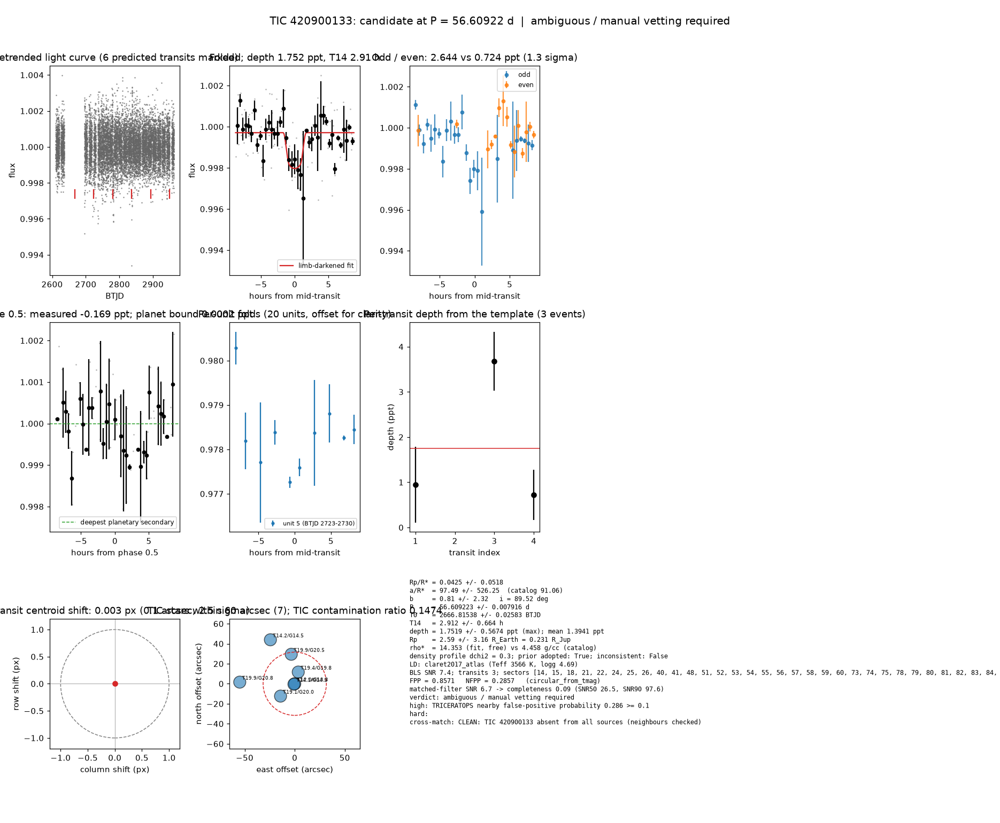

# Candidate packet: TIC 420900133, P = 56.60922 d

Generated 2026-09-03 07:47 UTC by tesshunter. This is a CANDIDATE. Nothing in this packet is a detection; the automated checks are necessary, not sufficient. The human reviews and submits.

**Automated verdict:** ambiguous / manual vetting required (light curve only: promising planet candidate)  
**FPP / NFPP (TRICERATOPS):** 0.8571 / 0.2857 — above 0.5, does not proceed to submission

## Fitted parameters (limb-darkened transit fit)

| parameter | value |
|---|---|
| period | 56.609223 +/- 0.007916 d |
| epoch | 2666.81538 +/- 0.02583 BTJD = 2459666.81538 BJD |
| duration T14 | 2.912 +/- 0.664 h |
| depth (model maximum) | 1.7519 +/- 0.5674 ppt (shape-degenerate error 2.8771 ppt) |
| depth (duration-averaged) | 1.3941 ppt |
| Rp/R* | 0.0425 +/- 0.0518 |
| a/R* | 97.49 +/- 526.25 (catalog density gives 91.06 +/- 2.07) |
| impact parameter | 0.81 +/- 2.32 ; inclination 89.52 deg |
| Rp | 2.59 +/- 3.16 R_Earth = 0.231 +/- 0.282 R_Jup (R* = 0.559 +/- 0.020 R_Sun) |
| stellar density | fit (free) 14.353 g/cc vs catalog 4.458 +/- 0.304 g/cc; ratio 3.22, profile delta chi2 0.3; prior adopted: True; inconsistent: False |
| limb darkening | u1 = 0.289, u2 = 0.359 (claret2017_atlas (Teff 3566 K, logg 4.69)) |
| fit | least_squares, 99 points, 3 transits, reduced chi2 1.59, delta BIC vs flat 6 |
| BLS | SNR 7.4, box depth 1.865 ppt, 3 transits observed, alias label 4P |

## Vetting checks

| check | result |
|---|---|
| odd/even (median) | pass (2.0 sigma) |
| odd/even (fit template) | odd 2.644 +/- 1.367 ppt (2 events), even 0.724 +/- 0.555 ppt (1 events), difference 1.3 sigma, 114% of the mean |
| secondary at phase 0.5 | -0.1690 ppt measured; deepest planetary secondary at the fitted a/R* 0.0002 ppt; not detected |
| a/R* consistency | pass — free-fit a/R* = 134.47 (b = 0.61) against 91.06 +/- 2.07 from the catalog density (14.353 vs 4.458 g/cc, ratio 3.22; profile delta chi2 0.3 with a/R* held in the catalog range, 0.1 after the red-noise |
| V-shape | none (t_flat/t_total 0.60); fitted geometry grazing: False |
| per-unit depths | pass |
| centroid | shift 0.003 px, 2.5 sigma |
| contamination | flagged, 27 neighbours checked |
| FPP / NFPP | 0.8571 / 0.2857 (TRICERATOPS 1.1.0: FPP 0.8571, NFPP 0.2857 over 21 scenarios and 114 TIC stars within 10 px; aperture circular_from_tmag; 100000 draws; fold binned (35 points, error 394 ppm); sectors [14, 15, 18].) |

Flags: TRICERATOPS nearby false-positive probability 0.286 >= 0.1; nearby star could produce the signal: 0 high-risk and 5 medium-risk neighbour(s) of 27 checked

## Completeness at this SNR

Matched-filter SNR 6.7 on this star's detrended data binned to 30 min: the P2 completeness curve (`docs/COMPLETENESS.md`, 2100 injections on 300 stars, config survey_v1) recovers 0.09 of injected signals at this SNR (SNR50 = 26.5, SNR90 = 97.6; the 5-7.1 bin recovered 0/131). Curve measured in P2 with batman injections into the survey preset (survey_v1: FFI stitches binned to 30 min, periods 1-40 d, Rp/R* 0.01-0.12); the matched-filter SNR here is computed on this candidate's own detrended data with the same definition. Outside that regime the number is an extrapolation.

## Star and neighbours

TIC 420900133: Teff 3566 K, log g 4.69, R = 0.559 +/- 0.020 R_Sun, M = 0.554 +/- 0.023 M_Sun, Tmag 11.97, TIC contamination ratio 0.1474 (source tic; assumed errors: False).

| ID | dstArcSec | Tmag | GAIAmag | gaiabp | gaiarp | Teff | rad | contratio | disposition |
|---|---|---|---|---|---|---|---|---|---|
| 420900133 | 0.00 | 11.97 | 13.32 | 14.29 | 12.01 | 3566.00 | 0.56 | 0.15 | n/a |
| 1551306264 | 0.87 | 14.07 | 14.50 | n/a | n/a | n/a | n/a | n/a | n/a |
| 1551306263 | 12.22 | 19.44 | 19.81 | 20.05 | 19.35 | n/a | n/a | n/a | n/a |
| 1551306265 | 18.81 | 19.10 | 19.96 | 20.71 | 18.88 | n/a | n/a | n/a | n/a |
| 1551306329 | 29.67 | 19.93 | 20.51 | 20.89 | 19.77 | n/a | n/a | n/a | n/a |
| 420900138 | 50.24 | 14.17 | 14.54 | 14.81 | 14.11 | 6253.00 | 1.20 | n/a | n/a |
| 1551306321 | 54.96 | 19.89 | 20.78 | 21.26 | 19.35 | n/a | n/a | n/a | n/a |

## Cross-match

CLEAN: TIC 420900133 absent from all sources (neighbours checked)  
Catalog versions: `ctoi=2026-09-03:f6964541;nasa_ps=2026-09-03:85f3c196;nasa_pscomppars=2026-09-03:4843e49c;spoc_tce=2026-09-03:e580dde7;tess_eb=2026-09-03:43555226;toi=2026-09-03:4704bb7c`

## Data

Sectors [14, 15, 18, 21, 22, 24, 25, 26, 40, 41, 48, 51, 52, 53, 54, 55, 56, 57, 58, 59, 60, 73, 74, 75, 78, 79, 80, 81, 82, 83, 84, 85, 86]; 11473 raw and 11464 cleaned cadences; products: SPOC s14, SPOC s15, SPOC s18, SPOC s21, SPOC s22, SPOC s24.

## Figure



## ExoFOP CTOI fields

```json
{
 "target": "TIC 420900133",
 "tic_id": 420900133,
 "discovery_source": "TESS",
 "period_days": 56.60922319142736,
 "period_err_days": 0.007916017198775683,
 "epoch_bjd": 2459666.815378967,
 "epoch_err_days": 0.025831940907699632,
 "depth_ppm": 1751.8917955861025,
 "depth_err_ppm": 567.4264642705705,
 "duration_hours": 2.911565643664254,
 "duration_err_hours": 0.6639419755730627,
 "disposition": "PC",
 "tag": "FILL_ME: YYYYMMDD_username_tesshunter_NNN",
 "candidate_name": null,
 "paper_url": null,
 "notes": "Survey rank 26 (frozen score 3.0713); survey stitch SNR 23.97365651497013, 14.0 transits."
}
```

_The pipeline finds candidates. It does not submit._
