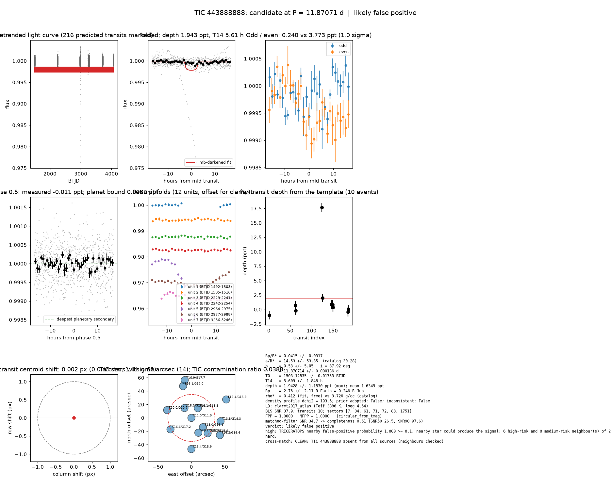

# Candidate packet: TIC 443888888, P = 11.87071 d

Generated 2026-09-03 07:20 UTC by tesshunter. This is a CANDIDATE. Nothing in this packet is a detection; the automated checks are necessary, not sufficient. The human reviews and submits.

**Automated verdict:** likely false positive (light curve only: promising planet candidate)  
**FPP / NFPP (TRICERATOPS):** 1.0000 / 1.0000 — above 0.5, does not proceed to submission

## Fitted parameters (limb-darkened transit fit)

| parameter | value |
|---|---|
| period | 11.870714 +/- 0.000136 d |
| epoch | 1503.12835 +/- 0.01753 BTJD = 2458503.12835 BJD |
| duration T14 | 5.609 +/- 1.848 h |
| depth (model maximum) | 1.9428 +/- 1.1830 ppt (shape-degenerate error 0.7327 ppt) |
| depth (duration-averaged) | 1.6349 ppt |
| Rp/R* | 0.0415 +/- 0.0317 |
| a/R* | 14.53 +/- 53.35 (catalog density gives 30.28 +/- 0.55) |
| impact parameter | 0.53 +/- 5.05 ; inclination 87.92 deg |
| Rp | 2.76 +/- 2.11 R_Earth = 0.246 +/- 0.188 R_Jup (R* = 0.608 +/- 0.018 R_Sun) |
| stellar density | fit (free) 0.412 g/cc vs catalog 3.726 +/- 0.205 g/cc; ratio 0.11, profile delta chi2 193.6; prior adopted: False; inconsistent: False |
| limb darkening | u1 = 0.332, u2 = 0.315 (claret2017_atlas (Teff 3886 K, logg 4.64)) |
| fit | least_squares, 640 points, 10 transits, reduced chi2 19.96, delta BIC vs flat 1095 |
| BLS | SNR 37.9, box depth 1.868 ppt, 10 transits observed, alias label P |

## Vetting checks

| check | result |
|---|---|
| odd/even (median) | pass (1.0 sigma) |
| odd/even (fit template) | odd 0.240 +/- 0.528 ppt (5 events), even 3.773 +/- 3.445 ppt (5 events), difference 1.0 sigma, 176% of the mean |
| secondary at phase 0.5 | -0.0114 ppt measured; deepest planetary secondary at the fitted a/R* 0.0082 ppt; not detected |
| a/R* consistency | pass — free-fit a/R* = 14.53 (b = 0.53) against 30.28 +/- 0.55 from the catalog density (0.412 vs 3.726 g/cc, ratio 0.11; profile delta chi2 193.6 with a/R* held in the catalog range, 7.7 after the red-noise |
| V-shape | none (t_flat/t_total n/a); fitted geometry grazing: False |
| per-unit depths | FLAG |
| centroid | shift 0.002 px, 1.4 sigma |
| contamination | flagged, 29 neighbours checked |
| FPP / NFPP | 1.0000 / 1.0000 (TRICERATOPS 1.1.0: FPP 1.0000, NFPP 1.0000 over 24 scenarios and 115 TIC stars within 10 px; aperture circular_from_tmag; 100000 draws; fold binned (67 points, error 285 ppm); sectors [7, 34, 61].) |

Flags: TRICERATOPS nearby false-positive probability 1.000 >= 0.1; nearby star could produce the signal: 6 high-risk and 0 medium-risk neighbour(s) of 29 checked; per-unit transit depths disagree by > 3σ across observing units

## Completeness at this SNR

Matched-filter SNR 34.7 on this star's detrended data binned to 30 min: the P2 completeness curve (`docs/COMPLETENESS.md`, 2100 injections on 300 stars, config survey_v1) recovers 0.61 of injected signals at this SNR (SNR50 = 26.5, SNR90 = 97.6; the 20-50 bin recovered 237/368). Curve measured in P2 with batman injections into the survey preset (survey_v1: FFI stitches binned to 30 min, periods 1-40 d, Rp/R* 0.01-0.12); the matched-filter SNR here is computed on this candidate's own detrended data with the same definition. Outside that regime the number is an extrapolation.

## Star and neighbours

TIC 443888888: Teff 3886 K, log g 4.64, R = 0.608 +/- 0.018 R_Sun, M = 0.595 +/- 0.020 M_Sun, Tmag 10.98, TIC contamination ratio 0.0388 (source tic; assumed errors: False).

| ID | dstArcSec | Tmag | GAIAmag | gaiabp | gaiarp | Teff | rad | contratio | disposition |
|---|---|---|---|---|---|---|---|---|---|
| 443888888 | 0.00 | 10.98 | 11.93 | 12.86 | 10.99 | 3886.00 | 0.61 | 0.04 | n/a |
| 804289360 | 17.39 | 18.10 | 18.81 | 19.44 | 17.99 | 4444.00 | n/a | n/a | n/a |
| 804289351 | 18.02 | 18.02 | 18.40 | 18.65 | 17.94 | 6272.00 | n/a | n/a | n/a |
| 443888890 | 22.12 | 17.97 | 19.07 | 20.43 | 17.87 | 3501.00 | n/a | n/a | n/a |
| 804289350 | 24.48 | 20.22 | 20.83 | 20.77 | 19.56 | n/a | n/a | n/a | n/a |
| 804288429 | 33.35 | 18.11 | 18.45 | 18.70 | 18.06 | n/a | n/a | n/a | n/a |
| 443888891 | 35.63 | 16.63 | 17.19 | 17.65 | 16.56 | 5139.00 | 0.87 | n/a | n/a |
| 804289353 | 38.06 | 19.99 | 20.72 | 21.20 | 19.72 | n/a | n/a | n/a | n/a |
| 443888889 | 43.80 | 13.77 | 14.31 | 14.76 | 13.72 | 5227.00 | 0.79 | n/a | n/a |
| 443888893 | 46.59 | 15.35 | 15.92 | 16.39 | 15.29 | 5100.00 | 0.68 | n/a | n/a |
| 443888879 | 49.04 | 16.13 | 16.96 | 17.75 | 16.02 | n/a | n/a | n/a | n/a |
| 443888892 | 49.71 | 16.24 | 16.63 | 16.92 | 16.18 | 6172.00 | 0.77 | n/a | n/a |
| 443888875 | 57.24 | 16.90 | 17.73 | 18.54 | 16.81 | 4049.00 | 0.52 | n/a | n/a |
| 443888882 | 58.73 | 15.36 | 15.87 | 16.28 | 15.30 | 5421.00 | 0.89 | n/a | n/a |

## Cross-match

CLEAN: TIC 443888888 absent from all sources (neighbours checked)  
Catalog versions: `ctoi=2026-09-03:f6964541;nasa_ps=2026-09-03:85f3c196;nasa_pscomppars=2026-09-03:4843e49c;spoc_tce=2026-09-03:e580dde7;tess_eb=2026-09-03:43555226;toi=2026-09-03:4704bb7c`

## Data

Sectors [7, 34, 61, 71, 72, 88, 1751]; 6488 raw and 6467 cleaned cadences; products: SPOC s7, TESS-SPOC s34, TESS-SPOC s61, TESS-SPOC s71, TESS-SPOC s72, QLP s88.

## Figure



## ExoFOP CTOI fields

```json
{
 "target": "TIC 443888888",
 "tic_id": 443888888,
 "discovery_source": "TESS",
 "period_days": 11.870713998150547,
 "period_err_days": 0.0001360856627165398,
 "epoch_bjd": 2458503.1283475067,
 "epoch_err_days": 0.017525259945920975,
 "depth_ppm": 1942.7877295390417,
 "depth_err_ppm": 1183.0067474818225,
 "duration_hours": 5.608730169833709,
 "duration_err_hours": 1.8484400762282664,
 "disposition": "PC",
 "tag": "FILL_ME: YYYYMMDD_username_tesshunter_NNN",
 "candidate_name": null,
 "paper_url": null,
 "notes": "Survey rank 12 (frozen score 3.3123); survey stitch SNR 36.24059095362699, 10.0 transits."
}
```

_The pipeline finds candidates. It does not submit._
