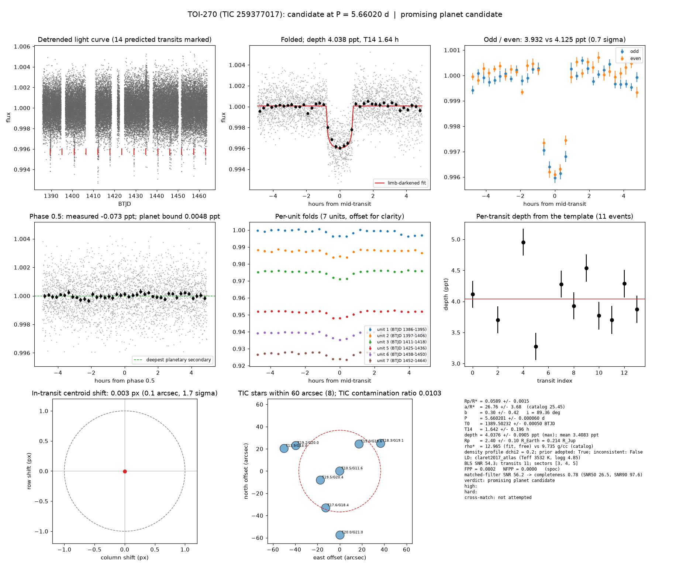

# Candidate packet: TOI-270 (TIC 259377017), P = 5.66020 d

Generated 2026-09-02 18:52 UTC by tesshunter. This is a CANDIDATE. Nothing in this packet is a detection; the automated checks are necessary, not sufficient. The human reviews and submits.

**Automated verdict:** promising planet candidate (light curve only: promising planet candidate)  
**FPP / NFPP (TRICERATOPS):** 0.0802 / 0.0000

## Fitted parameters (limb-darkened transit fit)

| parameter | value |
|---|---|
| period | 5.660201 +/- 0.000060 d |
| epoch | 1389.50232 +/- 0.00050 BTJD = 2458389.50232 BJD |
| duration T14 | 1.642 +/- 0.196 h |
| depth (model maximum) | 4.0376 +/- 0.0905 ppt (shape-degenerate error 0.2153 ppt) |
| depth (duration-averaged) | 3.4083 ppt |
| Rp/R* | 0.0589 +/- 0.0015 |
| a/R* | 26.76 +/- 3.68 (catalog density gives 25.45 +/- 0.30) |
| impact parameter | 0.30 +/- 0.42 ; inclination 89.36 deg |
| Rp | 2.40 +/- 0.10 R_Earth = 0.214 +/- 0.009 R_Jup (R* = 0.374 +/- 0.011 R_Sun) |
| stellar density | fit (free) 12.965 g/cc vs catalog 9.735 +/- 0.346 g/cc; ratio 1.33, profile delta chi2 0.2; prior adopted: True; inconsistent: False |
| limb darkening | u1 = 0.272, u2 = 0.373 (claret2017_atlas (Teff 3532 K, logg 4.85)) |
| fit | least_squares, 2442 points, 11 transits, reduced chi2 0.97, delta BIC vs flat 2934 |
| BLS | SNR 54.3, box depth 3.550 ppt, 11 transits observed, alias label P/2 |

## Vetting checks

| check | result |
|---|---|
| odd/even (median) | pass (0.7 sigma) |
| odd/even (fit template) | odd 3.932 +/- 0.221 ppt (5 events), even 4.125 +/- 0.188 ppt (6 events), difference 0.7 sigma, 5% of the mean |
| secondary at phase 0.5 | -0.0730 ppt measured; deepest planetary secondary at the fitted a/R* 0.0048 ppt; not detected |
| a/R* consistency | pass — free-fit a/R* = 28.00 (b = 0.00) against 25.45 +/- 0.30 from the catalog density (12.965 vs 9.735 g/cc, ratio 1.33; profile delta chi2 0.2 with a/R* held in the catalog range, 0.1 after the red-noise  |
| V-shape | none (t_flat/t_total 0.60); fitted geometry grazing: False |
| per-unit depths | pass |
| centroid | shift 0.003 px, 1.7 sigma |
| contamination | flagged, 13 neighbours checked |
| FPP / NFPP | 0.0802 / 0.0000 (TRICERATOPS 1.1.0: FPP 0.0802, NFPP 0.0000 over 18 scenarios and 64 TIC stars within 10 px; aperture spoc; 200000 draws; fold binned (150 points, error 329 ppm); sectors [3, 4, 5].) |

Flags: nearby star could produce the signal: 1 high-risk and 2 medium-risk neighbour(s) of 13 checked (medium: TRICERATOPS NFPP 6.88e-77 with the real aperture)

## Completeness at this SNR

Matched-filter SNR 56.2 on this star's detrended data binned to 30 min: the P2 completeness curve (`docs/COMPLETENESS.md`, 2100 injections on 300 stars, config survey_v1) recovers 0.78 of injected signals at this SNR (SNR50 = 26.5, SNR90 = 97.6; the 50-1000000000.0 bin recovered 586/658). Curve measured in P2 with batman injections into the survey preset (survey_v1: FFI stitches binned to 30 min, periods 1-40 d, Rp/R* 0.01-0.12); the matched-filter SNR here is computed on this candidate's own detrended data with the same definition. Outside that regime the number is an extrapolation.

## Star and neighbours

TIC 259377017: Teff 3532 K, log g 4.85, R = 0.374 +/- 0.011 R_Sun, M = 0.362 +/- 0.020 M_Sun, Tmag 10.50, TIC contamination ratio 0.0103 (source tic; assumed errors: False).

| ID | dstArcSec | Tmag | GAIAmag | gaiabp | gaiarp | Teff | rad | contratio | disposition |
|---|---|---|---|---|---|---|---|---|---|
| 259377017 | 0.00 | 10.50 | 11.63 | 12.87 | 10.54 | 3532.00 | 0.37 | 0.01 | n/a |
| 685369655 | 19.19 | 19.52 | 20.41 | 21.04 | 19.13 | n/a | n/a | n/a | n/a |
| 685369843 | 29.88 | 19.02 | 19.61 | 20.03 | 18.87 | 4902.00 | n/a | n/a | n/a |
| 259377022 | 35.45 | 17.57 | 18.40 | 19.20 | 17.46 | 4023.00 | 0.88 | n/a | n/a |
| 685369845 | 44.38 | 18.33 | 19.09 | 19.73 | 18.18 | 4271.00 | 0.51 | n/a | n/a |
| 685369658 | 45.67 | 19.20 | 20.01 | 20.87 | 19.18 | 4069.00 | n/a | n/a | n/a |
| 259377015 | 53.97 | 13.93 | 14.40 | 14.78 | 13.87 | 5552.00 | 1.35 | n/a | n/a |
| 685369654 | 57.60 | 20.01 | 20.98 | 21.85 | 19.68 | n/a | n/a | n/a | n/a |

## Cross-match

Catalog cross-match not attempted.  
Catalog versions: `n/a`

## Data

Sectors [3, 4, 5]; 46922 raw and 44558 cleaned cadences; products: SPOC s3, SPOC s4, SPOC s5.

## Figure



## ExoFOP CTOI fields

```json
{
 "target": "TIC 259377017",
 "tic_id": 259377017,
 "discovery_source": "TESS",
 "period_days": 5.66020136392659,
 "period_err_days": 6.0181819692127784e-05,
 "epoch_bjd": 2458389.5023201974,
 "epoch_err_days": 0.0005003338476012025,
 "depth_ppm": 4037.552303472691,
 "depth_err_ppm": 90.53678518547645,
 "duration_hours": 1.6424342804523495,
 "duration_err_hours": 0.19550307579175769,
 "disposition": "PC",
 "tag": "FILL_ME: YYYYMMDD_username_tesshunter_NNN",
 "candidate_name": null,
 "paper_url": null,
 "notes": "tesshunter candidate on TIC 259377017: P = 5.66020 d, depth = 4038 ppm, T14 = 1.64 h, SNR 54.3, 11 transits in sectors 3,4,5. Limb-darkened fit: Rp/R* = 0.0589, a/R* = 26.76 (catalog 25.45), b = 0.30; Rp = 2.40 R_Earth. TRICERATOPS FPP = 0.080, NFPP = 0.000. Automated verdict: promising planet candidate. Cross-match: not attempted."
}
```

_The pipeline finds candidates. It does not submit._
